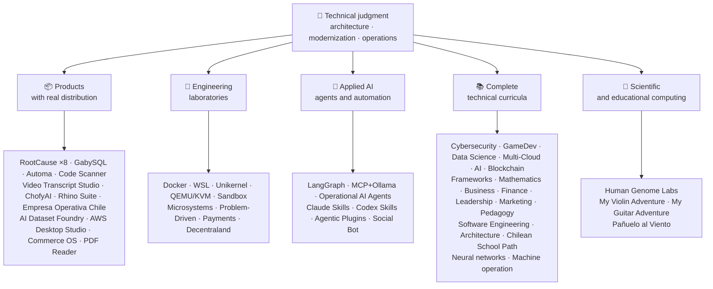

<div align="center" dir="rtl">

# 👋فلاديمير أكونيا

## **Solution Architect·أقدم مجموعة كاملة·التحول الرقمي·العمليات الإدارية**

**تدريب مهني في مجال علوم الحاسوب والهندسة الحاسوبية وإدارة الأعمال، مع بناء 16 سنة وبرمجيات تشغيلية في بيئات حقيقية. وأربط الأعمال التجارية، والناس، والعمليات، والتكنولوجيا بتصميم وتقييم الحلول وتقديمها والمحافظة عليها مع الحكم التقني ونظرة تنفيذية - مدعومة بأدلة يمكن التحقق منها في حساب غيت هوب هذا.**

[](https://vladimiracunadev-create.github.io/)
[](https://www.linkedin.com/in/vladimir-acu%C3%B1a-valdebenito-11924a29/)
[](mailto:vladimir.acuna.dev@gmail.com)

[](#النطاق-المهني)
[](docs/ECOSYSTEM.ar.md)
[](#المناهج-التقنية-الكاملة)

<!-- STATS:START -->
[](https://github.com/vladimiracunadev-create?tab=repositories)
[](https://github.com/vladimiracunadev-create?tab=repositories)
[](#النظام-الإيكولوجي-في-غلاف)
[](#المناهج-التقنية-الكاملة)
[](https://github.com/vladimiracunadev-create?tab=repositories)
<!-- STATS:END -->

[](https://github.com/vladimiracunadev-create?tab=repositories)
[](https://github.com/vladimiracunadev-create?tab=followers)

[🌐 Portfolio (6 languages)](https://vladimiracunadev-create.github.io/) ·
[🧩 Ecosystem](#النظام-الإيكولوجي-في-غلاف) ·
[⚡ Evaluate me in 10 minutes](#إذا-كان-لديك-10-دقائق-لتقييمي) ·
[✅ Professional scope](#النطاق-المهني) ·
[🧭 Non-coding management](#فرص-العمل-في-مجالات-الإدارة-والإدارة-وغير-الترميز) ·
[📋 Role matrix](PROFESIONAL_ROLES.md) ·
[📬 Contact](#الاتصال)

**🌐 النسخ الكاملة:** [Español](README.md) · [English](README.en.md) · [Português](README.pt.md) · [Italiano](README.it.md) · [Français](README.fr.md) · [简体中文](README.zh.md) · [繁體中文](README.zh-TW.md) · [日本語](README.ja.md) · [한국어](README.ko.md) · [Türkçe](README.tr.md) · [Русский](README.ru.md) · [Tiếng Việt](README.vi.md) · [ไทย](README.th.md) · [Deutsch](README.de.md) · [Українська](README.uk.md) · [Polski](README.pl.md) · [العربية](README.ar.md) · [فارسی](README.fa.md) · [Bahasa Indonesia](README.id.md) · [Nederlands](README.nl.md) · [हिन्दी](README.hi.md) · [Ελληνικά](README.el.md)

**الجوهر التقني:**
PHP 8 · Python · Rust · Go · Node/TS · Java 21 · .NET 8 · Dart/Flutter · WASM
· AWS · Terraform · Kubernetes · Docker · n8n · LangGraph/MCP · CI/CD · FinOps · Observability

**جسر تكنولوجيا الأعمال:**
تحليل العمليات والاحتياجات·تقييم الحل·تنسيق التنفيذ·العمليات والاستمرارية·إدارة المخاطر·المنتجات والخدمات·التعليم التقني

</div>

---

> [!NOTE]
> ولا يحول هذا الموجز الفرص إلى خبرة. فالخبرة التقنية الحتمية والمهارات القابلة للتحويل والتطبيقات القابلة للتطبيق والأهداف الإنمائية المستقبلية منفصلة صراحة. (الدليل المتصل (جيت هوب قابل للتنفيذ أو وثائقي، حيث يوجد شيء**لا**وقد تم الانتهاء من ذلك، وهو ما يُذكر على هذا النحو.

## 🎯ما الذي ستجده هنا

وهذا ليس &quot; إعادة واحدة &quot; : بل هو نظام إيكولوجي يتقاسم المعايير.

- 🔁 **التخفيضات القابلة للتكاثر**- مستنسخة، تشغيل، والتحقق.
- 🧰 **الأدوات الموحدة**-المكافآت، (هوب كلي)`doctor`و`smoke`لكل مستودع
- 🛡️ **الدفاع بعمق**- المسح السري والسياسات والممارسات المحظورة صراحة.
- 📈 **القابلية للاحترام** — `/health`, `/ready`, `/metrics`لوحات الـ (داش) و (التعقب)
- 📚 **وثائق التوعية بالسمعة**- المجند، المبتدئ، الفيروس، أو الأمن، حسب المستودع.
- 📦 **توزيع المنتجات**- الإطلاقات القابلة للحمل، والخصوم، وبناء الأدلة؛ والتوقيعات التجارية/التاريخية التي يُعلن أنها معلقة عند الاقتضاء.
- 🌍 **التدنيس**- حافظة بست لغات )الإيسا(·EN·PT·هو·FR·ZH.
- 🧭 **الأمانة التقنية**- كل حالة تحمل اسما`OPERATIONAL`, `DOCUMENTED/SCAFFOLD`أو`PLANNED`.

## ✅الحالة التي يمكن التحقق منها

| الوجه السطحي | أدلة ملموسة |
|---|---|
| 🧪 **التغطية بالاختبارات** | GabySQL**828 اختبارا**"و تذمر"**503.8M queries**(0 ذعر)·Empresa Operativa Chile**158 اختبارا** ·Automa**150 باوند** ·منظمة العفو الدولية المتعددة الأطراف |
| 🤖 **Production-grade agents** | LangGraph RealWorld **25/25 operational backends** (cases 01–25, 100% coverage) · Operational AI Agents **13 agents** with **39 deterministic evals** |
| 🔗 **الاندماج في المجتمع المحلي** | **20 حالة**مرسل**19 تشغيلية**"مراجعة بشكل فردي مع "دوكر· **18+ محركات ثنائي الفينيل متعدد البروم** · **20+ حاويات** ·11 نمطا |
| 📦 **التوزيع** | **151 بلاغا**عبر نظام إيكولوجي**64 مستودعاً عمومياً** ·المثبتات والقطع الأثرية`.exe` · `.msi` · `.dmg` · `.apk`مع إجراء فحصات وإثباتات؛ وتوقيعات تجارية/موقعة جارية حيثما ينطبق ذلك |
| 🛡️ **سلسلة الإمداد** | CodeQL·Semgrep·Bandit·Trivy·Grype·Gitleaks·TruffleHog·CycloneDX SBOM·بطاقة الإسكوار |
| 📚 **المناهج** | **530 14 فصلا**يمكن التحقق منها عبر 21 برنامجاً، حسب ما يُحسب[a workflow](.github/workflows/stats.yml)من هيكل المستودع الحقيقي أو مصدر قابل للتحقق معلن في المستودع - غير مكتوب باليد -·كل برنامج يعلن عن مركزه التحريري ومحدوديةه |
| 🌐 **Portfolio** | PWA غير القابلة للتركيب· **6 لغات** · **36 PDFs**منشأ خط أنابيب·CV Data API·Capacitor Android·Lighthouse 100 |
| 🔒 **التلف** | عدم إجراء أي قياس عن بعد في منتجات الطب الشرعي والإمبريسا أوبيراتيفا شيلي - تحقق من كل بناء (لا أندرويد)`INTERNET`إذن) |
| 🌐 **المواقع المنشورة** | **56 موقعاً لصفحة جيب**- 55 هبوطاً، واحد لكل منتج أو برنامج أو ملاح للنظم الإيكولوجية، بالإضافة إلى حافظة كل منها من مستودعها الخاص·جميع الـ 56 تم التحقق منها`200` |

## 🗺️النظام الإيكولوجي في غلاف



## 🗂️ المنظومة: المنتجات والمختبرات والذكاء الاصطناعي التطبيقي والحوسبة العلمية

العمل التطبيقي لهذا الملف الشخصي موجود في وثيقة مستقلة: برمجيات تُنزَّل وتُثبَّت، ومختبرات هندسية، وذكاء اصطناعي تطبيقي، وحوسبة علمية، إضافةً إلى وصف كل fork لمشاريع الأطراف الثالثة الموجودة في الحساب.

- 📦 **المنتجات ذات التوزيع الحقيقي** (22)
- 🧪 **المختبرات الهندسية** (11)
- 🤖 **الذكاء الاصطناعي التطبيقي** (6)
- 🔬 **الحوسبة العلمية** (1)
- 🍴 **forks لمشاريع أطراف ثالثة** (52)

👉 **[عرض المنظومة كاملة](docs/ECOSYSTEM.ar.md)** · [🍴 forks لمشاريع أطراف ثالثة](docs/ECOSYSTEM.ar.md#forks)

## 📚المناهج التقنية الكاملة

برامج مستقلة باللغة الإسبانية، مع إعلان مركز كل مستودع ونطاقه. الـ 21 برنامج يضاف إلى**530 14 فصلا**"أعدّها"[a workflow](.github/workflows/stats.yml)من هيكل المستودع الحقيقي أو مصدر قابل للتحقق معلن في المستودع؛ وتعيد الشارة أسبوعياً ولا تكتب باليد.

🧭 [**Lifelong Learning Ecosystem**](https://github.com/vladimiracunadev-create/lifelong-learning-ecosystem)هو بوصلة اتحادية تربط 30 طريقا حقيقيا عبر 6 مناطق من خلال خرائط بصرية و[accessible offline portal](https://vladimiracunadev-create.github.io/lifelong-learning-ecosystem/); It is not counted as an additional program.

| Program | الفصول | النطاق |
|---|---:|---|
| [🔢 **Computational Mathematics**](https://github.com/vladimiracunadev-create/computational-mathematics-program) | 360 | من الاعتماد على الأصابع لإعادة إنتاج ورقة· **360 مظاهرة محددة تم التحقق منها في مركز التحقيقات الجنائية** ·080 1 دفتر ملاحظات·مسرد محدد المدة· [site](https://vladimiracunadev-create.github.io/computational-mathematics-program/) |
| [🏦 **Finance and Banking**](https://github.com/vladimiracunadev-create/finance-and-banking-evolution-program) | 356 | 534 ح·الرياضيات المالية والمعايير الدولية للإبلاغ المالي· **27 قضية** · **298 اختبارا** · [site](https://vladimiracunadev-create.github.io/finance-and-banking-evolution-program/) |
| [🎮 **GameDev**](https://github.com/vladimiracunadev-create/modern-gamedev-program) | 352 | الرياضيات و C#/C++/GDScript → shaders, AI, multiplayer, VR/AR·يا إلهي·الوحدة·غير واقعي· **تم التحقق من 10 مختبرات غودو في مركز التحقيقات الجنائية**(301 شيك)· [site](https://vladimiracunadev-create.github.io/modern-gamedev-program/) |
| [🛡️ **Cybersecurity**](https://github.com/vladimiracunadev-create/modern-cybersecurity-program) | 360 | **v1.3.0** ·20 جزءا·فريق أحمر، إدارة شؤون الإعلام، أمن السحاب، استغلال ديف، فرقة العمل المعنية بالقوارب، ولعبة الأمن·مجهزة**7 شهادات تصديق** ·خارج الشبكة الأندرويدية/البرنامج العالمي·دليل PDF·CI, Security, and Pages verified· [site](https://vladimiracunadev-create.github.io/modern-cybersecurity-program/) |
| [📈 **Marketing, Sales, and Growth**](https://github.com/vladimiracunadev-create/marketing-sales-growth-evolution-program) | 336 | 24 جزءاً منها مع التعاريف التشغيلية، وصحائف القياس، وبيبليوغرافيا يمكن التحقق منها، والسياق التنظيمي الشيلي· **v1.6.0** ·١-٢٩ كلمات·17 مساراً قائماً على الدور· [site](https://vladimiracunadev-create.github.io/marketing-sales-growth-evolution-program/) |
| [🏢 **Business Creation**](https://github.com/vladimiracunadev-create/modern-business-creation-program) | 336 | إنشاء وتشغيل شركة حقيقية في شيلي: من مرحلة التفكير إلى مرحلة التأسيس، والسلطة الضريبية، والعمليات، والأزمات، والخروج·360 رسما بيانيا·مسرد قصير الأجل قدره 251 1·دليل 548 1 صفحة· [site](https://vladimiracunadev-create.github.io/modern-business-creation-program/) |
| [🏛️ **Architecture and Built Environment**](https://github.com/vladimiracunadev-create/architecture-built-environment-learning-program) | 830 | 83 قطعة·60 دورة تكاملية·34 مسارا·المصادر القابلة للتعقب·مُعدّل، قارئ خارج الخط، وصحائف (جيت هوب)· [site](https://vladimiracunadev-create.github.io/architecture-built-environment-learning-program/) |
| [🇨🇱 **Chilean School Learning Path**](https://github.com/vladimiracunadev-create/chilean-school-learning-path) | 8,841 | الرتب ١-١٢· **156 4 تجربة متكاملة شاملة لعدة مناهج** · **823 2 هدفاً من أهداف التعلم** ·مصادر وزارة التعليم·لم يُبت بعد في المقترحات واستعراضات بشرية متخصصة· [site](https://vladimiracunadev-create.github.io/chilean-school-learning-path/) |
| [🧭 **Modern Software Engineering**](https://github.com/vladimiracunadev-create/modern-software-engineering-program) | 480 | 40 جزءا و 8 مراحل·:: المؤسسات → المنتج، والهيكل، والأمن، والأجهزة المعنية بالأجهزة، والبرمجيات، والصناعات، والصناعات، والصناعات، والصناعات، والصناعات، والنظم المتعددة العناصر·مركز التحرير الذي أعلنته الجهة الوديعة· [site](https://vladimiracunadev-create.github.io/modern-software-engineering-program/) |
| [🎓 **Pedagogy and Learning Sciences**](https://github.com/vladimiracunadev-create/education-pedagogy-learning-sciences-program) | 300 | من كيفية تعلم الشخص كيف يتم تدريب المعلمين·25 جزءا· **كل صنف يعلن أن الأدلة في حالة الحد** ·الإلمام المبكر، والأساليب المقارنة، والاحتياجات التعليمية المحددة، والتعايش، والتنوع الثقافي، والأدلة الدولية·097 1 مسرداً محدد المدة، 325 رسماً بيانياً، وبنك صف للنشاط 60·14 مسارا وظيفيا حسب الدور·LMS-exportable· **v2.1.0** · [site](https://vladimiracunadev-create.github.io/education-pedagogy-learning-sciences-program/) |
| [☁️ **Multi-Cloud**](https://github.com/vladimiracunadev-create/multi-cloud-engineering-program) | 288 | AWS·Azure·GCP·Kubernetes·Terraform·SRE·FinOps· **288 1 ساعة** ·288 مختبراً مع أدلة من شركة JSON·032 1 مصدراً متعقباً·884 2 صفحة دليل PDF· [site](https://vladimiracunadev-create.github.io/multi-cloud-engineering-program/) |
| [🎖️ **Executive Leadership**](https://github.com/vladimiracunadev-create/executive-leadership-founder-program) | 288 | من امتلاكك لنتيجة أولى لقيادة شركة وتأسيس فريقك الخاص: فريق "كولي" و"أوك ر" و"مال" و"نتوج" و"منتج" و"مركب" و"م.·24 حالة، و 96 مختبرا، و 39 نموذجا· [site](https://vladimiracunadev-create.github.io/executive-leadership-founder-program/) |
| [🐍 **Python Data Science**](https://github.com/vladimiracunadev-create/python-data-science-program) | 232 | القطبان، ML+Optuna/SHAP، Py Torch/LMs/LoRA، MLOps·برنامج النوافذ الأصلية + أندرويد· [site](https://vladimiracunadev-create.github.io/python-data-science-program/) |
| [🧠 **AI Evolution**](https://github.com/vladimiracunadev-create/artificial-intelligence-evolution-program) | 184 | ترجمة:· **v0.17.0** · **708 دفتر ملاحظات** · **148 ورقة أساسية** ·(ويندوز) خارج (أندرويد) و (بيوا)· [site](https://vladimiracunadev-create.github.io/artificial-intelligence-evolution-program/) |
| [🌐 **Comparative Programming**](https://github.com/vladimiracunadev-create/polyglot-programming-labs) | 176 | مفهوم واحد**10 لغات**تم التحقق منها في مركز التحقيقات الجنائية**360 1 تنفيذا**- مضافا إليه**632 1 برنامجاً**بلغات ما زالت موجودة (كوبول، فورتران، آدا، آر بي جي، إم بي إس) وزجاجة من**60 بطاقة في 15 أسرة** ·v1.1.0· [site](https://vladimiracunadev-create.github.io/polyglot-programming-labs/) |
| [🧩 **Frameworks Compared**](https://github.com/vladimiracunadev-create/framework-ecosystems-labs) | 149 | عقد واحد قابل للتنفيذ، بدون مكيفين، ضد شركة Express، وشركة FastAPI، وشركة سبرنغ بوت، وشركة ASP.NET، وDjango، وشركة رايلز، وشركة لارافل، وشركة React، وVue، وSvelte، وشركة أخرى·12 جزءا· **70 فصلاً من الفصول** · **397 حالة تم التحقق منها في التحقيق الجنائي** · **210 مصادر ISBN/DOI** · [site](https://vladimiracunadev-create.github.io/framework-ecosystems-labs/) |
| [🗄️ **Databases**](https://github.com/vladimiracunadev-create/database-systems-labs) | 74 | **ف-3-0.0** ·هندسة قواعد البيانات في 15 جزءا·230 ساعة· **المصدر القابل للتحقق لكل مطالبة**: 120 مصدرا مع ISBN أو DOI أو معيار·نفس القضية حُلّت في 27 محركاً·مسرد 306- الأجل·150 باوند· [site](https://vladimiracunadev-create.github.io/database-systems-labs/) |
| [📐 **Psychometrics and Assessment**](https://github.com/vladimiracunadev-create/psychometrics-and-assessment-program) | 40 | كيفية بناء أداة القياس، وسجلها، والتحقق منها، ومراجعة الحسابات·8 أجزاء·محرك قابل للتنفيذ**5 صكوك و 344 بندا، 276 من الأماكن العامة** |
| [⛓️ **Blockchain**](https://github.com/vladimiracunadev-create/blockchain-learning-path) | 66 | **v0.14.0** ·من صفر إلى بنية أساسية مالية قابلة للبرمجة ومحلل في سلسلة· **91 ممارسة**و**363 اختبار** ·العقود المبرمة مع مؤسسة (التشويش والتجار) وتحليلات ثابتة للأخشاب في مركز الاستخبارات المركزية·تطبيقات خارج الإنترنت تم التحقق منها بفتح المخزن و عد محتوياته· [site](https://vladimiracunadev-create.github.io/blockchain-learning-path/) |
| [🧠 **Neural Network Training Labs**](https://github.com/vladimiracunadev-create/neural-network-training-labs) | 31 | 7 وحدات نموذجية·▪ ▪214 ساعة· **93 دفتر ملاحظات**- ٣١ فصلا، و ٣١ نسخة للطلاب، و ٣١ حلا -·المسائل، والخرائط البصرية، والممارسات، والتقييم مع البيانات العامة الحقيقية·Py Torch· [study site](https://vladimiracunadev-create.github.io/neural-network-training-labs/) |
| [🕹️ **Machine Operator**](https://github.com/vladimiracunadev-create/machine-operator-program) | 451 | **41 وحدة تدريب**واحد لكل آلة· **502 h 15 min** ·النظم والضوابط والفيزياء والسلامة وتصميم المحاكاة مع مصادر لكل فئة·* لم يُنفذ أي مُحفز بعد، ويُعلن عن ذلك على هذا النحو* |

## ⚡إذا كان لديك 10 دقائق لتقييمي

الفكرة ليست فقط أن ننظر إلى الرمز:**كيف أعتقد**كيف أوثق وكيف أجعل كل شيء قابل للتنفيذ

**الطريق ألف - القابلية للملاحظة والتشائم الحقيقية*** (أفضلي)*

```bash
git clone https://github.com/vladimiracunadev-create/social-bot-scheduler.git
```

سترون سير العمل، والمقاييس، ولوحات الدبابيس، وأجهزة الحراسة في 19 حالة و18+ محركات الـ دي بي.

**الطريق باء - الهياكل الأساسية القابلة للتكاثر في دقائق**

```bash
git clone https://github.com/vladimiracunadev-create/docker-labs.git
```

**الطريق جيم - العملاء الذين لديهم ولاية مطبعة**

```bash
git clone https://github.com/vladimiracunadev-create/langgraph-realworld.git
```

**الطريق دال - نتاج الطب الشرعي الشائع، بدون استنساخ**

تحميل المُسلّح أو مُعدّل (كيلي) من[RootCause releases](https://github.com/vladimiracunadev-create/rootcause-windows-inspector/releases)التحقق من`SHA256SUMS`.

## 🧠المعايير التي أطبقها في جميع أنحاء المخازن

- **DX أولا**- إذا لم يكن من السهل تشغيله، فإنه ليس مفيدا كقاعدة عامة أو كقاعدة فريق.
- **إمكانية الاحتفاط من اليوم 1**- مقاييس وقابلية للتعقب، وليس تفكيراً بعد ذلك.
- **الأمن في خط الأنابيب**- المسح السري، SBOM لكل إطلاق، ممارسات محظورة صراحة.
- **القدرة على التكيف**- الايدمان، وكسر الدائرة، والتدهور المراقب.
- **Polyglot by design**- اللغة والمحرك المختارين من خلال قضية الاستخدام، لا من خلال الموضة.
- **الصدق بشأن المركز**- أعيد تسمية إعادة واحدة )أ(`Multisimulador` → `machine-operator-program`() تجنب البرمجيات الواعدة التي لا توجد بعد.
- **(بادجز) هي إشارات، وليس دليلاً**- كل مذكرة أيضا تعلن**ما لا يفعله**.
- **النموذج الخارجي**- تم تصميم المجال أولا؛ والواجهة هي إسقاط.
- **يُعلن عن العمل الخارجي كعمل خارجي** — توصف [52 fork](docs/ECOSYSTEM.ar.md#forks) لمشاريع الأطراف الثالثة واحداً واحداً وتبقى خارج جميع أرقام الأعمال الخاصة في هذا الملف.

## ✅النطاق المهني

خلفيتي المزدوجة**الهندسة الحاسوبية والحساب الإلكتروني + إدارة الأعمال**- يساعدني على ترجمة أهداف الأعمال إلى قرارات تقنية وقيود تقنية إلى خيارات واضحة للعمليات، والناتج، والعملاء، والقيادة.

### 🎯الهوية الأساسية

| الدور | المساندة |
|---|---|
| **Solution Architect** | تصميم نظام متنقل قابل للتكدس مع حكم تطوري |
| **مهندسة تحديث الجراثيم** | التطور الحقيقي (PHP 5.x)8.x، إعادة التصنيع التدريجي دون توقف العمليات) |
| **أقدم مجموعة كاملة من التكنولوجيا** | الهيكلة والتنفيذ والمعايير المتعلقة بالمنابر الحقيقية (+16 سنة) |
| **AI Automation Architect** | Agentic systems with LangGraph/MCP and n8n flows with guardrails |

### ↗ التوسع الطبيعي

**مهندس أورشات** · **مهندس /مهند** · **مهندس متنقل (مُتمر)** · **مهندس الحلول** · **بناء المنتجات التقنية** · **التدريب التقني** · **خبير استشاري في التحول الرقمي** · **محلل أعمال/عمليات** · **العمليات التقنية للمنتجات**

### ⚙️النطاق التكميلي

مهندس منبر/معهد التنمية الدولية·أجهزة تنقية/مبادرة مكافحة التصحر·مهندس / ملاح·التطبيق·مهندس آلي·خبير استشاري تقني - تجاري

## 🧭فرص العمل في مجالات الإدارة والإدارة وغير الترميز

وظائف إدارية وتنظيمية وتجارية تسهم فيها المعلوماتية والإدارة دون أن تكون البرمجة هي المهمة المحورية، مصنَّفة بصدق (كفاءة قابلة للنقل، أو إمكانية تقديم، أو هدف مستقبلي) مع الفجوة الخاصة بكل منها. المجالات المشمولة:

قيادة التكنولوجيا · إدارة المشروع · إدارة الأعمال · الاستراتيجية والتغيير · تحليل الأعمال · المنتجات والخدمات · إدارة أمن الفضاء الإلكتروني · التجارة والمبيعات · الرقابة المالية والإدارية · النوعية · التعليم · السوقيات والموردون · إدارة البيانات والمبادرة · القطاع العام

👉 **[عرض مصفوفة الفرص كاملة](docs/MANAGEMENT.ar.md)**

## 🤖سير التطوير بمساعدة الذكاء الاصطناعي

| Tool | الاستخدام الرئيسي |
|---|---|
| **مدونة قواعد السلوك** | استعراض المحفوظات وتنفيذها والوثائق التقنية |
| **ChatGPT Plus** | التحليل والهيكل والتكرار (منذ 2023) |
| **الرمز** | إنتاج المواد وإعادة تصنيعها |
| **Antigravity** | التعجيل بتدفقات التنمية والتشغيل الآلي |
| **VS Code / OpenCode** | البيئات التي تقدم فيها المساعدة المتكاملة في مجال التنفيذ |

> أنا أجمع بين حكمي التقني، وإثبات صحة الإنسان، وتوجهي المعماري. إن منظمة العفو الدولية تُكمِّل القدرات والسرعة والوصول - فهي لا تحل محل الخبرة.

## 📌توافر

**مفتوح:**أقدم مجموعة كاملة·الهيكل التنظيمي·تحديث الجلود·المنبر/البرنامج المتكامل·التطبيق·جهاز التنقيب العملي·التلقائية·AI Automation·تحليل الأعمال/الوظائف·تنسيق مشاريع تكنولوجيا المعلومات·العمليات الإنتاجية·التحول الرقمي·الحلول الاستشارية/المشاريع·التعليم التقني·النوعية والتحسين المستمر·اعتماد وإدارة شؤون الإعلام

**)أ( قيمت وفقا لنطاق كل دور:**مالك المنتجات/مدير المنتجات التقنية·تقديم الخدمات·عمليات تكنولوجيا المعلومات·GRC/ technology risk·الإدارة والعمليات·الرقابة الإدارية·تحديث القطاع العام. والألقاب التنفيذية والإدارية العامة هي أهداف إنمائية في المستقبل، لا تُدعى التجربة.

**الطريقة:**نائي أو هجين، حسب المشروع.

## 📬الاتصال

[](https://vladimiracunadev-create.github.io/)
[](https://www.linkedin.com/in/vladimir-acu%C3%B1a-valdebenito-11924a29/)
[](https://gitlab.com/vladimir.acuna.dev-group/vladimir.acuna.dev-group)
[](mailto:vladimir.acuna.dev@gmail.com)

---

<div align="center">

[🤝 Contribute](CONTRIBUTING.en.md) ·
[🛡️ Security](SECURITY.en.md) ·
[⚖️ Code of Conduct](CODE_OF_CONDUCT.en.md)

<sub>تزامنت هذه المبادرة مع حالة المستودعات العامة التي يمكن التحقق منها - أي التكوينات والتغييرات التي تُقرأ عن طريق البروتوكول الاختياري لاتفاقية مناهضة التعذيب -·آخر عملية تحقق: 12 تشرين الأول/أكتوبر 2026.</sub>

</div>
