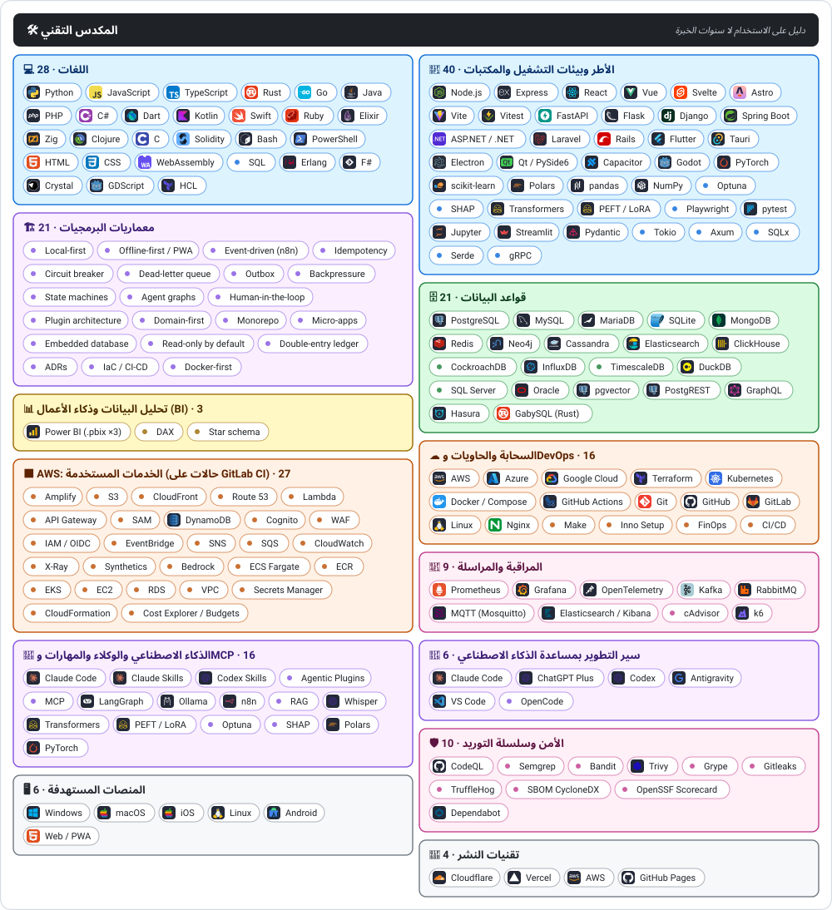
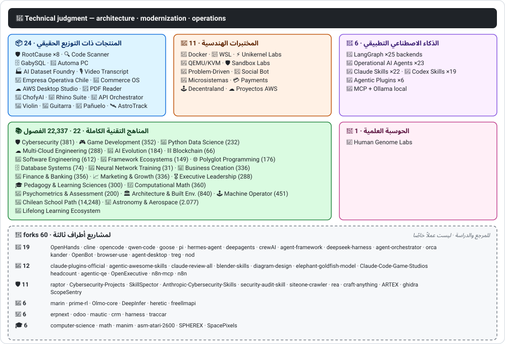

# 👋فلاديمير أكونيا

## **مهندس ذكاء اصطناعي·Solution Architect·أقدم مجموعة كاملة·التحول الرقمي·العمليات الإدارية**

**تدريب مهني في مجال علوم الحاسوب والهندسة الحاسوبية وإدارة الأعمال، مع بناء 16 سنة وبرمجيات تشغيلية في بيئات حقيقية. وأربط الأعمال التجارية، والناس، والعمليات، والتكنولوجيا بتصميم وتقييم الحلول وتقديمها والمحافظة عليها مع الحكم التقني ونظرة تنفيذية - مدعومة بأدلة يمكن التحقق منها في حساب غيت هوب هذا.**

<!-- STATS:START -->

<!-- STATS:END -->

[🧭 من أين تبدأ](docs/START_HERE.ar.md) ·
[🌐 Portfolio (22 languages)](https://vladimiracunadev-create.github.io/) ·
[🧩 Ecosystem](#النظام-الإيكولوجي-في-غلاف) ·
[🛠️ المكدس التقني](#-المكدس-التقني) ·
[⚡ Evaluate me in 10 minutes](docs/guides/TECH_LEAD.ar.md) ·
[✅ Professional scope](#النطاق-المهني) ·
[🧭 Non-coding management](#فرص-العمل-في-مجالات-الإدارة-والإدارة-وغير-الترميز) ·
[📋 مصفوفة المناصب](PROFESIONAL_ROLES.ar.md) ·
[📬 Contact](#الاتصال)

**🌐 النسخ الكاملة:** [Español](README.md) · [English](README.en.md) · [Português](README.pt.md) · [Italiano](README.it.md) · [Français](README.fr.md) · [简体中文](README.zh.md) · [繁體中文](README.zh-TW.md) · [日本語](README.ja.md) · [한국어](README.ko.md) · [Türkçe](README.tr.md) · [Русский](README.ru.md) · [Tiếng Việt](README.vi.md) · [ไทย](README.th.md) · [Deutsch](README.de.md) · [Українська](README.uk.md) · [Polski](README.pl.md) · [العربية](README.ar.md) · [فارسی](README.fa.md) · [Bahasa Indonesia](README.id.md) · [Nederlands](README.nl.md) · [हिन्दी](README.hi.md) · [Ελληνικά](README.el.md)

**الجوهر التقني:**
PHP 8 · Python · Rust · Go · Node/TS · Java 21 · .NET 8 · Dart/Flutter · WASM
· AWS · Terraform · Kubernetes · Docker · n8n · LangGraph/MCP · CI/CD · FinOps · Observability

**جسر تكنولوجيا الأعمال:**
تحليل العمليات والاحتياجات·تقييم الحل·تنسيق التنفيذ·العمليات والاستمرارية·إدارة المخاطر·المنتجات والخدمات·التعليم التقني

---

> [!NOTE]
> ولا يحول هذا الموجز الفرص إلى خبرة. فالخبرة التقنية الحتمية والمهارات القابلة للتحويل والتطبيقات القابلة للتطبيق والأهداف الإنمائية المستقبلية منفصلة صراحة. (الدليل المتصل (جيت هوب قابل للتنفيذ أو وثائقي، حيث يوجد شيء**لا**وقد تم الانتهاء من ذلك، وهو ما يُذكر على هذا النحو.

## 🧭 من أين تبدأ

اختر حالتك وانتقل مباشرة إلى ما تحتاجه:

🧑‍💼 [التوظيف](docs/guides/RECRUITER.ar.md) · 💼 [عميل أو عمل حر](docs/guides/FREELANCE.ar.md) · 🛠️ [التقييم التقني](docs/guides/TECH_LEAD.ar.md) · 🏢 [الأعمال والإدارة](docs/guides/BUSINESS.ar.md) · 🤝 [التعاون والأمن](docs/guides/COLLABORATOR.ar.md) · 🎓 [التعلّم أو التعليم](docs/guides/LEARNER.ar.md)

## 🎯ما الذي ستجده هنا

وهذا ليس &quot; إعادة واحدة &quot; : بل هو نظام إيكولوجي يتقاسم المعايير.

- 🔁 **التخفيضات القابلة للتكاثر**- مستنسخة، تشغيل، والتحقق.
- 🧰 **الأدوات الموحدة**-المكافآت، (هوب كلي)`doctor`و`smoke`لكل مستودع
- 🛡️ **الدفاع بعمق**- المسح السري والسياسات والممارسات المحظورة صراحة.
- 📈 **القابلية للاحترام** — `/health`, `/ready`, `/metrics`لوحات الـ (داش) و (التعقب)
- 📚 **وثائق التوعية بالسمعة**- المجند، المبتدئ، الفيروس، أو الأمن، حسب المستودع.
- 📦 **توزيع المنتجات**- الإطلاقات القابلة للحمل، والخصوم، وبناء الأدلة؛ والتوقيعات التجارية/التاريخية التي يُعلن أنها معلقة عند الاقتضاء.
- 🌍 **التدنيس** — يُنشر هذا الملف الشخصي بـ22 لغة ويقدّم الملف التعريفي للأعمال 154 ملف PDF عامًا (7 عائلات × 22 لغة) (ES · EN · PT · IT · FR · ZH · ZH-TW · JA · KO · TR · RU · VI · TH · DE · UK · PL · AR · FA · ID · NL · HI · EL).
- 🧭 **الأمانة التقنية**- كل حالة تحمل اسما`OPERATIONAL`, `DOCUMENTED/SCAFFOLD`أو`PLANNED`.

## ✅الحالة التي يمكن التحقق منها

| الوجه السطحي | أدلة ملموسة |
|---|---|
| 🧪 **التغطية بالاختبارات** | GabySQL**850 اختبارا**"و تذمر"**503.8M queries**(0 ذعر)·Empresa Operativa Chile**230 اختبارا** ·Automa**150 باوند** ·منظمة العفو الدولية المتعددة الأطراف |
| 🤖 **Production-grade agents** | LangGraph RealWorld **25/25 operational backends** (cases 01–25, 100% coverage) · Operational AI Agents **23 agents** with **69 deterministic evals** |
| 🔗 **الاندماج في المجتمع المحلي** | **20 حالة**مرسل**19 تشغيلية**"مراجعة بشكل فردي مع "دوكر· **18+ محركات ثنائي الفينيل متعدد البروم** · **20+ حاويات** ·11 نمطا |
| 📦 **التوزيع** | **166 بلاغا**عبر نظام إيكولوجي**67 مستودعاً عمومياً** ·المثبتات والقطع الأثرية`.exe` · `.msi` · `.dmg` · `.apk`مع إجراء فحصات وإثباتات؛ وتوقيعات تجارية/موقعة جارية حيثما ينطبق ذلك |
| 🛡️ **سلسلة الإمداد** | CodeQL·Semgrep·Bandit·Trivy·Grype·Gitleaks·TruffleHog·CycloneDX SBOM·بطاقة الإسكوار |
| 📚 **المناهج** | **22,337 فصلا**يمكن التحقق منها عبر 22 برنامجاً، حسب ما يُحسب[a workflow](.github/workflows/stats.yml)من هيكل المستودع الحقيقي أو مصدر قابل للتحقق معلن في المستودع - غير مكتوب باليد -·كل برنامج يعلن عن مركزه التحريري ومحدوديةه |
| 🌐 **Portfolio** | PWA غير القابلة للتركيب· **22 لغات** · **154 PDFs**منشأ خط أنابيب·CV Data API·Capacitor Android·Lighthouse 100 |
| 🔒 **التلف** | عدم إجراء أي قياس عن بعد في منتجات الطب الشرعي والإمبريسا أوبيراتيفا شيلي - تحقق من كل بناء (لا أندرويد)`INTERNET`إذن) |
| 🌐 **المواقع المنشورة** | **57 موقعاً لصفحة جيب**- 56 هبوطاً، واحد لكل منتج أو برنامج أو ملاح للنظم الإيكولوجية، بالإضافة إلى حافظة كل منها من مستودعها الخاص·جميع الـ 57 تم التحقق منها`200` |

## 🛠️ المكدس التقني

تقنيات رُصدت في المستودعات العامة (ملفات التعريف والاعتماديات والحاويات والشيفرة) ومجمّعة حسب المجال. الظهور في مستودع —بما في ذلك المختبرات والمناهج— دليل على الاستخدام وليس ادعاءً بسنوات من الخبرة الإنتاجية.

**معماريات البرمجيات**

Local-first → [empresa-operativa-chile](https://github.com/vladimiracunadev-create/empresa-operativa-chile), [ai-dataset-foundry](https://github.com/vladimiracunadev-create/ai-dataset-foundry) · Event-driven → [social-bot-scheduler](https://github.com/vladimiracunadev-create/social-bot-scheduler) · Resilience → [problem-driven-systems-lab](https://github.com/vladimiracunadev-create/problem-driven-systems-lab) · Ledger → [universal-payments-engineering-lab](https://github.com/vladimiracunadev-create/universal-payments-engineering-lab) · Plugins → [agentic-plugins-toolkit](https://github.com/vladimiracunadev-create/agentic-plugins-toolkit) · Agents → [langgraph-realworld](https://github.com/vladimiracunadev-create/langgraph-realworld), [operational-ai-agents](https://github.com/vladimiracunadev-create/operational-ai-agents) · Domain-first → [rhino-suite](https://github.com/vladimiracunadev-create/rhino-suite) · Micro-apps → [microsistemas](https://github.com/vladimiracunadev-create/microsistemas) · Embedded DB → [gabysql](https://github.com/vladimiracunadev-create/gabysql) · IaC → [proyectos-aws](https://github.com/vladimiracunadev-create/proyectos-aws)

**تحليل البيانات وذكاء الأعمال (BI)**

Power BI (.pbix ×3) · DAX · Star schema → [social-bot-scheduler](https://github.com/vladimiracunadev-create/social-bot-scheduler)

**AWS: الخدمات المستخدمة (حالات على GitLab CI)**

الحالات A–P → [proyectos-aws-gitlab](https://gitlab.com/vladimir.acuna.dev-group/proyectos-aws-gitlab) (GitLab CI → AWS; جميع الحالات الـ16 معلنة مكتملة؛ والحالة M مرحلتها الأولى فقط) · [proyectos-aws](https://github.com/vladimiracunadev-create/proyectos-aws) (GitHub Actions) · EC2, RDS, VPC, Secrets Manager, CloudFormation, Cost Explorer → [aws-desktop-studio](https://github.com/vladimiracunadev-create/aws-desktop-studio) (استعلام فعلي عن المخزون؛ وEC2 مع التشغيل والإيقاف وإعادة التشغيل بضبط مزدوج)

**سير التطوير بمساعدة الذكاء الاصطناعي**

| Tool | الاستخدام الرئيسي |
|---|---|
| **مدونة قواعد السلوك** | استعراض المحفوظات وتنفيذها والوثائق التقنية |
| **ChatGPT Plus** | التحليل والهيكل والتكرار (منذ 2023) |
| **الرمز** | إنتاج المواد وإعادة تصنيعها |
| **Antigravity** | التعجيل بتدفقات التنمية والتشغيل الآلي |
| **VS Code / OpenCode** | البيئات التي تقدم فيها المساعدة المتكاملة في مجال التنفيذ |

> أنا أجمع بين حكمي التقني، وإثبات صحة الإنسان، وتوجهي المعماري. إن منظمة العفو الدولية تُكمِّل القدرات والسرعة والوصول - فهي لا تحل محل الخبرة.

**تقنيات النشر**

Cloudflare (عمل شخصي) · Vercel (هاكاثون NASA Space Apps) · AWS (مواقع تشغيلية مرتبطة بـ GitLab) · GitHub Pages

## 🗺️النظام الإيكولوجي في غلاف

## 🗂️ المنظومة: المنتجات والمختبرات والذكاء الاصطناعي التطبيقي والمناهج والحوسبة العلمية

العمل التطبيقي لهذا الملف الشخصي موجود في وثيقة مستقلة: برمجيات تُنزَّل وتُثبَّت، ومختبرات هندسية، وذكاء اصطناعي تطبيقي، ومناهج تقنية كاملة، وحوسبة علمية، إضافةً إلى وصف كل fork لمشاريع الأطراف الثالثة الموجودة في الحساب.

- 📦 [**المنتجات ذات التوزيع الحقيقي**](docs/ECOSYSTEM.ar.md#products) (24)
- 🧪 [**المختبرات الهندسية**](docs/ECOSYSTEM.ar.md#labs) (11)
- 🤖 [**الذكاء الاصطناعي التطبيقي**](docs/ECOSYSTEM.ar.md#ai) (6)
- 📚 [**المناهج التقنية الكاملة**](docs/ECOSYSTEM.ar.md#curricula) (22)
- 🔬 [**الحوسبة العلمية**](docs/ECOSYSTEM.ar.md#science) (1)
- 🍴 [**forks لمشاريع أطراف ثالثة**](docs/ECOSYSTEM.ar.md#forks) (60)

👉 **[عرض المنظومة كاملة](docs/ECOSYSTEM.ar.md)** · [🍴 forks لمشاريع أطراف ثالثة](docs/ECOSYSTEM.ar.md#forks)

## 🛰️ هاكاثون NASA Space Apps 2026

شاركتُ في **NASA Space Apps Challenge 2026** (سانتياغو، 14 و15 نوفمبر)، في تحدي *Planet X and SPHEREx*، ضمن فريق من 6 أشخاص. المنتج هو **AstroTrack · SPHEREx**: عارض ويب تُكتب فيه إحداثيات من السماء فتظهر تلك المنطقة كتسلسل من صور SPHEREx عبر الزمن، بالاعتماد على بيانات NASA/IPAC IRSA.

- **دوري:** الوصول إلى البيانات (استعلامات IRSA مع ذاكرة تخزين مؤقت وحساب مسبق لحقول العرض التجريبي)، والتغليف (PWA ومثبّتات سطح المكتب بـ Tauri وملف APK لأندرويد بـ Capacitor)، وواجهة «التنزيلات»، وتدقيق الاتساق بين التوثيق والشيفرة.
- **تسليم يمكن التحقق منه:** يجمع [spherex-releases](https://github.com/vladimiracunadev-create/spherex-releases) 7 إصدارات (من v0.1.0 إلى v0.4.2) مع مجاميع SHA-256 · [تطبيق الويب](https://spherex-planet-x-tau.vercel.app/) · [مستودع الفريق](https://github.com/mauriciovalenzuela742/SPHEREX).
- **حدود معلنة:** العارض والتصميم وبقية الواجهة الخلفية من عمل أعضاء آخرين في الفريق؛ المثبّتات غير موقّعة ولم تُختبر على أجهزة حقيقية؛ استخدمتُ الذكاء الاصطناعي (Claude Code) مساعدًا كما هو معلن في المستودع. هذا يصف مساهمتي لا نتيجة الهاكاثون.

## 🧠المعايير التي أطبقها في جميع أنحاء المخازن

- **DX أولا**- إذا لم يكن من السهل تشغيله، فإنه ليس مفيدا كقاعدة عامة أو كقاعدة فريق.
- **إمكانية الاحتفاط من اليوم 1**- مقاييس وقابلية للتعقب، وليس تفكيراً بعد ذلك.
- **الأمن في خط الأنابيب**- المسح السري، SBOM لكل إطلاق، ممارسات محظورة صراحة.
- **القدرة على التكيف**- الايدمان، وكسر الدائرة، والتدهور المراقب.
- **Polyglot by design**- اللغة والمحرك المختارين من خلال قضية الاستخدام، لا من خلال الموضة.
- **الصدق بشأن المركز**- أعيد تسمية إعادة واحدة )أ(`Multisimulador` → `machine-operator-program`() تجنب البرمجيات الواعدة التي لا توجد بعد.
- **(بادجز) هي إشارات، وليس دليلاً**- كل مذكرة أيضا تعلن**ما لا يفعله**.
- **النموذج الخارجي**- تم تصميم المجال أولا؛ والواجهة هي إسقاط.
- **يُعلن عن العمل الخارجي كعمل خارجي** — توصف [60 fork](docs/ECOSYSTEM.ar.md#forks) لمشاريع الأطراف الثالثة واحداً واحداً وتبقى خارج جميع أرقام الأعمال الخاصة في هذا الملف.

## ✅النطاق المهني

خلفيتي المزدوجة**الهندسة الحاسوبية والحساب الإلكتروني + إدارة الأعمال**- يساعدني على ترجمة أهداف الأعمال إلى قرارات تقنية وقيود تقنية إلى خيارات واضحة للعمليات، والناتج، والعملاء، والقيادة.

### 🎯الهوية الأساسية

| الدور | المساندة |
|---|---|
| **Solution Architect** | تصميم نظام متنقل قابل للتكدس مع حكم تطوري |
| **مهندسة تحديث الجراثيم** | التطور الحقيقي (PHP 5.x)8.x، إعادة التصنيع التدريجي دون توقف العمليات) |
| **أقدم مجموعة كاملة من التكنولوجيا** | الهيكلة والتنفيذ والمعايير المتعلقة بالمنابر الحقيقية (+16 سنة) |
| **AI Automation Architect** | Agentic systems with LangGraph/MCP and n8n flows with guardrails |

### ↗ التوسع الطبيعي

**مهندس أورشات** · **مهندس /مهند** · **مهندس متنقل (مُتمر)** · **مهندس الحلول** · **بناء المنتجات التقنية** · **التدريب التقني** · **خبير استشاري في التحول الرقمي** · **محلل أعمال/عمليات** · **العمليات التقنية للمنتجات** · **AI Engineer (LLM / ML)** · **Data Engineer** · **DevSecOps / AppSec Engineer** · **QA Automation / Test Engineer** · **Technical Writer** · **مدرّس / مدرّب / مُعلّم تقنية** · **Instructional Designer (EdTech)** · **Technical Mentor**

### ⚙️النطاق التكميلي

مهندس منبر/معهد التنمية الدولية·أجهزة تنقية/مبادرة مكافحة التصحر·مهندس / ملاح·التطبيق·مهندس آلي·خبير استشاري تقني - تجاري · Backend / API Engineer · Fintech / Payments Engineer · Developer Advocate / DevRel

## 🧭فرص العمل في مجالات الإدارة والإدارة وغير الترميز

وظائف إدارية وتنظيمية وتجارية تسهم فيها المعلوماتية والإدارة دون أن تكون البرمجة هي المهمة المحورية، مصنَّفة بصدق (كفاءة قابلة للنقل، أو إمكانية تقديم، أو هدف مستقبلي) مع الفجوة الخاصة بكل منها. المجالات المشمولة:

قيادة التكنولوجيا · إدارة المشروع · إدارة الأعمال · الاستراتيجية والتغيير · تحليل الأعمال · المنتجات والخدمات · إدارة أمن الفضاء الإلكتروني · التجارة والمبيعات · الرقابة المالية والإدارية · النوعية · التعليم · السوقيات والموردون · إدارة البيانات والمبادرة · القطاع العام

👉 **[عرض مصفوفة الفرص كاملة](docs/MANAGEMENT.ar.md)**

## 📌توافر

**مفتوح:**أقدم مجموعة كاملة·الهيكل التنظيمي·تحديث الجلود·المنبر/البرنامج المتكامل·التطبيق·جهاز التنقيب العملي·التلقائية·AI Automation·تحليل الأعمال/الوظائف·تنسيق مشاريع تكنولوجيا المعلومات·العمليات الإنتاجية·التحول الرقمي·الحلول الاستشارية/المشاريع·التعليم التقني·النوعية والتحسين المستمر·اعتماد وإدارة شؤون الإعلام

**)أ( قيمت وفقا لنطاق كل دور:**مالك المنتجات/مدير المنتجات التقنية·تقديم الخدمات·عمليات تكنولوجيا المعلومات·GRC/ technology risk·الإدارة والعمليات·الرقابة الإدارية·تحديث القطاع العام. والألقاب التنفيذية والإدارية العامة هي أهداف إنمائية في المستقبل، لا تُدعى التجربة.

**الطريقة:**نائي أو هجين، حسب المشروع.

## 📬الاتصال

---

[🤝 Contribute](CONTRIBUTING.ar.md) ·
[🛡️ Security](SECURITY.ar.md) ·
[⚖️ Code of Conduct](CODE_OF_CONDUCT.ar.md)

README متزامن مع الحالة القابلة للتحقق للمستودعات العامة —الأرقام والتغييرات تُقرأ عبر واجهة API— · آخر تحقق: <!-- VERIFIED:START -->2026-11-24<!-- VERIFIED:END -->.

