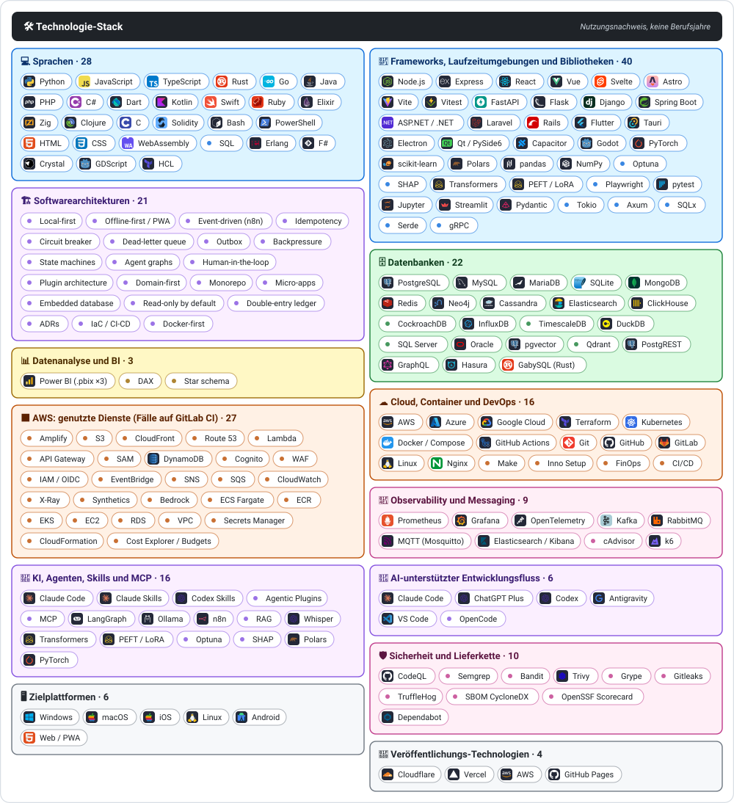
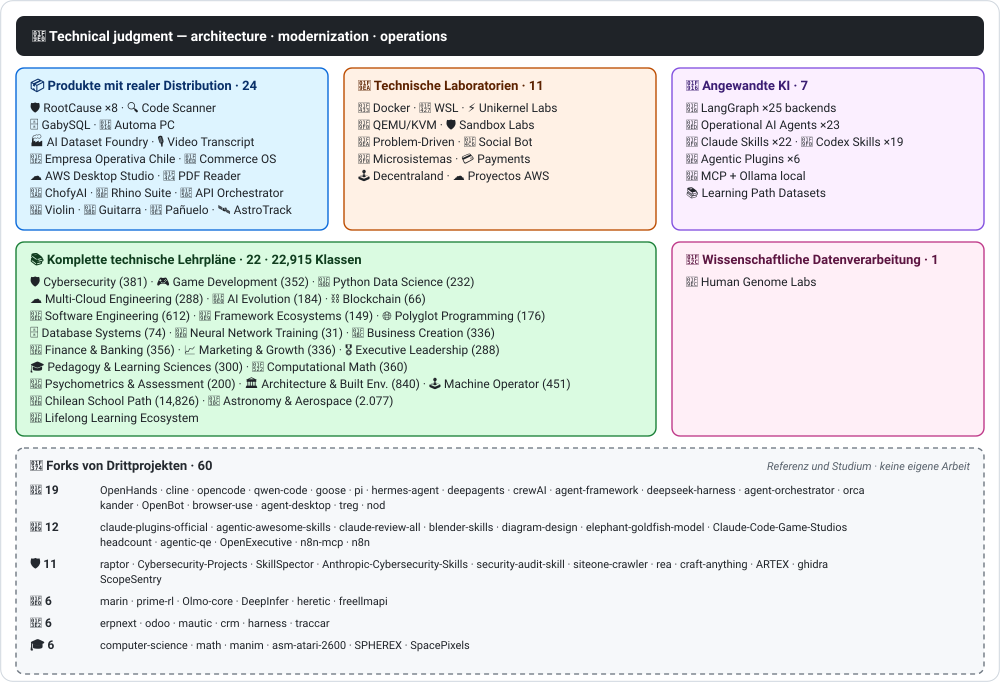

# 👋Wladimir Acuña

## **KI-Ingenieur·Lösungsarchitekt·Senior Full-Stack·Digitale Transformation·Management & Operations**

**Professionell ausgebildet in Informatik und Computing Engineering und Business Administration, mit 16+ Jahren Bau und Betrieb von Software in realen Umgebungen. Ich verbinde Unternehmen, Mitarbeiter, Prozesse und Technologien, um Lösungen mit technischem Urteilsvermögen und einer operativen Sichtweise zu entwerfen, zu bewerten, zu liefern und zu erhalten - unterstützt durch überprüfbare Beweise in diesem GitHub-Konto.**

<!-- STATS:START -->

<!-- STATS:END -->

[🧭 Wo anfangen](docs/START_HERE.de.md) ·
[🌐 Portfolio (22 languages)](https://vladimiracunadev-create.github.io/) ·
[🧩 Ecosystem](#ökosystem-auf-einen-blick) ·
[🛠️ Technologie-Stack](#-technologie-stack) ·
[⚡ Evaluate me in 10 minutes](docs/guides/TECH_LEAD.de.md) ·
[✅ Professional scope](#berufsumfang) ·
[🧭 Non-coding management](#management-administration-und-non-coding-karrieremöglichkeiten) ·
[📋 Rollenmatrix](PROFESIONAL_ROLES.de.md) ·
[📬 Contact](#kontakt)

**🌐 Vollständige Versionen:** [Español](README.md) · [English](README.en.md) · [Português](README.pt.md) · [Italiano](README.it.md) · [Français](README.fr.md) · [简体中文](README.zh.md) · [繁體中文](README.zh-TW.md) · [日本語](README.ja.md) · [한국어](README.ko.md) · [Türkçe](README.tr.md) · [Русский](README.ru.md) · [Tiếng Việt](README.vi.md) · [ไทย](README.th.md) · [Deutsch](README.de.md) · [Українська](README.uk.md) · [Polski](README.pl.md) · [العربية](README.ar.md) · [فارسی](README.fa.md) · [Bahasa Indonesia](README.id.md) · [Nederlands](README.nl.md) · [हिन्दी](README.hi.md) · [Ελληνικά](README.el.md)

**Technischer Kern:**
PHP 8 · Python · Rust · Go · Node/TS · Java 21 · .NET 8 · Dart/Flutter · WASM
· AWS · Terraform · Kubernetes · Docker · n8n · LangGraph/MCP · CI/CD · FinOps · Observability

**Unternehmens-Technologie-Brücke:**
Prozess- und Anforderungsanalyse·Lösungsbewertung·Lieferkoordinierung·Betrieb und Kontinuität·Risikomanagement·Produkt und Dienstleistung·technische Ausbildung

---

> [!NOTE]
> Dieses Profil macht aus Chancen keine Erfahrung. Bewährte technische Erfahrungen, übertragbare Fähigkeiten, tragfähige Anwendungen und zukünftige Entwicklungsziele werden explizit voneinander getrennt. Verknüpfte GitHub-Beweise sind ausführbar oder dokumentarisch; wo etwas ist**nicht**fertig, wird es als solches angegeben.

## 🧭 Wo anfangen

Wählen Sie Ihren Fall und gehen Sie direkt zum Wesentlichen:

🧑‍💼 [Recruiting](docs/guides/RECRUITER.de.md) · 💼 [Kunde oder Freelance](docs/guides/FREELANCE.de.md) · 🛠️ [Technische Bewertung](docs/guides/TECH_LEAD.de.md) · 🏢 [Business und Management](docs/guides/BUSINESS.de.md) · 🤝 [Zusammenarbeit und Sicherheit](docs/guides/COLLABORATOR.de.md) · 🎓 [Lernen oder lehren](docs/guides/LEARNER.de.md)

## 🎯Was Sie hier finden werden

Dies ist kein „One Repo: Es ist ein Ökosystem mit gemeinsamen Standards.

- 🔁 **Reproduzierbare Demos**Klonen, Laufen, Validieren.
- 🧰 **Standardisierte Werkzeuge**— Makefiles, Hub CLI,`doctor`, und`smoke`pro Repository.
- 🛡️ **Verteidigung in der Tiefe**- geheimes Scannen, Richtlinien und ausdrücklich verbotene Praktiken.
- 📈 **Beobachtung** — `/health`, `/ready`, `/metrics`Dashboards und Rückverfolgbarkeit.
- 📚 **Audienzbewusste Dokumentation**- Recruiter, Anfänger, DevOps oder Sicherheit, abhängig vom Repository.
- 📦 **Verteilung der Erzeugnisse**- herunterladbare Releases, Checksummen und Build-Beweise; kommerzielle / Store-Signaturen, die als anhängig erklärt wurden, wenn anwendbar.
- 🌍 **Internationalisierung** — dieses Profil ist in 22 Sprachen veröffentlicht, und das Portfolio bietet 154 öffentliche PDFs (7 Familien × 22 Sprachen) (ES · EN · PT · IT · FR · ZH · ZH-TW · JA · KO · TR · RU · VI · TH · DE · UK · PL · AR · FA · ID · NL · HI · EL).
- 🧭 **Technische Ehrlichkeit**Jeder Fall gekennzeichnet`OPERATIONAL`, `DOCUMENTED/SCAFFOLD`, oder`PLANNED`.

## ✅Nachprüfbarer Status

| Oberfläche | Konkrete Beweise |
|---|---|
| 🧪 **Testabdeckung** | GabySQL**850 Prüfungen**+ Fuzzing over**503,8 Mio. Abfragen**(0 Paniken)·Empresa Operativa Chile**230 Prüfungen** ·Automa**150 pytest** ·Mehrfach-OS-KI |
| 🤖 **Mittel zur Herstellung** | LangGraph RealWorld**25/25 operative Backends**(Fälle 01-25, 100% Abdeckung)·Operationelle KI-Agenten**23 Agenten**mit**69 deterministische Evals** |
| 🔗 **Polyglotte** | **20 Fälle**Sender → n8n → Empfänger —**19 Einsatzkräfte**, einzeln mit Docker auditiert -· **18+ DB-Motoren** · **20+ Container** ·11 Muster |
| 📦 **Verteilung** | **166 Releases**In einem Ökosystem von**68 im Eigentum stehende öffentliche Datenspeicher** ·Installateure und Artefakte`.exe` · `.msi` · `.dmg` · `.apk`mit Prüfsummen und Baunachweisen; ggf. laufende Signaturen von Geschäfts-/Ladengeschäften |
| 🛡️ **Lieferkette** | CodeQL·Semgrep·Bandit·Triviolett·Grype·Gitleaks·TrüffelHog·CycloneDX SBOM·Scorecard |
| 📚 **Curricula** | **22.915 Klassen**über 22 Programme nachprüfbar, gezählt nach[a workflow](.github/workflows/stats.yml)aus einer realen Repository-Struktur oder einer überprüfbaren Quelle, die im Repository deklariert ist – nicht von Hand geschrieben –·Jedes Programm erklärt seinen redaktionellen Status und seine Einschränkungen |
| 🌐 **Portfolio** | Installierbare PWA· **22 Sprachen** · **154 PDFs**erzeugt durch Pipeline·CV Daten-API·Kondensator Android·Lighthouse 100 |
| 🔒 **Telemetrie** | Null Telemetrie in forensischen Produkten und Empresa Operativa Chile - in jedem Build verifiziert (kein Android)`INTERNET`Erlaubnis |
| 🌐 **Veröffentlichte Websites** | **57 GitHub Seiten**56 Landungen, eine pro Produkt, Programm oder Ökosystem-Navigator, plus das Portfolio - jede aus ihrem eigenen Repository bereitgestellt·alle 57 verifiziert mit HTTP`200` |

## 🛠️ Technologie-Stack

In den öffentlichen Repositories erkannte Technologien (Manifeste, Abhängigkeiten, Container und Code), nach Bereichen gruppiert. Das Auftauchen in einem Repository – auch in Laboren und Lehrplänen – ist ein Nutzungsnachweis, keine Behauptung jahrelanger Produktionserfahrung.

👉 **[Woher der Technologie-Stack kommt](docs/STACK_SOURCES.de.md)**

**Softwarearchitekturen**

Local-first → [empresa-operativa-chile](https://github.com/vladimiracunadev-create/empresa-operativa-chile), [ai-dataset-foundry](https://github.com/vladimiracunadev-create/ai-dataset-foundry) · Event-driven → [social-bot-scheduler](https://github.com/vladimiracunadev-create/social-bot-scheduler) · Resilience → [problem-driven-systems-lab](https://github.com/vladimiracunadev-create/problem-driven-systems-lab) · Ledger → [universal-payments-engineering-lab](https://github.com/vladimiracunadev-create/universal-payments-engineering-lab) · Plugins → [agentic-plugins-toolkit](https://github.com/vladimiracunadev-create/agentic-plugins-toolkit) · Agents → [langgraph-realworld](https://github.com/vladimiracunadev-create/langgraph-realworld), [operational-ai-agents](https://github.com/vladimiracunadev-create/operational-ai-agents) · Domain-first → [rhino-suite](https://github.com/vladimiracunadev-create/rhino-suite) · Micro-apps → [microsistemas](https://github.com/vladimiracunadev-create/microsistemas) · Embedded DB → [gabysql](https://github.com/vladimiracunadev-create/gabysql) · IaC → [proyectos-aws](https://github.com/vladimiracunadev-create/proyectos-aws)

**Datenanalyse und BI**

Power BI (.pbix ×3) · DAX · Star schema → [social-bot-scheduler](https://github.com/vladimiracunadev-create/social-bot-scheduler)

**AWS: genutzte Dienste (Fälle auf GitLab CI)**

Fälle A–P → [proyectos-aws-gitlab](https://gitlab.com/vladimir.acuna.dev-group/proyectos-aws-gitlab) (GitLab CI → AWS; alle 16 als abgeschlossen erklärt; Fall M nur Phase 1) · [proyectos-aws](https://github.com/vladimiracunadev-create/proyectos-aws) (GitHub Actions) · EC2, RDS, VPC, Secrets Manager, CloudFormation, Cost Explorer → [aws-desktop-studio](https://github.com/vladimiracunadev-create/aws-desktop-studio) (echte Bestandsabfrage; EC2 mit Start, Stopp und Neustart unter doppelter Kontrolle)

**AI-unterstützter Entwicklungsfluss**

| Werkzeug | Hauptverwendung |
|---|---|
| **Claude Code** | Architekturprüfung, Implementierung und technische Dokumentation |
| **ChatGPT Plus** | Analyse, Architektur und Iteration (seit 2023) |
| **Codex** | Codegenerierung und Refactoring |
| **Antigravitation** | Beschleunigung von Entwicklungs- und Automatisierungsflüssen |
| **VS-Code / OpenCode** | Umgebungen mit integrierter KI-Unterstützung |

> Ich kombiniere mein eigenes technisches Urteil, menschliche Validierung und architektonische Richtung. KI verstärkt Kapazität, Geschwindigkeit und Reichweite – sie ersetzt nicht die Erfahrung.

**Veröffentlichungs-Technologien**

Cloudflare (persönliche Arbeit) · Vercel (NASA-Space-Apps-Hackathon) · AWS (operative Websites, mit GitLab verbunden) · GitHub Pages

## 🗺️Ökosystem auf einen Blick

## 🗂️ Ökosystem: Produkte, Labore, angewandte KI, Lehrpläne und wissenschaftliches Rechnen

Die praktische Arbeit des Profils steht in einem eigenen Dokument: Software zum Herunterladen und Installieren, Engineering-Labore, angewandte KI, vollständige technische Lehrpläne und wissenschaftliches Rechnen – dazu die Beschreibung jedes Forks von Drittprojekten im Konto.

- 📦 [**Produkte mit realer Distribution**](docs/ECOSYSTEM.de.md#products) (24)
- 🧪 [**Technische Laboratorien**](docs/ECOSYSTEM.de.md#labs) (11)
- 🤖 [**Angewandte KI**](docs/ECOSYSTEM.de.md#ai) (7)
- 📚 [**Komplette technische Lehrpläne**](docs/ECOSYSTEM.de.md#curricula) (22)
- 🔬 [**Wissenschaftliche Datenverarbeitung**](docs/ECOSYSTEM.de.md#science) (1)
- 🍴 [**Forks von Drittprojekten**](docs/ECOSYSTEM.de.md#forks) (60)

👉 **[Das vollständige Ökosystem ansehen](docs/ECOSYSTEM.de.md)** · [🍴 Forks von Drittprojekten](docs/ECOSYSTEM.de.md#forks)

## 🛰️ NASA-Space-Apps-Hackathon 2026

Ich habe an der **NASA Space Apps Challenge 2026** (Santiago, 14. und 15. November) teilgenommen, in der Aufgabe *Planet X and SPHEREx*, in einem Team von 6 Personen. Das Produkt ist **AstroTrack · SPHEREx**: ein Web-Viewer, in dem man Himmelskoordinaten eingibt und diese Region als Bildfolge von SPHEREx über die Zeit sieht, mit Daten von NASA/IPAC IRSA.

- **Mein Anteil:** Datenzugriff (IRSA-Abfragen mit Cache und vorberechneten Demo-Feldern), Paketierung (PWA, Desktop-Installer mit Tauri und Android-APK mit Capacitor), die Ansicht „Downloads“ und ein Konsistenz-Audit zwischen Dokumentation und Code.
- **Überprüfbare Lieferung:** [spherex-releases](https://github.com/vladimiracunadev-create/spherex-releases) bündelt 7 Releases (v0.1.0 bis v0.4.2) mit SHA-256-Prüfsummen · [Web-App](https://spherex-planet-x-tau.vercel.app/) · [Team-Repository](https://github.com/mauriciovalenzuela742/SPHEREX).
- **Erklärte Grenzen:** Viewer, Design und der übrige Backend-Teil stammen von anderen Teammitgliedern; die Installer sind nicht signiert und wurden nicht auf echten Geräten getestet; ich habe KI (Claude Code) als Assistenten genutzt, wie im Repository erklärt. Das beschreibt meinen Beitrag, kein Hackathon-Ergebnis.

## 🧠Standards, die ich in allen Repositories anwende

- **DX zuerst**— wenn es nicht einfach zu laufen ist, ist es nicht nützlich als Demo oder als Teambasis.
- **Beobachtung ab Tag 1**— Metriken und Rückverfolgbarkeit, kein nachträglicher Einfall.
- **Sicherheit als Pipeline**— geheimes Scannen, SBOM pro Release, ausdrücklich verbotene Praktiken.
- **Echte Resilienz**- Idempotenz, Leistungsschalter und kontrollierte Degradation.
- **Polyglotte nach Design**Sprache und Motor, die nach Anwendungsfall, niemals nach Mode ausgewählt werden.
- **Ehrlichkeit über Status**Ein Repo wurde umbenannt ()`Multisimulador` → `machine-operator-program`) vielversprechende Software zu vermeiden, die noch nicht existiert.
- **Abzeichen sind Signale, keine Beweise**Jedes Repo erklärt auch**Was er nicht tut**.
- **Modell nach außen**- die Domäne wird zuerst entworfen; die Schnittstelle ist eine Projektion.
- **Externe Arbeit wird als extern deklariert** — die [60 Forks](docs/ECOSYSTEM.de.md#forks) von Drittprojekten werden einzeln beschrieben und bleiben außerhalb aller Zahlen eigener Arbeit in diesem Profil.

## ✅Berufsumfang

Mein dualer Hintergrund -**Informatik und Computing Engineering + Business Administration**— hilft mir, Geschäftsziele in technische Entscheidungen und technische Einschränkungen in klare Optionen für Betrieb, Produkt, Kunden und Führung zu übersetzen.

### 🎯Kernidentität

| Rolle | Rückhalt |
|---|---|
| **Lösungsarchitekt** | Modulares, skalierbares Systemdesign mit evolutionärem Urteil |
| **Legacy Modernisation Architekt** | Reale Legacy-Evolution (PHP 5.x → 8.x, inkrementelles Refactoring ohne Unterbrechung des Betriebs) |
| **Senior Full-Stack / Tech Lead** | Architektur, Ausführung und Standards auf realen Plattformen (+16 Jahre) |
| **AI Automation Architekt** | Agentische Systeme mit LangGraph/MCP und n8n fließt mit Leitplanken |

### ↗ Natürliche Erweiterung

**AI Orchestration Engineer** · **Systeme / Rust Engineer** · **Mobile Engineer (Flutter)** · **Solutions Engineer** · **Technischer Produktbauer** · **Technischer Trainer** · **Digital Transformation Berater** · **Technischer Berater (Technologie, Daten und KI)** · **Business / Funktionaler Analyst** · **Technische Produktoperationen** · **AI Engineer (LLM / ML)** · **Data Engineer** · **DevSecOps / AppSec Engineer** · **QA Automation / Test Engineer** · **Technical Writer** · **Dozent / Trainer / Technologie-Instruktor** · **Instructional Designer (EdTech)** · **Technical Mentor**

### ⚙️Ergänzender Anwendungsbereich

Plattformingenieur / IDP·DevOps / CI-CD·Cloud / AWS Engineer·Antrag SRE·Automatisierungsingenieur·Technischer Berater · Backend / API Engineer · Fintech / Payments Engineer · Developer Advocate / DevRel

## 🧭Management, Administration und Non-Coding Karrieremöglichkeiten

Management-, Verwaltungs- und Business-Rollen, in denen Informatik und Betriebswirtschaft beitragen, ohne dass Programmieren die Kernaufgabe ist – ehrlich eingestuft (übertragbare Kompetenz, Bewerbungsmöglichkeit oder Zukunftsziel) und mit der jeweiligen Lücke. Abgedeckte Bereiche:

Technologieführerschaft · Projektmanagement · Betriebswirtschaftslehre · Strategie und Wandel · Geschäftsanalyse · Produkt und Dienstleistung · Cybersecurity Management · Handels- und Verkaufsgeschäfte · Finanz- und Managementkontrolle · Qualität · Bildung · Logistik und Lieferanten · Data und AI Governance · Öffentlicher Sektor

👉 **[Die vollständige Chancenmatrix ansehen](docs/MANAGEMENT.de.md)**

## 📌Verfügbarkeit

**Offen für:**Senior Full-Stack·Architektur·Legacy Modernisierung·Plattform/IDP·Antrag SRE·pragmatische DevOps·Automatisierung·AI Automation·Business/Funktionalanalyse·IT Projektkoordinierung·Produktoperationen·Digitale Transformation·Solutions Consulting/Presales·technische Ausbildung·Qualität und kontinuierliche Verbesserung·KI-Adoption und Governance

**Bewertet nach dem Umfang jeder Rolle:**Product Owner / technischer Produktmanager·Service Delivery·IT-Betrieb·GRC / Technologierisiko·Verwaltung und Operationen·Verwaltungskontrolle·Modernisierung des öffentlichen Sektors. Executive und General Management Titel sind zukünftige Entwicklungsziele, nicht beanspruchte Erfahrung.

**Modalität:**Remote oder Hybrid, je nach Projekt.

## 📬Kontakt

---

[🤝 Contribute](CONTRIBUTING.de.md) ·
[🛡️ Security](SECURITY.de.md) ·
[⚖️ Code of Conduct](CODE_OF_CONDUCT.de.md)

README synchronisiert mit dem überprüfbaren Zustand der öffentlichen Repositories —Zahlen und Änderungen werden über die API gelesen— · letzte Überprüfung: <!-- VERIFIED:START -->2026-11-24<!-- VERIFIED:END -->.

