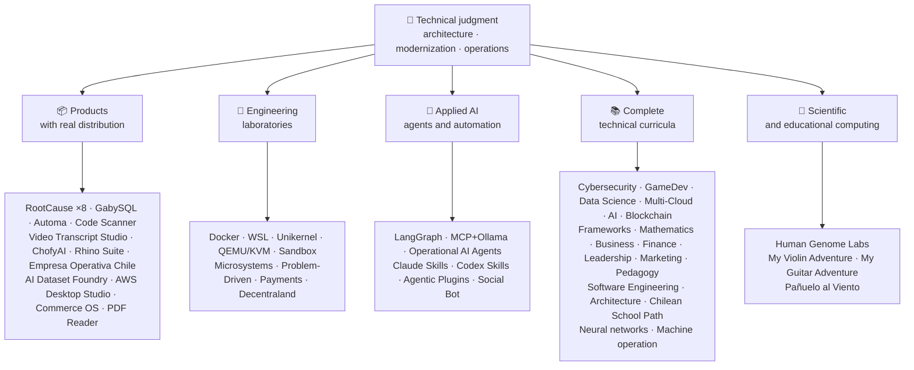

<div align="center">

# 👋Βλαντίμιρ Ακούνια

## **Αρχιτέκτονας Λύσης·Ανώτερος πλήρης στοίβα·Ψηφιακή Μεταμόρφωση·Διαχείριση & Λειτουργίες**

**Επαγγελματικά εκπαιδευμένο στην Επιστήμη Υπολογιστών και στην Μηχανική Υπολογιστών και Διοίκηση Επιχειρήσεων, με 16+ χρόνια κατασκευής και λειτουργικού λογισμικού σε πραγματικά περιβάλλοντα. Συνδέω τις επιχειρήσεις, τους ανθρώπους, τις διαδικασίες και την τεχνολογία με το σχεδιασμό, την αξιολόγηση, την παροχή και τη διατήρηση λύσεων με τεχνική κρίση και μια επιχειρησιακή άποψη — που υποστηρίζεται από επαληθεύσιμα στοιχεία σε αυτόν τον λογαριασμό GitHub.**

[](https://vladimiracunadev-create.github.io/)
[](https://www.linkedin.com/in/vladimir-acu%C3%B1a-valdebenito-11924a29/)
[](mailto:vladimir.acuna.dev@gmail.com)

[](#επαγγελματικό-πεδίο-εφαρμογής)
[](docs/ECOSYSTEM.el.md)
[](#πλήρης-τεχνική-επιμέλεια)

<!-- STATS:START -->
[](https://github.com/vladimiracunadev-create?tab=repositories)
[](https://github.com/vladimiracunadev-create?tab=repositories)
[](#ecosystem-σε-μια-λάμψη)
[](#πλήρης-τεχνική-επιμέλεια)
[](https://github.com/vladimiracunadev-create?tab=repositories)
<!-- STATS:END -->

[](https://github.com/vladimiracunadev-create?tab=repositories)
[](https://github.com/vladimiracunadev-create?tab=followers)

[🌐 Portfolio (6 languages)](https://vladimiracunadev-create.github.io/) ·
[🧩 Ecosystem](#ecosystem-σε-μια-λάμψη) ·
[⚡ Evaluate me in 10 minutes](#αν-έχετε-10-λεπτά-για-να-με-αξιολογήσετε) ·
[✅ Professional scope](#επαγγελματικό-πεδίο-εφαρμογής) ·
[🧭 Non-coding management](#διαχείριση-διοίκηση-και-μη-κωδικοποίηση-ευκαιρίες-καριέρας) ·
[📋 Role matrix](PROFESIONAL_ROLES.md) ·
[📬 Contact](#επαφή)

**🌐 Πλήρεις εκδόσεις:** [Español](README.md) · [English](README.en.md) · [Português](README.pt.md) · [Italiano](README.it.md) · [Français](README.fr.md) · [简体中文](README.zh.md) · [繁體中文](README.zh-TW.md) · [日本語](README.ja.md) · [한국어](README.ko.md) · [Türkçe](README.tr.md) · [Русский](README.ru.md) · [Tiếng Việt](README.vi.md) · [ไทย](README.th.md) · [Deutsch](README.de.md) · [Українська](README.uk.md) · [Polski](README.pl.md) · [العربية](README.ar.md) · [فارسی](README.fa.md) · [Bahasa Indonesia](README.id.md) · [Nederlands](README.nl.md) · [हिन्दी](README.hi.md) · [Ελληνικά](README.el.md)

**Τεχνικός πυρήνας:**
PHP 8 · Python · Rust · Go · Node/TS · Java 21 · .NET 8 · Dart/Flutter · WASM
· AWS · Terraform · Kubernetes · Docker · n8n · LangGraph/MCP · CI/CD · FinOps · Observability

**Γέφυρα «επιχειρησιακής τεχνολογίας»:**
ανάλυση διεργασιών και απαιτήσεων·αξιολόγηση λύσης·συντονισμός παράδοσης·πράξεις και συνέχεια·διαχείριση κινδύνων·προϊόν και υπηρεσία·τεχνική εκπαίδευση

</div>

---

> [!NOTE]
> Αυτό το προφίλ δεν μετατρέπει τις ευκαιρίες σε εμπειρία. Διαχωρίζονται ρητά οι αποδεδειγμένες τεχνικές εμπειρίες, οι μεταβιβάσιμες δεξιότητες, οι βιώσιμες εφαρμογές και οι μελλοντικοί αναπτυξιακοί στόχοι. Τα στοιχεία του Linked GitHub είναι εκτελέσιμα ή ντοκιμαντέρ, όπου κάτι είναι**όχι**Τελειωμένο, δηλώνεται ως τέτοιο.

## 🎯Τι θα Βρείτε Εδώ

Αυτό δεν είναι “μια repo”: είναι ένα οικοσύστημα με κοινά πρότυπα.

- 🔁 **Αναπαραγωγικά demos**— κλώνος, τρέχα, επικυρώσε.
- 🧰 **Τυποποιημένη εργαλειοθέτηση**— Makefiles, Hub CLI,`doctor`, και`smoke`ανά χώρο αποθήκευσης.
- 🛡️ **Άμυνα σε βάθος**— μυστική σάρωση, πολιτικές και ρητά απαγορευμένες πρακτικές.
- 📈 **Παρατηρησιμότητα** — `/health`, `/ready`, `/metrics`, ταμπλό και ιχνηλασιμότητα.
- 📚 **Τεκμηρίωση για το κοινό**— στρατολογητή, αρχάριο, DevOps ή ασφάλεια, ανάλογα με το χώρο αποθήκευσης.
- 📦 **Κατανομή προϊόντων**— τις εκδόσεις, τα ληφθέντα έγγραφα και τα αποδεικτικά στοιχεία,
- 🌍 **Διεθνοποίηση**— χαρτοφυλάκιο σε 6 γλώσσες (ES)·ΕΝ·PT·ΤΙ·FR·ΖΗ).
- 🧭 **Τεχνική ειλικρίνεια**— κάθε περίπτωση με ετικέτα`OPERATIONAL`, `DOCUMENTED/SCAFFOLD`, ή`PLANNED`.

## ✅Επαληθευμένη κατάσταση

| Επιφάνεια | Συγκεκριμένα αποδεικτικά στοιχεία |
|---|---|
| 🧪 **Κάλυψη δοκιμής** | GabySQL (Γαβριέλλα)**828 δοκιμές**+ fuzzing over (στα Αγγλικά)**503.8M ερωτήματα**(0 πανικό)·Εμπρέσα Operativa Χιλή**158 δοκιμές** ·Αυτόματο**150 pytest (πυόδοντας)** ·CI πολλών OS |
| 🤖 **Παράγωγα** | Πραγματικό κόσμο LangGraph**Λειτουργικά συστήματα υποστήριξης 25/25**(περιπτώσεις 01-25, κάλυψη 100%)·Επιχειρησιακοί πράκτορες AI**13 παράγοντες**με**39 ντετερμινιστικές εκτιμήσεις** |
| 🔗 **Ενσωμάτωση πολυσφαιρίου** | **20 περιπτώσεις**αποστολέας →n8n→ παραλήπτης —**19 επιχειρησιακά**, ατομικά ελεγμένο με Docker—· **18+ κινητήρες DB** · **20+ δοχεία** ·11 μοτίβα |
| 📦 **Κατανομή** | **151 εκδόσεις**σε ένα οικοσύστημα**64 δημόσια αρχεία καταγραφής ιδιοκτησίας** ·εγκαταστάτες και τεχνουργήματα`.exe` · `.msi` · `.dmg` · `.apk`με τα ληξιαρχικά και αποδεικτικά στοιχεία· εμπορικές/αποθήκες υπογραφές σε εξέλιξη, όπου απαιτείται |
| 🛡️ **Εφοδιαστική αλυσίδα** | ΚωδικόςQL·Σεμγκρέπ·Ληστής·Τριβάκι·Γρύπα·Γκιτλακά·Τροφός·ΚυκλώναςDX SBOM·Κάρτα βαθμολογίας |
| 📚 **Κουρκουμά** | **14.530 κατηγορίες**επαληθεύσιμο σε 21 προγράμματα, με βάση[a workflow](.github/workflows/stats.yml)από πραγματική δομή αποθετηρίου ή επαληθεύσιμη πηγή που δηλώνεται στο αποθετήριο —μη γραμμένη με το χέρι—·κάθε πρόγραμμα δηλώνει την συντακτική του κατάσταση και τους περιορισμούς του |
| 🌐 **Χαρτοφυλάκιο** | Εγκαταστατέα PWA· **6 γλώσσες** · **36 PDFs**παραγόμενη από αγωγό·CV Data API·Πυκνωτής Android·Φάρος 100 |
| 🔒 **Τηλεμετρία** | Μηδενική τηλεμετρία σε εγκληματολογικά προϊόντα και Empresa Operativa Χιλή — επαληθεύεται σε κάθε κατασκευή (όχι Android`INTERNET`άδεια) |
| 🌐 **Δημοσιευμένοι ιστότοποι** | **56 GitHub Σελίδες ιστοσελίδες**—55 εκφορτώσεις, μία ανά προϊόν, πρόγραμμα ή οικοσύστημα, συν το χαρτοφυλάκιο— καθεμία από τις οποίες έχει αναπτυχθεί από το δικό της αποθετήριο·και τα 56 επαληθεύτηκαν με HTTP`200` |

## 🗺️Ecosystem σε μια λάμψη



## 🗂️ Οικοσύστημα: προϊόντα, εργαστήρια, εφαρμοσμένη ΤΝ και επιστημονικοί υπολογισμοί

Το πρακτικό έργο του προφίλ βρίσκεται σε ξεχωριστό έγγραφο: λογισμικό που κατεβάζεται και εγκαθίσταται, εργαστήρια μηχανικής, εφαρμοσμένη ΤΝ και επιστημονικοί υπολογισμοί, μαζί με την περιγραφή κάθε fork έργων τρίτων που υπάρχει στον λογαριασμό.

- 📦 **Προϊόντα με πραγματική διανομή** (22)
- 🧪 **Εργαστήρια Μηχανικών** (11)
- 🤖 **Εφαρμοσμένη ΤΝ** (6)
- 🔬 **Επιστημονική Υπολογιστική** (1)
- 🍴 **Forks έργων τρίτων** (52)

👉 **[Δείτε ολόκληρο το οικοσύστημα](docs/ECOSYSTEM.el.md)** · [🍴 Forks έργων τρίτων](docs/ECOSYSTEM.el.md#forks)

## 📚Πλήρης τεχνική επιμέλεια

Αλληλοσυσσωρεύσιμα προγράμματα στα ισπανικά, με κατάσταση και πεδίο εφαρμογής δηλωμένα από κάθε χώρο αποθήκευσης. Τα 21 προγράμματα προσθέτουν έως και**14.530 κατηγορίες**, μετρά με[a workflow](.github/workflows/stats.yml)από πραγματική δομή αποθετηρίου ή επαληθεύσιμη πηγή που δηλώνεται στο αποθετήριο· το σήμα ανανεώνεται κάθε εβδομάδα και δεν γράφεται με το χέρι.

🧭 [**Lifelong Learning Ecosystem**](https://github.com/vladimiracunadev-create/lifelong-learning-ecosystem)είναι μια υποτροφιασμένη πυξίδα που συνδέει 30 πραγματικές διαδρομές σε 6 περιοχές μέσω οπτικών χαρτών και[accessible offline portal](https://vladimiracunadev-create.github.io/lifelong-learning-ecosystem/)· δεν υπολογίζεται ως ένα πρόσθετο πρόγραμμα.

| Πρόγραμμα | Κλάσεις | Πεδίο εφαρμογής |
|---|---:|---|
| [🔢 **Computational Mathematics**](https://github.com/vladimiracunadev-create/computational-mathematics-program) | 360 | Από την υπολόγιση στα δάχτυλα μέχρι την αναπαραγωγή ενός χαρτιού· **360 ντετερμινιστικές διαδηλώσεις επαληθεύτηκαν στο CI** ·1.080 σημειωματάρια·489-τερματικό γλωσσάριο· [site](https://vladimiracunadev-create.github.io/computational-mathematics-program/) |
| [🏦 **Finance and Banking**](https://github.com/vladimiracunadev-create/finance-and-banking-evolution-program) | 356 | 534 η·χρηματοοικονομικά μαθηματικά και ΔΠΧΠ → πίστωση, κίνδυνος, Βασιλεία ΙΙΙ, ανοικτή χρηματοδότηση, DLT, σταθερά νομίσματα, και MiCA· **27 περιπτώσεις** · **298 δοκιμές** · [site](https://vladimiracunadev-create.github.io/finance-and-banking-evolution-program/) |
| [🎮 **GameDev**](https://github.com/vladimiracunadev-create/modern-gamedev-program) | 352 | Μαθηματικά και C#/C++/GDScript → Σκιάστρα, AI, multiplayer, VR/AR·Γκοντό.·Ενότητα·Μη πραγματικό· **10 εργαστήρια Godot επαληθεύονται στο CI**(301 έλεγχοι)· [site](https://vladimiracunadev-create.github.io/modern-gamedev-program/) |
| [🛡️ **Cybersecurity**](https://github.com/vladimiracunadev-create/modern-cybersecurity-program) | 360 | **v1.3.0** ·20 μέρη·θεμελίωση → Κόκκινη ομάδα, DFIR, ασφάλεια cloud, εκμετάλλευση dev, CTF, και ασφάλεια παιχνιδιών·χαρτογραφημένο σε**7 πιστοποιήσεις** ·offline Android / εφαρμογή ιστού·Εγχειρίδιο PDF·CI, Ασφάλεια και Σελίδες επαληθευμένες· [site](https://vladimiracunadev-create.github.io/modern-cybersecurity-program/) |
| [📈 **Marketing, Sales, and Growth**](https://github.com/vladimiracunadev-create/marketing-sales-growth-evolution-program) | 336 | 24 μέρη με επιχειρησιακούς ορισμούς, δελτία μέτρησης, επαληθεύσιμη βιβλιογραφία και κανονιστικό πλαίσιο της Χιλής· **v1.6.0** ·1.29M λέξεις·17 διαδρομές με βάση το ρόλο· [site](https://vladimiracunadev-create.github.io/marketing-sales-growth-evolution-program/) |
| [🏢 **Business Creation**](https://github.com/vladimiracunadev-create/modern-business-creation-program) | 336 | Δημιουργία και λειτουργία μιας πραγματικής εταιρείας στη Χιλή: από την ιδέα στην ενσωμάτωση, φορολογική αρχή, επιχειρήσεις, κρίση, και έξοδος·360 διαγράμματα·1,251-τερματικό γλωσσάριο·Εγχειρίδιο 1.548 σελίδων· [site](https://vladimiracunadev-create.github.io/modern-business-creation-program/) |
| [🏛️ **Architecture and Built Environment**](https://github.com/vladimiracunadev-create/architecture-built-environment-learning-program) | 830 | 83 μέρη·60 ολοκληρωτικές συνεδρίες·34 μονοπάτια·ιχνηλάσιμες πηγές·Markdown, offline αναγνώστης, και GitHub Σελίδες· [site](https://vladimiracunadev-create.github.io/architecture-built-environment-learning-program/) |
| [🇨🇱 **Chilean School Learning Path**](https://github.com/vladimiracunadev-create/chilean-school-learning-path) | 8,841 | Βαθμοί 1–12· **4.156 ολοκληρωμένες διασχολικές εμπειρίες** · **2.823 μαθησιακοί στόχοι** ·Πηγές MINEDUC·δεν εκκρεμούν προτάσεις και εξειδικευμένη ανθρώπινη αναθεώρηση που εκκρεμεί ακόμη· [site](https://vladimiracunadev-create.github.io/chilean-school-learning-path/) |
| [🧭 **Modern Software Engineering**](https://github.com/vladimiracunadev-create/modern-software-engineering-program) | 480 | 40 μέρη και 8 στάδια·θεμέλια → προϊόν, αρχιτεκτονική, ασφάλεια, DevOps, SRE, SPEC, AI, και συστήματα πολλαπλών παραγόντων·συντακτική κατάσταση που δηλώνεται από το αποθετήριο· [site](https://vladimiracunadev-create.github.io/modern-software-engineering-program/) |
| [🎓 **Pedagogy and Learning Sciences**](https://github.com/vladimiracunadev-create/education-pedagogy-learning-sciences-program) | 300 | Από το πώς μαθαίνει ένα άτομο μέχρι το πώς εκπαιδεύονται οι δάσκαλοι·25 μέρη· **κάθε τάξη δηλώνει την κατάσταση και τα όρια των αποδείξεων της** ·Πρώιμη παιδεία, συγκριτικές μέθοδοι, ειδικές εκπαιδευτικές ανάγκες, συνύπαρξη, πολιτιστική πολυμορφία και διεθνή στοιχεία·1,097-τερματικό γλωσσάριο, 325 διαγράμματα, και μια 60-δραστηριότητα τράπεζα τάξη·14 πορείες σταδιοδρομίας ανά ρόλο·LMS-εξαγώγιμο· **v2.1.0** · [site](https://vladimiracunadev-create.github.io/education-pedagogy-learning-sciences-program/) |
| [☁️ **Multi-Cloud**](https://github.com/vladimiracunadev-create/multi-cloud-engineering-program) | 288 | AWS (ΣΥΜ)·Αζούρ·GCP·Κουμπερνέτες·Τεραμόμορφο·ΣΡΕ·Φινόπς· **1.288 ώρες** ·288 εργαστήρια με στοιχεία JSON·1,032 πηγές που εντοπίστηκαν·2,884-σελίδα εγχειρίδιο PDF· [site](https://vladimiracunadev-create.github.io/multi-cloud-engineering-program/) |
| [🎖️ **Executive Leadership**](https://github.com/vladimiracunadev-create/executive-leadership-founder-program) | 288 | Από την ιδιοκτησία του πρώτου αποτελέσματος σας να ηγηθεί μια εταιρεία και την ίδρυση της δικής σας: ομάδες, KPI / OKR, χρηματοδότηση, προϊόν, κίνδυνος, διοικητικό συμβούλιο, και M&A·24 περιπτώσεις, 96 εργαστήρια, και 39 πρότυπα· [site](https://vladimiracunadev-create.github.io/executive-leadership-founder-program/) |
| [🐍 **Python Data Science**](https://github.com/vladimiracunadev-create/python-data-science-program) | 232 | Πολικοί, ML+Optuna/SHAP, PyTorch/LLMs/LORA, MLOps·εγγενής εφαρμογή Windows + Android APK· [site](https://vladimiracunadev-create.github.io/python-data-science-program/) |
| [🧠 **AI Evolution**](https://github.com/vladimiracunadev-create/artificial-intelligence-evolution-program) | 184 | Symbolic → probabilistic → deep learning → LLMs, RAG, agents, safety, and frontier · **v0.17.0** · **708 notebooks** · **148 foundational papers** · offline Windows, Android, and PWA apps · [site](https://vladimiracunadev-create.github.io/artificial-intelligence-evolution-program/) |
| [🌐 **Comparative Programming**](https://github.com/vladimiracunadev-create/polyglot-programming-labs) | 176 | Μια ιδέα,**10 γλώσσες**επαληθεύτηκε στο CI —**1.360 υλοποιήσεις**— συν**1.632 προγράμματα**σε ακίνητες γλώσσες (COBOL, Fortran, Ada, RPG, MUMPS...) και έναν άτλαντα**60 κάρτες σε 15 οικογένειες** ·v1.1.0· [site](https://vladimiracunadev-create.github.io/polyglot-programming-labs/) |
| [🧩 **Frameworks Compared**](https://github.com/vladimiracunadev-create/framework-ecosystems-labs) | 149 | Ένα εκτελέσιμο συμβόλαιο, χωρίς προσαρμογείς, εναντίον Express, FastAPI, Spring Boot, ASP.NET, Django, Rails, Laravel, React, Vue, Svelte, και πολλά άλλα·12 μέρη· **70 οικοδομημένες τάξεις** · **397 περιπτώσεις που επαληθεύτηκαν σε ΚΚΠ** · **210 ISBN/DOI πηγές** · [site](https://vladimiracunadev-create.github.io/framework-ecosystems-labs/) |
| [🗄️ **Databases**](https://github.com/vladimiracunadev-create/database-systems-labs) | 74 | **v3.0.0** ·μηχανική βάσεων δεδομένων σε 15 μέρη·230 ώρες· **την επαληθεύσιμη πηγή για κάθε ισχυρισμό**120 πηγές με ISBN, DOI, ή πρότυπο·Η ίδια περίπτωση λύθηκε σε 27 κινητήρες·306-τερματικό γλωσσάριο·150 pytest (πυόδοντας)· [site](https://vladimiracunadev-create.github.io/database-systems-labs/) |
| [📐 **Psychometrics and Assessment**](https://github.com/vladimiracunadev-create/psychometrics-and-assessment-program) | 40 | Πώς ένα όργανο μέτρησης κατασκευάζεται, βαθμολογείται, επικυρώνεται και ελέγχεται·8 μέρη·Εκτελέσιμος κινητήρας με**5 μέσα και 344 αντικείμενα, 276 δημόσια** |
| [⛓️ **Blockchain**](https://github.com/vladimiracunadev-create/blockchain-learning-path) | 66 | **v0.14.0** ·από μηδέν έως προγραμματιζόμενη οικονομική υποδομή και ανάλυση της αλυσίδας· **91 πρακτικές**και**363 δοκιμές** ·συμβάσεις με το Χυτήριο (fuzzing και indariants) και τη στατική ανάλυση Slither σε CI·offline εφαρμογές επαληθεύονται με το άνοιγμα του δυαδικού και μετρώντας τα περιεχόμενά του· [site](https://vladimiracunadev-create.github.io/blockchain-learning-path/) |
| [🧠 **Neural Network Training Labs**](https://github.com/vladimiracunadev-create/neural-network-training-labs) | 31 | 7 ενότητες·≈214 ώρες· **93 σημειωματάρια**— 31 τάξεις, 31 φοιτητικές εκδόσεις και 31 λύσεις·ερωτήσεις, οπτικούς χάρτες, πρακτικές και αξιολόγηση με πραγματικά δημόσια δεδομένα·Πάιτορτς· [study site](https://vladimiracunadev-create.github.io/neural-network-training-labs/) |
| [🕹️ **Machine Operator**](https://github.com/vladimiracunadev-create/machine-operator-program) | 451 | **41 ενότητες κατάρτισης**, ένα ανά μηχανή· **502 h 15 λεπτά** ·συστήματα, έλεγχοι, φυσική, ασφάλεια και σχεδιασμός προσομοίωσης με πηγές ανά κατηγορία·* Δεν εκτελέσιμος προσομοιωτής ακόμα, και δηλώνεται με αυτόν τον τρόπο* |

## ⚡Αν έχετε 10 λεπτά για να με αξιολογήσετε

Η ιδέα δεν είναι μόνο να δούμε τον κώδικα: είναι να δούμε**Πώς νομίζω**, πώς καταγράφω, και πώς κάνω τα πάντα εκτελέσιμα.

**Διαδρομή Α — Πραγματική παρατηρητικότητα και ενορχήστρωση*** (το αγαπημένο μου) *

```bash
git clone https://github.com/vladimiracunadev-create/social-bot-scheduler.git
```

Θα δείτε ροές εργασίας, μετρικούς, ταμπλό, και guardrails σε 19 περιπτώσεις και 18 + DB κινητήρες.

**Διαδρομή Β — Αναπαραγωγή υποδομή σε λεπτά**

```bash
git clone https://github.com/vladimiracunadev-create/docker-labs.git
```

**Διαδρομή Γ — Πράκτορες με δακτυλογραφημένη κατάσταση**

```bash
git clone https://github.com/vladimiracunadev-create/langgraph-realworld.git
```

**Διαδρομή Δ — εγκληματολογικό προϊόν Rust, χωρίς κλωνοποίηση**

Κατεβάστε το δυαδικό εγκατάστασης ή CLI από[RootCause releases](https://github.com/vladimiracunadev-create/rootcause-windows-inspector/releases)και να επαληθεύσει`SHA256SUMS`.

## 🧠Πρότυπα που εφαρμόζω σε όλα τα αποθετήρια

- **DX πρώτα**— εάν δεν είναι εύκολο να τρέξει, δεν είναι χρήσιμο ως demo ή ως βάση ομάδας.
- **Παρατηρησιμότητα από την ημέρα 1**— μετρικές μετρήσεις και ανιχνευσιμότητα, όχι μια δεύτερη σκέψη.
- **Ασφάλεια ως αγωγός**— μυστική σάρωση, SBOM ανά απελευθέρωση, ρητά απαγορευμένες πρακτικές.
- **Πραγματική ανθεκτικότητα**— την ιδεότητα, τον διακόπτη κυκλώματος και την ελεγχόμενη αποδόμηση.
- **Πολυγλωττία από σχεδιασμό**— γλώσσα και μηχανή που επιλέγεται με τη χρήση της υπόθεσης, ποτέ με τη μόδα.
- **Ειλικρίνεια σχετικά με την κατάσταση**— μία νέα ονομασία μετονομάστηκε σε (`Multisimulador` → `machine-operator-program`) για να αποφευχθεί η ελπιδοφόρα λογισμικό που δεν υπάρχει ακόμα.
- **Τα σκοινιά είναι σήματα, όχι στοιχεία.**— κάθε συμφωνία επαναλήψεως δηλώνει επίσης**τι δεν κάνει**.
- **Υπόδειγμα προς τα έξω**— ο τομέας έχει σχεδιαστεί πρώτος· η διεπαφή είναι μια προβολή.
- **Οι εξωτερικές εργασίες δηλώνονται ως εξωτερικές** — τα [52 forks](docs/ECOSYSTEM.el.md#forks) έργων τρίτων περιγράφονται ένα προς ένα και μένουν εκτός όλων των αριθμών ιδίου έργου αυτού του προφίλ.

## ✅Επαγγελματικό πεδίο εφαρμογής

Το διπλό μου υπόβαθρο -**Επιστήμη Υπολογιστών και Μηχανική Υπολογιστών + Διοίκηση Επιχειρήσεων**— με βοηθά να μεταφράζω τους επιχειρηματικούς στόχους σε τεχνικές αποφάσεις και τεχνικούς περιορισμούς σε σαφείς επιλογές για τις επιχειρήσεις, το προϊόν, τους πελάτες και την ηγεσία.

### 🎯Ταυτότητα πυρήνα

| Ρόλος | Υποστήριγμα |
|---|---|
| **Αρχιτέκτονας Λύσης** | Σχεδίαση συστήματος με εξελικτική κρίση |
| **Αρχιτέκτονας Εκσυγχρονισμού Κληρονομιάς** | Πραγματική εξέλιξη κληρονομιάς (PHP 5.x→8.x, επαυξημένη αναπαράσταση χωρίς διακοπή των εργασιών) |
| **Ανώτερος πλήρης/τεχνικός μόλυβδος** | Αρχιτεκτονική, εκτέλεση και πρότυπα για πραγματικές πλατφόρμες (+16 χρόνια) |
| **Αρχιτέκτονας Αυτοματισμού της AI** | Συστήματα Agentic με LangGraph/MCP και n8n ροές με guardrails |

### ↗ Φυσική Επέκταση

**Μηχανικός Ενορχηστρώσεων AI** · **Συστήματα / Μηχανικός Rust** · **Κινητός μηχανικός (Flutter)** · **Λύσεις Μηχανικός** · **Κατασκευαστής τεχνικών προϊόντων** · **Τεχνικός εκπαιδευτής** · **Σύμβουλος Ψηφιακής Μεταμόρφωσης** · **Επιχειρηματικός / λειτουργικός αναλυτής** · **Τεχνικές εργασίες προϊόντων**

### ⚙️Συμπληρωματικό πεδίο εφαρμογής

Μηχανικός πλατφόρμας / IDP·DevOps / CI-CD·Μηχανικός Cloud / AWS·Εφαρμογή SRE·Μηχανικός αυτοματισμού·Τεχνικός-εμπορικός σύμβουλος

## 🧭Διαχείριση, Διοίκηση και Μη Κωδικοποίηση Ευκαιρίες Καριέρας

Θέσεις διοίκησης, διαχείρισης και επιχειρηματικής δραστηριότητας όπου η πληροφορική και η διοίκηση συνεισφέρουν χωρίς ο προγραμματισμός να είναι το κεντρικό καθήκον, ταξινομημένες με ειλικρίνεια (μεταβιβάσιμη ικανότητα, δυνατότητα υποψηφιότητας ή μελλοντικός στόχος) και με το κενό καθεμιάς. Καλυπτόμενοι τομείς:

Ηγετικό ρόλο στην τεχνολογία · Διαχείριση του έργου · Διοίκηση επιχειρήσεων · Στρατηγική και αλλαγή · Ανάλυση επιχειρήσεων · Προϊόν και υπηρεσία · Διαχείριση της ασφάλειας στον κυβερνοχώρο · Εμπορικές και πωλήσεις · Δημοσιονομικός και διαχειριστικός έλεγχος · Ποιότητα · Εκπαίδευση · Διοικητικές υπηρεσίες και προμηθευτές · Δεδομένα και διακυβέρνηση της ΤΝ · Δημόσιος τομέας

👉 **[Δείτε τον πλήρη πίνακα ευκαιριών](docs/MANAGEMENT.el.md)**

## 🤖AI-βοηθούμενη ροή ανάπτυξης

| Εργαλείο | Κύρια χρήση |
|---|---|
| **Κωδικός Claude** | Αρχιτεκτονική επανεξέταση, εφαρμογή και τεχνική τεκμηρίωση |
| **ChatGPT Plus** | Ανάλυση, αρχιτεκτονική και επανάληψη (από 2023) |
| **Κώδικας** | Παραγωγή και αναπαράγοντα κωδικών |
| **Αντιβαρύτητα** | Επιτάχυνση των ροών ανάπτυξης και αυτοματοποίησης |
| **Κωδικός VS / OpenCode** | Περιβάλλον με ολοκληρωμένη βοήθεια ΤΠ |

> Συνδυάζω την τεχνική μου κρίση, την ανθρώπινη επικύρωση, και την αρχιτεκτονική κατεύθυνση. Η AI ενισχύει τη χωρητικότητα, την ταχύτητα και την πρόσβαση — δεν αντικαθιστά την εμπειρία.

## 📌Διαθεσιμότητα

**Άνοιγμα σε:**Ανώτερος πλήρης στοίβα·Αρχιτεκτονική·Εκσυγχρονισμός της κληρονομιάς·Πλατφόρμα/ΕΠΑ·Εφαρμογή SRE·ρεαλιστικά DevOps·Αυτοματοποίηση·Αυτοματισμός AI·ανάλυση επιχειρήσεων/λειτουργικών δραστηριοτήτων·Συντονισμός έργων ΤΠ·Πράξεις προϊόντων·ψηφιακός μετασχηματισμός·λύσεις που συμβουλεύονται/προπωλούνται·τεχνική εκπαίδευση·ποιότητα και συνεχής βελτίωση·Υιοθέτηση και διακυβέρνηση της ΤΠ

**Αξιολογείται σύμφωνα με το πεδίο εφαρμογής κάθε ρόλου:**Ιδιοκτήτης / τεχνικός διαχειριστής προϊόντων·Παράδοση υπηρεσιών·Λειτουργίες πληροφορικής·GRC / κίνδυνος τεχνολογίας·διοίκηση και επιχειρήσεις·έλεγχος διαχείρισης·τον εκσυγχρονισμό του δημόσιου τομέα. Οι τίτλοι εκτελεστικής και γενικής διαχείρισης είναι μελλοντικοί αναπτυξιακοί στόχοι, όχι η διεκδίκηση εμπειρίας.

**Modality:** remote or hybrid, depending on the project.

## 📬Επαφή

[](https://vladimiracunadev-create.github.io/)
[](https://www.linkedin.com/in/vladimir-acu%C3%B1a-valdebenito-11924a29/)
[](https://gitlab.com/vladimir.acuna.dev-group/vladimir.acuna.dev-group)
[](mailto:vladimir.acuna.dev@gmail.com)

---

<div align="center">

[🤝 Contribute](CONTRIBUTING.en.md) ·
[🛡️ Security](SECURITY.en.md) ·
[⚖️ Code of Conduct](CODE_OF_CONDUCT.en.md)

<sub>README συγχρονίζεται με την επαληθεύσιμη κατάσταση των δημόσιων αποθετηρίων - σχάρες και αλλαγές που διαβάζονται μέσω του API—·τελευταία επαλήθευση: 12 Οκτωβρίου 2026.</sub>

</div>
