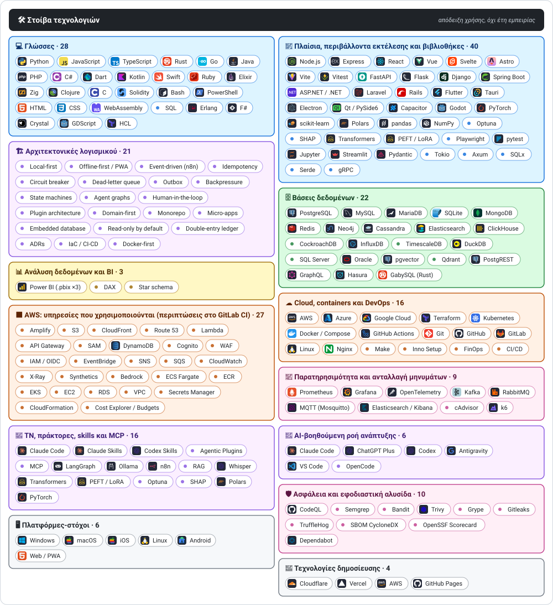
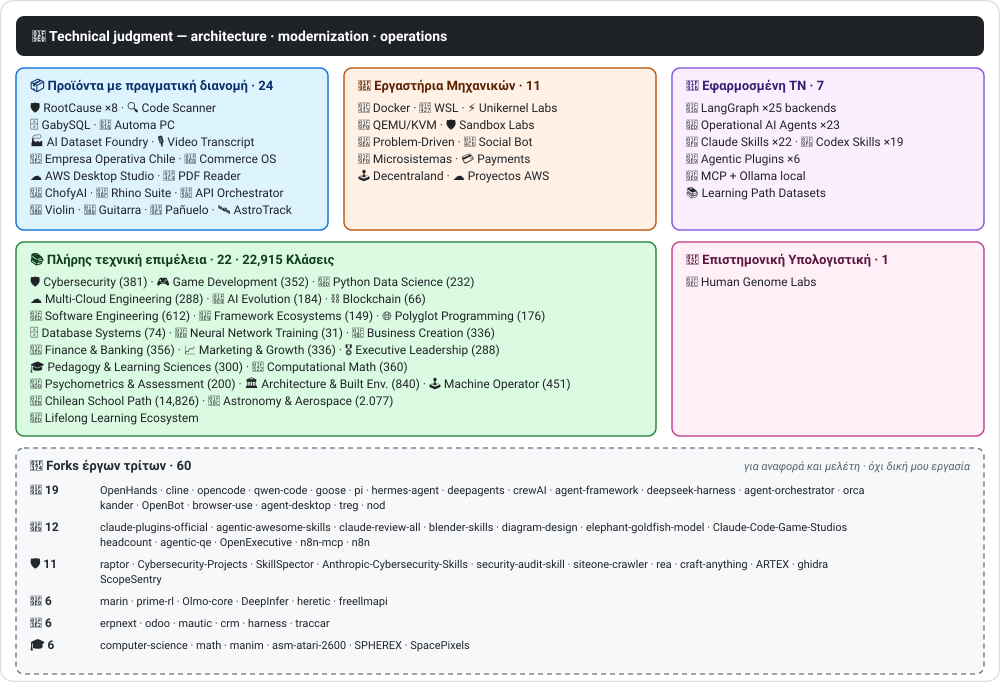

# 👋Βλαντίμιρ Ακούνια

## **Μηχανικός Τεχνητής Νοημοσύνης·Αρχιτέκτονας Λύσης·Ανώτερος πλήρης στοίβα·Ψηφιακή Μεταμόρφωση·Διαχείριση & Λειτουργίες**

**Επαγγελματικά εκπαιδευμένο στην Επιστήμη Υπολογιστών και στην Μηχανική Υπολογιστών και Διοίκηση Επιχειρήσεων, με 16+ χρόνια κατασκευής και λειτουργικού λογισμικού σε πραγματικά περιβάλλοντα. Συνδέω τις επιχειρήσεις, τους ανθρώπους, τις διαδικασίες και την τεχνολογία με το σχεδιασμό, την αξιολόγηση, την παροχή και τη διατήρηση λύσεων με τεχνική κρίση και μια επιχειρησιακή άποψη — που υποστηρίζεται από επαληθεύσιμα στοιχεία σε αυτόν τον λογαριασμό GitHub.**

<!-- STATS:START -->

<!-- STATS:END -->

[🧭 Από πού να ξεκινήσετε](docs/START_HERE.el.md) ·
[🌐 Portfolio (22 languages)](https://vladimiracunadev-create.github.io/) ·
[🧩 Ecosystem](#ecosystem-σε-μια-λάμψη) ·
[🛠️ Στοίβα τεχνολογιών](#-στοίβα-τεχνολογιών) ·
[⚡ Evaluate me in 10 minutes](docs/guides/TECH_LEAD.el.md) ·
[✅ Professional scope](#επαγγελματικό-πεδίο-εφαρμογής) ·
[🧭 Non-coding management](#διαχείριση-διοίκηση-και-μη-κωδικοποίηση-ευκαιρίες-καριέρας) ·
[📋 Μήτρα θέσεων](PROFESIONAL_ROLES.el.md) ·
[📬 Contact](#επαφή)

**🌐 Πλήρεις εκδόσεις:** [Español](README.md) · [English](README.en.md) · [Português](README.pt.md) · [Italiano](README.it.md) · [Français](README.fr.md) · [简体中文](README.zh.md) · [繁體中文](README.zh-TW.md) · [日本語](README.ja.md) · [한국어](README.ko.md) · [Türkçe](README.tr.md) · [Русский](README.ru.md) · [Tiếng Việt](README.vi.md) · [ไทย](README.th.md) · [Deutsch](README.de.md) · [Українська](README.uk.md) · [Polski](README.pl.md) · [العربية](README.ar.md) · [فارسی](README.fa.md) · [Bahasa Indonesia](README.id.md) · [Nederlands](README.nl.md) · [हिन्दी](README.hi.md) · [Ελληνικά](README.el.md)

**Τεχνικός πυρήνας:**
PHP 8 · Python · Rust · Go · Node/TS · Java 21 · .NET 8 · Dart/Flutter · WASM
· AWS · Terraform · Kubernetes · Docker · n8n · LangGraph/MCP · CI/CD · FinOps · Observability

**Γέφυρα «επιχειρησιακής τεχνολογίας»:**
ανάλυση διεργασιών και απαιτήσεων·αξιολόγηση λύσης·συντονισμός παράδοσης·πράξεις και συνέχεια·διαχείριση κινδύνων·προϊόν και υπηρεσία·τεχνική εκπαίδευση

---

> [!NOTE]
> Αυτό το προφίλ δεν μετατρέπει τις ευκαιρίες σε εμπειρία. Διαχωρίζονται ρητά οι αποδεδειγμένες τεχνικές εμπειρίες, οι μεταβιβάσιμες δεξιότητες, οι βιώσιμες εφαρμογές και οι μελλοντικοί αναπτυξιακοί στόχοι. Τα στοιχεία του Linked GitHub είναι εκτελέσιμα ή ντοκιμαντέρ, όπου κάτι είναι**όχι**Τελειωμένο, δηλώνεται ως τέτοιο.

## 🧭 Από πού να ξεκινήσετε

Επιλέξτε την περίπτωσή σας και πηγαίνετε κατευθείαν σε ό,τι χρειάζεστε:

🧑‍💼 [Πρόσληψη](docs/guides/RECRUITER.el.md) · 💼 [Πελάτης ή freelance](docs/guides/FREELANCE.el.md) · 🛠️ [Τεχνική αξιολόγηση](docs/guides/TECH_LEAD.el.md) · 🏢 [Επιχείρηση και διοίκηση](docs/guides/BUSINESS.el.md) · 🤝 [Συνεργασία και ασφάλεια](docs/guides/COLLABORATOR.el.md) · 🎓 [Μάθηση ή διδασκαλία](docs/guides/LEARNER.el.md)

## 🎯Τι θα Βρείτε Εδώ

Αυτό δεν είναι “μια repo”: είναι ένα οικοσύστημα με κοινά πρότυπα.

- 🔁 **Αναπαραγωγικά demos**— κλώνος, τρέχα, επικυρώσε.
- 🧰 **Τυποποιημένη εργαλειοθέτηση**— Makefiles, Hub CLI,`doctor`, και`smoke`ανά χώρο αποθήκευσης.
- 🛡️ **Άμυνα σε βάθος**— μυστική σάρωση, πολιτικές και ρητά απαγορευμένες πρακτικές.
- 📈 **Παρατηρησιμότητα** — `/health`, `/ready`, `/metrics`, ταμπλό και ιχνηλασιμότητα.
- 📚 **Τεκμηρίωση για το κοινό**— στρατολογητή, αρχάριο, DevOps ή ασφάλεια, ανάλογα με το χώρο αποθήκευσης.
- 📦 **Κατανομή προϊόντων**— τις εκδόσεις, τα ληφθέντα έγγραφα και τα αποδεικτικά στοιχεία,
- 🌍 **Διεθνοποίηση** — αυτό το προφίλ δημοσιεύεται σε 22 γλώσσες και το χαρτοφυλάκιο προσφέρει 154 δημόσια PDF (7 οικογένειες × 22 γλώσσες) (ES · EN · PT · IT · FR · ZH · ZH-TW · JA · KO · TR · RU · VI · TH · DE · UK · PL · AR · FA · ID · NL · HI · EL).
- 🧭 **Τεχνική ειλικρίνεια**— κάθε περίπτωση με ετικέτα`OPERATIONAL`, `DOCUMENTED/SCAFFOLD`, ή`PLANNED`.

## ✅Επαληθευμένη κατάσταση

| Επιφάνεια | Συγκεκριμένα αποδεικτικά στοιχεία |
|---|---|
| 🧪 **Κάλυψη δοκιμής** | GabySQL (Γαβριέλλα)**850 δοκιμές**+ fuzzing over (στα Αγγλικά)**503.8M ερωτήματα**(0 πανικό)·Εμπρέσα Operativa Χιλή**230 δοκιμές** ·Αυτόματο**150 pytest (πυόδοντας)** ·CI πολλών OS |
| 🤖 **Παράγωγα** | Πραγματικό κόσμο LangGraph**Λειτουργικά συστήματα υποστήριξης 25/25**(περιπτώσεις 01-25, κάλυψη 100%)·Επιχειρησιακοί πράκτορες AI**23 παράγοντες**με**69 ντετερμινιστικές εκτιμήσεις** |
| 🔗 **Ενσωμάτωση πολυσφαιρίου** | **20 περιπτώσεις**αποστολέας →n8n→ παραλήπτης —**19 επιχειρησιακά**, ατομικά ελεγμένο με Docker—· **18+ κινητήρες DB** · **20+ δοχεία** ·11 μοτίβα |
| 📦 **Κατανομή** | **166 εκδόσεις**σε ένα οικοσύστημα**68 δημόσια αρχεία καταγραφής ιδιοκτησίας** ·εγκαταστάτες και τεχνουργήματα`.exe` · `.msi` · `.dmg` · `.apk`με τα ληξιαρχικά και αποδεικτικά στοιχεία· εμπορικές/αποθήκες υπογραφές σε εξέλιξη, όπου απαιτείται |
| 🛡️ **Εφοδιαστική αλυσίδα** | ΚωδικόςQL·Σεμγκρέπ·Ληστής·Τριβάκι·Γρύπα·Γκιτλακά·Τροφός·ΚυκλώναςDX SBOM·Κάρτα βαθμολογίας |
| 📚 **Κουρκουμά** | **22.915 κατηγορίες**επαληθεύσιμο σε 22 προγράμματα, με βάση[a workflow](.github/workflows/stats.yml)από πραγματική δομή αποθετηρίου ή επαληθεύσιμη πηγή που δηλώνεται στο αποθετήριο —μη γραμμένη με το χέρι—·κάθε πρόγραμμα δηλώνει την συντακτική του κατάσταση και τους περιορισμούς του |
| 🌐 **Χαρτοφυλάκιο** | Εγκαταστατέα PWA· **22 γλώσσες** · **154 PDFs**παραγόμενη από αγωγό·CV Data API·Πυκνωτής Android·Φάρος 100 |
| 🔒 **Τηλεμετρία** | Μηδενική τηλεμετρία σε εγκληματολογικά προϊόντα και Empresa Operativa Χιλή — επαληθεύεται σε κάθε κατασκευή (όχι Android`INTERNET`άδεια) |
| 🌐 **Δημοσιευμένοι ιστότοποι** | **57 GitHub Σελίδες ιστοσελίδες**—56 εκφορτώσεις, μία ανά προϊόν, πρόγραμμα ή οικοσύστημα, συν το χαρτοφυλάκιο— καθεμία από τις οποίες έχει αναπτυχθεί από το δικό της αποθετήριο·και τα 57 επαληθεύτηκαν με HTTP`200` |

## 🛠️ Στοίβα τεχνολογιών

Τεχνολογίες που εντοπίστηκαν στα δημόσια αποθετήρια (manifests, εξαρτήσεις, containers και κώδικας), ομαδοποιημένες ανά τομέα. Η εμφάνιση σε ένα αποθετήριο —συμπεριλαμβανομένων εργαστηρίων και προγραμμάτων σπουδών— αποτελεί ένδειξη χρήσης, όχι δήλωση ετών εμπειρίας παραγωγής.

👉 **[Από πού προέρχεται το τεχνολογικό stack](docs/STACK_SOURCES.el.md)**

**Αρχιτεκτονικές λογισμικού**

Local-first → [empresa-operativa-chile](https://github.com/vladimiracunadev-create/empresa-operativa-chile), [ai-dataset-foundry](https://github.com/vladimiracunadev-create/ai-dataset-foundry) · Event-driven → [social-bot-scheduler](https://github.com/vladimiracunadev-create/social-bot-scheduler) · Resilience → [problem-driven-systems-lab](https://github.com/vladimiracunadev-create/problem-driven-systems-lab) · Ledger → [universal-payments-engineering-lab](https://github.com/vladimiracunadev-create/universal-payments-engineering-lab) · Plugins → [agentic-plugins-toolkit](https://github.com/vladimiracunadev-create/agentic-plugins-toolkit) · Agents → [langgraph-realworld](https://github.com/vladimiracunadev-create/langgraph-realworld), [operational-ai-agents](https://github.com/vladimiracunadev-create/operational-ai-agents) · Domain-first → [rhino-suite](https://github.com/vladimiracunadev-create/rhino-suite) · Micro-apps → [microsistemas](https://github.com/vladimiracunadev-create/microsistemas) · Embedded DB → [gabysql](https://github.com/vladimiracunadev-create/gabysql) · IaC → [proyectos-aws](https://github.com/vladimiracunadev-create/proyectos-aws)

**Ανάλυση δεδομένων και BI**

Power BI (.pbix ×3) · DAX · Star schema → [social-bot-scheduler](https://github.com/vladimiracunadev-create/social-bot-scheduler)

**AWS: υπηρεσίες που χρησιμοποιούνται (περιπτώσεις στο GitLab CI)**

Περιπτώσεις A–P → [proyectos-aws-gitlab](https://gitlab.com/vladimir.acuna.dev-group/proyectos-aws-gitlab) (GitLab CI → AWS; και οι 16 δηλωμένες ως ολοκληρωμένες· η περίπτωση M μόνο η φάση 1) · [proyectos-aws](https://github.com/vladimiracunadev-create/proyectos-aws) (GitHub Actions) · EC2, RDS, VPC, Secrets Manager, CloudFormation, Cost Explorer → [aws-desktop-studio](https://github.com/vladimiracunadev-create/aws-desktop-studio) (πραγματικά ερωτήματα απογραφής· EC2 με εκκίνηση, διακοπή και επανεκκίνηση υπό διπλό έλεγχο)

**AI-βοηθούμενη ροή ανάπτυξης**

| Εργαλείο | Κύρια χρήση |
|---|---|
| **Κωδικός Claude** | Αρχιτεκτονική επανεξέταση, εφαρμογή και τεχνική τεκμηρίωση |
| **ChatGPT Plus** | Ανάλυση, αρχιτεκτονική και επανάληψη (από 2023) |
| **Κώδικας** | Παραγωγή και αναπαράγοντα κωδικών |
| **Αντιβαρύτητα** | Επιτάχυνση των ροών ανάπτυξης και αυτοματοποίησης |
| **Κωδικός VS / OpenCode** | Περιβάλλον με ολοκληρωμένη βοήθεια ΤΠ |

> Συνδυάζω την τεχνική μου κρίση, την ανθρώπινη επικύρωση, και την αρχιτεκτονική κατεύθυνση. Η AI ενισχύει τη χωρητικότητα, την ταχύτητα και την πρόσβαση — δεν αντικαθιστά την εμπειρία.

**Τεχνολογίες δημοσίευσης**

Cloudflare (προσωπική εργασία) · Vercel (hackathon NASA Space Apps) · AWS (λειτουργικοί ιστότοποι, συνδεδεμένοι με το GitLab) · GitHub Pages

## 🗺️Ecosystem σε μια λάμψη

## 🗂️ Οικοσύστημα: προϊόντα, εργαστήρια, εφαρμοσμένη ΤΝ, προγράμματα σπουδών και επιστημονικοί υπολογισμοί

Το πρακτικό έργο του προφίλ βρίσκεται σε ξεχωριστό έγγραφο: λογισμικό που κατεβάζεται και εγκαθίσταται, εργαστήρια μηχανικής, εφαρμοσμένη ΤΝ, πλήρη τεχνικά προγράμματα σπουδών και επιστημονικοί υπολογισμοί, μαζί με την περιγραφή κάθε fork έργων τρίτων που υπάρχει στον λογαριασμό.

- 📦 [**Προϊόντα με πραγματική διανομή**](docs/ECOSYSTEM.el.md#products) (24)
- 🧪 [**Εργαστήρια Μηχανικών**](docs/ECOSYSTEM.el.md#labs) (11)
- 🤖 [**Εφαρμοσμένη ΤΝ**](docs/ECOSYSTEM.el.md#ai) (7)
- 📚 [**Πλήρης τεχνική επιμέλεια**](docs/ECOSYSTEM.el.md#curricula) (22)
- 🔬 [**Επιστημονική Υπολογιστική**](docs/ECOSYSTEM.el.md#science) (1)
- 🍴 [**Forks έργων τρίτων**](docs/ECOSYSTEM.el.md#forks) (60)

👉 **[Δείτε ολόκληρο το οικοσύστημα](docs/ECOSYSTEM.el.md)** · [🍴 Forks έργων τρίτων](docs/ECOSYSTEM.el.md#forks)

## 🛰️ Hackathon NASA Space Apps 2026

Συμμετείχα στο **NASA Space Apps Challenge 2026** (Σαντιάγο, 14–15 Νοεμβρίου), στην πρόκληση *Planet X and SPHEREx*, σε ομάδα 6 ατόμων. Το προϊόν είναι το **AstroTrack · SPHEREx**: ένας web viewer όπου πληκτρολογείς συντεταγμένες του ουρανού και βλέπεις την περιοχή ως ακολουθία εικόνων του SPHEREx στον χρόνο, με δεδομένα NASA/IPAC IRSA.

- **Το μερίδιό μου:** πρόσβαση σε δεδομένα (ερωτήματα IRSA με cache και προϋπολογισμένα πεδία του demo), πακετάρισμα (PWA, desktop installers με Tauri και Android APK με Capacitor), η προβολή «Λήψεις» και έλεγχος συνέπειας μεταξύ τεκμηρίωσης και κώδικα.
- **Επαληθεύσιμη παράδοση:** το [spherex-releases](https://github.com/vladimiracunadev-create/spherex-releases) συγκεντρώνει 7 εκδόσεις (v0.1.0 έως v0.4.2) με αθροίσματα SHA-256 · [web εφαρμογή](https://spherex-planet-x-tau.vercel.app/) · [αποθετήριο της ομάδας](https://github.com/mauriciovalenzuela742/SPHEREX).
- **Δηλωμένα όρια:** ο viewer, ο σχεδιασμός και το υπόλοιπο backend είναι δουλειά άλλων μελών της ομάδας· οι installers δεν είναι υπογεγραμμένοι και δεν δοκιμάστηκαν σε πραγματικές συσκευές· χρησιμοποίησα AI (Claude Code) ως βοηθό, όπως δηλώνεται στο αποθετήριο. Αυτό περιγράφει τη συνεισφορά μου, όχι αποτέλεσμα του hackathon.

## 🧠Πρότυπα που εφαρμόζω σε όλα τα αποθετήρια

- **DX πρώτα**— εάν δεν είναι εύκολο να τρέξει, δεν είναι χρήσιμο ως demo ή ως βάση ομάδας.
- **Παρατηρησιμότητα από την ημέρα 1**— μετρικές μετρήσεις και ανιχνευσιμότητα, όχι μια δεύτερη σκέψη.
- **Ασφάλεια ως αγωγός**— μυστική σάρωση, SBOM ανά απελευθέρωση, ρητά απαγορευμένες πρακτικές.
- **Πραγματική ανθεκτικότητα**— την ιδεότητα, τον διακόπτη κυκλώματος και την ελεγχόμενη αποδόμηση.
- **Πολυγλωττία από σχεδιασμό**— γλώσσα και μηχανή που επιλέγεται με τη χρήση της υπόθεσης, ποτέ με τη μόδα.
- **Ειλικρίνεια σχετικά με την κατάσταση**— μία νέα ονομασία μετονομάστηκε σε (`Multisimulador` → `machine-operator-program`) για να αποφευχθεί η ελπιδοφόρα λογισμικό που δεν υπάρχει ακόμα.
- **Τα σκοινιά είναι σήματα, όχι στοιχεία.**— κάθε συμφωνία επαναλήψεως δηλώνει επίσης**τι δεν κάνει**.
- **Υπόδειγμα προς τα έξω**— ο τομέας έχει σχεδιαστεί πρώτος· η διεπαφή είναι μια προβολή.
- **Οι εξωτερικές εργασίες δηλώνονται ως εξωτερικές** — τα [60 forks](docs/ECOSYSTEM.el.md#forks) έργων τρίτων περιγράφονται ένα προς ένα και μένουν εκτός όλων των αριθμών ιδίου έργου αυτού του προφίλ.

## ✅Επαγγελματικό πεδίο εφαρμογής

Το διπλό μου υπόβαθρο -**Επιστήμη Υπολογιστών και Μηχανική Υπολογιστών + Διοίκηση Επιχειρήσεων**— με βοηθά να μεταφράζω τους επιχειρηματικούς στόχους σε τεχνικές αποφάσεις και τεχνικούς περιορισμούς σε σαφείς επιλογές για τις επιχειρήσεις, το προϊόν, τους πελάτες και την ηγεσία.

### 🎯Ταυτότητα πυρήνα

| Ρόλος | Υποστήριγμα |
|---|---|
| **Αρχιτέκτονας Λύσης** | Σχεδίαση συστήματος με εξελικτική κρίση |
| **Αρχιτέκτονας Εκσυγχρονισμού Κληρονομιάς** | Πραγματική εξέλιξη κληρονομιάς (PHP 5.x→8.x, επαυξημένη αναπαράσταση χωρίς διακοπή των εργασιών) |
| **Ανώτερος πλήρης/τεχνικός μόλυβδος** | Αρχιτεκτονική, εκτέλεση και πρότυπα για πραγματικές πλατφόρμες (+16 χρόνια) |
| **Αρχιτέκτονας Αυτοματισμού της AI** | Συστήματα Agentic με LangGraph/MCP και n8n ροές με guardrails |

### ↗ Φυσική Επέκταση

**Μηχανικός Ενορχηστρώσεων AI** · **Συστήματα / Μηχανικός Rust** · **Κινητός μηχανικός (Flutter)** · **Λύσεις Μηχανικός** · **Κατασκευαστής τεχνικών προϊόντων** · **Τεχνικός εκπαιδευτής** · **Σύμβουλος Ψηφιακής Μεταμόρφωσης** · **Τεχνικός σύμβουλος (τεχνολογία, δεδομένα και AI)** · **Επιχειρηματικός / λειτουργικός αναλυτής** · **Τεχνικές εργασίες προϊόντων** · **AI Engineer (LLM / ML)** · **Data Engineer** · **DevSecOps / AppSec Engineer** · **QA Automation / Test Engineer** · **Technical Writer** · **Εκπαιδευτικός / Εισηγητής / Εκπαιδευτής τεχνολογίας** · **Instructional Designer (EdTech)** · **Technical Mentor**

### ⚙️Συμπληρωματικό πεδίο εφαρμογής

Μηχανικός πλατφόρμας / IDP·DevOps / CI-CD·Μηχανικός Cloud / AWS·Εφαρμογή SRE·Μηχανικός αυτοματισμού·Τεχνικός-εμπορικός σύμβουλος · Backend / API Engineer · Fintech / Payments Engineer · Developer Advocate / DevRel

## 🧭Διαχείριση, Διοίκηση και Μη Κωδικοποίηση Ευκαιρίες Καριέρας

Θέσεις διοίκησης, διαχείρισης και επιχειρηματικής δραστηριότητας όπου η πληροφορική και η διοίκηση συνεισφέρουν χωρίς ο προγραμματισμός να είναι το κεντρικό καθήκον, ταξινομημένες με ειλικρίνεια (μεταβιβάσιμη ικανότητα, δυνατότητα υποψηφιότητας ή μελλοντικός στόχος) και με το κενό καθεμιάς. Καλυπτόμενοι τομείς:

Ηγετικό ρόλο στην τεχνολογία · Διαχείριση του έργου · Διοίκηση επιχειρήσεων · Στρατηγική και αλλαγή · Ανάλυση επιχειρήσεων · Προϊόν και υπηρεσία · Διαχείριση της ασφάλειας στον κυβερνοχώρο · Εμπορικές και πωλήσεις · Δημοσιονομικός και διαχειριστικός έλεγχος · Ποιότητα · Εκπαίδευση · Διοικητικές υπηρεσίες και προμηθευτές · Δεδομένα και διακυβέρνηση της ΤΝ · Δημόσιος τομέας

👉 **[Δείτε τον πλήρη πίνακα ευκαιριών](docs/MANAGEMENT.el.md)**

## 📌Διαθεσιμότητα

**Άνοιγμα σε:**Ανώτερος πλήρης στοίβα·Αρχιτεκτονική·Εκσυγχρονισμός της κληρονομιάς·Πλατφόρμα/ΕΠΑ·Εφαρμογή SRE·ρεαλιστικά DevOps·Αυτοματοποίηση·Αυτοματισμός AI·ανάλυση επιχειρήσεων/λειτουργικών δραστηριοτήτων·Συντονισμός έργων ΤΠ·Πράξεις προϊόντων·ψηφιακός μετασχηματισμός·λύσεις που συμβουλεύονται/προπωλούνται·τεχνική εκπαίδευση·ποιότητα και συνεχής βελτίωση·Υιοθέτηση και διακυβέρνηση της ΤΠ

**Αξιολογείται σύμφωνα με το πεδίο εφαρμογής κάθε ρόλου:**Ιδιοκτήτης / τεχνικός διαχειριστής προϊόντων·Παράδοση υπηρεσιών·Λειτουργίες πληροφορικής·GRC / κίνδυνος τεχνολογίας·διοίκηση και επιχειρήσεις·έλεγχος διαχείρισης·τον εκσυγχρονισμό του δημόσιου τομέα. Οι τίτλοι εκτελεστικής και γενικής διαχείρισης είναι μελλοντικοί αναπτυξιακοί στόχοι, όχι η διεκδίκηση εμπειρίας.

**Modality:** remote or hybrid, depending on the project.

## 📬Επαφή

---

[🤝 Contribute](CONTRIBUTING.el.md) ·
[🛡️ Security](SECURITY.el.md) ·
[⚖️ Code of Conduct](CODE_OF_CONDUCT.el.md)

README συγχρονισμένο με την επαληθεύσιμη κατάσταση των δημόσιων αποθετηρίων —αριθμοί και αλλαγές διαβάζονται μέσω API— · τελευταία επαλήθευση: <!-- VERIFIED:START -->2026-11-24<!-- VERIFIED:END -->.

