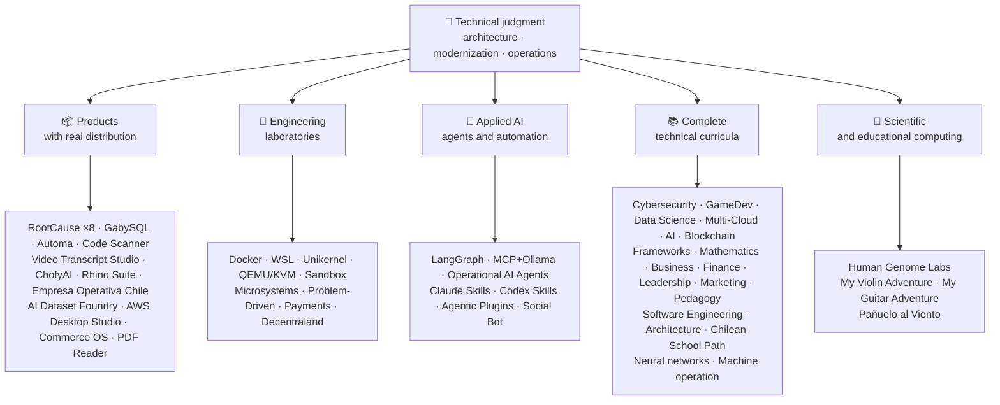

<div align="center">

# 👋 Vladimir Acuña

## **Solution Architect · Senior Full-Stack · Digital Transformation · Management & Operations**

**Professionally trained in Computer Science and Computing Engineering and Business Administration, with 16+ years building and operating software in real environments. I connect business, people, processes, and technology to design, evaluate, deliver, and sustain solutions with technical judgment and an operational view — backed by verifiable evidence in this GitHub account.**

[](https://vladimiracunadev-create.github.io/)
[](https://www.linkedin.com/in/vladimir-acu%C3%B1a-valdebenito-11924a29/)
[](mailto:vladimir.acuna.dev@gmail.com)

[](#-professional-scope)
[](docs/ECOSYSTEM.en.md)
[](#-complete-technical-curricula)

<!-- STATS:START -->
[](https://github.com/vladimiracunadev-create?tab=repositories)
[](https://github.com/vladimiracunadev-create?tab=repositories)
[](#-ecosystem-at-a-glance)
[](#-complete-technical-curricula)
[](https://github.com/vladimiracunadev-create?tab=repositories)
<!-- STATS:END -->

[](https://github.com/vladimiracunadev-create?tab=repositories)
[](https://github.com/vladimiracunadev-create?tab=followers)

[🌐 Portfolio (6 languages)](https://vladimiracunadev-create.github.io/) ·
[🧩 Ecosystem](#-ecosystem-at-a-glance) ·
[⚡ Evaluate me in 10 minutes](#-if-you-have-10-minutes-to-evaluate-me) ·
[✅ Professional scope](#-professional-scope) ·
[🧭 Non-coding management](#-management-administration-and-non-coding-career-opportunities) ·
[📋 Role matrix](PROFESIONAL_ROLES.md) ·
[📬 Contact](#-contact)

**🌐 Full versions:** [Español](README.md) · [English](README.en.md) · [Português](README.pt.md) · [Italiano](README.it.md) · [Français](README.fr.md) · [简体中文](README.zh.md) · [繁體中文](README.zh-TW.md) · [日本語](README.ja.md) · [한국어](README.ko.md) · [Türkçe](README.tr.md) · [Русский](README.ru.md) · [Tiếng Việt](README.vi.md) · [ไทย](README.th.md) · [Deutsch](README.de.md) · [Українська](README.uk.md) · [Polski](README.pl.md) · [العربية](README.ar.md) · [فارسی](README.fa.md) · [Bahasa Indonesia](README.id.md) · [Nederlands](README.nl.md) · [हिन्दी](README.hi.md) · [Ελληνικά](README.el.md)

**Technical core:**
PHP 8 · Python · Rust · Go · Node/TS · Java 21 · .NET 8 · Dart/Flutter · WASM
· AWS · Terraform · Kubernetes · Docker · n8n · LangGraph/MCP · CI/CD · FinOps · Observability

**Business–technology bridge:**
process and requirements analysis · solution evaluation · delivery coordination · operations and continuity · risk management · product and service · technical education

</div>

---

> [!NOTE]
> This profile does not turn opportunities into experience. Proven technical experience, transferable skills, viable applications, and future development goals are explicitly separated. Linked GitHub evidence is executable or documentary; where something is **not** finished, it is stated as such.

## 🎯 What You Will Find Here

This is not “one repo”: it is an ecosystem with shared standards.

- 🔁 **Reproducible demos** — clone, run, validate.
- 🧰 **Standardized tooling** — Makefiles, Hub CLI, `doctor`, and `smoke` per repository.
- 🛡️ **Defense in depth** — secret scanning, policies, and explicitly forbidden practices.
- 📈 **Observability** — `/health`, `/ready`, `/metrics`, dashboards, and traceability.
- 📚 **Audience-aware documentation** — recruiter, beginner, DevOps, or security, depending on the repository.
- 📦 **Product distribution** — downloadable releases, checksums, and build evidence; commercial/store signatures declared as pending when applicable.
- 🌍 **Internationalization** — portfolio in 6 languages (ES · EN · PT · IT · FR · ZH).
- 🧭 **Technical honesty** — every case labeled `OPERATIONAL`, `DOCUMENTED/SCAFFOLD`, or `PLANNED`.

## ✅ Verifiable Status

| Surface | Concrete evidence |
|---|---|
| 🧪 **Test coverage** | GabySQL **828 tests** + fuzzing over **503.8M queries** (0 panics) · Empresa Operativa Chile **158 tests** · Automa **150 pytest** · multi-OS CI |
| 🤖 **Production-grade agents** | LangGraph RealWorld **25/25 operational backends** (cases 01–25, 100% coverage) · Operational AI Agents **13 agents** with **39 deterministic evals** |
| 🔗 **Polyglot integration** | **20 cases** sender→n8n→receiver —**19 operational**, individually audited with Docker— · **18+ DB engines** · **20+ containers** · 11 patterns |
| 📦 **Distribution** | **151 releases** across an ecosystem of **64 owned public repositories** · installers and artifacts `.exe` · `.msi` · `.dmg` · `.apk` with checksums and build evidence; commercial/store signatures in progress where applicable |
| 🛡️ **Supply chain** | CodeQL · Semgrep · Bandit · Trivy · Grype · Gitleaks · TruffleHog · CycloneDX SBOM · Scorecard |
| 📚 **Curricula** | **14,530 classes** verifiable across 21 programs, counted by [a workflow](.github/workflows/stats.yml) from real repository structure or a verifiable source declared in the repository —not written by hand— · every program declares its editorial status and limitations |
| 🌐 **Portfolio** | Installable PWA · **6 languages** · **36 PDFs** generated by pipeline · CV Data API · Capacitor Android · Lighthouse 100 |
| 🔒 **Telemetry** | Zero telemetry in forensic products and Empresa Operativa Chile — verified in every build (no Android `INTERNET` permission) |
| 🌐 **Published sites** | **56 GitHub Pages sites** —55 landings, one per product, program, or ecosystem navigator, plus the portfolio— each deployed from its own repository · all 56 verified with HTTP `200` |

## 🗺️ Ecosystem At A Glance



## 🗂️ Ecosystem: products, labs, applied AI and scientific computing

The hands-on work of this profile lives in its own document: software you download and install, engineering labs, applied AI and scientific computing, plus a description of every fork of third-party projects kept in the account.

- 📦 **Products With Real Distribution** (22)
- 🧪 **Engineering Laboratories** (11)
- 🤖 **Applied AI** (6)
- 🔬 **Scientific Computing** (1)
- 🍴 **Forks of third-party projects** (52)

👉 **[See the full ecosystem](docs/ECOSYSTEM.en.md)** · [🍴 Forks of third-party projects](docs/ECOSYSTEM.en.md#forks)

## 📚 Complete Technical Curricula

Sequential programs in Spanish, with status and scope declared by each repository. The 21 programs add up to **14,530 classes**, counted by [a workflow](.github/workflows/stats.yml) from real repository structure or a verifiable source declared in the repository; the badge refreshes weekly and is not written by hand.

🧭 [**Lifelong Learning Ecosystem**](https://github.com/vladimiracunadev-create/lifelong-learning-ecosystem) is a federated compass connecting 30 real paths across 6 areas through visual maps and an [accessible offline portal](https://vladimiracunadev-create.github.io/lifelong-learning-ecosystem/); it is not counted as an additional program.

| Program | Classes | Scope |
|---|---:|---|
| [🔢 **Computational Mathematics**](https://github.com/vladimiracunadev-create/computational-mathematics-program) | 360 | From counting on fingers to reproducing a paper · **360 deterministic demonstrations verified in CI** · 1,080 notebooks · 489-term glossary · [site](https://vladimiracunadev-create.github.io/computational-mathematics-program/) |
| [🏦 **Finance and Banking**](https://github.com/vladimiracunadev-create/finance-and-banking-evolution-program) | 356 | 534 h · financial mathematics and IFRS → credit, risk, Basel III, open finance, DLT, stablecoins, and MiCA · **27 cases** · **298 tests** · [site](https://vladimiracunadev-create.github.io/finance-and-banking-evolution-program/) |
| [🎮 **GameDev**](https://github.com/vladimiracunadev-create/modern-gamedev-program) | 352 | Mathematics and C#/C++/GDScript → shaders, AI, multiplayer, VR/AR · Godot · Unity · Unreal · **10 Godot labs verified in CI** (301 checks) · [site](https://vladimiracunadev-create.github.io/modern-gamedev-program/) |
| [🛡️ **Cybersecurity**](https://github.com/vladimiracunadev-create/modern-cybersecurity-program) | 360 | **v1.3.0** · 20 parts · foundations → Red Team, DFIR, cloud security, exploit dev, CTF, and game security · mapped to **7 certifications** · offline Android/web app · PDF manual · CI, Security, and Pages verified · [site](https://vladimiracunadev-create.github.io/modern-cybersecurity-program/) |
| [📈 **Marketing, Sales, and Growth**](https://github.com/vladimiracunadev-create/marketing-sales-growth-evolution-program) | 336 | 24 parts with operational definitions, measurement sheets, verifiable bibliography, and Chilean regulatory context · **v1.6.0** · 1.29M words · 17 role-based paths · [site](https://vladimiracunadev-create.github.io/marketing-sales-growth-evolution-program/) |
| [🏢 **Business Creation**](https://github.com/vladimiracunadev-create/modern-business-creation-program) | 336 | Create and operate a real company in Chile: from idea to incorporation, tax authority, operations, crisis, and exit · 360 diagrams · 1,251-term glossary · 1,548-page manual · [site](https://vladimiracunadev-create.github.io/modern-business-creation-program/) |
| [🏛️ **Architecture and Built Environment**](https://github.com/vladimiracunadev-create/architecture-built-environment-learning-program) | 830 | 83 parts · 60 integrative sessions · 34 paths · traceable sources · Markdown, offline reader, and GitHub Pages · [site](https://vladimiracunadev-create.github.io/architecture-built-environment-learning-program/) |
| [🇨🇱 **Chilean School Learning Path**](https://github.com/vladimiracunadev-create/chilean-school-learning-path) | 8,841 | Grades 1–12 · **4,156 integrated cross-curricular experiences** · **2,823 learning objectives** · MINEDUC sources · no pending proposals and specialized human review still pending · [site](https://vladimiracunadev-create.github.io/chilean-school-learning-path/) |
| [🧭 **Modern Software Engineering**](https://github.com/vladimiracunadev-create/modern-software-engineering-program) | 480 | 40 parts and 8 stages · foundations → product, architecture, security, DevOps, SRE, SPEC, AI, and multi-agent systems · editorial status declared by the repository · [site](https://vladimiracunadev-create.github.io/modern-software-engineering-program/) |
| [🎓 **Pedagogy and Learning Sciences**](https://github.com/vladimiracunadev-create/education-pedagogy-learning-sciences-program) | 300 | From how a person learns to how teachers are trained · 25 parts · **each class declares its evidence state and limits** · early literacy, comparative methods, specific educational needs, coexistence, cultural diversity, and international evidence · 1,097-term glossary, 325 diagrams, and a 60-activity classroom bank · 14 career paths by role · LMS-exportable · **v2.1.0** · [site](https://vladimiracunadev-create.github.io/education-pedagogy-learning-sciences-program/) |
| [☁️ **Multi-Cloud**](https://github.com/vladimiracunadev-create/multi-cloud-engineering-program) | 288 | AWS · Azure · GCP · Kubernetes · Terraform · SRE · FinOps · **1,288 hours** · 288 labs with JSON evidence · 1,032 traced sources · 2,884-page PDF manual · [site](https://vladimiracunadev-create.github.io/multi-cloud-engineering-program/) |
| [🎖️ **Executive Leadership**](https://github.com/vladimiracunadev-create/executive-leadership-founder-program) | 288 | From owning your first outcome to leading a company and founding your own: teams, KPI/OKR, finance, product, risk, board, and M&A · 24 cases, 96 labs, and 39 templates · [site](https://vladimiracunadev-create.github.io/executive-leadership-founder-program/) |
| [🐍 **Python Data Science**](https://github.com/vladimiracunadev-create/python-data-science-program) | 232 | Polars, ML+Optuna/SHAP, PyTorch/LLMs/LoRA, MLOps · native Windows app + Android APK · [site](https://vladimiracunadev-create.github.io/python-data-science-program/) |
| [🧠 **AI Evolution**](https://github.com/vladimiracunadev-create/artificial-intelligence-evolution-program) | 184 | Symbolic → probabilistic → deep learning → LLMs, RAG, agents, safety, and frontier · **v0.17.0** · **708 notebooks** · **148 foundational papers** · offline Windows, Android, and PWA apps · [site](https://vladimiracunadev-create.github.io/artificial-intelligence-evolution-program/) |
| [🌐 **Comparative Programming**](https://github.com/vladimiracunadev-create/polyglot-programming-labs) | 176 | One concept, **10 languages** verified in CI — **1,360 implementations** — plus **1,632 programs** in still-living languages (COBOL, Fortran, Ada, RPG, MUMPS…) and an atlas of **60 cards in 15 families** · v1.1.0 · [site](https://vladimiracunadev-create.github.io/polyglot-programming-labs/) |
| [🧩 **Frameworks Compared**](https://github.com/vladimiracunadev-create/framework-ecosystems-labs) | 149 | One executable contract, without adapters, against Express, FastAPI, Spring Boot, ASP.NET, Django, Rails, Laravel, React, Vue, Svelte, and more · 12 parts · **70 built classes** · **397 cases verified in CI** · **210 ISBN/DOI sources** · [site](https://vladimiracunadev-create.github.io/framework-ecosystems-labs/) |
| [🗄️ **Databases**](https://github.com/vladimiracunadev-create/database-systems-labs) | 74 | **v3.0.0** · database engineering in 15 parts · 230 hours · **the verifiable source for every claim**: 120 sources with ISBN, DOI, or standard · same case solved in 27 engines · 306-term glossary · 150 pytest · [site](https://vladimiracunadev-create.github.io/database-systems-labs/) |
| [📐 **Psychometrics and Assessment**](https://github.com/vladimiracunadev-create/psychometrics-and-assessment-program) | 40 | How a measurement instrument is built, scored, validated, and audited · 8 parts · executable engine with **5 instruments and 344 items, 276 public-domain** |
| [⛓️ **Blockchain**](https://github.com/vladimiracunadev-create/blockchain-learning-path) | 66 | **v0.14.0** · from zero to programmable financial infrastructure and on-chain analytics · **91 practices** and **363 tests** · contracts with Foundry (fuzzing and invariants) and Slither static analysis in CI · offline apps verified by opening the binary and counting its contents · [site](https://vladimiracunadev-create.github.io/blockchain-learning-path/) |
| [🧠 **Neural Network Training Labs**](https://github.com/vladimiracunadev-create/neural-network-training-labs) | 31 | 7 modules · ≈214 hours · **93 notebooks** —31 classes, 31 student versions, and 31 solutions— · questions, visual maps, practices, and assessment with real public data · PyTorch · [study site](https://vladimiracunadev-create.github.io/neural-network-training-labs/) |
| [🕹️ **Machine Operator**](https://github.com/vladimiracunadev-create/machine-operator-program) | 451 | **41 training modules**, one per machine · **502 h 15 min** · systems, controls, physics, safety, and simulation design with sources per class · *no executable simulator yet, and it is declared that way* |

## ⚡ If You Have 10 Minutes To Evaluate Me

The idea is not just to look at code: it is to see **how I think**, how I document, and how I make everything executable.

**Route A — Real observability and orchestration** *(my favorite)*

```bash
git clone https://github.com/vladimiracunadev-create/social-bot-scheduler.git
```

You will see workflows, metrics, dashboards, and guardrails across 19 cases and 18+ DB engines.

**Route B — Reproducible infrastructure in minutes**

```bash
git clone https://github.com/vladimiracunadev-create/docker-labs.git
```

**Route C — Agents with typed state**

```bash
git clone https://github.com/vladimiracunadev-create/langgraph-realworld.git
```

**Route D — Rust forensic product, without cloning**

Download the installer or CLI binary from [RootCause releases](https://github.com/vladimiracunadev-create/rootcause-windows-inspector/releases) and verify `SHA256SUMS`.

## 🧠 Standards I Apply Across Repositories

- **DX first** — if it is not easy to run, it is not useful as a demo or as a team base.
- **Observability from day 1** — metrics and traceability, not an afterthought.
- **Security as pipeline** — secret scanning, SBOM per release, explicitly forbidden practices.
- **Real resilience** — idempotency, circuit breaker, and controlled degradation.
- **Polyglot by design** — language and engine chosen by use case, never by fashion.
- **Honesty about status** — one repo was renamed (`Multisimulador` → `machine-operator-program`) to avoid promising software that does not exist yet.
- **Badges are signals, not evidence** — each repo also declares **what it does NOT do**.
- **Model outward** — the domain is designed first; the interface is a projection.
- **External work is declared as external** — the [52 forks](docs/ECOSYSTEM.en.md#forks) of third-party projects are described one by one and stay out of every own-work figure in this profile.

## ✅ Professional Scope

My dual background —**Computer Science and Computing Engineering + Business Administration**— helps me translate business goals into technical decisions and technical constraints into clear options for operations, product, customers, and leadership.

### 🎯 Core Identity

| Role | Backing |
|---|---|
| **Solution Architect** | Modular, scalable system design with evolutionary judgment |
| **Legacy Modernization Architect** | Real legacy evolution (PHP 5.x→8.x, incremental refactoring without interrupting operations) |
| **Senior Full-Stack / Tech Lead** | Architecture, execution, and standards on real platforms (+16 years) |
| **AI Automation Architect** | Agentic systems with LangGraph/MCP and n8n flows with guardrails |

### ↗ Natural Expansion

**AI Orchestration Engineer** · **Systems / Rust Engineer** · **Mobile Engineer (Flutter)** · **Solutions Engineer** · **Technical Product Builder** · **Technical Trainer** · **Digital Transformation Consultant** · **Business / Functional Analyst** · **Technical Product Operations**

### ⚙️ Complementary Scope

Platform Engineer / IDP · DevOps / CI-CD · Cloud / AWS Engineer · Application SRE · Automation Engineer · Technical-commercial consultant

## 🧭 Management, Administration, and Non-Coding Career Opportunities

Management, administration and business roles where computing and administration contribute without programming being the central task, classified honestly (transferable skill, application possibility or future goal) with the gap for each. Areas covered:

Technology leadership · Project management · Business administration · Strategy and change · Business analysis · Product and service · Cybersecurity management · Commercial and sales · Finance and management control · Quality · Education · Logistics and suppliers · Data and AI governance · Public sector

👉 **[See the full opportunities matrix](docs/MANAGEMENT.en.md)**

## 🤖 AI-Assisted Development Flow

| Tool | Main use |
|---|---|
| **Claude Code** | Architectural review, implementation, and technical documentation |
| **ChatGPT Plus** | Analysis, architecture, and iteration (since 2023) |
| **Codex** | Code generation and refactoring |
| **Antigravity** | Acceleration of development and automation flows |
| **VS Code / OpenCode** | Environments with integrated AI assistance |

> I combine my own technical judgment, human validation, and architectural direction. AI amplifies capacity, speed, and reach — it does not replace experience.

## 📌 Availability

**Open to:** Senior Full-Stack · Architecture · Legacy modernization · Platform/IDP · Application SRE · pragmatic DevOps · Automation · AI Automation · business/functional analysis · IT project coordination · Product Operations · digital transformation · solutions consulting/presales · technical education · quality and continuous improvement · AI adoption and governance

**Evaluated according to each role’s scope:** Product Owner / technical Product Manager · Service Delivery · IT Operations · GRC / technology risk · administration and operations · management control · public-sector modernization. Executive and general-management titles are future development goals, not claimed experience.

**Modality:** remote or hybrid, depending on the project.

## 📬 Contact

[](https://vladimiracunadev-create.github.io/)
[](https://www.linkedin.com/in/vladimir-acu%C3%B1a-valdebenito-11924a29/)
[](https://gitlab.com/vladimir.acuna.dev-group/vladimir.acuna.dev-group)
[](mailto:vladimir.acuna.dev@gmail.com)

---

<div align="center">

[🤝 Contribute](CONTRIBUTING.en.md) ·
[🛡️ Security](SECURITY.en.md) ·
[⚖️ Code of Conduct](CODE_OF_CONDUCT.en.md)

<sub>README synchronized with the verifiable state of the public repositories —figures and changes read through the API— · last verification: October 12, 2026.</sub>

</div>
