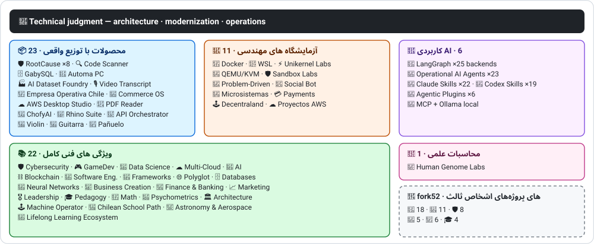

<div align="center" dir="rtl">

# 👋ولادیمیر آیسینا

## **مهندس هوش مصنوعی·راه حل معماری·پیر Full-Stack·تحول دیجیتال·مدیریت و عملیات**

**حرفه ای در علوم کامپیوتر و مهندسی محاسبات و مدیریت کسب و کار آموزش دیده است، با 16 سال ساخت و ساز و نرم افزار عملیاتی در محیط های واقعی. من کسب و کار، افراد، فرآیندها و تکنولوژی را به طراحی، ارزیابی، تحویل و حفظ راه حل با قضاوت فنی و یک دیدگاه عملیاتی متصل می کنم - با حمایت شواهد قابل راستی آزمایی در این حساب GitHub.**

[](https://vladimiracunadev-create.github.io/)
[](https://www.linkedin.com/in/vladimir-acu%C3%B1a-valdebenito-11924a29/)
[](mailto:vladimir.acuna.dev@gmail.com)

[](#حرفه-ای)
[](docs/ECOSYSTEM.fa.md)
[](#ویژگی-های-فنی-کامل)

<!-- STATS:START -->
[](https://github.com/vladimiracunadev-create?tab=repositories)
[](https://github.com/vladimiracunadev-create?tab=repositories)
[](#سیستم-در-یک-نگاه)
[](#ویژگی-های-فنی-کامل)
[](https://github.com/vladimiracunadev-create?tab=repositories)
[](docs/ECOSYSTEM.fa.md#forks)
[](https://github.com/vladimiracunadev-create?tab=repositories)
[](https://github.com/pulls?q=author%3Avladimiracunadev-create+type%3Apr)
[](https://github.com/issues?q=author%3Avladimiracunadev-create+type%3Aissue)
<!-- STATS:END -->

[](https://github.com/vladimiracunadev-create?tab=repositories)
[](https://github.com/vladimiracunadev-create?tab=followers)

[🧭 از کجا شروع کنیم](docs/START_HERE.fa.md) ·
[🌐 Portfolio (22 languages)](https://vladimiracunadev-create.github.io/) ·
[🧩 Ecosystem](#سیستم-در-یک-نگاه) ·
[🛠️ پشتهٔ فناوری](#-پشتهٔ-فناوری) ·
[⚡ Evaluate me in 10 minutes](#اگر-10-دقیقه-وقت-دارید-تا-من-را-ارزیابی-کنید) ·
[✅ Professional scope](#حرفه-ای) ·
[🧭 Non-coding management](#مدیریت-مدیریت-و-فرصت-های-شغلی-غیر-مشارکتی) ·
[📋 ماتریس مشاغل](PROFESIONAL_ROLES.fa.md) ·
[📬 Contact](#تماس)

**🌐 نسخه‌های کامل:** [Español](README.md) · [English](README.en.md) · [Português](README.pt.md) · [Italiano](README.it.md) · [Français](README.fr.md) · [简体中文](README.zh.md) · [繁體中文](README.zh-TW.md) · [日本語](README.ja.md) · [한국어](README.ko.md) · [Türkçe](README.tr.md) · [Русский](README.ru.md) · [Tiếng Việt](README.vi.md) · [ไทย](README.th.md) · [Deutsch](README.de.md) · [Українська](README.uk.md) · [Polski](README.pl.md) · [العربية](README.ar.md) · [فارسی](README.fa.md) · [Bahasa Indonesia](README.id.md) · [Nederlands](README.nl.md) · [हिन्दी](README.hi.md) · [Ελληνικά](README.el.md)

**هسته فنی:**
PHP 8 · Python · Rust · Go · Node/TS · Java 21 · .NET 8 · Dart/Flutter · WASM
· AWS · Terraform · Kubernetes · Docker · n8n · LangGraph/MCP · CI/CD · FinOps · Observability

**پل تجاری-تکنولوژی:**
فرآیند و تجزیه و تحلیل الزامات·ارزیابی راه حل·هماهنگی تحویل·عملیات و استمرار·مدیریت ریسک·محصول و خدمات·آموزش فنی

</div>

---

> [!NOTE]
> This profile does not turn opportunities into experience. Proven technical experience, transferable skills, viable applications, and future development goals are explicitly separated. Linked GitHub evidence is executable or documentary; where something is **not** finished, it is stated as such.

## 🧭 از کجا شروع کنیم

مورد خود را انتخاب کنید و مستقیم به مطلب موردنظر بروید:

🧑‍💼 [استخدام](docs/guides/RECRUITER.fa.md) · 💼 [کارفرما یا فریلنس](docs/guides/FREELANCE.fa.md) · 🛠️ [ارزیابی فنی](docs/guides/TECH_LEAD.fa.md) · 🏢 [کسب‌وکار و مدیریت](docs/guides/BUSINESS.fa.md) · 🤝 [همکاری و امنیت](docs/guides/COLLABORATOR.fa.md) · 🎓 [یادگیری یا آموزش](docs/guides/LEARNER.fa.md)

## 🎯آنچه در اینجا پیدا خواهید کرد

این یک «یک repo» نیست: این یک اکوسیستم با استانداردهای مشترک است.

- 🔁 **دانلود بازی Reroducible**- کلون، اجرا، اعتبار
- 🧰 **ابزار استاندارد سازی**فایل های Makefiles، Hub CLI`doctor`و`smoke`در هر مخزن
- 🛡️ **دفاع در عمق**اسکن مخفی، سیاست ها و شیوه های آشکارا ممنوع
- 📈 **قابلیت پذیری** — `/health`, `/ready`, `/metrics`, داشبورد و قابلیت ردیابی
- 📚 **آرشیو برچسب های مرتبط**- استخدام کننده، مبتدی، DevOps یا امنیت، بسته به مخزن.
- 📦 **توزیع محصول**- نسخه های قابل دانلود، چکه ها و ساخت شواهد؛ امضاهای تجاری / فروشگاه اعلام شده در صورت لزوم.
- 🌍 **Internationalization** — این پروفایل به ۲۲ زبان منتشر شده و نمونه‌کارها ۱۵۴ فایل PDF عمومی ارائه می‌دهد (۷ خانواده × ۲۲ زبان) (ES · EN · PT · IT · FR · ZH · ZH-TW · JA · KO · TR · RU · VI · TH · DE · UK · PL · AR · FA · ID · NL · HI · EL).
- 🧭 **صداقت فنی**هر پرونده ای که برچسب زده شود`OPERATIONAL`, `DOCUMENTED/SCAFFOLD`یا`PLANNED`.

## ✅وضعیت قابل تایید

| Surface | Concrete evidence |
|---|---|
| 🧪 **پوشش تست** | GabySQL**850 تست**+  fu**503.8M**(0 وحشت)·عملیات Empresa در شیلی**230 تست** ·Automa**150 pytest** ·CI چند بعدیOS CI |
| 🤖 **تولید کنندگان** | LangGraph RealWorld**25/25 بازگشت عملیاتی**(مورد های 01 تا 25، 100٪ پوشش)·بازیگران AI عملیاتی**23 عامل**با**69 معیاری برای evals** |
| 🔗 **Polyglot یکپارچگی** | **20 مورد**فرستنده:n8n**19 عملیات عملیاتی**به صورت جداگانه با Docker حسابرسی می شود.· **18+ موتورهای DB** · **20+** ·11 الگو |
| 📦 **Distribution** | **155 releases** across an ecosystem of **65 owned public repositories** · installers and artifacts `.exe` · `.msi` · `.dmg` · `.apk` with checksums and build evidence; commercial/store signatures in progress where applicable |
| 🛡️ **زنجیره تامین** | کدQL·Semgrep·Bandit·Trivy·Grype·گیتیکوس·تروفه ها·CycloneDX SBOM·کارت امتیاز |
| 📚 **Curricula** | **14550 کلاس**قابل تایید در 21 برنامه، شمارش شده توسط[a workflow](.github/workflows/stats.yml)از ساختار مخزن واقعی یا یک منبع قابل راستی که در مخزن اعلام شده است – که نه با دست نوشته شده است –·هر برنامه وضعیت و محدودیت های سرمقاله خود را اعلام می کند |
| 🌐 **نمونه کارها** | نصب PWA· **22 زبان** · **154 PDF**تولید شده توسط خط لوله·CV Data API·Android·فانوس دریایی 100 |
| 🔒 **تله** | عدم تقارن صفر در محصولات قانونی و عملکرد Empresa در هر ساخت (بدون Android)`INTERNET`اجازه) |
| 🌐 **سایت های منتشر شده** | **57 صفحه**56 فرود، یک محصول، برنامه یا هدایت کننده اکوسیستم، به علاوه نمونه کارها – هر کدام از مخزن خود را·همه 57 تایید شده با HTTP`200` |

## 🛠️ پشتهٔ فناوری

فناوری‌هایی که در مخزن‌های عمومی شناسایی شده‌اند (مانیفست‌ها، وابستگی‌ها، کانتینرها و کد) و بر اساس حوزه گروه‌بندی شده‌اند. حضور در یک مخزن —از جمله آزمایشگاه‌ها و برنامه‌های آموزشی— شواهدی از استفاده است، نه ادعای سال‌ها تجربهٔ عملیاتی.

**زبان‌ها**


<sub>Python · JavaScript · TypeScript · Rust · Go · Java · PHP · C# · Dart · Kotlin · Swift · Ruby · Elixir · Zig · Clojure · C · Solidity · Bash · PowerShell · HTML · CSS · WebAssembly · SQL · Erlang · F# · Crystal · GDScript · HCL</sub>

**چارچوب‌ها، محیط‌های اجرا و کتابخانه‌ها**


<sub>Node.js · Express · React · Vue · Svelte · Astro · Vite · Vitest · FastAPI · Flask · Django · Spring Boot · ASP.NET / .NET · Laravel · Rails · Flutter · Tauri · Electron · Qt / PySide6 · Capacitor · Godot · PyTorch · scikit-learn · Polars · pandas · NumPy · Optuna · SHAP · Transformers · PEFT / LoRA · Playwright · pytest · Jupyter · Streamlit · Pydantic · Tokio · Axum · SQLx · Serde</sub>

**معماری‌های نرم‌افزار**


-0969da?style=flat-square)


<sub>Local-first → [empresa-operativa-chile](https://github.com/vladimiracunadev-create/empresa-operativa-chile), [ai-dataset-foundry](https://github.com/vladimiracunadev-create/ai-dataset-foundry) · Event-driven → [social-bot-scheduler](https://github.com/vladimiracunadev-create/social-bot-scheduler) · Resilience → [problem-driven-systems-lab](https://github.com/vladimiracunadev-create/problem-driven-systems-lab) · Ledger → [universal-payments-engineering-lab](https://github.com/vladimiracunadev-create/universal-payments-engineering-lab) · Plugins → [agentic-plugins-toolkit](https://github.com/vladimiracunadev-create/agentic-plugins-toolkit) · Agents → [langgraph-realworld](https://github.com/vladimiracunadev-create/langgraph-realworld), [operational-ai-agents](https://github.com/vladimiracunadev-create/operational-ai-agents) · Domain-first → [rhino-suite](https://github.com/vladimiracunadev-create/rhino-suite) · Micro-apps → [microsistemas](https://github.com/vladimiracunadev-create/microsistemas) · Embedded DB → [gabysql](https://github.com/vladimiracunadev-create/gabysql) · IaC → [proyectos-aws](https://github.com/vladimiracunadev-create/proyectos-aws)</sub>

**پایگاه‌های داده**


<sub>PostgreSQL · MySQL · MariaDB · SQLite · MongoDB · Redis · Neo4j · Cassandra · Elasticsearch · ClickHouse · CockroachDB · InfluxDB · TimescaleDB · DuckDB · SQL Server · Oracle · pgvector · PostgREST · GraphQL · GabySQL (Rust)</sub>

**ابر، کانتینر و DevOps**


<sub>AWS · Terraform · Kubernetes · Docker / Compose · GitHub Actions · Git · GitHub · GitLab · Linux · Nginx · Make · Inno Setup · FinOps · CI/CD</sub>

**مشاهده‌پذیری و پیام‌رسانی**


<sub>Prometheus · Grafana · OpenTelemetry · Kafka · MQTT (Mosquitto) · Elasticsearch / Kibana · cAdvisor · k6</sub>

**هوش مصنوعی، عامل‌ها، مهارت‌ها و MCP**


<sub>Claude Code · Claude Skills · Codex Skills · Agentic Plugins · MCP · LangGraph · Ollama · n8n · RAG · Whisper · Transformers · PEFT / LoRA · Optuna · SHAP · Polars · PyTorch</sub>

**جریان توسعه AI-Assisted Development Flow**


| Tool | Main use |
|---|---|
| **کد کلود** | بررسی معماری، پیاده سازی و مستندات فنی |
| **ChatGPT Plus** | تجزیه و تحلیل، معماری و تکرار (از سال 2023) |
| **Codex** | تولید کد و بازسازی |
| **ضد جاذبه** | افزایش پیشرفت و جریان اتوماسیون |
| **VS Code / OpenCode** | محیط های با کمک AI یکپارچه |

> من قضاوت فنی خودم، اعتبار انسانی و جهت معماری را ترکیب می کنم. هوش مصنوعی ظرفیت، سرعت و دستیابی را تقویت می کند – جایگزین تجربه نمی شود.

**امنیت و زنجیرهٔ تأمین**


**پلتفرم‌های هدف**


<sub>Windows · macOS · iOS · Linux · Android · Web / PWA</sub>

## 🗺️سیستم در یک نگاه



## 🗂️ اکوسیستم: محصولات، آزمایشگاه‌ها، هوش مصنوعی کاربردی، برنامه‌های آموزشی و محاسبات علمی

کارهای عملی این پروفایل در سندی جداگانه آمده است: نرم‌افزارهایی که دانلود و نصب می‌شوند، آزمایشگاه‌های مهندسی، هوش مصنوعی کاربردی، برنامه‌های آموزشی فنی کامل و محاسبات علمی، به‌همراه توضیح هر fork از پروژه‌های اشخاص ثالث که در حساب وجود دارد.

- 📦 **محصولات با توزیع واقعی** (22)
- 🧪 **آزمایشگاه های مهندسی** (11)
- 🤖 **کاربردی AI** (6)
- 📚 **ویژگی های فنی کامل** (21)
- 🔬 **محاسبات علمی** (1)
- 🍴 **forkهای پروژه‌های اشخاص ثالث** (52)

👉 **[مشاهدهٔ کل اکوسیستم](docs/ECOSYSTEM.fa.md)** · [🍴 forkهای پروژه‌های اشخاص ثالث](docs/ECOSYSTEM.fa.md#forks)

## 📚ویژگی های فنی کامل

برنامه های اکتشافی در اسپانیایی، با وضعیت و محدوده اعلام شده توسط هر مخزن. 21 برنامه اضافه شده به**14550 کلاس**شمارش شده توسط[a workflow](.github/workflows/stats.yml)از ساختار مخزن واقعی یا یک منبع قابل راستی که در مخزن اعلام شده است؛ نشان هر هفته تازه می شود و توسط دست نوشته نمی شود.

🌌 **در حال برنامه‌ریزی، خارج از شمارش:** [نجوم، اخترفیزیک، علوم فضایی و مهندسی هوافضا](https://github.com/vladimiracunadev-create/astronomy-astrophysics-space-sciences-aerospace-engineering-learning-program) — ۲٬۰۷۷ درس برنامه‌ریزی‌شده در ۱۲ حوزه و ۱۳۳ بلوک؛ برای ۳۹۷ درس متن نوشته شده و همه هنوز در وضعیت E0 هستند. آموزش مستقل، نه مجوز حرفه‌ای · [سایت](https://vladimiracunadev-create.github.io/astronomy-astrophysics-space-sciences-aerospace-engineering-learning-program/).

👉 **[مشاهدهٔ هر ۲۱ برنامه](docs/ECOSYSTEM.fa.md#curricula)**

## ⚡اگر 10 دقیقه وقت دارید تا من را ارزیابی کنید

ایده فقط نگاه کردن به کد نیست: دیدن کد است.**چگونه فکر می کنم**چگونه سند می کنم و چگونه همه چیز را اجرا می کنم.

**مسیر A – قابلیت های واقعی و ارکستر**(من مورد علاقه ام)

```bash
git clone https://github.com/vladimiracunadev-create/social-bot-scheduler.git
```

شما گردش های کاری، معیارها، داشبورد ها و محافظ ها را در 20 مورد و 18 موتور DB مشاهده خواهید کرد.

**جاده B – زیرساخت های قابل بازیافت در دقیقه**

```bash
git clone https://github.com/vladimiracunadev-create/docker-labs.git
```

**مسیر C – نمایندگان با حالت تایپ**

```bash
git clone https://github.com/vladimiracunadev-create/langgraph-realworld.git
```

**مسیر D – محصول قانونی Rust بدون نظارت**

دانلود بازی The installer یا binary از[RootCause releases](https://github.com/vladimiracunadev-create/rootcause-windows-inspector/releases)و تایید`SHA256SUMS`.

## 🧠استانداردهایی که در سراسر مخازن اعمال می کنم

- **اولین DX**اگر اجرای آن آسان نباشد، به عنوان یک دموی یا به عنوان یک پایگاه تیمی مفید نیست.
- **قابلیت اطمینان از روز 1**- معیارها و قابلیت ردیابی، نه یک پس انداز.
- **امنیت به عنوان خط لوله**اسکن مخفی، SBOM در هر آزادی، به طور واضح ممنوع است.
- **انعطاف پذیری واقعی**– قابلیت تشخیص، شکستن مدار و تخریب کنترل شده
- **Polyglot با طراحی**زبان و موتور انتخاب شده توسط مورد استفاده، هرگز با مد.
- **صداقت در مورد وضعیت**یک بار تغییر نام داده شد (`Multisimulador` → `machine-operator-program`برای جلوگیری از نرم افزار امیدوار کننده که هنوز وجود ندارد.
- **نشانه ها هستند، نه شواهد**هر بار که دوباره اعلام می کند**آنچه که انجام نمی دهد**.
- **مدل خارجی**- دامنه ابتدا طراحی شده است؛ رابط یک پیش بینی است.
- **کار خارجی به عنوان خارجی اعلام می شود** — [52 fork](docs/ECOSYSTEM.fa.md#forks) پروژه‌های اشخاص ثالث یکی‌یکی توصیف می‌شوند و از همهٔ ارقام کارهای شخصی این پروفایل بیرون می‌مانند.

## ✅حرفه ای

پس زمینه دوگانه من -**مهندسی کامپیوتر و محاسبات + مدیریت کسب و کار**- به من کمک می کند تا اهداف کسب و کار را به تصمیمات فنی و محدودیت های فنی به گزینه های روشن برای عملیات، محصول، مشتریان و رهبری تبدیل کنم.

### 🎯هویت اصلی

| Role | Backing |
|---|---|
| **راه حل معماری** | طراحی سیستم های مقیاس پذیر با قضاوت تکاملی |
| **معماری مدرن سازی** | تکامل میراث واقعی (PHP 5.x) 8.x، بازسازی تدریجی بدون وقفه عملیات |
| **ارشد Full-Stack / Tech Lead** | معماری، اجرای و استانداردهای سیستم عامل های واقعی (+16 سال) |
| **معماری اتوماسیون AI** | سیستم های عامل با LangGraph /MCP و n8n با محافظان جریان می یابد |

### ↗ گسترش طبیعی

**مهندسی ارکستر AI** · **سیستم ها / مهندس Rust** · **مهندس موبایل (Flutter)** · **راه حل های مهندسی** · **سازنده محصول فنی** · **مربی فنی** · **مشاور تحول دیجیتال** · **Business / Applied Analysis** · **عملیات محصول فنی** · **AI Engineer (LLM / ML)** · **Data Engineer** · **DevSecOps / AppSec Engineer** · **QA Automation / Test Engineer** · **Technical Writer** · **مدرس / مربی / مربی فناوری** · **Instructional Designer (EdTech)** · **Technical Mentor**

### ⚙️محدوده های تکمیلی

مهندسی پلتفرم / IDP·DevOps / CI-CD·مهندسی Cloud / AWS·کاربرد SRE·مهندسی اتوماسیون·مشاور فنی تجاری · Backend / API Engineer · Fintech / Payments Engineer · Developer Advocate / DevRel

## 🧭مدیریت، مدیریت و فرصت های شغلی غیر مشارکتی

نقش‌های مدیریتی، اداری و کسب‌وکار که در آن‌ها دانش انفورماتیک و مدیریت بدون محوریت برنامه‌نویسی ارزش می‌آفریند؛ با طبقه‌بندی صادقانه (مهارت قابل انتقال، امکان درخواست شغل یا هدف آینده) و با شکاف هر کدام. حوزه‌های پوشش‌داده‌شده:

رهبری تکنولوژی · مدیریت پروژه · مدیریت کسب و کار · استراتژی و تغییر · تحلیل کسب و کار · محصول و خدمات · مدیریت امنیت سایبری · تجارت و فروش · مدیریت و مدیریت کنترل · Quality · Education · تدارکات و تامین کنندگان · داده ها و مدیریت AI · بخش عمومی

👉 **[مشاهدهٔ ماتریس کامل فرصت‌ها](docs/MANAGEMENT.fa.md)**

## 📌در دسترس بودن

**Open to:** Senior Full-Stack · Architecture · Legacy modernization · Platform/IDP · Application SRE · pragmatic DevOps · Automation · AI Automation · business/functional analysis · IT project coordination · Product Operations · digital transformation · solutions consulting/presales · technical education · quality and continuous improvement · AI adoption and governance

**ارزیابی با توجه به دامنه هر نقش:**مالک محصول / مدیر محصول فنی·خدمات تحویل·عملیات IT·خطر تکنولوژی GRC·مدیریت و عملیات·کنترل مدیریت·مدرن سازی بخش عمومی عناوین اجرایی و مدیریت عمومی اهداف توسعه آینده هستند، نه ادعا تجربه.

**تغییر:**از راه دور یا هیبریدی، بسته به پروژه.

## 📬تماس

[](https://vladimiracunadev-create.github.io/)
[](https://www.linkedin.com/in/vladimir-acu%C3%B1a-valdebenito-11924a29/)
[](https://gitlab.com/vladimir.acuna.dev-group/vladimir.acuna.dev-group)
[](mailto:vladimir.acuna.dev@gmail.com)

---

<div align="center">

[🤝 Contribute](CONTRIBUTING.fa.md) ·
[🛡️ Security](SECURITY.fa.md) ·
[⚖️ Code of Conduct](CODE_OF_CONDUCT.fa.md)

<sub>README با وضعیت قابل راستی‌آزمایی مخزن‌های عمومی همگام است —ارقام و تغییرات از طریق API خوانده می‌شوند— · آخرین بررسی: <!-- VERIFIED:START -->2026-11-09<!-- VERIFIED:END -->.</sub>

</div>
