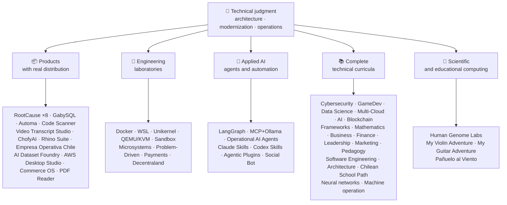

<div align="center" dir="rtl">

# 👋ولادیمیر آیسینا

## **راه حل معماری·پیر Full-Stack·تحول دیجیتال·مدیریت و عملیات**

**حرفه ای در علوم کامپیوتر و مهندسی محاسبات و مدیریت کسب و کار آموزش دیده است، با 16 سال ساخت و ساز و نرم افزار عملیاتی در محیط های واقعی. من کسب و کار، افراد، فرآیندها و تکنولوژی را به طراحی، ارزیابی، تحویل و حفظ راه حل با قضاوت فنی و یک دیدگاه عملیاتی متصل می کنم - با حمایت شواهد قابل راستی آزمایی در این حساب GitHub.**

[](https://vladimiracunadev-create.github.io/)
[](https://www.linkedin.com/in/vladimir-acu%C3%B1a-valdebenito-11924a29/)
[](mailto:vladimir.acuna.dev@gmail.com)

[](#حرفه-ای)
[](docs/ECOSYSTEM.fa.md)
[](#ویژگی-های-فنی-کامل)

<!-- STATS:START -->
[](https://github.com/vladimiracunadev-create?tab=repositories)
[](https://github.com/vladimiracunadev-create?tab=repositories)
[](#سیستم-در-یک-نگاه)
[](#ویژگی-های-فنی-کامل)
[](https://github.com/vladimiracunadev-create?tab=repositories)
<!-- STATS:END -->

[](https://github.com/vladimiracunadev-create?tab=repositories)
[](https://github.com/vladimiracunadev-create?tab=followers)

[🌐 Portfolio (6 languages)](https://vladimiracunadev-create.github.io/) ·
[🧩 Ecosystem](#سیستم-در-یک-نگاه) ·
[⚡ Evaluate me in 10 minutes](#اگر-10-دقیقه-وقت-دارید-تا-من-را-ارزیابی-کنید) ·
[✅ Professional scope](#حرفه-ای) ·
[🧭 Non-coding management](#مدیریت-مدیریت-و-فرصت-های-شغلی-غیر-مشارکتی) ·
[📋 Role matrix](PROFESIONAL_ROLES.md) ·
[📬 Contact](#تماس)

**🌐 نسخه‌های کامل:** [Español](README.md) · [English](README.en.md) · [Português](README.pt.md) · [Italiano](README.it.md) · [Français](README.fr.md) · [简体中文](README.zh.md) · [繁體中文](README.zh-TW.md) · [日本語](README.ja.md) · [한국어](README.ko.md) · [Türkçe](README.tr.md) · [Русский](README.ru.md) · [Tiếng Việt](README.vi.md) · [ไทย](README.th.md) · [Deutsch](README.de.md) · [Українська](README.uk.md) · [Polski](README.pl.md) · [العربية](README.ar.md) · [فارسی](README.fa.md) · [Bahasa Indonesia](README.id.md) · [Nederlands](README.nl.md) · [हिन्दी](README.hi.md) · [Ελληνικά](README.el.md)

**هسته فنی:**
PHP 8 · Python · Rust · Go · Node/TS · Java 21 · .NET 8 · Dart/Flutter · WASM
· AWS · Terraform · Kubernetes · Docker · n8n · LangGraph/MCP · CI/CD · FinOps · Observability

**پل تجاری-تکنولوژی:**
فرآیند و تجزیه و تحلیل الزامات·ارزیابی راه حل·هماهنگی تحویل·عملیات و استمرار·مدیریت ریسک·محصول و خدمات·آموزش فنی

</div>

---

> [!NOTE]
> This profile does not turn opportunities into experience. Proven technical experience, transferable skills, viable applications, and future development goals are explicitly separated. Linked GitHub evidence is executable or documentary; where something is **not** finished, it is stated as such.

## 🎯آنچه در اینجا پیدا خواهید کرد

این یک «یک repo» نیست: این یک اکوسیستم با استانداردهای مشترک است.

- 🔁 **دانلود بازی Reroducible**- کلون، اجرا، اعتبار
- 🧰 **ابزار استاندارد سازی**فایل های Makefiles، Hub CLI`doctor`و`smoke`در هر مخزن
- 🛡️ **دفاع در عمق**اسکن مخفی، سیاست ها و شیوه های آشکارا ممنوع
- 📈 **قابلیت پذیری** — `/health`, `/ready`, `/metrics`, داشبورد و قابلیت ردیابی
- 📚 **آرشیو برچسب های مرتبط**- استخدام کننده، مبتدی، DevOps یا امنیت، بسته به مخزن.
- 📦 **توزیع محصول**- نسخه های قابل دانلود، چکه ها و ساخت شواهد؛ امضاهای تجاری / فروشگاه اعلام شده در صورت لزوم.
- 🌍 **Internationalization** — portfolio in 6 languages (ES · EN · PT · IT · FR · ZH).
- 🧭 **صداقت فنی**هر پرونده ای که برچسب زده شود`OPERATIONAL`, `DOCUMENTED/SCAFFOLD`یا`PLANNED`.

## ✅وضعیت قابل تایید

| Surface | Concrete evidence |
|---|---|
| 🧪 **پوشش تست** | GabySQL**828 تست**+  fu**503.8M**(0 وحشت)·عملیات Empresa در شیلی**158 تست** ·Automa**150 pytest** ·CI چند بعدیOS CI |
| 🤖 **تولید کنندگان** | LangGraph RealWorld**25/25 بازگشت عملیاتی**(مورد های 01 تا 25، 100٪ پوشش)·بازیگران AI عملیاتی**13 عامل**با**39 معیاری برای evals** |
| 🔗 **Polyglot یکپارچگی** | **20 مورد**فرستنده:n8n**19 عملیات عملیاتی**به صورت جداگانه با Docker حسابرسی می شود.· **18+ موتورهای DB** · **20+** ·11 الگو |
| 📦 **Distribution** | **151 releases** across an ecosystem of **64 owned public repositories** · installers and artifacts `.exe` · `.msi` · `.dmg` · `.apk` with checksums and build evidence; commercial/store signatures in progress where applicable |
| 🛡️ **زنجیره تامین** | کدQL·Semgrep·Bandit·Trivy·Grype·گیتیکوس·تروفه ها·CycloneDX SBOM·کارت امتیاز |
| 📚 **Curricula** | **14530 کلاس**قابل تایید در 21 برنامه، شمارش شده توسط[a workflow](.github/workflows/stats.yml)از ساختار مخزن واقعی یا یک منبع قابل راستی که در مخزن اعلام شده است – که نه با دست نوشته شده است –·هر برنامه وضعیت و محدودیت های سرمقاله خود را اعلام می کند |
| 🌐 **نمونه کارها** | نصب PWA· **6 زبان** · **36 PDF**تولید شده توسط خط لوله·CV Data API·Android·فانوس دریایی 100 |
| 🔒 **تله** | عدم تقارن صفر در محصولات قانونی و عملکرد Empresa در هر ساخت (بدون Android)`INTERNET`اجازه) |
| 🌐 **سایت های منتشر شده** | **56 صفحه**55 فرود، یک محصول، برنامه یا هدایت کننده اکوسیستم، به علاوه نمونه کارها – هر کدام از مخزن خود را·همه 56 تایید شده با HTTP`200` |

## 🗺️سیستم در یک نگاه



## 🗂️ اکوسیستم: محصولات، آزمایشگاه‌ها، هوش مصنوعی کاربردی و محاسبات علمی

کارهای عملی این پروفایل در سندی جداگانه آمده است: نرم‌افزارهایی که دانلود و نصب می‌شوند، آزمایشگاه‌های مهندسی، هوش مصنوعی کاربردی و محاسبات علمی، به‌همراه توضیح هر fork از پروژه‌های اشخاص ثالث که در حساب وجود دارد.

- 📦 **محصولات با توزیع واقعی** (22)
- 🧪 **آزمایشگاه های مهندسی** (11)
- 🤖 **کاربردی AI** (6)
- 🔬 **محاسبات علمی** (1)
- 🍴 **forkهای پروژه‌های اشخاص ثالث** (52)

👉 **[مشاهدهٔ کل اکوسیستم](docs/ECOSYSTEM.fa.md)** · [🍴 forkهای پروژه‌های اشخاص ثالث](docs/ECOSYSTEM.fa.md#forks)

## 📚ویژگی های فنی کامل

برنامه های اکتشافی در اسپانیایی، با وضعیت و محدوده اعلام شده توسط هر مخزن. 21 برنامه اضافه شده به**14530 کلاس**شمارش شده توسط[a workflow](.github/workflows/stats.yml)از ساختار مخزن واقعی یا یک منبع قابل راستی که در مخزن اعلام شده است؛ نشان هر هفته تازه می شود و توسط دست نوشته نمی شود.

🧭 [**Lifelong Learning Ecosystem**](https://github.com/vladimiracunadev-create/lifelong-learning-ecosystem)یک قطب نمای تغذیه شده است که 30 مسیر واقعی را در 6 ناحیه از طریق نقشه های بصری و یک قطب نمای بصری متصل می کند.[accessible offline portal](https://vladimiracunadev-create.github.io/lifelong-learning-ecosystem/)این به عنوان یک برنامه اضافی شمرده نمی شود.

| Program | Classes | Scope |
|---|---:|---|
| [🔢 **Computational Mathematics**](https://github.com/vladimiracunadev-create/computational-mathematics-program) | 360 | از شمارش روی انگشتان تا بازتولید یک کاغذ· **360 تظاهرات قاطع تایید شده در CI** ·1080 نوت بوک·۴۸۹- واژه نامه· [site](https://vladimiracunadev-create.github.io/computational-mathematics-program/) |
| [🏦 **Finance and Banking**](https://github.com/vladimiracunadev-create/finance-and-banking-evolution-program) | 356 | 534 h·ریاضیات مالی و IFRS اعتبار، ریسک، بازل III، امور مالی باز، DLT، ثابت کوین ها و MiCA· **27 مورد** · **تست های 298** · [site](https://vladimiracunadev-create.github.io/finance-and-banking-evolution-program/) |
| [🎮 **GameDev**](https://github.com/vladimiracunadev-create/modern-gamedev-program) | 352 | Mathematics and C#/C++/GDScript → shaders, AI, multiplayer, VR/AR · Godot · Unity · Unreal · **10 Godot labs verified in CI** (301 checks) · [site](https://vladimiracunadev-create.github.io/modern-gamedev-program/) |
| [🛡️ **Cybersecurity**](https://github.com/vladimiracunadev-create/modern-cybersecurity-program) | 360 | **v1.3.0** ·20 قسمت·بنیادهای Red Team، DFIR، امنیت ابر، بهره برداری از dev، CTF و امنیت بازی·نقشه برداری برای**7 گواهینامه** ·برنامه Android / Web·PDF Manual·CI، امنیت و صفحات تایید شده· [site](https://vladimiracunadev-create.github.io/modern-cybersecurity-program/) |
| [📈 **Marketing, Sales, and Growth**](https://github.com/vladimiracunadev-create/marketing-sales-growth-evolution-program) | 336 | 24 بخش با تعاریف عملیاتی، ورق های اندازه گیری، بی اعتبار بودن واقعی، و زمینه تنظیم مقررات شیلی· **v1.6.0** ·1.29M کلمات·17 مسیر مبتنی بر نقش· [site](https://vladimiracunadev-create.github.io/marketing-sales-growth-evolution-program/) |
| [🏢 **Business Creation**](https://github.com/vladimiracunadev-create/modern-business-creation-program) | 336 | ایجاد و کار یک شرکت واقعی در شیلی: از ایده به مشارکت، اقتدار مالیاتی، عملیات، بحران و خروج·360 نمودار·1،251-termary·1،548 صفحه راهنمای· [site](https://vladimiracunadev-create.github.io/modern-business-creation-program/) |
| [🏛️ **Architecture and Built Environment**](https://github.com/vladimiracunadev-create/architecture-built-environment-learning-program) | 830 | 83 قسمت·60 جلسه ی یکپارچه·34 مسیر·منابع قابل ردیابی·مارک معکوس، خواننده آفلاین و صفحات GitHub· [site](https://vladimiracunadev-create.github.io/architecture-built-environment-learning-program/) |
| [🇨🇱 **Chilean School Learning Path**](https://github.com/vladimiracunadev-create/chilean-school-learning-path) | 8,841 | درجه 1 -12· **۴،۱۵ تجربه برنامه های درسی یکپارچه** · **2823 اهداف یادگیری** ·منابع ذهنی·هیچ پیشنهادی و بررسی تخصصی انسانی هنوز در انتظار نیست· [site](https://vladimiracunadev-create.github.io/chilean-school-learning-path/) |
| [🧭 **Modern Software Engineering**](https://github.com/vladimiracunadev-create/modern-software-engineering-program) | 480 | 40 قسمت و 8 مرحله·پایه ها، محصول، معماری، امنیت، DevOps، SRE، SPEC، AI و سیستم های چند عاملی·وضعیت سرمقاله اعلام شده توسط مخزن· [site](https://vladimiracunadev-create.github.io/modern-software-engineering-program/) |
| [🎓 **Pedagogy and Learning Sciences**](https://github.com/vladimiracunadev-create/education-pedagogy-learning-sciences-program) | 300 | از چگونگی یادگیری یک فرد به چگونگی آموزش معلمان·25 قسمت· **هر کلاسی وضعیت و محدودیت های خود را اعلام می کند.** ·سواد اولیه، روش های مقایسه ای، نیازهای آموزشی خاص، همزیستی، تنوع فرهنگی و شواهد بین المللی·1097-termary, 325 Dias و 60-active Class bank·14 مسیر شغلی با نقش·LMS-Exportable· **v2.1.0** · [site](https://vladimiracunadev-create.github.io/education-pedagogy-learning-sciences-program/) |
| [☁️ **Multi-Cloud**](https://github.com/vladimiracunadev-create/multi-cloud-engineering-program) | 288 | AWS·Azure·GCP·Kubernetes·سازنده : Terraform·SRE·FinOps· **1،288 ساعت** ·288 آزمایشگاه با شواهد JSON·1032 منابع ردیابی·2884 صفحه راهنمای PDF· [site](https://vladimiracunadev-create.github.io/multi-cloud-engineering-program/) |
| [🎖️ **Executive Leadership**](https://github.com/vladimiracunadev-create/executive-leadership-founder-program) | 288 | از داشتن اولین نتیجه خود برای رهبری یک شرکت و تاسیس خود: تیم ها، KPI /OKR، امور مالی، محصول، خطر، هیئت مدیره و M&A·24 مورد، 96 آزمایشگاه و 39 قالب· [site](https://vladimiracunadev-create.github.io/executive-leadership-founder-program/) |
| [🐍 **Python Data Science**](https://github.com/vladimiracunadev-create/python-data-science-program) | 232 | Polars، ML+Optuna/SHAP، PyTorch/LLMs/LoRA، MLOps·برنامه های ویندوز بومی + Android APK· [site](https://vladimiracunadev-create.github.io/python-data-science-program/) |
| [🧠 **AI Evolution**](https://github.com/vladimiracunadev-create/artificial-intelligence-evolution-program) | 184 | نماد | یادگیری عمیق | LLM ها، RAG، عوامل، ایمنی و مرز· **v0.17.0** · **708 دفترچه** · **148 مقاله بنیادی** ·برنامه های آفلاین ویندوز، Android و PWA· [site](https://vladimiracunadev-create.github.io/artificial-intelligence-evolution-program/) |
| [🌐 **Comparative Programming**](https://github.com/vladimiracunadev-create/polyglot-programming-labs) | 176 | یک مفهوم،**10 زبان**تایید شده در CI -**1،360 پیاده سازی**- به علاوه**1،750 برنامه**در زبان های زنده (COBOL، Fortran، Ada، RPG، MUMPS ...) و alas of of the**60 کارت در 15 خانواده** ·v1.1.0· [site](https://vladimiracunadev-create.github.io/polyglot-programming-labs/) |
| [🧩 **Frameworks Compared**](https://github.com/vladimiracunadev-create/framework-ecosystems-labs) | 149 | یک قرارداد اجرایی، بدون آداپتور، در برابر Express، FastAPI، Spring Boot، ASP.NET، Django، Rails، Laravel، React، Vue، Svelte و بیشتر·12 قسمت· **70 کلاس ساخت** · **397 مورد تایید در CI** · **منابع ISBN/DOI** · [site](https://vladimiracunadev-create.github.io/framework-ecosystems-labs/) |
| [🗄️ **Databases**](https://github.com/vladimiracunadev-create/database-systems-labs) | 74 | **v3.0.0** ·مهندسی پایگاه داده در 15 بخش·230 ساعت· **منبع قابل اثبات برای هر ادعایی**120 منبع با ISBN، DEC یا استاندارد·همان مورد در 27 موتور حل شد·306- بلند مدت·150 pytest· [site](https://vladimiracunadev-create.github.io/database-systems-labs/) |
| [📐 **Psychometrics and Assessment**](https://github.com/vladimiracunadev-create/psychometrics-and-assessment-program) | 40 | چگونه یک ابزار اندازه گیری ساخته شده، به ثمر رسانده، معتبر و حسابرسی شده است·8 قسمت·موتور اجرایی با**5 ابزار و 344 آیتم، 276 Public-domain** |
| [⛓️ **Blockchain**](https://github.com/vladimiracunadev-create/blockchain-learning-path) | 66 | **v0.14.0** ·از صفر تا زیرساخت های مالی قابل برنامه ریزی و تجزیه و تحلیل های زنجیره ای· **91 شیوه**و**363 تست** ·قراردادهای با Foundry (تحریم و عایق) و تجزیه و تحلیل استاتیک Slither در CI·برنامه های آفلاین با باز کردن باینری و شمارش محتویات آن تایید شده است· [site](https://vladimiracunadev-create.github.io/blockchain-learning-path/) |
| [🧠 **Neural Network Training Labs**](https://github.com/vladimiracunadev-create/neural-network-training-labs) | 31 | 7 ماژول·≈ساعت ≈· **93 دفترچه یادداشت**- 31 کلاس، 31 نسخه دانشجویی و 31 راه حل -·سوالات، نقشه های بصری، شیوه ها و ارزیابی با داده های عمومی واقعی·PyTorch· [study site](https://vladimiracunadev-create.github.io/neural-network-training-labs/) |
| [🕹️ **Machine Operator**](https://github.com/vladimiracunadev-create/machine-operator-program) | 451 | **41 ماژول آموزش**یک در هر ماشین· **502 h 15 دقیقه** ·سیستم ها، کنترل ها، فیزیک، ایمنی و طراحی شبیه سازی با منابع در هر کلاس·* هنوز هم شبیه ساز اجرایی نیست و این گونه اعلام می شود |

## ⚡اگر 10 دقیقه وقت دارید تا من را ارزیابی کنید

ایده فقط نگاه کردن به کد نیست: دیدن کد است.**چگونه فکر می کنم**چگونه سند می کنم و چگونه همه چیز را اجرا می کنم.

**مسیر A – قابلیت های واقعی و ارکستر**(من مورد علاقه ام)

```bash
git clone https://github.com/vladimiracunadev-create/social-bot-scheduler.git
```

شما گردش های کاری، معیارها، داشبورد ها و محافظ ها را در 19 مورد و 18 موتور DB مشاهده خواهید کرد.

**جاده B – زیرساخت های قابل بازیافت در دقیقه**

```bash
git clone https://github.com/vladimiracunadev-create/docker-labs.git
```

**مسیر C – نمایندگان با حالت تایپ**

```bash
git clone https://github.com/vladimiracunadev-create/langgraph-realworld.git
```

**مسیر D – محصول قانونی Rust بدون نظارت**

دانلود بازی The installer یا binary از[RootCause releases](https://github.com/vladimiracunadev-create/rootcause-windows-inspector/releases)و تایید`SHA256SUMS`.

## 🧠استانداردهایی که در سراسر مخازن اعمال می کنم

- **اولین DX**اگر اجرای آن آسان نباشد، به عنوان یک دموی یا به عنوان یک پایگاه تیمی مفید نیست.
- **قابلیت اطمینان از روز 1**- معیارها و قابلیت ردیابی، نه یک پس انداز.
- **امنیت به عنوان خط لوله**اسکن مخفی، SBOM در هر آزادی، به طور واضح ممنوع است.
- **انعطاف پذیری واقعی**– قابلیت تشخیص، شکستن مدار و تخریب کنترل شده
- **Polyglot با طراحی**زبان و موتور انتخاب شده توسط مورد استفاده، هرگز با مد.
- **صداقت در مورد وضعیت**یک بار تغییر نام داده شد (`Multisimulador` → `machine-operator-program`برای جلوگیری از نرم افزار امیدوار کننده که هنوز وجود ندارد.
- **نشانه ها هستند، نه شواهد**هر بار که دوباره اعلام می کند**آنچه که انجام نمی دهد**.
- **مدل خارجی**- دامنه ابتدا طراحی شده است؛ رابط یک پیش بینی است.
- **کار خارجی به عنوان خارجی اعلام می شود** — [52 fork](docs/ECOSYSTEM.fa.md#forks) پروژه‌های اشخاص ثالث یکی‌یکی توصیف می‌شوند و از همهٔ ارقام کارهای شخصی این پروفایل بیرون می‌مانند.

## ✅حرفه ای

پس زمینه دوگانه من -**مهندسی کامپیوتر و محاسبات + مدیریت کسب و کار**- به من کمک می کند تا اهداف کسب و کار را به تصمیمات فنی و محدودیت های فنی به گزینه های روشن برای عملیات، محصول، مشتریان و رهبری تبدیل کنم.

### 🎯هویت اصلی

| Role | Backing |
|---|---|
| **راه حل معماری** | طراحی سیستم های مقیاس پذیر با قضاوت تکاملی |
| **معماری مدرن سازی** | تکامل میراث واقعی (PHP 5.x) 8.x، بازسازی تدریجی بدون وقفه عملیات |
| **ارشد Full-Stack / Tech Lead** | معماری، اجرای و استانداردهای سیستم عامل های واقعی (+16 سال) |
| **معماری اتوماسیون AI** | سیستم های عامل با LangGraph /MCP و n8n با محافظان جریان می یابد |

### ↗ گسترش طبیعی

**مهندسی ارکستر AI** · **سیستم ها / مهندس Rust** · **مهندس موبایل (Flutter)** · **راه حل های مهندسی** · **سازنده محصول فنی** · **مربی فنی** · **مشاور تحول دیجیتال** · **Business / Applied Analysis** · **عملیات محصول فنی**

### ⚙️محدوده های تکمیلی

مهندسی پلتفرم / IDP·DevOps / CI-CD·مهندسی Cloud / AWS·کاربرد SRE·مهندسی اتوماسیون·مشاور فنی تجاری

## 🧭مدیریت، مدیریت و فرصت های شغلی غیر مشارکتی

نقش‌های مدیریتی، اداری و کسب‌وکار که در آن‌ها دانش انفورماتیک و مدیریت بدون محوریت برنامه‌نویسی ارزش می‌آفریند؛ با طبقه‌بندی صادقانه (مهارت قابل انتقال، امکان درخواست شغل یا هدف آینده) و با شکاف هر کدام. حوزه‌های پوشش‌داده‌شده:

رهبری تکنولوژی · مدیریت پروژه · مدیریت کسب و کار · استراتژی و تغییر · تحلیل کسب و کار · محصول و خدمات · مدیریت امنیت سایبری · تجارت و فروش · مدیریت و مدیریت کنترل · Quality · Education · تدارکات و تامین کنندگان · داده ها و مدیریت AI · بخش عمومی

👉 **[مشاهدهٔ ماتریس کامل فرصت‌ها](docs/MANAGEMENT.fa.md)**

## 🤖جریان توسعه AI-Assisted Development Flow

| Tool | Main use |
|---|---|
| **کد کلود** | بررسی معماری، پیاده سازی و مستندات فنی |
| **ChatGPT Plus** | تجزیه و تحلیل، معماری و تکرار (از سال 2023) |
| **Codex** | تولید کد و بازسازی |
| **ضد جاذبه** | افزایش پیشرفت و جریان اتوماسیون |
| **VS Code / OpenCode** | محیط های با کمک AI یکپارچه |

> من قضاوت فنی خودم، اعتبار انسانی و جهت معماری را ترکیب می کنم. هوش مصنوعی ظرفیت، سرعت و دستیابی را تقویت می کند – جایگزین تجربه نمی شود.

## 📌در دسترس بودن

**Open to:** Senior Full-Stack · Architecture · Legacy modernization · Platform/IDP · Application SRE · pragmatic DevOps · Automation · AI Automation · business/functional analysis · IT project coordination · Product Operations · digital transformation · solutions consulting/presales · technical education · quality and continuous improvement · AI adoption and governance

**ارزیابی با توجه به دامنه هر نقش:**مالک محصول / مدیر محصول فنی·خدمات تحویل·عملیات IT·خطر تکنولوژی GRC·مدیریت و عملیات·کنترل مدیریت·مدرن سازی بخش عمومی عناوین اجرایی و مدیریت عمومی اهداف توسعه آینده هستند، نه ادعا تجربه.

**تغییر:**از راه دور یا هیبریدی، بسته به پروژه.

## 📬تماس

[](https://vladimiracunadev-create.github.io/)
[](https://www.linkedin.com/in/vladimir-acu%C3%B1a-valdebenito-11924a29/)
[](https://gitlab.com/vladimir.acuna.dev-group/vladimir.acuna.dev-group)
[](mailto:vladimir.acuna.dev@gmail.com)

---

<div align="center">

[🤝 Contribute](CONTRIBUTING.en.md) ·
[🛡️ Security](SECURITY.en.md) ·
[⚖️ Code of Conduct](CODE_OF_CONDUCT.en.md)

<sub>ReadME همگام با حالت قابل اثبات مخازن عمومی - چهره ها و تغییرات خواندن از طریق API -·آخرین تایید: 12 اکتبر 2026</sub>

</div>
