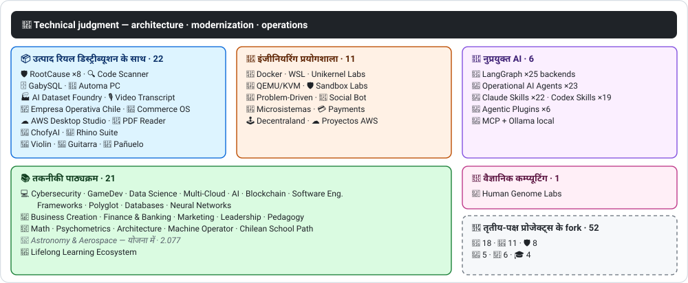

<div align="center">

# 👋व्लादिमीर Acuña

## **समाधान वास्तुकार·वरिष्ठ पूर्ण-स्टैक·डिजिटल रूपांतरण·प्रबंधन और संचालन**

**Professionally trained in Computer Science and Computing Engineering and Business Administration, with 16+ years building and operating software in real environments. I connect business, people, processes, and technology to design, evaluate, deliver, and sustain solutions with technical judgment and an operational view — backed by verifiable evidence in this GitHub account.**

[](https://vladimiracunadev-create.github.io/)
[](https://www.linkedin.com/in/vladimir-acu%C3%B1a-valdebenito-11924a29/)
[](mailto:vladimir.acuna.dev@gmail.com)

[](#व्यावसायिक-क्षेत्र)
[](docs/ECOSYSTEM.hi.md)
[](#तकनीकी-पाठ्यक्रम)

<!-- STATS:START -->
[](https://github.com/vladimiracunadev-create?tab=repositories)
[](https://github.com/vladimiracunadev-create?tab=repositories)
[](#पारिस्थितिकी-तंत्र-एक-झलक-में)
[](#तकनीकी-पाठ्यक्रम)
[](https://github.com/vladimiracunadev-create?tab=repositories)
[](docs/ECOSYSTEM.hi.md#forks)
[](https://github.com/vladimiracunadev-create?tab=repositories)
[](https://github.com/pulls?q=author%3Avladimiracunadev-create+type%3Apr)
[](https://github.com/issues?q=author%3Avladimiracunadev-create+type%3Aissue)
<!-- STATS:END -->

[](https://github.com/vladimiracunadev-create?tab=repositories)
[](https://github.com/vladimiracunadev-create?tab=followers)

[🧭 कहाँ से शुरू करें](docs/START_HERE.hi.md) ·
[🌐 Portfolio (22 languages)](https://vladimiracunadev-create.github.io/) ·
[🧩 Ecosystem](#पारिस्थितिकी-तंत्र-एक-झलक-में) ·
[🛠️ टेक्नोलॉजी स्टैक](#-टेक्नोलॉजी-स्टैक) ·
[⚡ Evaluate me in 10 minutes](#यदि-आपके-पास-10-मिनट-हैं-तो-मुझे-खाली-करने-के-लिए) ·
[✅ Professional scope](#व्यावसायिक-क्षेत्र) ·
[🧭 Non-coding management](#प्रबंधन-प्रशासन-और-गैर-कोडिंग-कैरियर-के-अवसर) ·
[📋 Role matrix](PROFESIONAL_ROLES.md) ·
[📬 Contact](#संपर्क)

**🌐 पूर्ण संस्करण:** [Español](README.md) · [English](README.en.md) · [Português](README.pt.md) · [Italiano](README.it.md) · [Français](README.fr.md) · [简体中文](README.zh.md) · [繁體中文](README.zh-TW.md) · [日本語](README.ja.md) · [한국어](README.ko.md) · [Türkçe](README.tr.md) · [Русский](README.ru.md) · [Tiếng Việt](README.vi.md) · [ไทย](README.th.md) · [Deutsch](README.de.md) · [Українська](README.uk.md) · [Polski](README.pl.md) · [العربية](README.ar.md) · [فارسی](README.fa.md) · [Bahasa Indonesia](README.id.md) · [Nederlands](README.nl.md) · [हिन्दी](README.hi.md) · [Ελληνικά](README.el.md)

**तकनीकी कोर:**
PHP 8 · Python · Rust · Go · Node/TS · Java 21 · .NET 8 · Dart/Flutter · WASM
· AWS · Terraform · Kubernetes · Docker · n8n · LangGraph/MCP · CI/CD · FinOps · Observability

**व्यापार प्रौद्योगिकी पुल:**
प्रक्रिया और आवश्यकताओं विश्लेषण·समाधान मूल्यांकन·वितरण समन्वय·संचालन और निरंतरता·जोखिम प्रबंधन·उत्पाद और सेवा·तकनीकी शिक्षा

</div>

---

> [!NOTE]
> यह प्रोफ़ाइल अनुभव में अवसर नहीं बदलती है। सिद्ध तकनीकी अनुभव, हस्तांतरणीय कौशल, व्यवहार्य अनुप्रयोग और भविष्य के विकास के लक्ष्य स्पष्ट रूप से अलग हो जाते हैं। लिंक्ड गिटहब सबूत निष्पादन योग्य या दस्तावेजी है; जहां कुछ है**नहीं**समाप्त हो गया, यह इस तरह के रूप में कहा जाता है।

## 🧭 कहाँ से शुरू करें

अपना मामला चुनें और सीधे अपनी ज़रूरत तक पहुँचें:

🧑‍💼 [भर्ती](docs/guides/RECRUITER.hi.md) · 💼 [क्लाइंट या फ़्रीलांस](docs/guides/FREELANCE.hi.md) · 🛠️ [तकनीकी मूल्यांकन](docs/guides/TECH_LEAD.hi.md) · 🏢 [व्यवसाय और प्रबंधन](docs/guides/BUSINESS.hi.md) · 🤝 [सहयोग और सुरक्षा](docs/guides/COLLABORATOR.hi.md) · 🎓 [सीखना या सिखाना](docs/guides/LEARNER.hi.md)

## 🎯आपको यहाँ क्या मिलेगा

यह "एक रेपो" नहीं है: यह साझा मानकों के साथ एक पारिस्थितिकी तंत्र है।

- 🔁 **Reproducible demos**— क्लोन, रन, मान्य।
- 🧰 **मानकीकृत टूलिंग**- मेकफ़ाइल्स, हब सीएलआई,`doctor`, और`smoke`प्रति भंडार
- 🛡️ **गहराई में रक्षा**- गुप्त स्कैनिंग, नीतियों और स्पष्ट रूप से निषिद्ध प्रथाओं।
- 📈 **अवलोकन** — `/health`, `/ready`, `/metrics`डैशबोर्ड, और अनुरेखणता।
- 📚 **ऑडियंस-एवेयर प्रलेखन**- रिपोजिटरी के आधार पर भर्तीकर्ता, शुरुआतकर्ता, देवोप, या सुरक्षा।
- 📦 **उत्पाद वितरण**- डाउनलोड करने योग्य रिलीज, चेकसम और सबूत का निर्माण; वाणिज्यिक / स्टोर हस्ताक्षर जब लागू किया लंबित घोषित किया गया।
- 🌍 **अंतर्राष्ट्रीयकरण** — यह प्रोफ़ाइल 22 भाषाओं में प्रकाशित है और पोर्टफ़ोलियो 154 सार्वजनिक PDF उपलब्ध कराता है (7 परिवार × 22 भाषाएँ) (ES · EN · PT · IT · FR · ZH · ZH-TW · JA · KO · TR · RU · VI · TH · DE · UK · PL · AR · FA · ID · NL · HI · EL).
- 🧭 **तकनीकी ईमानदारी**— प्रत्येक मामले में लेबल`OPERATIONAL`, `DOCUMENTED/SCAFFOLD`या`PLANNED`.

## ✅सत्यापन योग्य स्थिति

| सतह | ठोस सबूत |
|---|---|
| 🧪 **टेस्ट कवरेज** | GabySQL**850 टेस्ट**+ फ्यूज़िंग ओवर**503.8M क्वेरीज़**(0 panics)·Empresa ओपेरा चिल**230 परीक्षण** ·ऑटोमा**150 pytest** ·बहु-OS CI |
| 🤖 **उत्पादन ग्रेड एजेंट** | लैंग्वेज रियलवर्ल्ड**25/25 परिचालन परिवर्धन**(मामसूम 01-25, 100% कवरेज)·ऑपरेशनल एआई एजेंट**23 एजेंट**साथ**69 नियतिवादी evals** |
| 🔗 **Polyglot एकीकरण** | **20 मामले**प्रेषक → n8n → receiver —**19 परिचालन**व्यक्तिगत रूप से डॉकर के साथ लेखा परीक्षा· **18+ DB इंजन** · **20+ कंटेनर** ·11 पैटर्न |
| 📦 **वितरण** | **155 रिलीज़**एक पारिस्थितिकी तंत्र के पार**65 स्वामित्व वाली सार्वजनिक भंडार** ·संस्थापक और कलाकृतियों`.exe` · `.msi` · `.dmg` · `.apk`चेकसम और साक्ष्य का निर्माण; प्रगति पर वाणिज्यिक / स्टोर हस्ताक्षर जहां लागू हो |
| 🛡️ **आपूर्ति श्रृंखला** | कोड·Semgrep·बंदी·त्रिवी·Grype·गिटलाक·TruffleHog·चक्रवातDX SBOM·स्कोरकार्ड |
| 📚 **Curricula** | **14,550 classes** verifiable across 21 programs, counted by [a workflow](.github/workflows/stats.yml) from real repository structure or a verifiable source declared in the repository —not written by hand— · every program declares its editorial status and limitations |
| 🌐 **पोर्टफोलियो** | इंस्टॉल करने योग्य PWA· **22 भाषाएँ** · **154 PDF**पाइपलाइन द्वारा उत्पन्न·CV डेटा API·संधारित्र एंड्रॉयड·लाइटहाउस 100 |
| 🔒 **टेलीमेट्री** | फोरेंसिक उत्पादों और Empresa ओपेरा चिले में शून्य टेलीमेट्री - हर निर्माण में सत्यापित (कोई Android नहीं)`INTERNET`अनुमति |
| 🌐 **प्रकाशित स्थल** | **57 GitHub पेज साइटें**-56 लैंडिंग, एक प्रति उत्पाद, कार्यक्रम, या पारिस्थितिकी तंत्र नेविगेटर, साथ ही पोर्टफोलियो- प्रत्येक अपने स्वयं के भंडार से तैनात·सभी 57 HTTP के साथ सत्यापित`200` |

## 🛠️ टेक्नोलॉजी स्टैक

सार्वजनिक रिपॉज़िटरी में पाई गई तकनीकें (मैनिफ़ेस्ट, निर्भरताएँ, कंटेनर और कोड), क्षेत्र के अनुसार समूहित। किसी रिपॉज़िटरी में दिखना —प्रयोगशालाओं और पाठ्यक्रमों सहित— उपयोग का प्रमाण है, वर्षों के प्रोडक्शन अनुभव का दावा नहीं।

**भाषाएँ**


<sub>Python · JavaScript · TypeScript · Rust · Go · Java · PHP · C# · Dart · Kotlin · Swift · Ruby · Elixir · Zig · Clojure · C · Solidity · Bash · PowerShell · HTML · CSS · WebAssembly · SQL · Erlang · F# · Crystal · GDScript · HCL</sub>

**फ़्रेमवर्क, रनटाइम और लाइब्रेरी**


<sub>Node.js · Express · React · Vue · Svelte · Astro · Vite · Vitest · FastAPI · Flask · Django · Spring Boot · ASP.NET / .NET · Laravel · Rails · Flutter · Tauri · Electron · Qt / PySide6 · Capacitor · Godot · PyTorch · scikit-learn · Polars · pandas · NumPy · Optuna · SHAP · Transformers · PEFT / LoRA · Playwright · pytest · Jupyter · Streamlit · Pydantic · Tokio · Axum · SQLx · Serde</sub>

**सॉफ़्टवेयर आर्किटेक्चर**


-0969da?style=flat-square)


<sub>Local-first → [empresa-operativa-chile](https://github.com/vladimiracunadev-create/empresa-operativa-chile), [ai-dataset-foundry](https://github.com/vladimiracunadev-create/ai-dataset-foundry) · Event-driven → [social-bot-scheduler](https://github.com/vladimiracunadev-create/social-bot-scheduler) · Resilience → [problem-driven-systems-lab](https://github.com/vladimiracunadev-create/problem-driven-systems-lab) · Ledger → [universal-payments-engineering-lab](https://github.com/vladimiracunadev-create/universal-payments-engineering-lab) · Plugins → [agentic-plugins-toolkit](https://github.com/vladimiracunadev-create/agentic-plugins-toolkit) · Agents → [langgraph-realworld](https://github.com/vladimiracunadev-create/langgraph-realworld), [operational-ai-agents](https://github.com/vladimiracunadev-create/operational-ai-agents) · Domain-first → [rhino-suite](https://github.com/vladimiracunadev-create/rhino-suite) · Micro-apps → [microsistemas](https://github.com/vladimiracunadev-create/microsistemas) · Embedded DB → [gabysql](https://github.com/vladimiracunadev-create/gabysql) · IaC → [proyectos-aws](https://github.com/vladimiracunadev-create/proyectos-aws)</sub>

**डेटाबेस**


<sub>PostgreSQL · MySQL · MariaDB · SQLite · MongoDB · Redis · Neo4j · Cassandra · Elasticsearch · ClickHouse · CockroachDB · InfluxDB · TimescaleDB · DuckDB · SQL Server · Oracle · pgvector · PostgREST · GraphQL · GabySQL (Rust)</sub>

**क्लाउड, कंटेनर और DevOps**


<sub>AWS · Terraform · Kubernetes · Docker / Compose · GitHub Actions · Git · GitHub · GitLab · Linux · Nginx · Make · Inno Setup · FinOps · CI/CD</sub>

**ऑब्ज़र्वेबिलिटी और मैसेजिंग**


<sub>Prometheus · Grafana · OpenTelemetry · Kafka · MQTT (Mosquitto) · Elasticsearch / Kibana · cAdvisor · k6</sub>

**AI, एजेंट, स्किल और MCP**


<sub>Claude Code · Claude Skills · Codex Skills · Agentic Plugins · MCP · LangGraph · Ollama · n8n · RAG · Whisper · Transformers · PEFT / LoRA · Optuna · SHAP · Polars · PyTorch</sub>

**सुरक्षा और सप्लाई चेन**


**लक्षित प्लेटफ़ॉर्म**


<sub>Windows · macOS · iOS · Linux · Android · Web / PWA</sub>

## 🗺️पारिस्थितिकी तंत्र एक झलक में



## 🗂️ पारिस्थितिकी तंत्र: उत्पाद, प्रयोगशालाएँ, अनुप्रयुक्त AI, पाठ्यक्रम और वैज्ञानिक कम्प्यूटिंग

इस प्रोफ़ाइल का व्यावहारिक कार्य एक अलग दस्तावेज़ में है: डाउनलोड और इंस्टॉल होने वाला सॉफ़्टवेयर, इंजीनियरिंग प्रयोगशालाएँ, अनुप्रयुक्त AI, पूर्ण तकनीकी पाठ्यक्रम और वैज्ञानिक कम्प्यूटिंग, साथ ही खाते में मौजूद तृतीय-पक्ष प्रोजेक्ट्स के हर fork का विवरण।

- 📦 **उत्पाद रियल डिस्ट्रीब्यूशन के साथ** (22)
- 🧪 **इंजीनियरिंग प्रयोगशाला** (11)
- 🤖 **नुप्रयुक्त AI** (6)
- 📚 **तकनीकी पाठ्यक्रम** (21)
- 🔬 **वैज्ञानिक कम्प्यूटिंग** (1)
- 🍴 **तृतीय-पक्ष प्रोजेक्ट्स के fork** (52)

👉 **[पूरा पारिस्थितिकी तंत्र देखें](docs/ECOSYSTEM.hi.md)** · [🍴 तृतीय-पक्ष प्रोजेक्ट्स के fork](docs/ECOSYSTEM.hi.md#forks)

## 📚तकनीकी पाठ्यक्रम

स्पेनिश में अनुक्रमिक कार्यक्रम, प्रत्येक भंडार द्वारा घोषित स्थिति और दायरे के साथ। 21 कार्यक्रम में शामिल हो गए**14,550 कक्षा**, द्वारा गिना[a workflow](.github/workflows/stats.yml)वास्तविक भंडार संरचना या एक सत्यापन योग्य स्रोत से जो भंडार में घोषित किया गया है; बैज साप्ताहिक ताज़ा करता है और हाथ से नहीं लिखा जाता है।

🌌 **योजना में, गिनती से बाहर:** [खगोल विज्ञान, खगोल भौतिकी, अंतरिक्ष विज्ञान और वैमानिकी इंजीनियरिंग](https://github.com/vladimiracunadev-create/astronomy-astrophysics-space-sciences-aerospace-engineering-learning-program) — 12 क्षेत्रों और 133 ब्लॉकों में 2,077 नियोजित कक्षाएँ; 397 का पाठ लिखा जा चुका है और सभी अभी E0 स्थिति में हैं। स्वतंत्र प्रशिक्षण, पेशेवर प्रमाणन नहीं · [साइट](https://vladimiracunadev-create.github.io/astronomy-astrophysics-space-sciences-aerospace-engineering-learning-program/)।

👉 **[सभी 21 पाठ्यक्रम देखें](docs/ECOSYSTEM.hi.md#curricula)**

## ⚡यदि आपके पास 10 मिनट हैं तो मुझे खाली करने के लिए

यह विचार सिर्फ कोड को देखने के लिए नहीं है: यह देखना है**मैं कैसे सोचूं**मैं सब कुछ कैसे कर सकता हूँ, मैं कैसे कर सकता हूँ, कैसे मैं सब कुछ कर सकता हूँ।

**रूट A - रियल servability और orchestration***(मेरे पसंदीदा)*

```bash
git clone https://github.com/vladimiracunadev-create/social-bot-scheduler.git
```

आप 20 मामलों और 18+ डीबी इंजनों में वर्कफ़्लो, मैट्रिक, डैशबोर्ड और रेलिंग देखेंगे।

**रूट B - मिनटों में पुन: प्रयोज्य बुनियादी ढांचे**

```bash
git clone https://github.com/vladimiracunadev-create/docker-labs.git
```

**रूट C — टाइप्ड स्टेट के साथ एजेंट**

```bash
git clone https://github.com/vladimiracunadev-create/langgraph-realworld.git
```

**रूट डी - जंग फोरेंसिक उत्पाद, क्लोनिंग के बिना**

इंस्टॉलर या सीएलआई द्विआधारी डाउनलोड करें[RootCause releases](https://github.com/vladimiracunadev-create/rootcause-windows-inspector/releases)सत्यापित करना`SHA256SUMS`.

## 🧠वे मानक जिन्हें मैं सभी रिपॉज़िटरी में लागू करता हूँ

- **DX पहले**- अगर यह चलाने में आसान नहीं है, तो यह डेमो के रूप में या टीम बेस के रूप में उपयोगी नहीं है।
- **1 दिन से अवलोकन**— मीट्रिक और अनुरेखण, एक बाद नहीं।
- **पाइपलाइन के रूप में सुरक्षा**- गुप्त स्कैनिंग, SBOM प्रति रिलीज, स्पष्ट रूप से निषिद्ध प्रथाओं।
- **वास्तविक लचीलापन**- idempotency, सर्किट ब्रेकर, और नियंत्रित गिरावट।
- **डिजाइन द्वारा Polyglot**— भाषा और इंजन का प्रयोग करके किया जाता है, कभी फैशन से नहीं।
- **स्थिति के बारे में ईमानदारी**— एक रेपो का नाम बदल दिया गया था (`Multisimulador` → `machine-operator-program`) आशाजनक सॉफ्टवेयर से बचने के लिए जो अभी तक मौजूद नहीं है।
- **बैज संकेत हैं, सबूत नहीं**प्रत्येक रेपो भी घोषणा करता है**क्या नहीं करना चाहिए**.
- **मॉडल बाहरी**- डोमेन को पहले डिजाइन किया गया है; इंटरफ़ेस एक प्रक्षेपण है।
- **बाह्य कार्य को बाह्य घोषित किया जाता है** — तृतीय-पक्ष प्रोजेक्ट्स के [52 fork](docs/ECOSYSTEM.hi.md#forks) एक-एक करके वर्णित हैं और इस प्रोफ़ाइल की स्वयं के कार्य की सभी संख्याओं से बाहर रहते हैं।

## ✅व्यावसायिक क्षेत्र

मेरी दोहरी पृष्ठभूमि —**कंप्यूटर विज्ञान और कम्प्यूटिंग इंजीनियरिंग + बिजनेस एडमिनिस्ट्रेशन**- मुझे व्यावसायिक लक्ष्यों को तकनीकी निर्णयों और तकनीकी बाधाओं को संचालन, उत्पाद, ग्राहकों और नेतृत्व के लिए स्पष्ट विकल्पों में बदलने में मदद करता है।

### 🎯कोर पहचान

| भूमिका | समर्थन |
|---|---|
| **समाधान वास्तुकार** | विकासवादी निर्णय के साथ मॉड्यूलर, स्केलेबल सिस्टम डिजाइन |
| **विरासत आधुनिकीकरण वास्तुकार** | वास्तविक विरासत विकास (PHP 5.x → 8x, बिना किसी रुकावट के वृद्धिशील पुनर्निर्माण) |
| **वरिष्ठ पूर्ण-स्टैक / टेक लीड** | वास्तुकला, निष्पादन और वास्तविक प्लेटफार्मों पर मानकों (+16 वर्ष) |
| **एआई स्वचालन वास्तुकार** | लैंगग्राफ/एमसीपी के साथ एजेंटिक सिस्टम और n8n रेलिंग के साथ बहती है |

### ↗ स्वाभाविक विस्तार

**एआई ऑर्केस्ट्रेशन इंजीनियर** · **सिस्टम / जंग इंजीनियर** · **मोबाइल इंजीनियर (फ्लटर)** · **समाधान इंजीनियर** · **तकनीकी उत्पाद बिल्डर** · **तकनीकी ट्रेनर** · **डिजिटल ट्रांसफॉर्मेशन सलाहकार** · **व्यापार / कार्यात्मक विश्लेषक** · **तकनीकी उत्पाद संचालन** · **AI Engineer (LLM / ML)** · **Data Engineer** · **DevSecOps / AppSec Engineer** · **QA Automation / Test Engineer** · **Technical Writer** · **शिक्षक / प्रशिक्षक / प्रौद्योगिकी इंस्ट्रक्टर** · **Instructional Designer (EdTech)** · **Technical Mentor**

### ⚙️पूरक क्षेत्र

प्लेटफार्म इंजीनियर / आईडीपी·देवऑप्स / सीआई-सीडी·क्लाउड / एडब्ल्यूएस इंजीनियर·आवेदन SRE·स्वचालन इंजीनियर·तकनीकी सलाहकार · Backend / API Engineer · Fintech / Payments Engineer · Developer Advocate / DevRel

## 🧭प्रबंधन, प्रशासन और गैर कोडिंग कैरियर के अवसर

प्रबंधन, प्रशासन और व्यवसाय की वे भूमिकाएँ जहाँ सूचना-प्रौद्योगिकी और प्रशासन योगदान देते हैं और प्रोग्रामिंग मुख्य कार्य नहीं है; ईमानदारी से वर्गीकृत (हस्तांतरणीय दक्षता, आवेदन की संभावना या भविष्य का लक्ष्य) और हर भूमिका की कमी के साथ। शामिल क्षेत्र:

प्रौद्योगिकी नेतृत्व · परियोजना प्रबंधन · व्यवसाय प्रशासन · रणनीति और परिवर्तन · व्यापार विश्लेषण · उत्पाद और सेवा · साइबर सुरक्षा प्रबंधन · वाणिज्यिक और बिक्री · वित्त और प्रबंधन नियंत्रण · गुणवत्ता · शिक्षा · रसद और आपूर्तिकर्ता · डेटा और एआई शासन · Public sector

👉 **[अवसरों का पूरा मैट्रिक्स देखें](docs/MANAGEMENT.hi.md)**

## 🤖एआई-एसिस्टेड डेवलपमेंट फ्लो

| उपकरण | मुख्य उपयोग |
|---|---|
| **क्लाउड कोड** | वास्तु समीक्षा, कार्यान्वयन और तकनीकी प्रलेखन |
| **ChatGPT Plus** | विश्लेषण, वास्तुकला और पुनरावृत्ति (२०२३ से) |
| **कोडेक्स** | कोड जनरेशन और रिफैक्टरिंग |
| **Antigravity** | विकास और स्वचालन प्रवाह का त्वरण |
| **VS कोड / OpenCode** | एकीकृत एआई सहायता के साथ वातावरण |

> मैं अपने तकनीकी निर्णय, मानव सत्यापन और वास्तुशिल्प दिशा को जोड़ती हूं। एआई क्षमता, गति और पहुंच को बढ़ाता है - यह अनुभव की जगह नहीं लेता है।

## 📌उपलब्धता

**करने के लिए खुला:**वरिष्ठ पूर्ण-स्टैक·आर्किटेक्चर·विरासत आधुनिकीकरण·प्लेटफार्म / IDP·आवेदन SRE·Pragmatic DevOps·स्वचालन·एआई स्वचालन·व्यावसायिक विश्लेषण·आईटी परियोजना समन्वय·उत्पाद संचालन·डिजिटल रूपांतरण·समाधान परामर्श/बिक्री·तकनीकी शिक्षा·गुणवत्ता और निरंतर सुधार·एआई गोद लेने और शासन

**Evaluated according to each role’s scope:** Product Owner / technical Product Manager · Service Delivery · IT Operations · GRC / technology risk · administration and operations · management control · public-sector modernization. Executive and general-management titles are future development goals, not claimed experience.

**मोटलिटी:**रिमोट या हाइब्रिड परियोजना के आधार पर।

## 📬संपर्क

[](https://vladimiracunadev-create.github.io/)
[](https://www.linkedin.com/in/vladimir-acu%C3%B1a-valdebenito-11924a29/)
[](https://gitlab.com/vladimir.acuna.dev-group/vladimir.acuna.dev-group)
[](mailto:vladimir.acuna.dev@gmail.com)

---

<div align="center">

[🤝 Contribute](CONTRIBUTING.hi.md) ·
[🛡️ Security](SECURITY.hi.md) ·
[⚖️ Code of Conduct](CODE_OF_CONDUCT.hi.md)

<sub>README सार्वजनिक रिपॉज़िटरी की सत्यापन-योग्य स्थिति से सिंक है —आँकड़े और बदलाव API से पढ़े गए— · अंतिम सत्यापन: <!-- VERIFIED:START -->2026-11-09<!-- VERIFIED:END -->।</sub>

</div>
