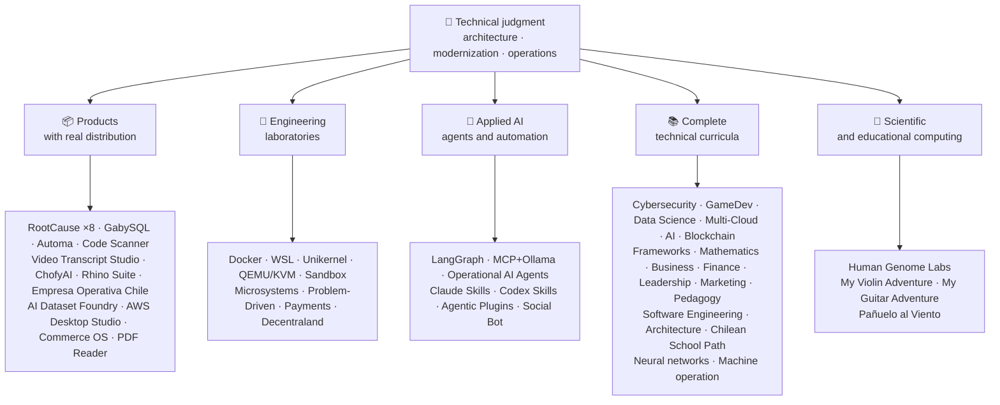

<div align="center">

# 👋Vladimir Acuña

## **Arsitek Solusi·Senior Full- Stack·Transformasi Digital·Manajemen & Operasi**

**Secara profesional terlatih dalam Ilmu Komputer dan Teknik Komputer dan Administrasi Bisnis, dengan 16 tahun membangun dan perangkat lunak operasi di lingkungan nyata. Saya menghubungkan bisnis, orang, proses, dan teknologi untuk merancang, mengevaluasi, memberikan, dan mempertahankan solusi dengan penilaian teknis dan pandangan operasional - didukung oleh bukti yang dapat diverifikasi dalam akun GitHub ini.**

[](https://vladimiracunadev-create.github.io/)
[](https://www.linkedin.com/in/vladimir-acu%C3%B1a-valdebenito-11924a29/)
[](mailto:vladimir.acuna.dev@gmail.com)

[](#scope-profesional)
[](docs/ECOSYSTEM.id.md)
[](#curricula-teknis-lengkap)

<!-- STATS:START -->
[](https://github.com/vladimiracunadev-create?tab=repositories)
[](https://github.com/vladimiracunadev-create?tab=repositories)
[](#ekosistem-pada-a-glance)
[](#curricula-teknis-lengkap)
[](https://github.com/vladimiracunadev-create?tab=repositories)
<!-- STATS:END -->

[](https://github.com/vladimiracunadev-create?tab=repositories)
[](https://github.com/vladimiracunadev-create?tab=followers)

[🌐 Portfolio (6 languages)](https://vladimiracunadev-create.github.io/) ·
[🧩 Ecosystem](#ekosistem-pada-a-glance) ·
[⚡ Evaluate me in 10 minutes](#jika-kau-memiliki-10-menit-untuk-mengevaluasi-aku) ·
[✅ Professional scope](#scope-profesional) ·
[🧭 Non-coding management](#manajemen-administrasi-dan-non--coding-kesempatan-karir) ·
[📋 Role matrix](PROFESIONAL_ROLES.md) ·
[📬 Contact](#kontak)

**🌐 Versi lengkap:** [Español](README.md) · [English](README.en.md) · [Português](README.pt.md) · [Italiano](README.it.md) · [Français](README.fr.md) · [简体中文](README.zh.md) · [繁體中文](README.zh-TW.md) · [日本語](README.ja.md) · [한국어](README.ko.md) · [Türkçe](README.tr.md) · [Русский](README.ru.md) · [Tiếng Việt](README.vi.md) · [ไทย](README.th.md) · [Deutsch](README.de.md) · [Українська](README.uk.md) · [Polski](README.pl.md) · [العربية](README.ar.md) · [فارسی](README.fa.md) · [Bahasa Indonesia](README.id.md) · [Nederlands](README.nl.md) · [हिन्दी](README.hi.md) · [Ελληνικά](README.el.md)

**Inti teknis:**
PHP 8 · Python · Rust · Go · Node/TS · Java 21 · .NET 8 · Dart/Flutter · WASM
· AWS · Terraform · Kubernetes · Docker · n8n · LangGraph/MCP · CI/CD · FinOps · Observability

**Bisnis-jembatan teknologi:**
analisis proses dan persyaratan·evaluasi solusi·koordinasi pengiriman·operasi dan kontinuitas·manajemen risiko·produk dan layanan·pendidikan teknis

</div>

---

> [!NOTE]
> Profil ini tidak mengubah peluang menjadi pengalaman. Diproduksi pengalaman teknis, keterampilan transferable, aplikasi yang layak, dan tujuan pembangunan masa depan secara eksplisit dipisahkan. Terkait dengan bukti GitHub dapat dieksekusi atau dokumenter; dimana sesuatu berada**tidak**selesai, itu dinyatakan seperti itu.

## 🎯Apa yang akan Anda temukan di sini

Ini bukan "satu repo": ini adalah ekosistem dengan standar bersama.

- 🔁 **Demo dapat direproduksi**- Klon, lari, validasi.
- 🧰 **Standardisasi Tooling**- Makefiles, Hub CRI,`doctor`, dan`smoke`per repositori.
- 🛡️ **Pertahanan dalam kedalaman**- Pemindaian rahasia, kebijakan, dan praktek terlarang secara eksplisit.
- 📈 **Observasi** — `/health`, `/ready`, `/metrics`, dasbor, dan traceability.
- 📚 **Dokumentasi audiencearenalitentment**- perekrut, pemula, DevOps, atau keamanan, tergantung pada repositori.
- 📦 **Pemrograman distribusi**- bisa diunduh rilis, checksums, dan membuat bukti; tanda tangan komersial / store dideklarasikan sebagai tertunda ketika berlaku.
- 🌍 **Internasionalisasi**- Portofolio dalam 6 bahasa (ES·EN·PT·IT·FR·ZH).
- 🧭 **Kejujuran teknis**- setiap kasus berlabel`OPERATIONAL`, `DOCUMENTED/SCAFFOLD`, atau`PLANNED`.

## ✅Status Dapat Diverifikasi

| Permukaan | Bukti beton |
|---|---|
| 🧪 **Uji cakupan** | GabySQL**828 tes**+ fuzzing over**Kueri 503.8M**(0 panik)·Empresa Operativa Chile**158 tests** ·Automa**150 pytest** ·multi- OS CI |
| 🤖 **Agen-kelas-produksi** | LangGrafik RealWorld**25 / 25 backend operasional**(kasus 01- 25, 100% cakupan)·Agen AI Operasional**13 agen**dengan**39 deterministik eval** |
| 🔗 **Integrasi Polyglot** | **20 kasus**- = Sender Avern8n Penerima = -**19 operasional**, secara individual diaudit dengan Docker -· **18 + mesin DB** · **20 + kontainer** ·11 pola |
| 📦 **Distribusi** | **151 rilis**di seluruh ekosistem**64 repositori publik milik** ·installers dan artifak`.exe` · `.msi` · `.dmg` · `.apk`dengan jumlah dan bukti yang ada; tanda tangan komersial / toko dalam proses dimana dapat diterapkan |
| 🛡️ **Rantai Supply** | CodeQL·Semgrep·Bandit·Trivy·Grype·Gitleaks·TruffleHog·CycloneDX SBOM·Scorecard |
| 📚 **Curricula** | **Kelas 14,530**diverifikasi di seluruh 21 program, dihitung oleh[a workflow](.github/workflows/stats.yml)dari struktur repositori nyata atau sumber yang dapat diverifikasi dideklarasikan dalam repositori - tidak ditulis dengan tangan -·setiap program mendeklarasikan status editorial dan keterbatasan |
| 🌐 **Portfolio** | PWA yang dapat dipasang· **6 bahasa** · **36 PDFs**dihasilkan oleh pipeline·API Data CV·Capacitor Android·Lighthouse 100 |
| 🔒 **Telemetri** | Zero telemetry in forensic products and Empresa operativa Chile - verified in every build (no Android`INTERNET`ijin) |
| 🌐 **Situs yang dipublikasikan** | **56 Situs Halaman GitHub**- 55 pendaratan, satu per produk, program, atau navigator ekosistem, ditambah portofolio - masing-masing dikerahkan dari repositori sendiri·semua 56 diverifikasi dengan HTTP`200` |

## 🗺️Ekosistem Pada A Glance



## 🗂️ Ekosistem: produk, laboratorium, AI terapan, dan komputasi ilmiah

Karya praktis profil ini ada di dokumen tersendiri: perangkat lunak yang diunduh dan dipasang, laboratorium rekayasa, AI terapan, dan komputasi ilmiah, beserta deskripsi setiap fork proyek pihak ketiga yang ada di akun.

- 📦 **Produk Dengan Distribusi Nyata** (22)
- 🧪 **Laboratorium Teknik** (11)
- 🤖 **AI Terapan** (6)
- 🔬 **Komputer Ilmiah** (1)
- 🍴 **Fork proyek pihak ketiga** (52)

👉 **[Lihat ekosistem lengkap](docs/ECOSYSTEM.id.md)** · [🍴 Fork proyek pihak ketiga](docs/ECOSYSTEM.id.md#forks)

## 📚Curricula Teknis Lengkap

Program Sequential dalam bahasa Spanyol, dengan status dan lingkup dideklarasikan oleh setiap repositori. 21 program ditambahkan ke**Kelas 14,530**(Yang dihitung dengan hisab) oleh malaikat Jibril.[a workflow](.github/workflows/stats.yml)dari struktur repositori nyata atau sumber yang dapat diverifikasi dideklarasikan dalam repositori; lencana menyegarkan mingguan dan tidak ditulis dengan tangan.

🧭 [**Lifelong Learning Ecosystem**](https://github.com/vladimiracunadev-create/lifelong-learning-ecosystem)adalah kompas federasi menghubungkan 30 jalur nyata di 6 daerah melalui peta visual dan[accessible offline portal](https://vladimiracunadev-create.github.io/lifelong-learning-ecosystem/); ini tidak dihitung sebagai sebuah program tambahan.

| Program | Kelas | Scope |
|---|---:|---|
| [🔢 **Computational Mathematics**](https://github.com/vladimiracunadev-create/computational-mathematics-program) | 360 | Dari mengandalkan jari untuk mereproduksi kertas· **360 deterministik demonstrasi diverifikasi dalam CI** ·1.080 notebook·489- istilah glossary· [site](https://vladimiracunadev-create.github.io/computational-mathematics-program/) |
| [🏦 **Finance and Banking**](https://github.com/vladimiracunadev-create/finance-and-banking-evolution-program) | 356 | 534 h·matematika keuangan dan kredit IFRS, risiko, Basel III, keuangan terbuka, DLT, stalecoins, dan MiCA· **27 kasus** · **298 tes** · [site](https://vladimiracunadev-create.github.io/finance-and-banking-evolution-program/) |
| [🎮 **GameDev**](https://github.com/vladimiracunadev-create/modern-gamedev-program) | 352 | Matematika dan C # / C + + / GDScript penggeser, Al, multiplayer, VR / AR·Titik·Persatuan·Tidak nyata· **10 laboratorium Godot diverifikasi dalam CI**(301 cek)· [site](https://vladimiracunadev-create.github.io/modern-gamedev-program/) |
| [🛡️ **Cybersecurity**](https://github.com/vladimiracunadev-create/modern-cybersecurity-program) | 360 | **v1.3.0** ·20 bagian·fondasi Tim Merah, DFIR, keamanan awan, explodev, CTF, dan keamanan permainan·dipetakan ke**7 sertifikat** ·aplikasi Android / web luring·Manual PDF·CI, Keamanan, dan Halaman diverifikasi· [site](https://vladimiracunadev-create.github.io/modern-cybersecurity-program/) |
| [📈 **Marketing, Sales, and Growth**](https://github.com/vladimiracunadev-create/marketing-sales-growth-evolution-program) | 336 | 24 bagian dengan definisi operasional, lembar pengukuran, bibliografi yang dapat diverifikasi, dan konteks regulasi Chili· **v1.6.0** ·1.29M kata·17 jalur berbasis· [site](https://vladimiracunadev-create.github.io/marketing-sales-growth-evolution-program/) |
| [🏢 **Business Creation**](https://github.com/vladimiracunadev-create/modern-business-creation-program) | 336 | Membuat dan mengoperasikan perusahaan nyata di Chili: dari ide untuk memasukkan, otoritas pajak, operasi, krisis, dan keluar·Metagram 360·1,251-term glossary·1.548- halaman manual· [site](https://vladimiracunadev-create.github.io/modern-business-creation-program/) |
| [🏛️ **Architecture and Built Environment**](https://github.com/vladimiracunadev-create/architecture-built-environment-learning-program) | 830 | 83 bagian·60 sesi integratif·34 path·sumber terlacak·Markdown, pembaca luring, dan Halaman GitHub· [site](https://vladimiracunadev-create.github.io/architecture-built-environment-learning-program/) |
| [🇨🇱 **Chilean School Learning Path**](https://github.com/vladimiracunadev-create/chilean-school-learning-path) | 8,841 | Kelas 1-12· **4.156 pengalaman terintegrasi.** · **2,823 belajar tujuan** ·Sumber MINEDUC·tidak ada proposal yang tertunda dan tinjauan khusus manusia masih tertunda· [site](https://vladimiracunadev-create.github.io/chilean-school-learning-path/) |
| [🧭 **Modern Software Engineering**](https://github.com/vladimiracunadev-create/modern-software-engineering-program) | 480 | 40 bagian dan 8 tahap·fondasi produk strenk, arsitektur, keamanan, DevOps, SRE, SPEC, AI, dan multi- sistem agen·status editorial dideklarasikan oleh repositori· [site](https://vladimiracunadev-create.github.io/modern-software-engineering-program/) |
| [🎓 **Pedagogy and Learning Sciences**](https://github.com/vladimiracunadev-create/education-pedagogy-learning-sciences-program) | 300 | Dari bagaimana seseorang belajar bagaimana guru dilatih·25 bagian· **setiap kelas menyatakan bukti negara dan batas** ·literasi awal, metode komparatif, kebutuhan pendidikan spesifik, koeksistensi, keragaman budaya, dan bukti internasional·1,097- istilah Glossary, 325 diagram, dan 60-aktivitas bank kelas·14 jalur karir oleh peran·LMS-exportable· **v2.1.0** · [site](https://vladimiracunadev-create.github.io/education-pedagogy-learning-sciences-program/) |
| [☁️ **Multi-Cloud**](https://github.com/vladimiracunadev-create/multi-cloud-engineering-program) | 288 | AWS·Azure·GCP·Kubernetes·Terraform·SRE·FinOps· **1.288 jam** ·288 laboratorium dengan bukti JSON·1,032 sumber dilacak·Manual 2.884- halaman PDF· [site](https://vladimiracunadev-create.github.io/multi-cloud-engineering-program/) |
| [🎖️ **Executive Leadership**](https://github.com/vladimiracunadev-create/executive-leadership-founder-program) | 288 | Dari memiliki hasil pertama Anda untuk memimpin perusahaan dan mendirikan tim Anda sendiri: tim, KPI / OKR, keuangan, produk, risiko, papan, dan M & A·24 kasus, 96 lab, dan 39 contoh· [site](https://vladimiracunadev-create.github.io/executive-leadership-founder-program/) |
| [🐍 **Python Data Science**](https://github.com/vladimiracunadev-create/python-data-science-program) | 232 | Polars, ML + Optuna / SHAP, PyTorch / LLM / LoRA, MLOps·native Windows app + Android APK· [site](https://vladimiracunadev-create.github.io/python-data-science-program/) |
| [🧠 **AI Evolution**](https://github.com/vladimiracunadev-create/artificial-intelligence-evolution-program) | 184 | Symbolic → probabilistic → deep learning → LLMs, RAG, agents, safety, and frontier · **v0.17.0** · **708 notebooks** · **148 foundational papers** · offline Windows, Android, and PWA apps · [site](https://vladimiracunadev-create.github.io/artificial-intelligence-evolution-program/) |
| [🌐 **Comparative Programming**](https://github.com/vladimiracunadev-create/polyglot-programming-labs) | 176 | Satu konsep,**10 bahasa**Diverifikasi dalam CI -**1.360 implementasi**- Plus**1.632 program**dalam bahasa yang masih hidup (COBOL, Fortran, Ada, RPG, MUMPS...) dan atlas**60 kartu dalam 15 keluarga** ·v1.0· [site](https://vladimiracunadev-create.github.io/polyglot-programming-labs/) |
| [🧩 **Frameworks Compared**](https://github.com/vladimiracunadev-create/framework-ecosystems-labs) | 149 | Satu kontrak executable, tanpa adaptor, melawan Express, FastAPI, Spring Boot, ASP.NET, Django, Rail, Laravel, React, Vue, Svelte, dan banyak lagi·12 bagian· **70 kelas yang dibangun** · **397 kasus diverifikasi dalam CI** · **Sumber ISBN / DOI 210** · [site](https://vladimiracunadev-create.github.io/framework-ecosystems-labs/) |
| [🗄️ **Databases**](https://github.com/vladimiracunadev-create/database-systems-labs) | 74 | **v3.0.0** ·basis data rekayasa dalam 15 bagian·230 jam· **sumber yang dapat diverifikasi untuk setiap klaim**: 120 sumber dengan ISBN, DOI, atau standar·kasus yang sama diselesaikan dalam 27 mesin·306 istilah glossary·150 pytest· [site](https://vladimiracunadev-create.github.io/database-systems-labs/) |
| [📐 **Psychometrics and Assessment**](https://github.com/vladimiracunadev-create/psychometrics-and-assessment-program) | 40 | Bagaimana alat pengukuran dibangun, mencetak, memvalidasi, dan diaudit·8 bagian·mesin dapat dieksekusi dengan**5 instrumen dan 344 item, 276 public-domain** |
| [⛓️ **Blockchain**](https://github.com/vladimiracunadev-create/blockchain-learning-path) | 66 | **v0.14.0** ·dari nol ke pemrograman infrastruktur keuangan dan analytics on-chain· **91 praktek**dan**363 tes** ·kontrak dengan Foundry (fuzzing and invariants) dan analisis statis Slither dalam CI·aplikasi offline diverifikasi dengan membuka biner dan menghitung isinya· [site](https://vladimiracunadev-create.github.io/blockchain-learning-path/) |
| [🧠 **Neural Network Training Labs**](https://github.com/vladimiracunadev-create/neural-network-training-labs) | 31 | 7 modul·214 jam· **93 buku catatan**- 31 kelas, 31 versi mahasiswa, dan 31 solusi -·pertanyaan, peta visual, praktek, dan penilaian dengan data publik yang nyata·PyTorch· [study site](https://vladimiracunadev-create.github.io/neural-network-training-labs/) |
| [🕹️ **Machine Operator**](https://github.com/vladimiracunadev-create/machine-operator-program) | 451 | **41 modul pelatihan**, satu per mesin· **502 j 15 menit** ·sistem, kontrol, fisika, keselamatan, dan desain simulasi dengan sumber per kelas·* tidak ada simulator executable belum, dan itu dideklarasikan seperti itu * |

## ⚡Jika kau memiliki 10 menit untuk mengevaluasi aku

Idenya bukan hanya untuk melihat kode: itu adalah untuk melihat**bagaimana saya berpikir**, bagaimana saya mendokumentasikan, dan bagaimana saya membuat semuanya dapat dieksekusi.

**Rute A-Observabilitas nyata dan orkestra**♪ (Favoritku) ♪

```bash
git clone https://github.com/vladimiracunadev-create/social-bot-scheduler.git
```

Anda akan melihat aliran kerja, metrik, dashboard, dan pagar di 19 kasus dan 18 + mesin DB.

**Rute B - infrastruktur reproduksi dalam beberapa menit**

```bash
git clone https://github.com/vladimiracunadev-create/docker-labs.git
```

**Route C - Agen dengan keadaan diketik**

```bash
git clone https://github.com/vladimiracunadev-create/langgraph-realworld.git
```

**Route D - Produk forensik Rust, tanpa kloning**

Unduh pemasang atau biner CLI dari[RootCause releases](https://github.com/vladimiracunadev-create/rootcause-windows-inspector/releases)dan memverifikasi`SHA256SUMS`.

## 🧠Standar yang saya terapkan di semua repositori

- **DX pertama**- Jika tidak mudah untuk menjalankan, tidak berguna sebagai demo atau sebagai basis tim.
- **Observasi dari hari pertama**- Metrik dan traceabilitas, bukan setelah pemikiran.
- **Keamanan sebagai baris pipa**- Pemindaian rahasia, SBOM per rilis, praktek terlarang secara eksplisit.
- **Ketahanan nyata**- Idempotensi, pemutus sirkuit, dan degradasi terkendali.
- **Polyglot berdasarkan desain**- bahasa dan mesin yang dipilih dengan kasus penggunaan, tidak pernah dengan fashion.
- **Kejujuran tentang status**- satu repo diganti namanya (`Multisimulador` → `machine-operator-program`) untuk menghindari perangkat lunak yang menjanjikan yang belum ada.
- **Lencana adalah sinyal, bukan bukti**- Setiap repo juga menyatakan**apa TIDAK DILAKUKAN**.
- **Model keluar**- domain dirancang pertama; antarmuka adalah proyeksi.
- **Pekerjaan eksternal dinyatakan sebagai eksternal** — [52 fork](docs/ECOSYSTEM.id.md#forks) proyek pihak ketiga dijelaskan satu per satu dan berada di luar semua angka karya sendiri di profil ini.

## ✅Scope Profesional

Latar belakangku...**Ilmu Komputer dan Teknik Komputer + Administrasi Bisnis**- membantu saya menerjemahkan tujuan bisnis ke dalam keputusan teknis dan kendala teknis ke pilihan yang jelas untuk operasi, produk, pelanggan, dan kepemimpinan.

### 🎯Identitas Inti

| Peran | Backing |
|---|---|
| **Arsitek Solusi** | Modular, rancangan sistem skalable dengan penilaian evolusioner |
| **Arsitek Modernisasi Legacy** | Evolusi warisan nyata (PHP 5.x 8.x, refaktoring insurmental tanpa mengganggu operasi) |
| **Ketua Senior Stack / Tech** | Arsitektur, eksekusi, dan standar pada platform nyata (+ 16 tahun) |
| **Arsitek Audisi AI Automatisasi** | Sistem bawaan dengan LangGraph / MCP dan n8n arus dengan guardrails |

### ↗ Ekspansi alami

**Insinyur Orkestra AI** · **Sistem / Mesin Rust** · **Engineer Mobile (Flutter)** · **Insinyur Solusi** · **Pembangun Produk Teknis** · **Teknisi Trainer** · **Konsultan Transformasi Digital** · **Penganalisa Bisnis / Fungsional** · **Operasi Produk Teknis**

### ⚙️Ruang lingkup pelengkap

Insinyur Platform / IDP·DevOps / CI- CD·Cloud / AWS Engineer·Aplikasi SRE·Insinyur Automatisasi·Konsultan teknik- komersial

## 🧭Manajemen, Administrasi, dan Non- Coding Kesempatan Karir

Peran manajemen, administrasi, dan bisnis di mana informatika dan administrasi memberi kontribusi tanpa pemrograman sebagai tugas utama, diklasifikasikan secara jujur (kompetensi yang dapat ditransfer, peluang melamar, atau tujuan masa depan) beserta kesenjangan masing-masing. Area yang dicakup:

Teknologi kepemimpinan · Manajemen projek · Administrasi bisnis · Strategi dan perubahan · Analisis bisnis · Produk dan layanan · Manajemen keamanan cyber · Komersial dan penjualan · Keuangan dan kontrol manajemen · Kualitas · Pendidikan · Penyontrolan dan pemasok · Pemerintahan Data dan AI · Sektor publik

👉 **[Lihat matriks peluang lengkap](docs/MANAGEMENT.id.md)**

## 🤖Alur pengembangan berbantuan AI

| Alat | Penggunaan utama |
|---|---|
| **Kode Claude** | Review arsitektur, implementasi, dan dokumentasi teknis |
| **CATGPT Plus** | Analisis, arsitektur, dan iterasi (sejak 2023) |
| **Codex** | Pembuatan kode dan memfaktorkan ulang |
| **Antigravity** | Percepatan pengembangan dan otomatisasi mengalir |
| **Kode VS / OpenCode** | Lingkungan dengan bantuan AI terintegrasi |

> Aku menggabungkan penilaian teknisku sendiri, validasi manusia, dan arah arsitektur. AI memperkuat kapasitas, kecepatan, dan jangkauan - tidak menggantikan pengalaman.

## 📌Ketersediaan

**Buka ke:**Senior Full- Stack·Arsitektur·Modernisasi Legacy·Platform / IDP·Aplikasi SRE·DevOps pragmatis·Automatisasi·ADE AutomatisName·analisis bisnis / fungsional·Koordinat proyek IT·Operasi Produk·transformasi digital·solusi konsultasi / prapenjualan·pendidikan teknis·perbaikan kualitas dan kontinyu·Adopsi dan pemerintahan AI

**Dievaluasi menurut setiap lingkup peran:**Manajer Produk Pemilik / teknis·Pengiriman Layanan·Operasi IT·GRC / teknologi berisiko·administrasi dan operasi·kontrol manajemen·public-sektor modernisasi. Judul manajemen eksekutif dan general adalah tujuan pembangunan masa depan, bukan pengalaman yang diklaim.

**Modalitas:**remote atau hybrid, tergantung pada proyek.

## 📬Kontak

[](https://vladimiracunadev-create.github.io/)
[](https://www.linkedin.com/in/vladimir-acu%C3%B1a-valdebenito-11924a29/)
[](https://gitlab.com/vladimir.acuna.dev-group/vladimir.acuna.dev-group)
[](mailto:vladimir.acuna.dev@gmail.com)

---

<div align="center">

[🤝 Contribute](CONTRIBUTING.en.md) ·
[🛡️ Security](SECURITY.en.md) ·
[⚖️ Code of Conduct](CODE_OF_CONDUCT.en.md)

<sub>README disinkronkan dengan kondisi yang dapat diverifikasi dari repositori publik - angka dan perubahan dibaca melalui API -·verifikasi terakhir: 12 Oktober 2026.</sub>

</div>
