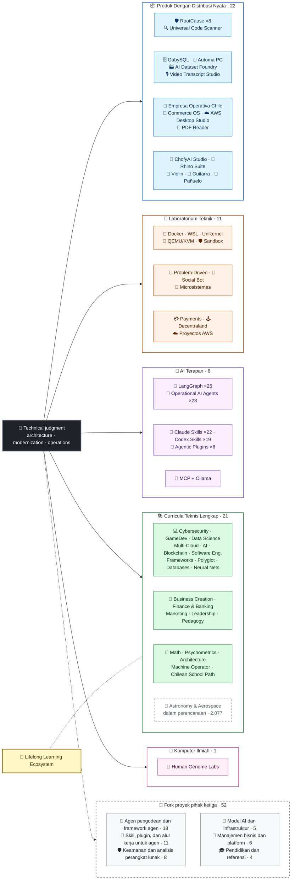

<div align="center">

# 👋Vladimir Acuña

## **Arsitek Solusi·Senior Full- Stack·Transformasi Digital·Manajemen & Operasi**

**Secara profesional terlatih dalam Ilmu Komputer dan Teknik Komputer dan Administrasi Bisnis, dengan 16 tahun membangun dan perangkat lunak operasi di lingkungan nyata. Saya menghubungkan bisnis, orang, proses, dan teknologi untuk merancang, mengevaluasi, memberikan, dan mempertahankan solusi dengan penilaian teknis dan pandangan operasional - didukung oleh bukti yang dapat diverifikasi dalam akun GitHub ini.**

[](https://vladimiracunadev-create.github.io/)
[](https://www.linkedin.com/in/vladimir-acu%C3%B1a-valdebenito-11924a29/)
[](mailto:vladimir.acuna.dev@gmail.com)

[](#scope-profesional)
[](docs/ECOSYSTEM.id.md)
[](#curricula-teknis-lengkap)

<!-- STATS:START -->
[](https://github.com/vladimiracunadev-create?tab=repositories)
[](https://github.com/vladimiracunadev-create?tab=repositories)
[](#ekosistem-pada-a-glance)
[](#curricula-teknis-lengkap)
[](https://github.com/vladimiracunadev-create?tab=repositories)
[](docs/ECOSYSTEM.id.md#forks)
[](https://github.com/vladimiracunadev-create?tab=repositories)
[](https://github.com/pulls?q=author%3Avladimiracunadev-create+type%3Apr)
[](https://github.com/issues?q=author%3Avladimiracunadev-create+type%3Aissue)
<!-- STATS:END -->

[](https://github.com/vladimiracunadev-create?tab=repositories)
[](https://github.com/vladimiracunadev-create?tab=followers)

[🧭 Mulai dari mana](docs/START_HERE.en.md) ·
[🌐 Portfolio (22 languages)](https://vladimiracunadev-create.github.io/) ·
[🧩 Ecosystem](#ekosistem-pada-a-glance) ·
[🛠️ Tumpukan teknologi](#-tumpukan-teknologi) ·
[⚡ Evaluate me in 10 minutes](#jika-kau-memiliki-10-menit-untuk-mengevaluasi-aku) ·
[✅ Professional scope](#scope-profesional) ·
[🧭 Non-coding management](#manajemen-administrasi-dan-non--coding-kesempatan-karir) ·
[📋 Role matrix](PROFESIONAL_ROLES.md) ·
[📬 Contact](#kontak)

**🌐 Versi lengkap:** [Español](README.md) · [English](README.en.md) · [Português](README.pt.md) · [Italiano](README.it.md) · [Français](README.fr.md) · [简体中文](README.zh.md) · [繁體中文](README.zh-TW.md) · [日本語](README.ja.md) · [한국어](README.ko.md) · [Türkçe](README.tr.md) · [Русский](README.ru.md) · [Tiếng Việt](README.vi.md) · [ไทย](README.th.md) · [Deutsch](README.de.md) · [Українська](README.uk.md) · [Polski](README.pl.md) · [العربية](README.ar.md) · [فارسی](README.fa.md) · [Bahasa Indonesia](README.id.md) · [Nederlands](README.nl.md) · [हिन्दी](README.hi.md) · [Ελληνικά](README.el.md)

**Inti teknis:**
PHP 8 · Python · Rust · Go · Node/TS · Java 21 · .NET 8 · Dart/Flutter · WASM
· AWS · Terraform · Kubernetes · Docker · n8n · LangGraph/MCP · CI/CD · FinOps · Observability

**Bisnis-jembatan teknologi:**
analisis proses dan persyaratan·evaluasi solusi·koordinasi pengiriman·operasi dan kontinuitas·manajemen risiko·produk dan layanan·pendidikan teknis

</div>

---

> [!NOTE]
> Profil ini tidak mengubah peluang menjadi pengalaman. Diproduksi pengalaman teknis, keterampilan transferable, aplikasi yang layak, dan tujuan pembangunan masa depan secara eksplisit dipisahkan. Terkait dengan bukti GitHub dapat dieksekusi atau dokumenter; dimana sesuatu berada**tidak**selesai, itu dinyatakan seperti itu.

## 🧭 Mulai dari mana

Pilih kasus Anda dan langsung menuju yang Anda butuhkan:

🧑‍💼 [Rekrutmen](docs/guides/RECRUITER.en.md) · 💼 [Klien atau freelance](docs/guides/FREELANCE.en.md) · 🛠️ [Evaluasi teknis](docs/guides/TECH_LEAD.en.md) · 🏢 [Bisnis dan manajemen](docs/guides/BUSINESS.en.md) · 🤝 [Kolaborasi dan keamanan](docs/guides/COLLABORATOR.en.md) · 🎓 [Belajar atau mengajar](docs/guides/LEARNER.en.md)

<sub>(English)</sub>

## 🎯Apa yang akan Anda temukan di sini

Ini bukan "satu repo": ini adalah ekosistem dengan standar bersama.

- 🔁 **Demo dapat direproduksi**- Klon, lari, validasi.
- 🧰 **Standardisasi Tooling**- Makefiles, Hub CRI,`doctor`, dan`smoke`per repositori.
- 🛡️ **Pertahanan dalam kedalaman**- Pemindaian rahasia, kebijakan, dan praktek terlarang secara eksplisit.
- 📈 **Observasi** — `/health`, `/ready`, `/metrics`, dasbor, dan traceability.
- 📚 **Dokumentasi audiencearenalitentment**- perekrut, pemula, DevOps, atau keamanan, tergantung pada repositori.
- 📦 **Pemrograman distribusi**- bisa diunduh rilis, checksums, dan membuat bukti; tanda tangan komersial / store dideklarasikan sebagai tertunda ketika berlaku.
- 🌍 **Internasionalisasi** — profil ini diterbitkan dalam 22 bahasa dan portofolio menyediakan 154 PDF publik (7 keluarga × 22 bahasa) (ES · EN · PT · IT · FR · ZH · ZH-TW · JA · KO · TR · RU · VI · TH · DE · UK · PL · AR · FA · ID · NL · HI · EL).
- 🧭 **Kejujuran teknis**- setiap kasus berlabel`OPERATIONAL`, `DOCUMENTED/SCAFFOLD`, atau`PLANNED`.

## ✅Status Dapat Diverifikasi

| Permukaan | Bukti beton |
|---|---|
| 🧪 **Uji cakupan** | GabySQL**850 tes**+ fuzzing over**Kueri 503.8M**(0 panik)·Empresa Operativa Chile**230 tests** ·Automa**150 pytest** ·multi- OS CI |
| 🤖 **Agen-kelas-produksi** | LangGrafik RealWorld**25 / 25 backend operasional**(kasus 01- 25, 100% cakupan)·Agen AI Operasional**23 agen**dengan**69 deterministik eval** |
| 🔗 **Integrasi Polyglot** | **20 kasus**- = Sender Avern8n Penerima = -**19 operasional**, secara individual diaudit dengan Docker -· **18 + mesin DB** · **20 + kontainer** ·11 pola |
| 📦 **Distribusi** | **155 rilis**di seluruh ekosistem**65 repositori publik milik** ·installers dan artifak`.exe` · `.msi` · `.dmg` · `.apk`dengan jumlah dan bukti yang ada; tanda tangan komersial / toko dalam proses dimana dapat diterapkan |
| 🛡️ **Rantai Supply** | CodeQL·Semgrep·Bandit·Trivy·Grype·Gitleaks·TruffleHog·CycloneDX SBOM·Scorecard |
| 📚 **Curricula** | **Kelas 14,550**diverifikasi di seluruh 21 program, dihitung oleh[a workflow](.github/workflows/stats.yml)dari struktur repositori nyata atau sumber yang dapat diverifikasi dideklarasikan dalam repositori - tidak ditulis dengan tangan -·setiap program mendeklarasikan status editorial dan keterbatasan |
| 🌐 **Portfolio** | PWA yang dapat dipasang· **22 bahasa** · **154 PDFs**dihasilkan oleh pipeline·API Data CV·Capacitor Android·Lighthouse 100 |
| 🔒 **Telemetri** | Zero telemetry in forensic products and Empresa operativa Chile - verified in every build (no Android`INTERNET`ijin) |
| 🌐 **Situs yang dipublikasikan** | **57 Situs Halaman GitHub**- 56 pendaratan, satu per produk, program, atau navigator ekosistem, ditambah portofolio - masing-masing dikerahkan dari repositori sendiri·semua 57 diverifikasi dengan HTTP`200` |

## 🛠️ Tumpukan teknologi

Teknologi yang terdeteksi di repositori publik (manifes, dependensi, kontainer, dan kode), dikelompokkan per area. Muncul di sebuah repositori —termasuk laboratorium dan kurikulum— adalah bukti penggunaan, bukan klaim pengalaman produksi bertahun-tahun.

**Bahasa**


<sub>Python · JavaScript · TypeScript · Rust · Go · Java · PHP · C# · Dart · Kotlin · Swift · Ruby · Elixir · Zig · Clojure · C · Solidity · Bash · PowerShell · HTML · CSS · WebAssembly · SQL · Erlang · F# · Crystal · GDScript · HCL</sub>

**Framework, runtime, dan pustaka**


<sub>Node.js · Express · React · Vue · Svelte · Astro · Vite · Vitest · FastAPI · Flask · Django · Spring Boot · ASP.NET / .NET · Laravel · Rails · Flutter · Tauri · Electron · Qt / PySide6 · Capacitor · Godot · PyTorch · scikit-learn · Polars · pandas · NumPy · Optuna · SHAP · Transformers · PEFT / LoRA · Playwright · pytest · Jupyter · Streamlit · Pydantic · Tokio · Axum · SQLx · Serde</sub>

**Basis data**


<sub>PostgreSQL · MySQL · MariaDB · SQLite · MongoDB · Redis · Neo4j · Cassandra · Elasticsearch · ClickHouse · CockroachDB · InfluxDB · TimescaleDB · DuckDB · SQL Server · Oracle · pgvector · PostgREST · GraphQL · GabySQL (Rust)</sub>

**Cloud, kontainer, dan DevOps**


<sub>AWS · Terraform · Kubernetes · Docker / Compose · GitHub Actions · Git · GitHub · GitLab · Linux · Nginx · Make · Inno Setup · FinOps · CI/CD</sub>

**Observabilitas dan pesan**


<sub>Prometheus · Grafana · OpenTelemetry · Kafka · MQTT (Mosquitto) · Elasticsearch / Kibana · cAdvisor · k6</sub>

**AI, agen, skill, dan MCP**


<sub>Claude Code · Claude Skills · Codex Skills · Agentic Plugins · MCP · LangGraph · Ollama · n8n · RAG · Whisper · Transformers · PEFT / LoRA · Optuna · SHAP · Polars · PyTorch</sub>

**Keamanan dan rantai pasok**


**Platform target**


<sub>Windows · macOS · iOS · Linux · Android · Web / PWA</sub>

## 🗺️Ekosistem Pada A Glance



## 🗂️ Ekosistem: produk, laboratorium, AI terapan, kurikulum, dan komputasi ilmiah

Karya praktis profil ini ada di dokumen tersendiri: perangkat lunak yang diunduh dan dipasang, laboratorium rekayasa, AI terapan, kurikulum teknis lengkap, dan komputasi ilmiah, beserta deskripsi setiap fork proyek pihak ketiga yang ada di akun.

- 📦 **Produk Dengan Distribusi Nyata** (22)
- 🧪 **Laboratorium Teknik** (11)
- 🤖 **AI Terapan** (6)
- 📚 **Curricula Teknis Lengkap** (21)
- 🔬 **Komputer Ilmiah** (1)
- 🍴 **Fork proyek pihak ketiga** (52)

👉 **[Lihat ekosistem lengkap](docs/ECOSYSTEM.id.md)** · [🍴 Fork proyek pihak ketiga](docs/ECOSYSTEM.id.md#forks)

## 📚Curricula Teknis Lengkap

Program Sequential dalam bahasa Spanyol, dengan status dan lingkup dideklarasikan oleh setiap repositori. 21 program ditambahkan ke**Kelas 14,550**(Yang dihitung dengan hisab) oleh malaikat Jibril.[a workflow](.github/workflows/stats.yml)dari struktur repositori nyata atau sumber yang dapat diverifikasi dideklarasikan dalam repositori; lencana menyegarkan mingguan dan tidak ditulis dengan tangan.

🌌 **Dalam perencanaan, di luar hitungan:** [Astronomi, astrofisika, ilmu antariksa, dan teknik dirgantara](https://github.com/vladimiracunadev-create/astronomy-astrophysics-space-sciences-aerospace-engineering-learning-program) — 2.077 kelas yang direncanakan dalam 12 area dan 133 blok; 397 sudah bertulis dan semuanya masih berstatus E0. Pelatihan mandiri, bukan sertifikasi profesional · [situs](https://vladimiracunadev-create.github.io/astronomy-astrophysics-space-sciences-aerospace-engineering-learning-program/).

👉 **[Lihat 21 program lengkap](docs/ECOSYSTEM.id.md#curricula)**

## ⚡Jika kau memiliki 10 menit untuk mengevaluasi aku

Idenya bukan hanya untuk melihat kode: itu adalah untuk melihat**bagaimana saya berpikir**, bagaimana saya mendokumentasikan, dan bagaimana saya membuat semuanya dapat dieksekusi.

**Rute A-Observabilitas nyata dan orkestra**♪ (Favoritku) ♪

```bash
git clone https://github.com/vladimiracunadev-create/social-bot-scheduler.git
```

Anda akan melihat aliran kerja, metrik, dashboard, dan pagar di 20 kasus dan 18 + mesin DB.

**Rute B - infrastruktur reproduksi dalam beberapa menit**

```bash
git clone https://github.com/vladimiracunadev-create/docker-labs.git
```

**Route C - Agen dengan keadaan diketik**

```bash
git clone https://github.com/vladimiracunadev-create/langgraph-realworld.git
```

**Route D - Produk forensik Rust, tanpa kloning**

Unduh pemasang atau biner CLI dari[RootCause releases](https://github.com/vladimiracunadev-create/rootcause-windows-inspector/releases)dan memverifikasi`SHA256SUMS`.

## 🧠Standar yang saya terapkan di semua repositori

- **DX pertama**- Jika tidak mudah untuk menjalankan, tidak berguna sebagai demo atau sebagai basis tim.
- **Observasi dari hari pertama**- Metrik dan traceabilitas, bukan setelah pemikiran.
- **Keamanan sebagai baris pipa**- Pemindaian rahasia, SBOM per rilis, praktek terlarang secara eksplisit.
- **Ketahanan nyata**- Idempotensi, pemutus sirkuit, dan degradasi terkendali.
- **Polyglot berdasarkan desain**- bahasa dan mesin yang dipilih dengan kasus penggunaan, tidak pernah dengan fashion.
- **Kejujuran tentang status**- satu repo diganti namanya (`Multisimulador` → `machine-operator-program`) untuk menghindari perangkat lunak yang menjanjikan yang belum ada.
- **Lencana adalah sinyal, bukan bukti**- Setiap repo juga menyatakan**apa TIDAK DILAKUKAN**.
- **Model keluar**- domain dirancang pertama; antarmuka adalah proyeksi.
- **Pekerjaan eksternal dinyatakan sebagai eksternal** — [52 fork](docs/ECOSYSTEM.id.md#forks) proyek pihak ketiga dijelaskan satu per satu dan berada di luar semua angka karya sendiri di profil ini.

## ✅Scope Profesional

Latar belakangku...**Ilmu Komputer dan Teknik Komputer + Administrasi Bisnis**- membantu saya menerjemahkan tujuan bisnis ke dalam keputusan teknis dan kendala teknis ke pilihan yang jelas untuk operasi, produk, pelanggan, dan kepemimpinan.

### 🎯Identitas Inti

| Peran | Backing |
|---|---|
| **Arsitek Solusi** | Modular, rancangan sistem skalable dengan penilaian evolusioner |
| **Arsitek Modernisasi Legacy** | Evolusi warisan nyata (PHP 5.x 8.x, refaktoring insurmental tanpa mengganggu operasi) |
| **Ketua Senior Stack / Tech** | Arsitektur, eksekusi, dan standar pada platform nyata (+ 16 tahun) |
| **Arsitek Audisi AI Automatisasi** | Sistem bawaan dengan LangGraph / MCP dan n8n arus dengan guardrails |

### ↗ Ekspansi alami

**Insinyur Orkestra AI** · **Sistem / Mesin Rust** · **Engineer Mobile (Flutter)** · **Insinyur Solusi** · **Pembangun Produk Teknis** · **Teknisi Trainer** · **Konsultan Transformasi Digital** · **Penganalisa Bisnis / Fungsional** · **Operasi Produk Teknis**

### ⚙️Ruang lingkup pelengkap

Insinyur Platform / IDP·DevOps / CI- CD·Cloud / AWS Engineer·Aplikasi SRE·Insinyur Automatisasi·Konsultan teknik- komersial

## 🧭Manajemen, Administrasi, dan Non- Coding Kesempatan Karir

Peran manajemen, administrasi, dan bisnis di mana informatika dan administrasi memberi kontribusi tanpa pemrograman sebagai tugas utama, diklasifikasikan secara jujur (kompetensi yang dapat ditransfer, peluang melamar, atau tujuan masa depan) beserta kesenjangan masing-masing. Area yang dicakup:

Teknologi kepemimpinan · Manajemen projek · Administrasi bisnis · Strategi dan perubahan · Analisis bisnis · Produk dan layanan · Manajemen keamanan cyber · Komersial dan penjualan · Keuangan dan kontrol manajemen · Kualitas · Pendidikan · Penyontrolan dan pemasok · Pemerintahan Data dan AI · Sektor publik

👉 **[Lihat matriks peluang lengkap](docs/MANAGEMENT.id.md)**

## 🤖Alur pengembangan berbantuan AI

| Alat | Penggunaan utama |
|---|---|
| **Kode Claude** | Review arsitektur, implementasi, dan dokumentasi teknis |
| **CATGPT Plus** | Analisis, arsitektur, dan iterasi (sejak 2023) |
| **Codex** | Pembuatan kode dan memfaktorkan ulang |
| **Antigravity** | Percepatan pengembangan dan otomatisasi mengalir |
| **Kode VS / OpenCode** | Lingkungan dengan bantuan AI terintegrasi |

> Aku menggabungkan penilaian teknisku sendiri, validasi manusia, dan arah arsitektur. AI memperkuat kapasitas, kecepatan, dan jangkauan - tidak menggantikan pengalaman.

## 📌Ketersediaan

**Buka ke:**Senior Full- Stack·Arsitektur·Modernisasi Legacy·Platform / IDP·Aplikasi SRE·DevOps pragmatis·Automatisasi·ADE AutomatisName·analisis bisnis / fungsional·Koordinat proyek IT·Operasi Produk·transformasi digital·solusi konsultasi / prapenjualan·pendidikan teknis·perbaikan kualitas dan kontinyu·Adopsi dan pemerintahan AI

**Dievaluasi menurut setiap lingkup peran:**Manajer Produk Pemilik / teknis·Pengiriman Layanan·Operasi IT·GRC / teknologi berisiko·administrasi dan operasi·kontrol manajemen·public-sektor modernisasi. Judul manajemen eksekutif dan general adalah tujuan pembangunan masa depan, bukan pengalaman yang diklaim.

**Modalitas:**remote atau hybrid, tergantung pada proyek.

## 📬Kontak

[](https://vladimiracunadev-create.github.io/)
[](https://www.linkedin.com/in/vladimir-acu%C3%B1a-valdebenito-11924a29/)
[](https://gitlab.com/vladimir.acuna.dev-group/vladimir.acuna.dev-group)
[](mailto:vladimir.acuna.dev@gmail.com)

---

<div align="center">

[🤝 Contribute](CONTRIBUTING.en.md) ·
[🛡️ Security](SECURITY.en.md) ·
[⚖️ Code of Conduct](CODE_OF_CONDUCT.en.md)

<sub>README disinkronkan dengan kondisi repositori publik yang dapat diverifikasi —angka dan perubahan dibaca melalui API— · verifikasi terakhir: <!-- VERIFIED:START -->2026-11-09<!-- VERIFIED:END -->.</sub>

</div>
