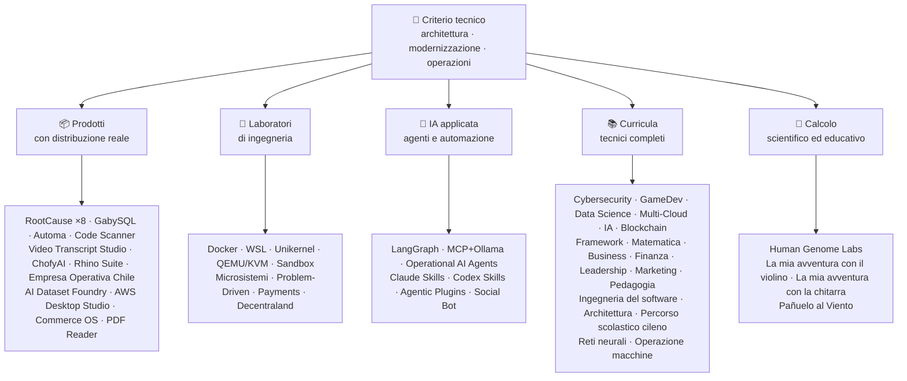

<div align="center">

# 👋 Vladimir Acuña

## **Solution Architect · Senior Full-Stack · Trasformazione Digitale · Gestione e Operazioni**

**Ingegnere in Informatica e Computazione e Amministratore d'Impresa, con oltre 16 anni nella costruzione e gestione di software reale. Collego business, persone, processi e tecnologia per progettare, valutare, consegnare e sostenere soluzioni — con evidenze verificabili su questo GitHub.**

[](https://vladimiracunadev-create.github.io/)
[](https://www.linkedin.com/in/vladimir-acu%C3%B1a-valdebenito-11924a29/)
[](mailto:vladimir.acuna.dev@gmail.com)

[](#-ambito-professionale)
[](docs/ECOSYSTEM.it.md)
[](#-curricula-tecnici-completi)

<!-- STATS:START -->
[](https://github.com/vladimiracunadev-create?tab=repositories)
[](https://github.com/vladimiracunadev-create?tab=repositories)
[](#-ecosistema-in-sintesi)
[](#-curricula-tecnici-completi)
[](https://github.com/vladimiracunadev-create?tab=repositories)
<!-- STATS:END -->

[](https://github.com/vladimiracunadev-create?tab=repositories)
[](https://github.com/vladimiracunadev-create?tab=followers)

[🌐 Portfolio (6 lingue)](https://vladimiracunadev-create.github.io/) ·
[🧩 Ecosistema](#-ecosistema-in-sintesi) ·
[⚡ Valutami in 10 minuti](#-se-hai-10-minuti-per-valutarmi) ·
[✅ Ambito professionale](#-ambito-professionale) ·
[🧭 Gestione senza programmazione](#-gestione-amministrazione-e-opportunità-professionali-senza-programmazione) ·
[📋 Matrice dei ruoli](PROFESIONAL_ROLES.md) ·
[📬 Contatto](#-contatto)

**🌐 Versioni complete:** [Español](README.md) · [English](README.en.md) · [Português](README.pt.md) · [Italiano](README.it.md) · [Français](README.fr.md) · [简体中文](README.zh.md) · [繁體中文](README.zh-TW.md) · [日本語](README.ja.md) · [한국어](README.ko.md) · [Türkçe](README.tr.md) · [Русский](README.ru.md) · [Tiếng Việt](README.vi.md) · [ไทย](README.th.md) · [Deutsch](README.de.md) · [Українська](README.uk.md) · [Polski](README.pl.md) · [العربية](README.ar.md) · [فارسی](README.fa.md) · [Bahasa Indonesia](README.id.md) · [Nederlands](README.nl.md) · [हिन्दी](README.hi.md) · [Ελληνικά](README.el.md)

**Nucleo tecnico:**
PHP 8 · Python · Rust · Go · Node/TS · Java 21 · .NET 8 · Dart/Flutter · WASM
· AWS · Terraform · Kubernetes · Docker · n8n · LangGraph/MCP · CI/CD · FinOps · Osservabilità

**Ponte business–tecnologia:** analisi di processi e requisiti · valutazione di soluzioni · coordinamento della delivery · operazioni e continuità · rischio · prodotto e servizio · formazione tecnica

</div>

---

> [!NOTE]
> Questo profilo non trasforma le possibilità in esperienza. Esperienza comprovata, competenze trasferibili, possibilità di candidatura e obiettivi futuri sono separati esplicitamente.

## 🎯 Cosa Troverai Qui

Non è “un repo”: è un ecosistema con standard comuni.

- 🔁 **Demo riproducibili** — cloni, esegui, validi.
- 🧰 **Tooling standardizzato** — Makefile, Hub CLI, `doctor` e `smoke` per repository.
- 🛡️ **Difesa in profondità** — secret scanning, policy e pratiche proibite dichiarate.
- 📈 **Osservabilità** — `/health`, `/ready`, `/metrics`, dashboard e tracciabilità.
- 📚 **Documentazione per pubblico** — recruiter, principiante, DevOps o sicurezza, secondo il repository.
- 📦 **Distribuzione come prodotto** — release scaricabili, checksum e prove di build; firme commerciali/store dichiarate come in corso quando applicabile.
- 🌍 **Internazionalizzazione** — portfolio in 6 lingue (ES · EN · PT · IT · FR · ZH).
- 🧭 **Onestà tecnica** — ogni caso marcato `OPERATIVO`, `DOCUMENTATO/SCAFFOLD` o `PIANIFICATO`.

## ✅ Stato Verificabile

| Superficie | Evidenza concreta |
|---|---|
| 🧪 **Copertura test** | GabySQL **828 test** + fuzz di **503,8 M query** (0 panic) · Empresa Operativa Chile **158 test** · Automa **150 pytest** · CI multi-OS |
| 🤖 **Agenti in produzione** | LangGraph RealWorld **25/25 backend operativi** (casi 01–25, copertura 100 %) · Operational AI Agents **13 agenti** con **39 eval deterministici** |
| 🔗 **Integrazione poliglotta** | **20 casi** emittente→n8n→ricevitore —**19 operativi**, auditati uno a uno con Docker— · **18+ motori DB** · **20+ container** · 11 pattern |
| 📦 **Distribuzione** | **151 release** pubblicate in un ecosistema di **64 repository pubblici propri** · installer e artefatti `.exe` · `.msi` · `.dmg` · `.apk` con checksum e prove di build; firme commerciali/store in corso quando applicabile |
| 🛡️ **Supply chain** | CodeQL · Semgrep · Bandit · Trivy · Grype · Gitleaks · TruffleHog · SBOM CycloneDX · Scorecard |
| 📚 **Curricula** | **14.530 classi** verificabili in 21 programmi, contate da [un workflow](.github/workflows/stats.yml) sulla struttura reale o su una fonte verificabile dichiarata nel repository —non scritte a mano— · ogni programma dichiara il proprio stato editoriale e i propri limiti |
| 🌐 **Portfolio** | PWA installabile · **6 lingue** · **36 PDF** via pipeline · CV Data API · Capacitor Android · Lighthouse 100 |
| 🔒 **Telemetria** | Zero nei prodotti forensi e in Empresa Operativa Chile — verificata in ogni build (senza permesso Android `INTERNET`) |
| 🌐 **Siti pubblicati** | **56 siti** su GitHub Pages —55 landing, una per prodotto, programma o navigatore dell'ecosistema, più il portfolio— tutti distribuiti dal proprio repository · tutti verificati con risposta `200` |

## 🗺️ Ecosistema In Sintesi



## 🗂️ Ecosistema: prodotti, laboratori, IA applicata e calcolo scientifico

Il lavoro pratico del profilo vive in un documento a parte: software da scaricare e installare, laboratori di ingegneria, IA applicata e calcolo scientifico, più la descrizione di ogni fork di progetti di terzi presente nell'account.

- 📦 **Prodotti Con Distribuzione Reale** (22)
- 🧪 **Laboratori Di Ingegneria** (11)
- 🤖 **IA Applicata** (6)
- 🔬 **Calcolo Scientifico** (1)
- 🍴 **Fork di progetti di terzi** (52)

👉 **[Vedi l'ecosistema completo](docs/ECOSYSTEM.it.md)** · [🍴 Fork di progetti di terzi](docs/ECOSYSTEM.it.md#forks)

## 📚 Curricula Tecnici Completi

Programmi sequenziali in spagnolo, con stato e ambito dichiarati da ogni repository. I 21 programmi sommano **14.530 classi**, contate da [un workflow](.github/workflows/stats.yml) sulla struttura reale o su una fonte verificabile dichiarata nel repository; il badge viene aggiornato ogni settimana e non è scritto a mano.

🧭 [**Lifelong Learning Ecosystem**](https://github.com/vladimiracunadev-create/lifelong-learning-ecosystem) è una bussola federata che collega 30 percorsi reali in 6 aree tramite mappe visuali e un [portale offline accessibile](https://vladimiracunadev-create.github.io/lifelong-learning-ecosystem/), senza essere contato come programma aggiuntivo.

| Programma | Classi | Ambito |
|---|---:|---|
| [🔢 **Matematica Computazionale**](https://github.com/vladimiracunadev-create/computational-mathematics-program) | 360 | Dal contare con le dita a riprodurre un paper · **360 dimostrazioni deterministiche verificate in CI** · 1.080 notebook · glossario di 489 termini · [sito](https://vladimiracunadev-create.github.io/computational-mathematics-program/) |
| [🏦 **Finanza e Banca**](https://github.com/vladimiracunadev-create/finance-and-banking-evolution-program) | 356 | 534 h · matematica finanziaria e IFRS → credito, rischio, Basilea III, open finance, DLT, stablecoin e MiCA · **27 casi** · **298 test** · [sito](https://vladimiracunadev-create.github.io/finance-and-banking-evolution-program/) |
| [🎮 **GameDev**](https://github.com/vladimiracunadev-create/modern-gamedev-program) | 352 | Matematica e C#/C++/GDScript → shader, IA, multiplayer, VR/AR · Godot · Unity · Unreal · **10 lab Godot verificati in CI** · [sito](https://vladimiracunadev-create.github.io/modern-gamedev-program/) |
| [🛡️ **Cybersecurity**](https://github.com/vladimiracunadev-create/modern-cybersecurity-program) | 360 | **v1.3.0** · 20 parti · fondamenti → Red Team, DFIR, cloud security, exploit dev, CTF e game security · mappato a **7 certificazioni** · app offline Android/web · manuale PDF · [sito](https://vladimiracunadev-create.github.io/modern-cybersecurity-program/) |
| [📈 **Marketing, Vendite e Crescita**](https://github.com/vladimiracunadev-create/marketing-sales-growth-evolution-program) | 336 | 24 parti con definizioni operative, schede di misurazione, bibliografia verificabile e contesto normativo cileno · **v1.6.0** · 1,29 M parole · 17 percorsi per ruolo · [sito](https://vladimiracunadev-create.github.io/marketing-sales-growth-evolution-program/) |
| [🏢 **Creazione d'Impresa**](https://github.com/vladimiracunadev-create/modern-business-creation-program) | 336 | Creare e operare un'impresa reale in Cile: idea, costituzione, SII, operazione, crisi e uscita · 360 diagrammi · glossario di 1.251 termini · manuale di 1.548 pagine · [sito](https://vladimiracunadev-create.github.io/modern-business-creation-program/) |
| [🏛️ **Architettura e Ambiente Costruito**](https://github.com/vladimiracunadev-create/architecture-built-environment-learning-program) | 830 | 83 parti · 60 sessioni integrative · 34 percorsi · fonti tracciabili · Markdown, lettore offline e GitHub Pages · [sito](https://vladimiracunadev-create.github.io/architecture-built-environment-learning-program/) |
| [🇨🇱 **Percorso Scolastico Cileno**](https://github.com/vladimiracunadev-create/chilean-school-learning-path) | 8.841 | Dalla 1ª primaria alla 4ª superiore cilena · **4.156 esperienze trasversali integrate** · **2.823 obiettivi di apprendimento** · fonti MINEDUC · nessuna proposta in sospeso e revisione umana specializzata ancora necessaria · [sito](https://vladimiracunadev-create.github.io/chilean-school-learning-path/) |
| [🧭 **Ingegneria del software moderna**](https://github.com/vladimiracunadev-create/modern-software-engineering-program) | 480 | 40 parti e 8 fasi · fondamenti → prodotto, architettura, sicurezza, DevOps, SRE, SPEC, IA e sistemi multi-agente · stato editoriale dichiarato dal repository · [sito](https://vladimiracunadev-create.github.io/modern-software-engineering-program/) |
| [🎓 **Pedagogia e Scienze dell'Apprendimento**](https://github.com/vladimiracunadev-create/education-pedagogy-learning-sciences-program) | 300 | Come una persona impara e come si forma chi insegna · 25 parti · **ogni classe dichiara evidenza e limiti** · alfabetizzazione, metodologie comparate, bisogni educativi, convivenza, diversità culturale · glossario di 1.097 termini · 14 percorsi · **v2.1.0** · [sito](https://vladimiracunadev-create.github.io/education-pedagogy-learning-sciences-program/) |
| [☁️ **Multi-Cloud**](https://github.com/vladimiracunadev-create/multi-cloud-engineering-program) | 288 | AWS · Azure · GCP · Kubernetes · Terraform · SRE · FinOps · **1.288 ore** · 288 lab con evidenza JSON · 1.032 fonti · manuale PDF di 2.884 pagine · [sito](https://vladimiracunadev-create.github.io/multi-cloud-engineering-program/) |
| [🎖️ **Leadership Esecutiva**](https://github.com/vladimiracunadev-create/executive-leadership-founder-program) | 288 | Dal primo risultato alla direzione di un'azienda e alla fondazione della propria: team, KPI/OKR, finanza, prodotto, rischio, board e M&A · [sito](https://vladimiracunadev-create.github.io/executive-leadership-founder-program/) |
| [🐍 **Python Data Science**](https://github.com/vladimiracunadev-create/python-data-science-program) | 232 | Polars, ML+Optuna/SHAP, PyTorch/LLMs/LoRA, MLOps · app Windows nativa + APK Android · [sito](https://vladimiracunadev-create.github.io/python-data-science-program/) |
| [🧠 **Evoluzione dell'IA**](https://github.com/vladimiracunadev-create/artificial-intelligence-evolution-program) | 184 | Simbolica → probabilistica → deep learning → LLM, RAG, agenti, sicurezza e frontiera · **v0.17.0** · **708 notebook** · 148 paper fondamentali · app offline Windows, Android e PWA · [sito](https://vladimiracunadev-create.github.io/artificial-intelligence-evolution-program/) |
| [🌐 **Programmazione Comparata**](https://github.com/vladimiracunadev-create/polyglot-programming-labs) | 176 | Un concetto, **10 linguaggi** verificati in CI — **1.360 implementazioni** — più **1.632 programmi** in linguaggi ancora vivi e atlas di **60 schede in 15 famiglie** · [sito](https://vladimiracunadev-create.github.io/polyglot-programming-labs/) |
| [🧩 **Framework Comparati**](https://github.com/vladimiracunadev-create/framework-ecosystems-labs) | 149 | Un contratto eseguibile contro Express, FastAPI, Spring Boot, ASP.NET, Django, Rails, Laravel, React, Vue, Svelte e altri · **70 classi costruite** · **397 casi verificati in CI** · **210 fonti** ISBN/DOI · [sito](https://vladimiracunadev-create.github.io/framework-ecosystems-labs/) |
| [🗄️ **Database**](https://github.com/vladimiracunadev-create/database-systems-labs) | 74 | **v3.0.0** · ingegneria database in 15 parti · 230 ore · 120 fonti con ISBN, DOI o standard · stesso caso in 27 motori · 150 pytest · [sito](https://vladimiracunadev-create.github.io/database-systems-labs/) |
| [📐 **Psicometria e Misurazione**](https://github.com/vladimiracunadev-create/psychometrics-and-assessment-program) | 40 | Come si costruisce, valuta, valida e audita uno strumento di misurazione · 8 parti · motore eseguibile con **5 strumenti e 344 item, 276 di pubblico dominio** |
| [⛓️ **Blockchain**](https://github.com/vladimiracunadev-create/blockchain-learning-path) | 66 | **v0.14.0** · da zero a infrastruttura finanziaria programmabile e analitica on-chain · **91 pratiche** e **363 test** · Foundry e Slither in CI · [sito](https://vladimiracunadev-create.github.io/blockchain-learning-path/) |
| [🧠 **Neural Network Training Labs**](https://github.com/vladimiracunadev-create/neural-network-training-labs) | 31 | 7 moduli · ≈214 ore · **93 notebook** —31 classi, 31 versioni studente e 31 soluzioni— · PyTorch · [sito di studio](https://vladimiracunadev-create.github.io/neural-network-training-labs/) |
| [🕹️ **Machine Operator**](https://github.com/vladimiracunadev-create/machine-operator-program) | 451 | **41 moduli formativi**, uno per macchina · **502 h 15 min** · sistemi, comandi, fisica, sicurezza e design di simulazione con fonti per classe · *nessun simulatore eseguibile ancora, e viene dichiarato* |

## ⚡ Se Hai 10 Minuti Per Valutarmi

L'idea non è solo guardare codice: è vedere **come penso**, come documento e come rendo tutto eseguibile.

**Percorso A — Osservabilità e orchestrazione reale** *(il mio preferito)*

```bash
git clone https://github.com/vladimiracunadev-create/social-bot-scheduler.git
```

Vedrai workflow, metriche, dashboard e guardrail su 19 casi e 18+ motori DB.

**Percorso B — Infrastruttura riproducibile in pochi minuti**

```bash
git clone https://github.com/vladimiracunadev-create/docker-labs.git
```

**Percorso C — Agenti con stato tipizzato**

```bash
git clone https://github.com/vladimiracunadev-create/langgraph-realworld.git
```

**Percorso D — Prodotto forense in Rust, senza clonare**

Scarica installer o binario CLI dalle [release di RootCause](https://github.com/vladimiracunadev-create/rootcause-windows-inspector/releases) e verifica `SHA256SUMS`.

## 🧠 Standard Che Applico In Tutti I Repository

- **DX prima di tutto** — se non si esegue facilmente, non serve come demo né come base di team.
- **Osservabilità dal giorno 1** — metriche e tracciabilità, non aggiunte dopo.
- **Sicurezza come pipeline** — secret scanning, SBOM per release, pratiche proibite dichiarate.
- **Resilienza reale** — idempotenza, circuit breaker e degradazione controllata.
- **Poliglotta per design** — linguaggio e motore scelti dal caso d'uso.
- **Onestà sullo stato** — un repo è stato rinominato (`Multisimulador` → `machine-operator-program`) per non promettere software che non esiste ancora.
- **I badge sono segnali, non evidenza** — ogni repo dichiara anche **cosa NON fa**.
- **Dal modello verso l'esterno** — prima il dominio, poi l'interfaccia come proiezione.
- **Ciò che è esterno viene dichiarato** — i [52 fork](docs/ECOSYSTEM.it.md#forks) di progetti di terzi sono descritti uno per uno e restano fuori da tutti i numeri di opera propria di questo profilo.

## ✅ Ambito Professionale

La mia formazione doppia —**Ingegneria Informatica e della Computazione + Amministrazione d'Impresa**— traduce obiettivi di business in decisioni tecniche e vincoli tecnici in opzioni chiare per operazioni, prodotto, clienti e direzione.

### 🎯 Identità Principale

| Ruolo | Evidenza |
|---|---|
| **Solution Architect** | Design di sistemi modulari, scalabili e con criterio evolutivo |
| **Legacy Modernization Architect** | Evoluzione reale del legacy (PHP 5.x→8.x, refactoring incrementale senza fermare l'operazione) |
| **Senior Full-Stack / Tech Lead** | Architettura, esecuzione e standard in piattaforme reali (+16 anni) |
| **AI Automation Architect** | Sistemi agentic con LangGraph/MCP e flussi n8n con guardrail |

### ↗ Espansione Naturale

**AI Orchestration Engineer** · **Systems / Rust Engineer** · **Mobile Engineer (Flutter)** · **Solutions Engineer** · **Technical Product Builder** · **Technical Trainer** · **Consulente di Trasformazione Digitale** · **Business / Functional Analyst** · **Technical Product Operations**

### ⚙️ Ambito Complementare

Platform Engineer / IDP · DevOps / CI-CD · Cloud / AWS Engineer · Application SRE · Automation Engineer · Consulente tecnico-commerciale

## 🧭 Gestione, Amministrazione e Opportunità Professionali senza Programmazione

Ruoli di gestione, amministrazione e business in cui informatica e amministrazione contribuiscono senza che programmare sia il compito centrale, classificati con onestà (competenza trasferibile, possibilità di candidatura o obiettivo futuro) e con il divario di ciascuno. Aree coperte:

Direzione tecnologica · Progetti · Amministrazione · Strategia · Business analysis · Prodotto e servizio · GRC e continuità · Commerciale · Finanza e controllo · Qualità · Educazione · Logistica · Dati e IA · Settore pubblico

👉 **[Vedi la matrice completa delle opportunità](docs/MANAGEMENT.it.md)**

## 🤖 Flusso Di Sviluppo Assistito Da IA

| Strumento | Uso principale |
|---|---|
| **Claude Code** | Revisione architetturale, implementazione e documentazione tecnica |
| **ChatGPT Plus** | Analisi, architettura e iterazione (dal 2023) |
| **Codex** | Generazione e refactoring di codice |
| **Antigravity** | Accelerazione di flussi di sviluppo e automazione |
| **VS Code / OpenCode** | Ambienti con assistenza IA integrata |

> Combino criterio tecnico proprio, validazione umana e direzione architetturale. L'IA amplifica capacità, velocità e portata — non sostituisce l'esperienza.

## 📌 Disponibilità

**Aperto a:** Senior Full-Stack · Architettura · Modernizzazione legacy · Platform/IDP · SRE · DevOps · Automazione · AI Automation · business/functional analysis · coordinamento progetti IT · Product Operations · trasformazione digitale · presales/solutions · formazione tecnica · qualità · adozione e governance IA

**Valutato in base al perimetro:** Product Owner/Manager tecnico · Service Delivery · IT Operations · GRC/risk · amministrazione/operations · management control · modernizzazione pubblica. I ruoli dirigenziali sono obiettivi futuri, non esperienza dichiarata.

**Modalità:** remoto o ibrido, secondo il progetto.

## 📬 Contatto

[](https://vladimiracunadev-create.github.io/)
[](https://www.linkedin.com/in/vladimir-acu%C3%B1a-valdebenito-11924a29/)
[](https://gitlab.com/vladimir.acuna.dev-group/vladimir.acuna.dev-group)
[](mailto:vladimir.acuna.dev@gmail.com)

---

<div align="center">

[🤝 Contribuire](CONTRIBUTING.it.md) ·
[🛡️ Sicurezza](SECURITY.it.md) ·
[⚖️ Codice di condotta](CODE_OF_CONDUCT.it.md)

<sub>README sincronizzato con lo stato verificabile dei repository pubblici —cifre e cambiamenti letti via API— · ultima verifica: 12 ottobre 2026.</sub>

</div>
