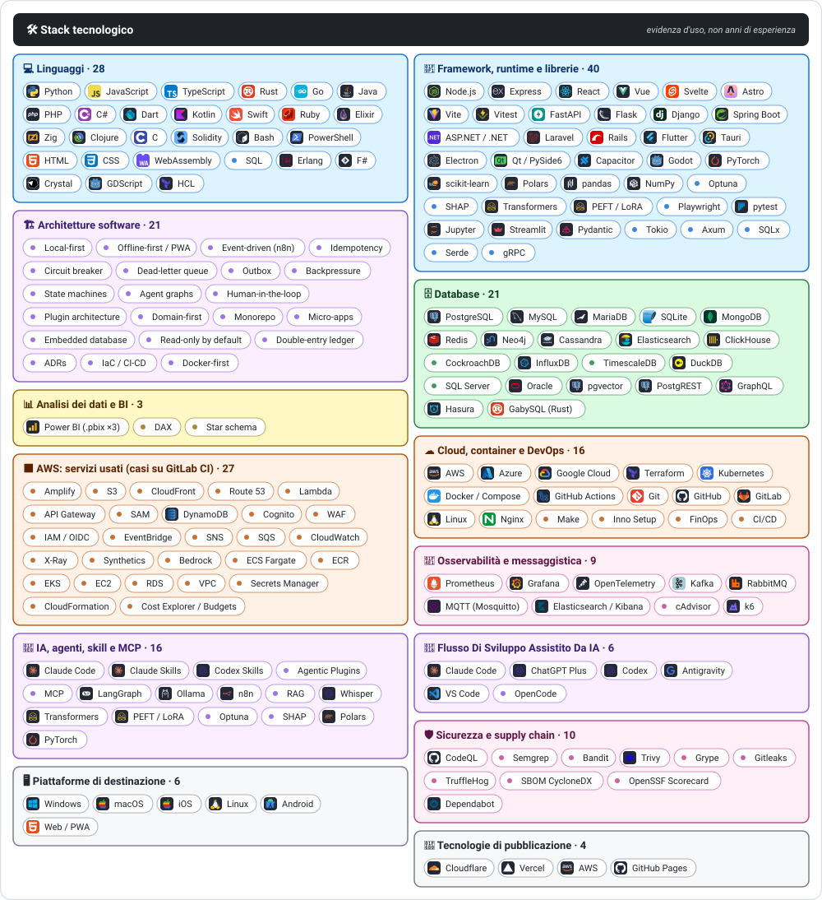
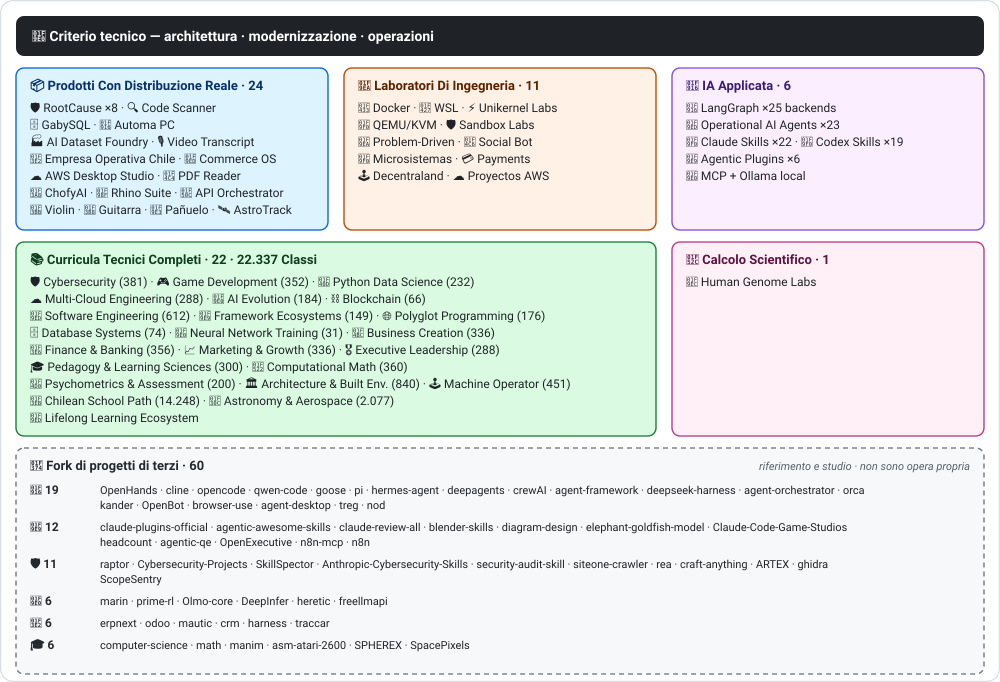

# 👋 Vladimir Acuña

## **Ingegnere dell'IA · Solution Architect · Senior Full-Stack · Trasformazione Digitale · Gestione e Operazioni**

**Ingegnere in Informatica e Computazione e Amministratore d'Impresa, con oltre 16 anni nella costruzione e gestione di software reale. Collego business, persone, processi e tecnologia per progettare, valutare, consegnare e sostenere soluzioni — con evidenze verificabili su questo GitHub.**

<!-- STATS:START -->

<!-- STATS:END -->

[🧭 Da dove iniziare](docs/START_HERE.it.md) ·
[🌐 Portfolio (22 lingue)](https://vladimiracunadev-create.github.io/) ·
[🧩 Ecosistema](#-ecosistema-in-sintesi) ·
[🛠️ Stack tecnologico](#-stack-tecnologico) ·
[⚡ Valutami in 10 minuti](docs/guides/TECH_LEAD.it.md) ·
[✅ Ambito professionale](#-ambito-professionale) ·
[🧭 Gestione senza programmazione](#-gestione-amministrazione-e-opportunità-professionali-senza-programmazione) ·
[📋 Matrice dei ruoli](PROFESIONAL_ROLES.it.md) ·
[📬 Contatto](#-contatto)

**🌐 Versioni complete:** [Español](README.md) · [English](README.en.md) · [Português](README.pt.md) · [Italiano](README.it.md) · [Français](README.fr.md) · [简体中文](README.zh.md) · [繁體中文](README.zh-TW.md) · [日本語](README.ja.md) · [한국어](README.ko.md) · [Türkçe](README.tr.md) · [Русский](README.ru.md) · [Tiếng Việt](README.vi.md) · [ไทย](README.th.md) · [Deutsch](README.de.md) · [Українська](README.uk.md) · [Polski](README.pl.md) · [العربية](README.ar.md) · [فارسی](README.fa.md) · [Bahasa Indonesia](README.id.md) · [Nederlands](README.nl.md) · [हिन्दी](README.hi.md) · [Ελληνικά](README.el.md)

**Nucleo tecnico:**
PHP 8 · Python · Rust · Go · Node/TS · Java 21 · .NET 8 · Dart/Flutter · WASM
· AWS · Terraform · Kubernetes · Docker · n8n · LangGraph/MCP · CI/CD · FinOps · Osservabilità

**Ponte business–tecnologia:** analisi di processi e requisiti · valutazione di soluzioni · coordinamento della delivery · operazioni e continuità · rischio · prodotto e servizio · formazione tecnica

---

> [!NOTE]
> Questo profilo non trasforma le possibilità in esperienza. Esperienza comprovata, competenze trasferibili, possibilità di candidatura e obiettivi futuri sono separati esplicitamente.

## 🧭 Da dove iniziare

Scegli il tuo caso e vai dritto a ciò che ti serve:

🧑‍💼 [Selezione del personale](docs/guides/RECRUITER.it.md) · 💼 [Cliente o freelance](docs/guides/FREELANCE.it.md) · 🛠️ [Valutazione tecnica](docs/guides/TECH_LEAD.it.md) · 🏢 [Business e gestione](docs/guides/BUSINESS.it.md) · 🤝 [Collaborazione e sicurezza](docs/guides/COLLABORATOR.it.md) · 🎓 [Imparare o insegnare](docs/guides/LEARNER.it.md)

## 🎯 Cosa Troverai Qui

Non è “un repo”: è un ecosistema con standard comuni.

- 🔁 **Demo riproducibili** — cloni, esegui, validi.
- 🧰 **Tooling standardizzato** — Makefile, Hub CLI, `doctor` e `smoke` per repository.
- 🛡️ **Difesa in profondità** — secret scanning, policy e pratiche proibite dichiarate.
- 📈 **Osservabilità** — `/health`, `/ready`, `/metrics`, dashboard e tracciabilità.
- 📚 **Documentazione per pubblico** — recruiter, principiante, DevOps o sicurezza, secondo il repository.
- 📦 **Distribuzione come prodotto** — release scaricabili, checksum e prove di build; firme commerciali/store dichiarate come in corso quando applicabile.
- 🌍 **Internazionalizzazione** — questo profilo è pubblicato in 22 lingue e il portfolio offre 154 PDF pubblici (7 famiglie × 22 lingue) (ES · EN · PT · IT · FR · ZH · ZH-TW · JA · KO · TR · RU · VI · TH · DE · UK · PL · AR · FA · ID · NL · HI · EL).
- 🧭 **Onestà tecnica** — ogni caso marcato `OPERATIVO`, `DOCUMENTATO/SCAFFOLD` o `PIANIFICATO`.

## ✅ Stato Verificabile

| Superficie | Evidenza concreta |
|---|---|
| 🧪 **Copertura test** | GabySQL **850 test** + fuzz di **503,8 M query** (0 panic) · Empresa Operativa Chile **230 test** · Automa **150 pytest** · CI multi-OS |
| 🤖 **Agenti in produzione** | LangGraph RealWorld **25/25 backend operativi** (casi 01–25, copertura 100 %) · Operational AI Agents **23 agenti** con **69 eval deterministici** |
| 🔗 **Integrazione poliglotta** | **20 casi** emittente→n8n→ricevitore —**19 operativi**, auditati uno a uno con Docker— · **18+ motori DB** · **20+ container** · 11 pattern |
| 📦 **Distribuzione** | **166 release** pubblicate in un ecosistema di **67 repository pubblici propri** · installer e artefatti `.exe` · `.msi` · `.dmg` · `.apk` con checksum e prove di build; firme commerciali/store in corso quando applicabile |
| 🛡️ **Supply chain** | CodeQL · Semgrep · Bandit · Trivy · Grype · Gitleaks · TruffleHog · SBOM CycloneDX · Scorecard |
| 📚 **Curricula** | **22.337 classi** verificabili in 22 programmi, contate da [un workflow](.github/workflows/stats.yml) sulla struttura reale o su una fonte verificabile dichiarata nel repository —non scritte a mano— · ogni programma dichiara il proprio stato editoriale e i propri limiti |
| 🌐 **Portfolio** | PWA installabile · **22 lingue** · **154 PDF** via pipeline · CV Data API · Capacitor Android · Lighthouse 100 |
| 🔒 **Telemetria** | Zero nei prodotti forensi e in Empresa Operativa Chile — verificata in ogni build (senza permesso Android `INTERNET`) |
| 🌐 **Siti pubblicati** | **57 siti** su GitHub Pages —56 landing, una per prodotto, programma o navigatore dell'ecosistema, più il portfolio— tutti distribuiti dal proprio repository · tutti verificati con risposta `200` |

## 🛠️ Stack tecnologico

Tecnologie rilevate nei repository pubblici (manifest, dipendenze, container e codice), raggruppate per area. Comparire in un repository —inclusi laboratori e curricula— è evidenza di utilizzo, non un'affermazione di anni di esperienza in produzione.

**Architetture software**

Local-first → [empresa-operativa-chile](https://github.com/vladimiracunadev-create/empresa-operativa-chile), [ai-dataset-foundry](https://github.com/vladimiracunadev-create/ai-dataset-foundry) · Event-driven → [social-bot-scheduler](https://github.com/vladimiracunadev-create/social-bot-scheduler) · Resilience → [problem-driven-systems-lab](https://github.com/vladimiracunadev-create/problem-driven-systems-lab) · Ledger → [universal-payments-engineering-lab](https://github.com/vladimiracunadev-create/universal-payments-engineering-lab) · Plugins → [agentic-plugins-toolkit](https://github.com/vladimiracunadev-create/agentic-plugins-toolkit) · Agents → [langgraph-realworld](https://github.com/vladimiracunadev-create/langgraph-realworld), [operational-ai-agents](https://github.com/vladimiracunadev-create/operational-ai-agents) · Domain-first → [rhino-suite](https://github.com/vladimiracunadev-create/rhino-suite) · Micro-apps → [microsistemas](https://github.com/vladimiracunadev-create/microsistemas) · Embedded DB → [gabysql](https://github.com/vladimiracunadev-create/gabysql) · IaC → [proyectos-aws](https://github.com/vladimiracunadev-create/proyectos-aws)

**Analisi dei dati e BI**

Power BI (.pbix ×3) · DAX · Star schema → [social-bot-scheduler](https://github.com/vladimiracunadev-create/social-bot-scheduler)

**AWS: servizi usati (casi su GitLab CI)**

Casi A–P → [proyectos-aws-gitlab](https://gitlab.com/vladimir.acuna.dev-group/proyectos-aws-gitlab) (GitLab CI → AWS; tutti i 16 dichiarati completati; il caso M, solo la fase 1) · [proyectos-aws](https://github.com/vladimiracunadev-create/proyectos-aws) (GitHub Actions) · EC2, RDS, VPC, Secrets Manager, CloudFormation, Cost Explorer → [aws-desktop-studio](https://github.com/vladimiracunadev-create/aws-desktop-studio) (interrogazione reale dell'inventario; EC2 con avvio, arresto e riavvio con doppio controllo)

**Flusso Di Sviluppo Assistito Da IA**

| Strumento | Uso principale |
|---|---|
| **Claude Code** | Revisione architetturale, implementazione e documentazione tecnica |
| **ChatGPT Plus** | Analisi, architettura e iterazione (dal 2023) |
| **Codex** | Generazione e refactoring di codice |
| **Antigravity** | Accelerazione di flussi di sviluppo e automazione |
| **VS Code / OpenCode** | Ambienti con assistenza IA integrata |

> Combino criterio tecnico proprio, validazione umana e direzione architetturale. L'IA amplifica capacità, velocità e portata — non sostituisce l'esperienza.

**Tecnologie di pubblicazione**

Cloudflare (lavoro personale) · Vercel (hackathon NASA Space Apps) · AWS (siti operativi, legati a GitLab) · GitHub Pages

## 🗺️ Ecosistema In Sintesi

## 🗂️ Ecosistema: prodotti, laboratori, IA applicata, curricula e calcolo scientifico

Il lavoro pratico del profilo vive in un documento a parte: software da scaricare e installare, laboratori di ingegneria, IA applicata, curricula tecnici completi e calcolo scientifico, più la descrizione di ogni fork di progetti di terzi presente nell'account.

- 📦 [**Prodotti Con Distribuzione Reale**](docs/ECOSYSTEM.it.md#products) (24)
- 🧪 [**Laboratori Di Ingegneria**](docs/ECOSYSTEM.it.md#labs) (11)
- 🤖 [**IA Applicata**](docs/ECOSYSTEM.it.md#ai) (6)
- 📚 [**Curricula Tecnici Completi**](docs/ECOSYSTEM.it.md#curricula) (22)
- 🔬 [**Calcolo Scientifico**](docs/ECOSYSTEM.it.md#science) (1)
- 🍴 [**Fork di progetti di terzi**](docs/ECOSYSTEM.it.md#forks) (60)

👉 **[Vedi l'ecosistema completo](docs/ECOSYSTEM.it.md)** · [🍴 Fork di progetti di terzi](docs/ECOSYSTEM.it.md#forks)

## 🛰️ Hackathon NASA Space Apps 2026

Ho partecipato al **NASA Space Apps Challenge 2026** (Santiago, 14 e 15 novembre), nella sfida *Planet X and SPHEREx*, in un team di 6 persone. Il prodotto è **AstroTrack · SPHEREx**: un visualizzatore web in cui si inseriscono coordinate del cielo e si vede quella zona come sequenza di immagini di SPHEREx nel tempo, con dati NASA/IPAC IRSA.

- **La mia parte:** accesso ai dati (query a IRSA con cache e precalcolo dei campi della demo), packaging (PWA, installer desktop con Tauri e APK Android con Capacitor), la vista «Download» e un audit di coerenza tra documentazione e codice.
- **Consegna verificabile:** [spherex-releases](https://github.com/vladimiracunadev-create/spherex-releases) raccoglie 7 release (da v0.1.0 a v0.4.2) con checksum SHA-256 · [applicazione web](https://spherex-planet-x-tau.vercel.app/) · [repository del team](https://github.com/mauriciovalenzuela742/SPHEREX).
- **Limiti dichiarati:** il visualizzatore, il design e il resto del backend sono opera di altre persone del team; gli installer non sono firmati e non sono stati provati su dispositivi reali; ho usato l'IA (Claude Code) come assistente, come dichiarato nel repository. Questo descrive il mio contributo, non un risultato dell'hackathon.

## 🧠 Standard Che Applico In Tutti I Repository

- **DX prima di tutto** — se non si esegue facilmente, non serve come demo né come base di team.
- **Osservabilità dal giorno 1** — metriche e tracciabilità, non aggiunte dopo.
- **Sicurezza come pipeline** — secret scanning, SBOM per release, pratiche proibite dichiarate.
- **Resilienza reale** — idempotenza, circuit breaker e degradazione controllata.
- **Poliglotta per design** — linguaggio e motore scelti dal caso d'uso.
- **Onestà sullo stato** — un repo è stato rinominato (`Multisimulador` → `machine-operator-program`) per non promettere software che non esiste ancora.
- **I badge sono segnali, non evidenza** — ogni repo dichiara anche **cosa NON fa**.
- **Dal modello verso l'esterno** — prima il dominio, poi l'interfaccia come proiezione.
- **Ciò che è esterno viene dichiarato** — i [60 fork](docs/ECOSYSTEM.it.md#forks) di progetti di terzi sono descritti uno per uno e restano fuori da tutti i numeri di opera propria di questo profilo.

## ✅ Ambito Professionale

La mia formazione doppia —**Ingegneria Informatica e della Computazione + Amministrazione d'Impresa**— traduce obiettivi di business in decisioni tecniche e vincoli tecnici in opzioni chiare per operazioni, prodotto, clienti e direzione.

### 🎯 Identità Principale

| Ruolo | Evidenza |
|---|---|
| **Solution Architect** | Design di sistemi modulari, scalabili e con criterio evolutivo |
| **Legacy Modernization Architect** | Evoluzione reale del legacy (PHP 5.x→8.x, refactoring incrementale senza fermare l'operazione) |
| **Senior Full-Stack / Tech Lead** | Architettura, esecuzione e standard in piattaforme reali (+16 anni) |
| **AI Automation Architect** | Sistemi agentic con LangGraph/MCP e flussi n8n con guardrail |

### ↗ Espansione Naturale

**AI Orchestration Engineer** · **Systems / Rust Engineer** · **Mobile Engineer (Flutter)** · **Solutions Engineer** · **Technical Product Builder** · **Technical Trainer** · **Consulente di Trasformazione Digitale** · **Business / Functional Analyst** · **Technical Product Operations** · **AI Engineer (LLM / ML)** · **Data Engineer** · **DevSecOps / AppSec Engineer** · **QA Automation / Test Engineer** · **Technical Writer** · **Docente / Formatore / Istruttore tecnologico** · **Instructional Designer (EdTech)** · **Technical Mentor**

### ⚙️ Ambito Complementare

Platform Engineer / IDP · DevOps / CI-CD · Cloud / AWS Engineer · Application SRE · Automation Engineer · Consulente tecnico-commerciale · Backend / API Engineer · Fintech / Payments Engineer · Developer Advocate / DevRel

## 🧭 Gestione, Amministrazione e Opportunità Professionali senza Programmazione

Ruoli di gestione, amministrazione e business in cui informatica e amministrazione contribuiscono senza che programmare sia il compito centrale, classificati con onestà (competenza trasferibile, possibilità di candidatura o obiettivo futuro) e con il divario di ciascuno. Aree coperte:

Direzione tecnologica · Progetti · Amministrazione · Strategia · Business analysis · Prodotto e servizio · GRC e continuità · Commerciale · Finanza e controllo · Qualità · Educazione · Logistica · Dati e IA · Settore pubblico

👉 **[Vedi la matrice completa delle opportunità](docs/MANAGEMENT.it.md)**

## 📌 Disponibilità

**Aperto a:** Senior Full-Stack · Architettura · Modernizzazione legacy · Platform/IDP · SRE · DevOps · Automazione · AI Automation · business/functional analysis · coordinamento progetti IT · Product Operations · trasformazione digitale · presales/solutions · formazione tecnica · qualità · adozione e governance IA

**Valutato in base al perimetro:** Product Owner/Manager tecnico · Service Delivery · IT Operations · GRC/risk · amministrazione/operations · management control · modernizzazione pubblica. I ruoli dirigenziali sono obiettivi futuri, non esperienza dichiarata.

**Modalità:** remoto o ibrido, secondo il progetto.

## 📬 Contatto

---

[🤝 Contribuire](CONTRIBUTING.it.md) ·
[🛡️ Sicurezza](SECURITY.it.md) ·
[⚖️ Codice di condotta](CODE_OF_CONDUCT.it.md)

README sincronizzato con lo stato verificabile dei repository pubblici —cifre e cambiamenti letti via API— · ultima verifica: <!-- VERIFIED:START -->2026-11-24<!-- VERIFIED:END -->.

