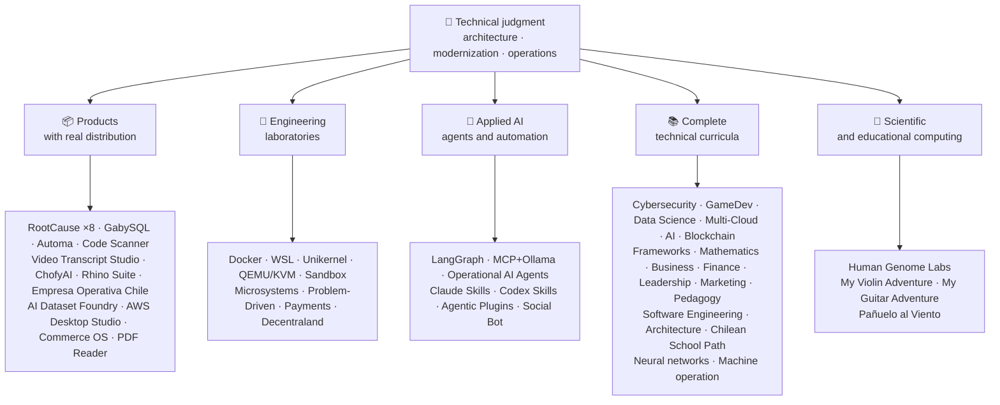

<div align="center">

# 👋ヴラディミール・アカニャ

## **ソリューションアーキテクト·シニアフルスタック·デジタル変革·経営・運営**

**コンピューターサイエンスとコンピューティング工学および経営管理の専門的訓練を受け、16年以上のビルトおよび実際の環境でソフトウェアを操作する。 業務、人、プロセス、技術を接続し、技術的な判断と運用状況を把握し、ソリューションを設計、評価、提供、および持続可能なものにします。このGitHubアカウントの検証を裏返しました。**

[](https://vladimiracunadev-create.github.io/)
[](https://www.linkedin.com/in/vladimir-acu%C3%B1a-valdebenito-11924a29/)
[](mailto:vladimir.acuna.dev@gmail.com)

[](#プロフェッショナルスコープ)
[](docs/ECOSYSTEM.ja.md)
[](#完全な技術的なカリキュラム)

<!-- STATS:START -->
[](https://github.com/vladimiracunadev-create?tab=repositories)
[](https://github.com/vladimiracunadev-create?tab=repositories)
[](#地球の環境システム)
[](#完全な技術的なカリキュラム)
[](https://github.com/vladimiracunadev-create?tab=repositories)
<!-- STATS:END -->

[](https://github.com/vladimiracunadev-create?tab=repositories)
[](https://github.com/vladimiracunadev-create?tab=followers)

[🌐 Portfolio (6 languages)](https://vladimiracunadev-create.github.io/) ·
[🧩 Ecosystem](#地球の環境システム) ·
[⚡ Evaluate me in 10 minutes](#自分を評価するために10分を持っている場合) ·
[✅ Professional scope](#プロフェッショナルスコープ) ·
[🧭 Non-coding management](#経営管理非コーディングのキャリア機会) ·
[📋 Role matrix](PROFESIONAL_ROLES.md) ·
[📬 Contact](#コンタクト)

**🌐 完全版:** [Español](README.md) · [English](README.en.md) · [Português](README.pt.md) · [Italiano](README.it.md) · [Français](README.fr.md) · [简体中文](README.zh.md) · [繁體中文](README.zh-TW.md) · [日本語](README.ja.md) · [한국어](README.ko.md) · [Türkçe](README.tr.md) · [Русский](README.ru.md) · [Tiếng Việt](README.vi.md) · [ไทย](README.th.md) · [Deutsch](README.de.md) · [Українська](README.uk.md) · [Polski](README.pl.md) · [العربية](README.ar.md) · [فارسی](README.fa.md) · [Bahasa Indonesia](README.id.md) · [Nederlands](README.nl.md) · [हिन्दी](README.hi.md) · [Ελληνικά](README.el.md)

**技術的な中心:**
PHP 8 · Python · Rust · Go · Node/TS · Java 21 · .NET 8 · Dart/Flutter · WASM
· AWS · Terraform · Kubernetes · Docker · n8n · LangGraph/MCP · CI/CD · FinOps · Observability

**業務技術橋:**
プロセスと要件の分析·ソリューション評価·配達コーディネート·業務・継続性·リスク管理·製品・サービス·テクニカル教育

</div>

---

> [!NOTE]
> 体験する機会をオンにしないプロファイルです。 確かな技術経験、譲渡可能なスキル、生存可能なアプリケーション、将来の開発目標は明示的に分けられます。 GitHub の証拠は実行可能か、またはドキュメンタリーです。何かが何かである**なし**終了、などと記載しております。

## 🎯あなたを見つけるためにここに

これは「1つのリポジトリ」ではありません。それは共通の基準を持つ生態系です。

- 🔁 **再発可能なデモ**— クローン、実行、検証。
- 🧰 **標準化された工具細工**— Makefiles、ハブ CLI、`doctor`と と と と 、`smoke`リポジトリごとに。
- 🛡️ **深さの防衛**— 秘密のスキャン、ポリシー、および明示的に禁止された慣行。
- 📈 **観察性** — `/health`, `/ready`, `/metrics`、ダッシュボードおよびトレーサビリティ。
- 📚 **オーディエンス・アウェアのドキュメント**— リポジトリに応じて、リクルーター、初心者、DevOps、またはセキュリティ。
- 📦 **製品の流通**— ダウンロード可能なリリース、チェックサム、および証拠のビルド。 該当する場合、商業/ストアのシグネチャは保留中のものとして宣言しました。
- 🌍 **国際的なサービス**— 6つの言語のポートフォリオ(ES)·エントリー·ツイート·インフォメーション·フリガナ·ZH)。
- 🧭 **技術的な正直者**— ラベルを貼る全てのケース`OPERATIONAL`, `DOCUMENTED/SCAFFOLD`, または`PLANNED`.

## ✅検証可能なステータス

| 表面を覆う | コンクリート証拠 |
|---|---|
| 🧪 **試験カバレッジ** | ガビーSQL**828 件のテスト**+ 上でのしゃべり**503.8M のクエリ**(0 パンク)·Empresa Operativa チリ**158 件のテスト** ·オートマチック**150 ピテスト** ·マルチOS CI |
| 🤖 **生産等級の代理店** | LangGraph リアルワールド**25/25 操作バックエンド**(ケース 01–25、100% のカバレッジ)·運用AIエージェント**13 代理店**とりあえず**39 の決定的な楕円** |
| 🔗 **Polyglotの統合** | **20件**sender→n8n→receiver — の**19 業務**, 個別にドッカーで監査· **18 + DBエンジン** · **20以上のコンテナ** ·11パターン |
| 📦 **流通販売** | **151 リリース**生態系全体**64 所有の公共リポジトリ** ·インストーラーとアーティファクト`.exe` · `.msi` · `.dmg` · `.apk`チェックサムと証拠をビルドする; 商業/ストアのシグネチャは、該当する進行中の |
| 🛡️ **サプライチェーン** | コードQL·セルムレプ·バンドイト·トリビー·グリペ·ジトルク·トラッフルホッグ·CycloneDX SBOM(サイクロンDX SBOM)·スコアカード |
| 📚 **カリキュラム** | **14,530 クラス**21プログラム全体で検証可能、カウント[a workflow](.github/workflows/stats.yml)リポジトリ構造やリポジトリで宣言された検証可能なソースから、手書きではなく、·すべてのプログラムが編集者の状態と制限を宣言します |
| 🌐 **ポートフォリオ** | インストール可能なPWA· **6 の言語** · **PDF36枚**パイプラインによって生成される·CVデータAPI·コンデンサーのアンドロイド·灯台 100 |
| 🔒 **テレメトリー** | フォレンジック製品とエンドレスバ・オペラティバ・チリのゼロテレメトリー — あらゆるビルドで検証 (Android なし)`INTERNET`許可) |
| 🌐 **公開サイト** | **56 GitHub ページサイト**—55 のランディング、製品、プログラム、またはエコシステム・ナビゲーター、およびポートフォリオごとに1つ、それぞれが独自のリポジトリから展開·全て 56 検証済み HTTP で検証済み`200` |

## 🗺️地球の環境システム



## 🗂️ エコシステム：プロダクト、ラボ、応用AI、科学計算

このプロフィールの実践的な成果は独立したドキュメントにまとめています。ダウンロードしてインストールできるソフトウェア、エンジニアリングラボ、応用AI、科学計算に加え、アカウント内にあるサードパーティプロジェクトの各フォークの説明も含みます。

- 📦 **実質の配分を用いるプロダクト** (22)
- 🧪 **エンジニアリング研究所** (11)
- 🤖 **応用AI** (6)
- 🔬 **科学コンピューティング** (1)
- 🍴 **サードパーティプロジェクトのフォーク** (52)

👉 **[エコシステム全体を見る](docs/ECOSYSTEM.ja.md)** · [🍴 サードパーティプロジェクトのフォーク](docs/ECOSYSTEM.ja.md#forks)

## 📚完全な技術的なカリキュラム

スペイン語のシーケンシャルプログラム、各リポジトリで宣言されたステータスとスコープ。 21プログラムが最大で追加**14,530 クラス**, カウント[a workflow](.github/workflows/stats.yml)リポジトリ構造やリポジトリで宣言された検証可能なソースから、バッジは週1回更新され、手元では書かれていません。

🧭 [**Lifelong Learning Ecosystem**](https://github.com/vladimiracunadev-create/lifelong-learning-ecosystem)ビジュアルマップと6つの領域を横断して30の実パスを接続するフェデレーションコンパスです。[accessible offline portal](https://vladimiracunadev-create.github.io/lifelong-learning-ecosystem/); 追加プログラムとしてカウントされません。

| 参加プログラム | レッスン | スコープ |
|---|---:|---|
| [🔢 **Computational Mathematics**](https://github.com/vladimiracunadev-create/computational-mathematics-program) | 360 | 指のカウントから紙を再現· **360 の決定的なデモは CI で検証しました** ·1,080 ノート·489 用語集· [site](https://vladimiracunadev-create.github.io/computational-mathematics-program/) |
| [🏦 **Finance and Banking**](https://github.com/vladimiracunadev-create/finance-and-banking-evolution-program) | 356 | 日 時: 534 分·金融数学とIFRS → クレジット、リスク、バーゼルIII、オープンファイナンス、DLT、安定コイン、およびMICA· **27 件** · **298 試験** · [site](https://vladimiracunadev-create.github.io/finance-and-banking-evolution-program/) |
| [🎮 **GameDev**](https://github.com/vladimiracunadev-create/modern-gamedev-program) | 352 | 数学とC#/C++/GDScript →シェーダー、AI、マルチプレイ、VR/AR·ゴルゴット·ユニバース·ユレアル· **CIで検証された10のGodotラボ**(301件のチェック)· [site](https://vladimiracunadev-create.github.io/modern-gamedev-program/) |
| [🛡️ **Cybersecurity**](https://github.com/vladimiracunadev-create/modern-cybersecurity-program) | 360 | **.3.0 の v1.3.0** ·20 部·基盤 → レッドチーム、DFIR、クラウドセキュリティ、開発、CTF、ゲームセキュリティ·地図を**7 認証** ·オフライン Android/web アプリ·PDFマニュアル·CI、セキュリティ、およびページ検証· [site](https://vladimiracunadev-create.github.io/modern-cybersecurity-program/) |
| [📈 **Marketing, Sales, and Growth**](https://github.com/vladimiracunadev-create/marketing-sales-growth-evolution-program) | 336 | 運用定義、測定シート、検証可能なバイブリグラフィー、チリ規制のコンテキストを持つ24部品· **..6.0 の v1.6.0** ·1.29M の言葉·17 のロールベースのパス· [site](https://vladimiracunadev-create.github.io/marketing-sales-growth-evolution-program/) |
| [🏢 **Business Creation**](https://github.com/vladimiracunadev-create/modern-business-creation-program) | 336 | チリの会社を創出し、運営する: 設立、税務当局、運用、危機、出退社を考え、·360 の図·1,251 用語集·1,548ページマニュアル· [site](https://vladimiracunadev-create.github.io/modern-business-creation-program/) |
| [🏛️ **Architecture and Built Environment**](https://github.com/vladimiracunadev-create/architecture-built-environment-learning-program) | 830 | 83 パーツ·60の統合セッション·34 パス·トレーサブルなソース·マークダウン、オフラインリーダー、GitHubページ· [site](https://vladimiracunadev-create.github.io/architecture-built-environment-learning-program/) |
| [🇨🇱 **Chilean School Learning Path**](https://github.com/vladimiracunadev-create/chilean-school-learning-path) | 8,841 | グレード 1～12· **4,156 統合されたクロスカリキュラムの経験** · **2,823 学習目的** ·MINEDUC ソース·未完成の提案や専門的ヒューマンレビューはまだ終わらない· [site](https://vladimiracunadev-create.github.io/chilean-school-learning-path/) |
| [🧭 **Modern Software Engineering**](https://github.com/vladimiracunadev-create/modern-software-engineering-program) | 480 | 40 部・8 段·基礎 → 製品・アーキテクチャ・セキュリティ・デベロッパー・SRE・SPEC・AI・マルチエージェント・システム·リポジトリによって宣言される編集状態· [site](https://vladimiracunadev-create.github.io/modern-software-engineering-program/) |
| [🎓 **Pedagogy and Learning Sciences**](https://github.com/vladimiracunadev-create/education-pedagogy-learning-sciences-program) | 300 | 教師が訓練される方法を学ぶ人から·25 部· **各クラスは、証拠状態と限界を宣言します。** ·初期のリテラシー、比較方法、特定の教育ニーズ、共存性、文化的多様性、および国際的証拠·1,097 用語集、325 図、60 アクティビティの教室銀行·役割による14のキャリアパス·LMS エクスポート可能· **.1.0 の** · [site](https://vladimiracunadev-create.github.io/education-pedagogy-learning-sciences-program/) |
| [☁️ **Multi-Cloud**](https://github.com/vladimiracunadev-create/multi-cloud-engineering-program) | 288 | AWS の·リファレンス·ギガシー·クーベルネ·テラフォーム·プレステージ·フィンオプス· **1,288時間** ·JSON 証拠による 288 件のラボ·1,032 個のトレースされたソース·2,884ページ PDFマニュアル· [site](https://vladimiracunadev-create.github.io/multi-cloud-engineering-program/) |
| [🎖️ **Executive Leadership**](https://github.com/vladimiracunadev-create/executive-leadership-founder-program) | 288 | 貴社の第一次成果を保有し、自社をリードし、チーム、KPI/OKR、ファイナンス、製品、リスク、ボード、M&A·24 ケース、96 ラボ、39 テンプレート· [site](https://vladimiracunadev-create.github.io/executive-leadership-founder-program/) |
| [🐍 **Python Data Science**](https://github.com/vladimiracunadev-create/python-data-science-program) | 232 | 極度、ML+Optuna/SHAP、PyTorch/LLMs/LoRA、MLOps·ネイティブWindowsアプリ + Android APK· [site](https://vladimiracunadev-create.github.io/python-data-science-program/) |
| [🧠 **AI Evolution**](https://github.com/vladimiracunadev-create/artificial-intelligence-evolution-program) | 184 | Symbolic → probabilistic → deep learning → LLMs, RAG, agents, safety, and frontier · **v0.17.0** · **708 notebooks** · **148 foundational papers** · offline Windows, Android, and PWA apps · [site](https://vladimiracunadev-create.github.io/artificial-intelligence-evolution-program/) |
| [🌐 **Comparative Programming**](https://github.com/vladimiracunadev-create/polyglot-programming-labs) | 176 | ひとつのコンセプト**10 の言語**CIで検証 —**1,360 の実装**プラス**1,632 のプログラム**静止言語(COBOL、Fortran、Ada、RPG、MUMPS...)、アトラス**15人の家族で60枚のカード** ·.1.0 の v1.1.0 の· [site](https://vladimiracunadev-create.github.io/polyglot-programming-labs/) |
| [🧩 **Frameworks Compared**](https://github.com/vladimiracunadev-create/framework-ecosystems-labs) | 149 | アダプターなしで、Express、FastAPI、Spring Boot、ASP.NET、Django、Rails、Laravel、React、Vue、Svelte、その他多くの機能が搭載されている、一つの実行可能契約·12 部· **70組クラス** · **CIで検証された397件** · **210 ISBN/DOI ソース** · [site](https://vladimiracunadev-create.github.io/framework-ecosystems-labs/) |
| [🗄️ **Databases**](https://github.com/vladimiracunadev-create/database-systems-labs) | 74 | **.0.0 の** ·15 部のデータベースエンジニアリング·お電話でのお問い合わせ· **すべてのクレームの検証可能なソース**: ISBN、DOI、または標準の120ソース·27エンジンで解決する同じ場合·306 用語集·150 ピテスト· [site](https://vladimiracunadev-create.github.io/database-systems-labs/) |
| [📐 **Psychometrics and Assessment**](https://github.com/vladimiracunadev-create/psychometrics-and-assessment-program) | 40 | 測定器が構築、評価、検証、監査される方法·8 部·実行可能なエンジンと**5 楽器と344 アイテム、276 パブリックドメイン** |
| [⛓️ **Blockchain**](https://github.com/vladimiracunadev-create/blockchain-learning-path) | 66 | **v0.14.0** · from zero to programmable financial infrastructure and on-chain analytics · **91 practices** and **363 tests** · contracts with Foundry (fuzzing and invariants) and Slither static analysis in CI · offline apps verified by opening the binary and counting its contents · [site](https://vladimiracunadev-create.github.io/blockchain-learning-path/) |
| [🧠 **Neural Network Training Labs**](https://github.com/vladimiracunadev-create/neural-network-training-labs) | 31 | 7 モジュール·≈214時間· **93 ノートブック**—31クラス、31の学生バージョン、31のソリューション·実際のパブリックデータに関する質問、ビジュアルマップ、慣行、評価·ピートーチ· [study site](https://vladimiracunadev-create.github.io/neural-network-training-labs/) |
| [🕹️ **Machine Operator**](https://github.com/vladimiracunadev-create/machine-operator-program) | 451 | **41 トレーニングモジュール**、機械ごとの1· **502 h 15 分** ·システムの制御、物理、安全、およびクラスごとのソースとのシミュレーション設計·※実行可能シミュレータは未だ、その方法が宣言されていない* |

## ⚡自分を評価するために10分を持っている場合

アイデアはコードを見るだけでなく、: それは参照することです**考え方**、どのようにドキュメントをするか、そして、どのようにして実行可能かを全て作ります。

**ルートA — 実質の観察とオーケストラ***(お気に入り)*

```bash
git clone https://github.com/vladimiracunadev-create/social-bot-scheduler.git
```

19例と18以上のDBエンジンのワークフロー、メトリック、ダッシュボード、ガードレールなどがご覧いただけます。

**B号線 — 数分で再発可能なインフラ**

```bash
git clone https://github.com/vladimiracunadev-create/docker-labs.git
```

**ルートC — 型付き状態のエージェント**

```bash
git clone https://github.com/vladimiracunadev-create/langgraph-realworld.git
```

**ルートD — 錆びない製品、クローニングなし**

インストーラーまたはCLIバイナリーをダウンロード[RootCause releases](https://github.com/vladimiracunadev-create/rootcause-windows-inspector/releases)確認・確認`SHA256SUMS`.

## 🧠リポジトリ全体で適用する標準

- **DX 初の**— 実行が容易でないと、デモやチームベースとしては役に立ちません。
- **1日目の観察性**— メトリックとトレーサビリティ、後続ではなく。
- **パイプラインとしてのセキュリティ**— 秘密のスキャン、リリースごとのSBOM、明示的に禁止された慣行。
- **実質の弾性**— 出土、遮断器および制御された劣化。
- **デザインによるポリグロット**— 決してファッションでではなく、使用例によって選ばれた言語とエンジン。
- **ステータスに関する正直**— 1つのリポジトリの名前を変更しました()`Multisimulador` → `machine-operator-program`) 未だに存在しない有望なソフトウェアを避けるため。
- **バッジは、証拠ではなく、信号です**— 各リポジトリも宣言します**何をしない**.
- **型式 出力**— ドメインは最初に設計され、インターフェイスは投影です。
- **外部の作業は外部の作業として宣言されます** — サードパーティプロジェクトの[52件のフォーク](docs/ECOSYSTEM.ja.md#forks)は一つずつ説明し、このプロフィールの自作に関する数値には含めません。

## ✅プロフェッショナルスコープ

私のデュアル背景 —**コンピュータサイエンスとコンピューティング工学+経営管理**— 業務の遂行、製品、顧客、およびリーダーシップの明確な選択肢に、ビジネスの目標を技術的な決定と技術的な制約に翻訳するのに役立ちます。

### 🎯コア・アイデンティティ

| 役割・役割 | バックリング |
|---|---|
| **ソリューションアーキテクト** | モジュラー、拡張可能なシステム設計、進化的な判断 |
| **レガシー・モダナイゼーション・アーキテクト** | 実質の遺産の進化(PHP 5.x→8.xの中断のない増分再ファクタリング) |
| **シニアフルスタック/テックリード** | 実際のプラットフォームに関するアーキテクチャ、実行、および基準(+16年) |
| **AIオートメーション設計** | LangGraph/MCP および n8n の流れが付いている無機系システムガードレール |

### ↗ 自然な展開

**AI のオーケストレーション エンジニア** · **システム/錆エンジニア** · **モバイルエンジニア(Flutter)** · **ソリューションエンジニア** · **技術的なプロダクト ビルダー** · **テクニカルトレーナー** · **デジタル変革コンサルタント** · **事業・機能アナリスト** · **技術的なプロダクト操作**

### ⚙️補完スコープ

プラットフォームエンジニア/ IDP·CI-CD のデベロッパー·クラウド/AWSエンジニア·アプリケーション SRE·オートメーションエンジニア·テクニカルコンサルタンスコンサルタント

## 🧭経営・管理・非コーディングのキャリア機会

情報技術と経営の素養が活きる、プログラミングが中心業務ではない経営・管理・ビジネス職。移転可能なスキル、応募の可能性、将来の目標として正直に分類し、それぞれのギャップも示しています。対象領域：

テクノロジーのリーダーシップ · プロジェクト管理 · 経営管理 · 戦略・変更 · 業務分析 · 製品・サービス · サイバーセキュリティ管理 · 商用・販売 · 財務・管理管理 · 品質保証 · Education · 物流・サプライヤー · データとAIのガバナンス · 公共部門

👉 **[機会マトリクス全体を見る](docs/MANAGEMENT.ja.md)**

## 🤖AI-Assisted Development Flow(AI-Assisted Development Flow) 開発実績

| ツール | 主な用途 |
|---|---|
| **クラウデコード** | 建築レビュー、実装、および技術文書 |
| **ChatGPT Plus とチャット** | 分析・アーキテクチャ・反復(2023)年以降 |
| **コードx** | コード生成と再ファクタリング |
| **アンチグラビティ** | 開発・自動化の流れの加速 |
| **VSコード/OpenCode** | 統合AI支援による環境 |

> 独自の技術判断、人的検証、建築的方向を組み合わせる。 AIは能力、スピード、リーチを増幅します。経験を交換しません。

## 📌利用条件

**以下に開きます:**シニアフルスタック·建築設計·脚本の近代化·プラットフォーム/IDP·アプリケーション SRE·ドラッグ&ドロップ·オートメーション·AIオートメーション·業務・機能分析·ITプロジェクトコーディネート·製品オペレーション·デジタルトランスフォーメーション·ソリューションコンサルティング/プリセールス·テクニカル教育·品質・継続的な改善·AIの採用とガバナンス

**各ロールのスコープに応じて評価される:**製品所有者/技術的なプロダクト マネージャー·サービスデリバリー·ITオペレーション·GRC/技術リスク·管理・運営·管理制御·公共セクターの近代化。 エグゼクティブと一般経営のタイトルは、将来の開発目標であり、要求された経験ではありません。

**変異性:**プロジェクトの依存に応じて、リモートまたはハイブリッド。

## 📬コンタクト

[](https://vladimiracunadev-create.github.io/)
[](https://www.linkedin.com/in/vladimir-acu%C3%B1a-valdebenito-11924a29/)
[](https://gitlab.com/vladimir.acuna.dev-group/vladimir.acuna.dev-group)
[](mailto:vladimir.acuna.dev@gmail.com)

---

<div align="center">

[🤝 Contribute](CONTRIBUTING.en.md) ·
[🛡️ Security](SECURITY.en.md) ·
[⚖️ Code of Conduct](CODE_OF_CONDUCT.en.md)

<sub>README は、パブリックリポジトリの検証可能な状態と同期しました。API で読み込まれるコンポーネントと変更 -·最終確認: 2026年10月12日</sub>

</div>
