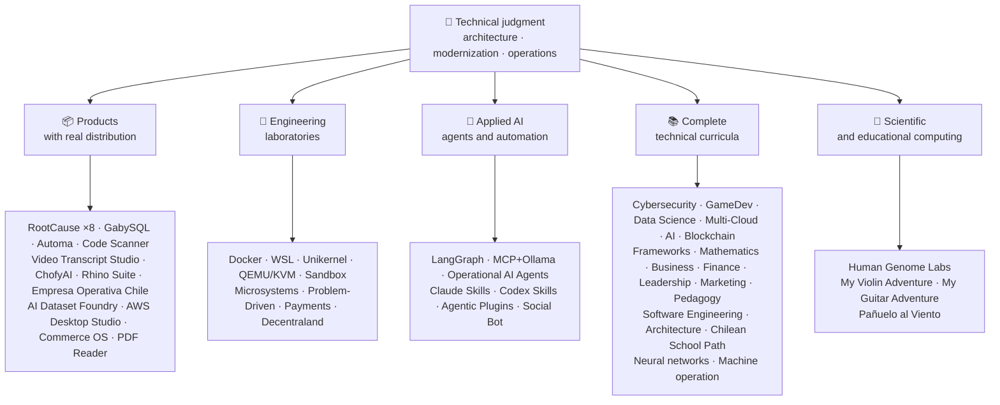

<div align="center">

# 👋블라디미르 Acuña

## **솔루션 Architect·수석 풀-스택·디지털 전환·관리 및 운영**

**16년 이상의 건물과 운영 소프트웨어를 갖춘 컴퓨터 과학 및 컴퓨팅 공학 및 비즈니스 관리 분야에서 전문적으로 훈련. I Connect Business, people, process, and technology to design, assessment, Deliver, and keep solution with technical resolution and operational view — 이 GitHub 계정에서 검증 가능한 증거로 백업.**

[](https://vladimiracunadev-create.github.io/)
[](https://www.linkedin.com/in/vladimir-acu%C3%B1a-valdebenito-11924a29/)
[](mailto:vladimir.acuna.dev@gmail.com)

[](#전문-범위)
[](docs/ECOSYSTEM.ko.md)
[](#완전한-기술-교육과정)

<!-- STATS:START -->
[](https://github.com/vladimiracunadev-create?tab=repositories)
[](https://github.com/vladimiracunadev-create?tab=repositories)
[](#한눈에-보는-생태계)
[](#완전한-기술-교육과정)
[](https://github.com/vladimiracunadev-create?tab=repositories)
<!-- STATS:END -->

[](https://github.com/vladimiracunadev-create?tab=repositories)
[](https://github.com/vladimiracunadev-create?tab=followers)

[🌐 Portfolio (6 languages)](https://vladimiracunadev-create.github.io/) ·
[🧩 Ecosystem](#한눈에-보는-생태계) ·
[⚡ Evaluate me in 10 minutes](#저를-평가할-시간이-10분이라면) ·
[✅ Professional scope](#전문-범위) ·
[🧭 Non-coding management](#관리-관리-비-코딩-경력-기회) ·
[📋 Role matrix](PROFESIONAL_ROLES.md) ·
[📬 Contact](#연락처)

**🌐 전체 버전:** [Español](README.md) · [English](README.en.md) · [Português](README.pt.md) · [Italiano](README.it.md) · [Français](README.fr.md) · [简体中文](README.zh.md) · [繁體中文](README.zh-TW.md) · [日本語](README.ja.md) · [한국어](README.ko.md) · [Türkçe](README.tr.md) · [Русский](README.ru.md) · [Tiếng Việt](README.vi.md) · [ไทย](README.th.md) · [Deutsch](README.de.md) · [Українська](README.uk.md) · [Polski](README.pl.md) · [العربية](README.ar.md) · [فارسی](README.fa.md) · [Bahasa Indonesia](README.id.md) · [Nederlands](README.nl.md) · [हिन्दी](README.hi.md) · [Ελληνικά](README.el.md)

**기술적인 핵심:**
PHP 8 · Python · Rust · Go · Node/TS · Java 21 · .NET 8 · Dart/Flutter · WASM
· AWS · Terraform · Kubernetes · Docker · n8n · LangGraph/MCP · CI/CD · FinOps · Observability

**사업 기술 교량:**
공정 및 요구 사항 분석·솔루션 평가·납품 coordination·운영 및 연속성·위험 관리·제품 및 서비스·기술 교육

</div>

---

> [!NOTE]
> 이 프로필은 경험에 기회를 끄지 않습니다. 입증된 기술적인 경험, transferable 기술, viable 신청 및 미래 발달 목표는 명시적으로 분리됩니다. Linked GitHub 증거는 실행 또는 문서화입니다. 뭔가가 있는 곳**뚱 베어**완료, 그것은 같은 명시.

## 🎯여기에서 확인할 수 있는 내용

이것은 "하나의 재포": 그것은 공유 표준 생태계입니다.

- 🔁 **Reproducible 데모**— clone, 실행, 검증.
- 🧰 **표준화 된 툴링**— Makefiles, 허브 CLI,`doctor`, 및`smoke`저장소 당.
- 🛡️ **방어력**- 비밀 검사, 정책 및 명시적으로 금지 관행.
- 📈 **옵션 정보** — `/health`, `/ready`, `/metrics`, 대쉬보드 및 추적성.
- 📚 **Audience-aware 문서**- 채용자, 초급자, DevOps, 또는 보안, 저장소에 따라.
- 📦 **제품 유통**— 다운로드 가능한 릴리즈, 체크섬, 그리고 증거를 구축; 상업/스토어 서명은 적용할 때 보류로 선언.
- 🌍 **국제화**— 6개국의 포트폴리오 (ES)·₢ 킹·유형: pt·...·담당자: Mr. wang·ZH).
- 🧭 **기술 정직**— 각 케이스 라벨`OPERATIONAL`, `DOCUMENTED/SCAFFOLD`, 또는`PLANNED`.

## ✅검증된 상태

| Surface | Concrete evidence |
|---|---|
| 🧪 **시험 적용** | 프로젝트**828 테스트**+ 훈제 이상**503.8M 쿼리**(0개의 판)·Empresa, 칠레**158 테스트** ·오토마**150 파이트** ·멀티OS CI |
| 🤖 **생산 급료 대리인** | 랭그라프 RealWorld**25/25 운영한 후원**(케이스 01-25, 100% 적용)·운영 AI 에이전트**13 대리인**으로**39개의 신중한 evals** |
| 🔗 **Polyglot 통합** | **20 건**sender→n8n→receiver —**19 운영**, 독수리로 개별적으로 감사-· **18+ DB 엔진** · **20 + 용기** ·11 패턴 |
| 📦 **의 특징** | **151 릴리스**생태계의 전반**64개 소유의 공공 저장소** ·설치 및 artifacts`.exe` · `.msi` · `.dmg` · `.apk`checksums와 build proof; 적용 가능한 진행 상황을 위한 상용/스토어 서명 |
| 🛡️ **공급 체인** | 코드QL·뚱 베어·팟캐스트·팟캐스트·뚱 베어·팟캐스트·TruffleHog의 특징·사이클론디X SBOM·팟캐스트 |
| 📚 **의약** | **14,530 클래스**21개 프로그램 전반에 걸쳐 검증 가능[a workflow](.github/workflows/stats.yml)실제 저장소 구조 또는 저장소에 선언 된 검증 가능한 소스에서 - 손으로 작성하지 않음·각 프로그램은 편집 상태 및 제한을 선언합니다. |
| 🌐 **의논하기** | PWA 설치· **6 개 언어** · **36 PDF의**생성물 : 파이프라인·CV 자료 API·축전기 인조 인간·등대 100 |
| 🔒 **원격 측정** | forensic 제품 및 Empresa Operativa Chile의 Zero telemetry - 모든 빌드에서 확인 (안드로이드 없음)`INTERNET`(주) |
| 🌐 **관련 사이트** | **56 GitHub 페이지 사이트**—55 착륙, 제품, 프로그램, 또는 생태계 항해자 당 하나, 포트폴리오 플러스 - 각각 자체 저장소에서 배치·모든 56 HTTP로 확인`200` |

## 🗺️한눈에 보는 생태계



## 🗂️ 생태계: 제품, 연구소, 응용 AI, 과학 컴퓨팅

이 프로필의 실무 성과는 별도 문서에 모여 있습니다. 다운로드해 설치하는 소프트웨어, 엔지니어링 연구소, 응용 AI, 과학 컴퓨팅, 그리고 계정에 있는 제3자 프로젝트 포크 각각에 대한 설명입니다.

- 📦 **Real Distribution을 통한 제품** (22)
- 🧪 **엔지니어링 연구소** (11)
- 🤖 **응용 AI** (6)
- 🔬 **과학 컴퓨팅** (1)
- 🍴 **제3자 프로젝트의 포크** (52)

👉 **[전체 생태계 보기](docs/ECOSYSTEM.ko.md)** · [🍴 제3자 프로젝트의 포크](docs/ECOSYSTEM.ko.md#forks)

## 📚완전한 기술 교육과정

스페인어의 순차적 프로그램, 상태 및 범위는 각 저장소에 의해 선언. 21개의 프로그램 추가**14,530 클래스**, 으로 계산[a workflow](.github/workflows/stats.yml)실제 저장소 구조 또는 저장소에 선언 된 검증 가능한 소스에서; 배지는 매주 새로 고침하고 손으로 작성되지 않습니다.

🧭 [**Lifelong Learning Ecosystem**](https://github.com/vladimiracunadev-create/lifelong-learning-ecosystem) is a federated compass connecting 30 real paths across 6 areas through visual maps and an [accessible offline portal](https://vladimiracunadev-create.github.io/lifelong-learning-ecosystem/); it is not counted as an additional program.

| 의 특징 | 의 특징 | 의논하기 |
|---|---:|---|
| [🔢 **Computational Mathematics**](https://github.com/vladimiracunadev-create/computational-mathematics-program) | 360 | 손가락에 넣기에서 종이를 재생· **360개의 신중한 시연** ·1,080 노트북·489-term 광택· [site](https://vladimiracunadev-create.github.io/computational-mathematics-program/) |
| [🏦 **Finance and Banking**](https://github.com/vladimiracunadev-create/finance-and-banking-evolution-program) | 356 | 534 시간·금융 수학 및 IFRS → 신용, 위험, Basel III, 개방 금융, DLT, Stablecoins 및 MiCA· **27 건의 사례** · **298 테스트** · [site](https://vladimiracunadev-create.github.io/finance-and-banking-evolution-program/) |
| [🎮 **GameDev**](https://github.com/vladimiracunadev-create/modern-gamedev-program) | 352 | 수학 및 C # / C++ / GDScript → 쉐이더, AI, 멀티플레이어, VR / AR·혜진·뚱 베어·뚱 베어· **CI에서 확인 된 10 Godot 실험실**(301건)· [site](https://vladimiracunadev-create.github.io/modern-gamedev-program/) |
| [🛡️ **Cybersecurity**](https://github.com/vladimiracunadev-create/modern-cybersecurity-program) | 360 | **₢ 킹** ·20 부품·기초 → Red Team, DFIR, 클라우드 보안, 분산, CTF 및 게임 보안·지도로**7 인증** ·오프라인 Android/웹 앱·PDF 설명서·CI, 보안 및 페이지 확인· [site](https://vladimiracunadev-create.github.io/modern-cybersecurity-program/) |
| [📈 **Marketing, Sales, and Growth**](https://github.com/vladimiracunadev-create/marketing-sales-growth-evolution-program) | 336 | 운영 정의, 측정 시트, 검증 가능한 생물학적, 칠레 규제 상황에 24 부품· **0.0.0.0 다운로드** ·1.29M 단어·17개의 역할 기반 경로· [site](https://vladimiracunadev-create.github.io/marketing-sales-growth-evolution-program/) |
| [🏢 **Business Creation**](https://github.com/vladimiracunadev-create/modern-business-creation-program) | 336 | 칠레에서 실제 회사를 만들고 운영합니다. 설립, 세금 기관, 운영, 위기 및 출구에 대한 아이디어에서·360도·1,251 용어 광택·1,548 페이지 설명서· [site](https://vladimiracunadev-create.github.io/modern-business-creation-program/) |
| [🏛️ **Architecture and Built Environment**](https://github.com/vladimiracunadev-create/architecture-built-environment-learning-program) | 830 | 83 부품·60개의 통합 세션·34 경로·추적 가능한 소스·Markdown, 오프라인 리더, GitHub 페이지· [site](https://vladimiracunadev-create.github.io/architecture-built-environment-learning-program/) |
| [🇨🇱 **Chilean School Learning Path**](https://github.com/vladimiracunadev-create/chilean-school-learning-path) | 8,841 | 학년 1-12· **4,156 통합 크로스 컬리어** · **2,823 학습 목표** ·MINEDUC 소스·공개 제안 및 전문 인적 검토는 여전히 종료· [site](https://vladimiracunadev-create.github.io/chilean-school-learning-path/) |
| [🧭 **Modern Software Engineering**](https://github.com/vladimiracunadev-create/modern-software-engineering-program) | 480 | 40 부품 및 8 단계·기초 → 제품, 건축, 안전, DevOps, SRE, SPEC, AI 및 다중 시약 체계·repository에 의해 선언 된 편집 상태· [site](https://vladimiracunadev-create.github.io/modern-software-engineering-program/) |
| [🎓 **Pedagogy and Learning Sciences**](https://github.com/vladimiracunadev-create/education-pedagogy-learning-sciences-program) | 300 | 선생님이 훈련하는 방법을 배우는 방법·25 부품· **각 클래스는 증거 국가와 한계를 선언합니다.** ·초기의 문학, 비교 방법, 특정 교육 요구, 협동, 문화 다양성, 국제 증거·1,097-term 광택, 325 다이어그램 및 60-activity 교실 은행·14 역할에 의한 경력 경로·LMS 호환· **₢ 킹** · [site](https://vladimiracunadev-create.github.io/education-pedagogy-learning-sciences-program/) |
| [☁️ **Multi-Cloud**](https://github.com/vladimiracunadev-create/multi-cloud-engineering-program) | 288 | AWS 지원·는·GCP(주)·쿠버네티스·의 특징·₢ 킹·핀 핑· **1,288 시간** ·288 JSON 증거와 실험실·1,032 추적 소스·2,884 페이지 PDF 설명서· [site](https://vladimiracunadev-create.github.io/multi-cloud-engineering-program/) |
| [🎖️ **Executive Leadership**](https://github.com/vladimiracunadev-create/executive-leadership-founder-program) | 288 | 회사를 선도하고 자신만의 팀을 이끌고, KPI/OKR, 금융, 제품, 위험, 보드 및 M&A를 자체적으로 관리하여·24건, 96건, 39건· [site](https://vladimiracunadev-create.github.io/executive-leadership-founder-program/) |
| [🐍 **Python Data Science**](https://github.com/vladimiracunadev-create/python-data-science-program) | 232 | 극, ML + Optuna / SHAP, PyTorch / LLMs / LoRA, MLOps·기본 Windows 앱 + Android APK· [site](https://vladimiracunadev-create.github.io/python-data-science-program/) |
| [🧠 **AI Evolution**](https://github.com/vladimiracunadev-create/artificial-intelligence-evolution-program) | 184 | 심볼 → probabilistic → 깊은 학습 → LLMs, RAG, 대리인, 안전, 및 국경· **v0.17.0의** · **708 노트북** · **148 기초지** ·오프라인 Windows, Android 및 PWA 앱· [site](https://vladimiracunadev-create.github.io/artificial-intelligence-evolution-program/) |
| [🌐 **Comparative Programming**](https://github.com/vladimiracunadev-create/polyglot-programming-labs) | 176 | 1개의 개념,**10 개 언어**CI에서 확인하기 —**1,360 구현**- 더하기**1,632 프로그램**아직도 살고있는 언어 (COBOL, Fortran, Ada, RPG, MUMPS...)과 아틀라스의**15개 가족 60개 카드** ·₢ 킹· [site](https://vladimiracunadev-create.github.io/polyglot-programming-labs/) |
| [🧩 **Frameworks Compared**](https://github.com/vladimiracunadev-create/framework-ecosystems-labs) | 149 | 어댑터가 없는 한 실행 가능한 계약, Express, FastAPI, Spring Boot, ASP.NET, Django, Rails, Laravel, React, Vue, Svelte 등·12 부품· **70 내장 클래스** · **397건 CI에서 확인된 경우** · **210 ISBN/DOI 소스** · [site](https://vladimiracunadev-create.github.io/framework-ecosystems-labs/) |
| [🗄️ **Databases**](https://github.com/vladimiracunadev-create/database-systems-labs) | 74 | **0.0.0.0의** ·15개 부품 엔지니어링·230시간· **모든 청구에 대한 검증 가능한 소스**: ISBN, DOI, 또는 표준 120 소스·27 엔진에서 해결되는 동일한 케이스·306-term 광택·150 파이트· [site](https://vladimiracunadev-create.github.io/database-systems-labs/) |
| [📐 **Psychometrics and Assessment**](https://github.com/vladimiracunadev-create/psychometrics-and-assessment-program) | 40 | 측정 계기가 내장되어 있고, 평가되고, 검증되고, 감사·8개 부품·실행 가능한 엔진**5개 상품 및 344개 상품, 276개 공공주** |
| [⛓️ **Blockchain**](https://github.com/vladimiracunadev-create/blockchain-learning-path) | 66 | **v0.14.0** · from zero to programmable financial infrastructure and on-chain analytics · **91 practices** and **363 tests** · contracts with Foundry (fuzzing and invariants) and Slither static analysis in CI · offline apps verified by opening the binary and counting its contents · [site](https://vladimiracunadev-create.github.io/blockchain-learning-path/) |
| [🧠 **Neural Network Training Labs**](https://github.com/vladimiracunadev-create/neural-network-training-labs) | 31 | 7개의 단위·≈214 시간· **93 노트북**—31 클래스, 31 학생 버전, 31 솔루션—·질문, 시각지도, 관행 및 실제 자료로 평가·핑크· [study site](https://vladimiracunadev-create.github.io/neural-network-training-labs/) |
| [🕹️ **Machine Operator**](https://github.com/vladimiracunadev-create/machine-operator-program) | 451 | **41 교육 모듈**, 기계 당 하나· **502 h 15 분** ·시스템, 제어, 물리, 안전, 및 클래스 당 소스와 시뮬레이션 디자인·* 아직 실행할 수 없는 시뮬레이터, 그리고 그것은 그 way* 선언됩니다 |

## ⚡저를 평가할 시간이 10분이라면

아이디어는 코드를 볼 수 없습니다 : 그것은 볼 수 있습니다**어떻게 생각**, 어떻게 문서, 그리고 어떻게 모든 실행을 만드는.

**A 루트 - 실제 관찰성 및 관현*** (내가 좋아)*

```bash
git clone https://github.com/vladimiracunadev-create/social-bot-scheduler.git
```

워크플로우, 메트릭, 대시보드, 가드 레일을 19건 이상, 18+ DB엔드를 볼 수 있습니다.

**Route B - 몇 분 안에 재현 가능한 인프라**

```bash
git clone https://github.com/vladimiracunadev-create/docker-labs.git
```

**Route C - 유형 상태와 에이전트**

```bash
git clone https://github.com/vladimiracunadev-create/langgraph-realworld.git
```

**Route D - cloning없이 Rust forensic 제품**

installer 또는 CLI 바이너리를 다운로드[RootCause releases](https://github.com/vladimiracunadev-create/rootcause-windows-inspector/releases)관련 기사`SHA256SUMS`.

## 🧠모든 저장소에 적용하는 표준

- **DX 첫 번째**— 실행이 쉽지 않은 경우, 데모 또는 팀 기지로 유용하지 않습니다.
- **당일 1의 관측**— 메트릭과 추적성, afterthought.
- **보안을 파이프라인으로**— 비밀 검사, SBOM 당 릴리스, 명시적으로 금지 관행.
- **실제 탄력**- idempotency, 회로 차단기 및 통제되는 degradation.
- **디자인에 의하여 Polyglot**- 사용 사례에 의해 선택된 언어 및 엔진, 패션에 의해 결코.
- **상태에 대해 정직**— 1개의 repo는 이름이 되었습니다 (`Multisimulador` → `machine-operator-program`) 아직 존재하지 않는 Promising 소프트웨어를 피하기 위해.
- **배지는 신호, 증거가 아닙니다**— 각 repo는 또한 선언합니다**그것은하지 않습니다**.
- **모델 outward**— 도메인은 먼저 설계; 인터페이스는 투사입니다.
- **외부 작업은 외부로 선언됩니다.** — 제3자 프로젝트의 [포크 52개](docs/ECOSYSTEM.ko.md#forks)는 하나씩 설명하며, 이 프로필의 자체 작업물 수치에서 제외됩니다.

## ✅전문 범위

내 이중 배경 —**컴퓨터 과학 및 컴퓨팅 공학 + 비즈니스 관리**— 저는 사업 목표에 기술 결정과 기술 제약을 작업, 제품, 고객 및 리더십에 대한 명확한 옵션으로 번역하는 데 도움이됩니다.

### 🎯핵심 정체성

| - 연혁 | 의 의 의 의 의 의 의 의 의 의 의 의 의 의 의 의 의 의 의 의 의 의 의 의 의 의 의 의 의 의 의 의 의 의 의 의 의 의 의 의 의 의 의 의 의 의 의 의 의 의 의 의 의 의 의 의 의 의 의 의 의 의 의 의 의 의 의 의 의 의 의 의 의 의 의 의 의 의 의 의 의 의 의 의 의 의 의 의 의 의 의 의 의 의 의 의 의 의 의 의 의 의 의 의 의 의 의 의 의 의 의 의 의 의 의 의 의 의 의 의 의 의 의 의 의 의 의 의 |
|---|---|
| **솔루션 Architect** | 모듈, 진화 판을 가진 확장 가능한 시스템 설계 |
| **건축 설계** | 실제 유산 진화 (PHP 5.x→8.x, 중단 작업 없이 증가하는) |
| **수석 풀스택 / 기술 리드** | 실제 플랫폼의 아키텍처, 실행 및 표준 (+16 년) |
| **AI 자동화 건축** | 랑그래프/MCP와 n8n를 가진 대리인 체계는 난간을 가진 흐릅니다 |

### ↗ 자연스러운 확장

**AI 관현 엔지니어** · **시스템 / Rust 엔지니어** · **모바일 엔지니어 (Flutter)** · **솔루션 엔지니어** · **기술 제품 Builder** · **기술 트레이너** · **디지털 전환 컨설턴트** · **사업/기능분석** · **기술 제품 운영**

### ⚙️관련 범위

플랫폼 엔지니어 / IDP·DevOps / CI-CD의·클라우드/ASME 엔지니어·신청 SRE·자동화 엔지니어·기술 협력사

## 🧭관리, 관리, 비 코딩 경력 기회

정보기술과 경영 역량이 기여하되 프로그래밍이 핵심 업무가 아닌 경영·관리·비즈니스 직무로, 정직하게 분류하고(이전 가능한 역량, 지원 가능성, 향후 목표) 각 직무의 격차를 함께 밝힙니다. 다루는 영역:

기술 리더십 · 사업소개 · 사업 관리 · 전략 및 변화 · 사업 분석 · 제품 및 서비스 · Cybersecurity 관리 · 상업 및 판매 · 금융 및 관리 제어 · Quality · 교육과정 · 물류 및 공급 업체 · 데이터 및 AI 관리 · 공공 부문

👉 **[전체 기회 매트릭스 보기](docs/MANAGEMENT.ko.md)**

## 🤖AI-Assisted 개발 흐름

| 의 특징 | 제품정보 |
|---|---|
| **Claude 코드** | 건축 검토, 구현 및 기술 문서 |
| **ChatGPT 플러스** | 분석, 건축, 그리고 이행 (since 2023) |
| **암호** | Code 생성 및 재발견 |
| **품질 관리** | 개발 및 자동화의 가속도 |
| **VS 코드 / OpenCode** | 통합 AI 지원 환경 |

> 나는 내 자신의 기술 판정, 인간 검증, 건축 방향을 결합. AI는 용량, 속도 및 도달을 증폭합니다. - 그것은 경험을 대체하지 않습니다.

## 📌가용성

**다음을:**수석 풀-스택·의 특징·관련 제품·플랫폼/IDP·신청 SRE·의붓기·회사연혁·AI 자동화·사업/기능 분석·IT 프로젝트 조정·제품 운영·디지털 변환·솔루션 컨설팅/판매·기술 교육·품질 및 지속적인 개선·AI 채택 및 관리

**각 역할의 범위에 따라 평가:**Product Owner / 기술 제품 관리자·서비스 납품·IT 운영·GRC / 기술 위험·관리 및 운영·관리 제어·공공 감독 현대화. 경영진 및 일반 경영진은 미래 개발 목표이며, 주장하지 않은 경험입니다.

**모델 번호:**프로젝트에 따라 원격 또는 하이브리드.

## 📬연락처

[](https://vladimiracunadev-create.github.io/)
[](https://www.linkedin.com/in/vladimir-acu%C3%B1a-valdebenito-11924a29/)
[](https://gitlab.com/vladimir.acuna.dev-group/vladimir.acuna.dev-group)
[](mailto:vladimir.acuna.dev@gmail.com)

---

<div align="center">

[🤝 Contribute](CONTRIBUTING.en.md) ·
[🛡️ Security](SECURITY.en.md) ·
[⚖️ Code of Conduct](CODE_OF_CONDUCT.en.md)

<sub>README는 공개 저장소의 검증 가능한 상태와 동기화 - 구성 및 변경 API를 통해 읽습니다.·최종 검증: 10월 12, 2026.</sub>

</div>
