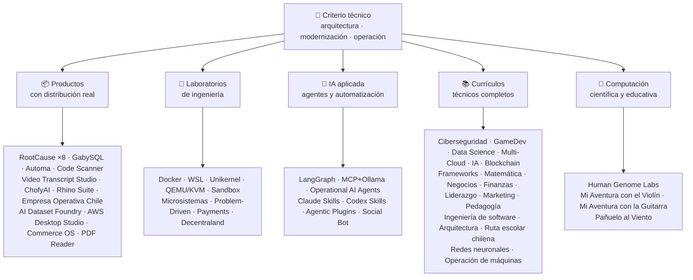

<div align="center">

# 👋 Vladimir Acuña

## **Arquitecto de Soluciones · Senior Full-Stack · Transformación Digital · Gestión y Operaciones**

**Ingeniero en Informática y Computación y Administrador de Empresas, con +16 años construyendo y operando software en entornos reales. Conecto negocios, personas, procesos y tecnología para diseñar, evaluar, entregar y sostener soluciones con criterio técnico y visión operacional — con evidencia verificable en este GitHub.**

[](https://vladimiracunadev-create.github.io/)
[](https://www.linkedin.com/in/vladimir-acu%C3%B1a-valdebenito-11924a29/)
[](mailto:vladimir.acuna.dev@gmail.com)

[](#-alcance-profesional)
[](docs/ECOSYSTEM.md)
[](#-currículos-técnicos-completos)

<!-- STATS:START -->
[](https://github.com/vladimiracunadev-create?tab=repositories)
[](https://github.com/vladimiracunadev-create?tab=repositories)
[](#-el-ecosistema-de-un-vistazo)
[](#-currículos-técnicos-completos)
[](https://github.com/vladimiracunadev-create?tab=repositories)
<!-- STATS:END -->

[](https://github.com/vladimiracunadev-create?tab=repositories)
[](https://github.com/vladimiracunadev-create?tab=followers)

[🌐 Portafolio (6 idiomas)](https://vladimiracunadev-create.github.io/) ·
[🧩 Ecosistema](#-el-ecosistema-de-un-vistazo) ·
[⚡ Evalúame en 10 minutos](#-si-tienes-10-minutos-para-evaluarme) ·
[✅ Alcance profesional](#-alcance-profesional) ·
[🧭 Gestión sin programación](#-gestión-administración-y-oportunidades-profesionales-sin-programación) ·
[📋 Matriz de cargos](PROFESIONAL_ROLES.md) ·
[📬 Contacto](#-contacto)

**🌐 Versiones completas:** [Español](README.md) · [English](README.en.md) · [Português](README.pt.md) · [Italiano](README.it.md) · [Français](README.fr.md) · [简体中文](README.zh.md) · [繁體中文](README.zh-TW.md) · [日本語](README.ja.md) · [한국어](README.ko.md) · [Türkçe](README.tr.md) · [Русский](README.ru.md) · [Tiếng Việt](README.vi.md) · [ไทย](README.th.md) · [Deutsch](README.de.md) · [Українська](README.uk.md) · [Polski](README.pl.md) · [العربية](README.ar.md) · [فارسی](README.fa.md) · [Bahasa Indonesia](README.id.md) · [Nederlands](README.nl.md) · [हिन्दी](README.hi.md) · [Ελληνικά](README.el.md)

**Núcleo técnico:**
PHP 8 · Python · Rust · Go · Node/TS · Java 21 · .NET 8 · Dart/Flutter · WASM
· AWS · Terraform · Kubernetes · Docker · n8n · LangGraph/MCP · CI/CD · FinOps · Observabilidad

**Puente negocio–tecnología:**
análisis de procesos y requerimientos · evaluación de soluciones · coordinación de entrega · operación y continuidad · gestión de riesgos · producto y servicio · formación técnica

</div>

---

> [!NOTE]
> Este perfil no convierte posibilidades en experiencia. La trayectoria técnica acreditada, las competencias transferibles, las posibilidades de postulación y los objetivos futuros se distinguen de forma explícita. Cada evidencia de GitHub enlazada es ejecutable o documental; donde algo **no** está terminado, se declara como tal.

## 🎯 Qué encontrarás aquí

No es «un repo»: es un ecosistema con estándares comunes.

- 🔁 **Demos reproducibles** — clonas, ejecutas, validas.
- 🧰 **Tooling estandarizado** — Makefiles, Hub CLI, `doctor` y `smoke` por repo.
- 🛡️ **Defensa en profundidad** — secret scanning, políticas, prácticas prohibidas explícitas.
- 📈 **Observabilidad** — `/health`, `/ready`, `/metrics`, dashboards y trazabilidad.
- 📚 **Documentación por audiencia** — reclutador, novato, DevOps o seguridad, según el repo.
- 📦 **Distribución como producto** — releases descargables, checksums y evidencia de build; firmas comerciales/en tiendas declaradas como pendientes cuando aplica.
- 🌍 **Internacionalización** — portafolio en 6 idiomas (ES · EN · PT · IT · FR · ZH).
- 🧭 **Honestidad técnica** — cada caso etiquetado `OPERATIVO`, `DOCUMENTADO/SCAFFOLD` o `PLANIFICADO`.

## ✅ Estado verificable

| Superficie | Evidencia concreta |
|---|---|
| 🧪 **Cobertura de pruebas** | GabySQL **828 tests** + fuzz de **503,8 M queries** (0 panics) · Empresa Operativa Chile **158 pruebas** · Automa **150 pytest** · CI multi-OS |
| 🤖 **Agentes en producción** | LangGraph RealWorld **25/25 backends operativos** (casos 01–25, cobertura 100 %) · Operational AI Agents **13 agentes** con **39 evals deterministas** |
| 🔗 **Integración políglota** | **20 casos** emisor→n8n→receptor —**19 operativos**, auditados uno a uno con Docker— · **18+ motores de BD** · **20+ contenedores** · 11 patrones |
| 📦 **Distribución** | **151 releases** publicadas en un ecosistema de **64 repositorios públicos propios** · instaladores y artefactos `.exe` · `.msi` · `.dmg` · `.apk` con checksums y evidencia de build; firmas comerciales/en tiendas en trámite cuando aplica |
| 🛡️ **Cadena de suministro** | CodeQL · Semgrep · Bandit · Trivy · Grype · Gitleaks · TruffleHog · SBOM CycloneDX · Scorecard |
| 📚 **Currículos** | **14.530 clases** verificables en 21 programas, contadas por [un workflow](.github/workflows/stats.yml) sobre estructura real o fuente verificable declarada en el repositorio —no escritas a mano— · cada programa declara su estado editorial y sus límites |
| 🌐 **Portafolio** | PWA instalable · **6 idiomas** · **36 PDFs** por pipeline · CV Data API · Capacitor Android · Lighthouse 100 |
| 🔒 **Telemetría** | Cero en los productos forenses y en Empresa Operativa Chile — verificada en cada build (sin permiso `INTERNET` en Android) |
| 🌐 **Sitios publicados** | **56 sitios** en GitHub Pages —55 landings, una por producto, programa o navegador del ecosistema, más el portafolio— cada uno desplegado desde su propio repositorio · los 56 comprobados con respuesta `200` |

## 🗺️ El ecosistema de un vistazo



## 🗂️ Ecosistema: productos, laboratorios, IA aplicada y computación científica

La obra práctica del perfil vive en un documento propio: software que se descarga e instala, laboratorios de ingeniería, IA aplicada y computación científica, además de la descripción de cada fork de proyectos de terceros que hay en la cuenta.

- 📦 **Productos con distribución real** (22)
- 🧪 **Laboratorios de ingeniería** (11)
- 🤖 **IA aplicada** (6)
- 🔬 **Computación científica** (1)
- 🍴 **Forks de proyectos de terceros** (52)

👉 **[Ver el ecosistema completo](docs/ECOSYSTEM.md)** · [🍴 Forks de proyectos de terceros](docs/ECOSYSTEM.md#forks)

## 📚 Currículos técnicos completos

Programas secuenciales en español, con estado y alcance declarados por repositorio. Los 21 programas suman **14.530 clases**, contadas por [un workflow](.github/workflows/stats.yml) sobre estructura real o fuente verificable declarada en el repositorio; la insignia se refresca cada semana, no está escrita a mano.

🧭 [**Lifelong Learning Ecosystem**](https://github.com/vladimiracunadev-create/lifelong-learning-ecosystem) funciona como brújula federada: conecta 30 recorridos reales en 6 áreas con mapas visuales y un [portal offline accesible](https://vladimiracunadev-create.github.io/lifelong-learning-ecosystem/), sin contarse como un programa adicional.

| Programa | Clases | Alcance |
|---|---:|---|
| [🔢 **Matemática computacional**](https://github.com/vladimiracunadev-create/computational-mathematics-program) | 360 | De contar con los dedos a reproducir un paper · **360 demostraciones deterministas verificadas en CI** · 1.080 notebooks · glosario de 489 términos · [sitio](https://vladimiracunadev-create.github.io/computational-mathematics-program/) |
| [🏦 **Finanzas y Banca**](https://github.com/vladimiracunadev-create/finance-and-banking-evolution-program) | 356 | 534 h · matemática financiera y NIIF → crédito, riesgos, Basilea III, finanzas abiertas, DLT, stablecoins y MiCA · **27 casos** · **298 pruebas** · [sitio](https://vladimiracunadev-create.github.io/finance-and-banking-evolution-program/) |
| [🎮 **GameDev**](https://github.com/vladimiracunadev-create/modern-gamedev-program) | 352 | Matemáticas y C#/C++/GDScript → shaders, IA, multijugador, VR/AR · Godot · Unity · Unreal · **10 labs Godot verificados en CI** (301 comprobaciones) · [sitio](https://vladimiracunadev-create.github.io/modern-gamedev-program/) |
| [🛡️ **Ciberseguridad**](https://github.com/vladimiracunadev-create/modern-cybersecurity-program) | 360 | **v1.3.0** · 20 partes · fundamentos → Red Team, DFIR, cloud security, exploit dev, CTF y game security · mapeo a **7 certificaciones** · app Android/web offline · manual PDF · CI, Security y Pages verificados · [sitio](https://vladimiracunadev-create.github.io/modern-cybersecurity-program/) |
| [📈 **Marketing, ventas y crecimiento**](https://github.com/vladimiracunadev-create/marketing-sales-growth-evolution-program) | 336 | 24 partes con definiciones operacionales, fichas de medición, bibliografía verificable y contexto normativo chileno · **v1.6.0** · 1,29 M palabras · 17 rutas por rol · [sitio](https://vladimiracunadev-create.github.io/marketing-sales-growth-evolution-program/) |
| [🏢 **Creación de empresas**](https://github.com/vladimiracunadev-create/modern-business-creation-program) | 336 | Crear y operar una empresa real en Chile: de la idea a la constitución, el SII, la operación, la crisis y la salida · 360 diagramas · glosario de 1.251 términos · manual de 1.548 páginas · [sitio](https://vladimiracunadev-create.github.io/modern-business-creation-program/) |
| [🏛️ **Arquitectura y entorno construido**](https://github.com/vladimiracunadev-create/architecture-built-environment-learning-program) | 830 | 83 partes · 60 sesiones integradoras · 34 rutas · fuentes trazables · Markdown, lector offline y GitHub Pages · [sitio](https://vladimiracunadev-create.github.io/architecture-built-environment-learning-program/) |
| [🇨🇱 **Ruta escolar chilena**](https://github.com/vladimiracunadev-create/chilean-school-learning-path) | 8.841 | De 1° básico a 4° medio · **4.156 experiencias transversales integradas** · **2.823 OA** · fuentes MINEDUC · 0 propuestas pendientes y revisión humana especializada pendiente · [sitio](https://vladimiracunadev-create.github.io/chilean-school-learning-path/) |
| [🧭 **Ingeniería de software moderna**](https://github.com/vladimiracunadev-create/modern-software-engineering-program) | 480 | 40 partes y 8 etapas · fundamentos → producto, arquitectura, seguridad, DevOps, SRE, SPEC, IA y sistemas multiagente · estado editorial declarado por el repositorio · [sitio](https://vladimiracunadev-create.github.io/modern-software-engineering-program/) |
| [🎓 **Pedagogía y ciencias del aprendizaje**](https://github.com/vladimiracunadev-create/education-pedagogy-learning-sciences-program) | 300 | De cómo aprende una persona a cómo se forma a quien enseña · 25 partes · **cada clase declara su estado de evidencia y sus límites** · alfabetización inicial, metodologías comparadas, necesidades educativas específicas, convivencia, diversidad cultural y evidencia internacional · glosario de 1.097 términos, 325 diagramas y banco de 60 actividades de aula · 14 rutas de carrera por rol · exportable a LMS · **v2.1.0** · [sitio](https://vladimiracunadev-create.github.io/education-pedagogy-learning-sciences-program/) |
| [☁️ **Multi-Cloud**](https://github.com/vladimiracunadev-create/multi-cloud-engineering-program) | 288 | AWS · Azure · GCP · Kubernetes · Terraform · SRE · FinOps · **1.288 horas** · 288 labs con evidencia JSON · 1.032 fuentes trazadas · manual PDF de 2.884 páginas · [sitio](https://vladimiracunadev-create.github.io/multi-cloud-engineering-program/) |
| [🎖️ **Liderazgo ejecutivo**](https://github.com/vladimiracunadev-create/executive-leadership-founder-program) | 288 | De asumir tu primer resultado a dirigir una empresa y fundar la propia: equipos, KPI/OKR, finanzas, producto, riesgo, directorio y M&A · 24 casos, 96 labs y 39 plantillas · [sitio](https://vladimiracunadev-create.github.io/executive-leadership-founder-program/) |
| [🐍 **Python Data Science**](https://github.com/vladimiracunadev-create/python-data-science-program) | 232 | Polars, ML+Optuna/SHAP, PyTorch/LLMs/LoRA, MLOps · app Windows nativa + APK Android · [sitio](https://vladimiracunadev-create.github.io/python-data-science-program/) |
| [🧠 **Evolución de la IA**](https://github.com/vladimiracunadev-create/artificial-intelligence-evolution-program) | 184 | Simbólica → probabilística → deep learning → LLMs, RAG, agentes, seguridad y frontera · **v0.17.0** · **708 notebooks** · eje de **148 papers fundacionales** · apps de Windows, Android y PWA offline · [sitio](https://vladimiracunadev-create.github.io/artificial-intelligence-evolution-program/) |
| [🌐 **Programación comparada**](https://github.com/vladimiracunadev-create/polyglot-programming-labs) | 176 | Un concepto, **10 lenguajes** verificados en CI — **1.360 implementaciones** — más **1.632 programas** en los lenguajes que siguen vivos (COBOL, Fortran, Ada, RPG, MUMPS…) y atlas de **60 fichas en 15 familias** · v1.1.0 · [sitio](https://vladimiracunadev-create.github.io/polyglot-programming-labs/) |
| [🧩 **Frameworks comparados**](https://github.com/vladimiracunadev-create/framework-ecosystems-labs) | 149 | Un contrato ejecutable, sin adaptadores, contra Express, FastAPI, Spring Boot, ASP.NET, Django, Rails, Laravel, React, Vue, Svelte y más · 12 partes · **70 clases construidas** · **397 casos verificados en CI** · **210 fuentes** con ISBN/DOI · [sitio](https://vladimiracunadev-create.github.io/framework-ecosystems-labs/) |
| [🗄️ **Bases de datos**](https://github.com/vladimiracunadev-create/database-systems-labs) | 74 | **v3.0.0** · ingeniería de bases de datos en 15 partes · 230 horas · **la fuente verificable de cada afirmación**: 120 fuentes con ISBN, DOI o norma · el mismo caso resuelto en 27 motores · glosario de 306 términos · 150 pytest · [sitio](https://vladimiracunadev-create.github.io/database-systems-labs/) |
| [📐 **Psicometría y medición**](https://github.com/vladimiracunadev-create/psychometrics-and-assessment-program) | 40 | Cómo se construye, puntúa, valida y audita un instrumento de medición · 8 partes · motor ejecutable con **5 instrumentos y 344 ítems, 276 de dominio público** |
| [⛓️ **Blockchain**](https://github.com/vladimiracunadev-create/blockchain-learning-path) | 66 | **v0.14.0** · de cero a la infraestructura financiera programable y la analítica on-chain · **91 prácticas** y **363 pruebas** · contratos con Foundry (fuzzing e invariantes) y análisis estático Slither en CI · apps offline verificadas abriendo el binario y contando lo que lleva dentro · [sitio](https://vladimiracunadev-create.github.io/blockchain-learning-path/) |
| [🧠 **Neural Network Training Labs**](https://github.com/vladimiracunadev-create/neural-network-training-labs) | 31 | 7 módulos · ≈214 horas · **93 notebooks** —31 clases, 31 versiones para estudiante y 31 soluciones— · preguntas, mapas visuales, prácticas y evaluación con datos públicos reales · PyTorch · [sitio de estudio](https://vladimiracunadev-create.github.io/neural-network-training-labs/) |
| [🕹️ **Machine Operator**](https://github.com/vladimiracunadev-create/machine-operator-program) | 451 | **41 módulos formativos**, uno por máquina · **502 h 15 min** · sistemas, mandos, física, seguridad y diseño de simulación con fuentes por clase · *sin simulador ejecutable todavía, y así se declara* |

## ⚡ Si tienes 10 minutos para evaluarme

La idea no es mirar código: es ver **cómo pienso**, cómo documento y cómo hago que todo sea ejecutable.

**Ruta A — Observabilidad y orquestación real** *(mi favorita)*

```bash
git clone https://github.com/vladimiracunadev-create/social-bot-scheduler.git
```

Verás workflows, métricas, dashboards y guardrails sobre 19 casos y 18+ motores de BD.

**Ruta B — Infraestructura reproducible en minutos**

```bash
git clone https://github.com/vladimiracunadev-create/docker-labs.git
```

**Ruta C — Agentes con estado tipado**

```bash
git clone https://github.com/vladimiracunadev-create/langgraph-realworld.git
```

**Ruta D — Producto forense en Rust, sin clonar**

Descarga el instalador o el binario CLI desde [las releases de RootCause](https://github.com/vladimiracunadev-create/rootcause-windows-inspector/releases) y verifica `SHA256SUMS`.

## 🧠 Estándares que aplico en todos los repos

- **DX primero** — si no se ejecuta fácil, no sirve ni como demo ni como base de equipo.
- **Observabilidad desde el día 1** — métricas y trazabilidad, no como añadido posterior.
- **Seguridad como pipeline** — secret scanning, SBOM por release, prácticas prohibidas declaradas.
- **Resiliencia real** — idempotencia, circuit breaker y degradación controlada.
- **Políglota por diseño** — lenguaje y motor elegidos por caso de uso, nunca por moda.
- **Honestidad sobre el estado** — un repo se renombró (`Multisimulador` → `machine-operator-program`) para no prometer software que aún no existe.
- **Los badges son señales, no evidencia** — cada repo declara también **lo que NO hace**.
- **Del modelo hacia afuera** — el dominio se diseña primero; la interfaz es una proyección.
- **Lo ajeno se declara ajeno** — los [52 forks](docs/ECOSYSTEM.md#forks) de proyectos de terceros se describen uno a uno y quedan fuera de todas las cifras de obra propia de este perfil.

## ✅ Alcance profesional

Mi formación dual —**Ingeniería en Informática y Computación + Administración de Empresas**— me permite traducir objetivos de negocio en decisiones técnicas, y restricciones técnicas en opciones comprensibles para operaciones, producto, clientes y dirección.

### 🎯 Identidad principal

| Rol | Respaldo |
|---|---|
| **Arquitecto de Soluciones** | Diseño de sistemas modulares, escalables y con criterio evolutivo |
| **Legacy Modernization Architect** | Evolución real de legado (PHP 5.x→8.x, refactor incremental sin cortar operación) |
| **Senior Full-Stack / Tech Lead** | Arquitectura, ejecución y estándares en plataformas reales (+16 años) |
| **AI Automation Architect** | Sistemas agénticos con LangGraph/MCP y flujos n8n con guardrails |

### ↗ Expansión natural

**AI Orchestration Engineer** · **Systems / Rust Engineer** · **Mobile Engineer (Flutter)** · **Solutions Engineer** · **Technical Product Builder** · **Technical Trainer** · **Consultor de Transformación Digital** · **Business / Functional Analyst** · **Product Operations Técnico**

### ⚙️ Alcance complementario

Platform Engineer / IDP · DevOps / CI-CD · Cloud / AWS Engineer · SRE de aplicaciones · Automation Engineer · Consultor técnico-comercial

## 🧭 Gestión, administración y oportunidades profesionales sin programación

Cargos de gestión, administración y negocio donde la informática y la administración aportan sin que programar sea la tarea central, clasificados con honestidad (competencia transferible, posibilidad de postulación u objetivo futuro) y con la brecha de cada uno. Áreas cubiertas:

Análisis de negocio y procesos · Gestión de proyectos tecnológicos · Producto y servicio · Transformación digital · Operaciones TI y continuidad · Riesgo, controles y GRC · Preventa y desarrollo de negocios tecnológicos · Administración y operaciones empresariales · Control de gestión y evaluación · Calidad y mejora continua · Educación y formación · Datos e IA responsable · Sector público y modernización institucional · Dirección tecnológica o empresarial

👉 **[Ver la matriz completa de oportunidades](docs/MANAGEMENT.md)**

## 🤖 Flujo de desarrollo asistido por IA

| Herramienta | Uso principal |
|---|---|
| **Claude Code** | Revisión arquitectónica, implementación y documentación técnica |
| **ChatGPT Plus** | Análisis, arquitectura e iteración (desde 2023) |
| **Codex** | Generación y refactorización de código |
| **Antigravity** | Aceleración de flujos de desarrollo y automatización |
| **VS Code / OpenCode** | Entornos con asistencia IA integrada |

> Combino criterio técnico propio, validación humana y dirección arquitectónica. La IA amplifica capacidad, velocidad y alcance — no reemplaza experiencia.

## 📌 Disponibilidad

**Abierto a:** Senior Full-Stack · Arquitectura · Modernización de legado · Platform/IDP · SRE de aplicaciones · DevOps pragmático · Automatización · AI Automation · análisis de negocio/funcional · coordinación de proyectos TI · Product Operations · transformación digital · preventa de soluciones · formación tecnológica · calidad y mejora continua · adopción y gobierno de IA

**En evaluación según alcance y evidencia exigida:** Product Owner / Product Manager técnico · Service Delivery · operaciones TI · GRC / riesgo tecnológico · administración y operaciones · control de gestión · proyectos de modernización pública. Los cargos de gerencia y dirección se presentan como desarrollo futuro, no como experiencia ya acreditada.

**Modalidad:** remoto o híbrido, según proyecto.

## 📬 Contacto

[](https://vladimiracunadev-create.github.io/)
[](https://www.linkedin.com/in/vladimir-acu%C3%B1a-valdebenito-11924a29/)
[](https://gitlab.com/vladimir.acuna.dev-group/vladimir.acuna.dev-group)
[](mailto:vladimir.acuna.dev@gmail.com)

---

<div align="center">

[🤝 Contribuir](CONTRIBUTING.md) ·
[🛡️ Seguridad](SECURITY.md) ·
[⚖️ Código de conducta](CODE_OF_CONDUCT.md)

<sub>README sincronizado con el estado real verificable de los repositorios públicos —cifras y cambios leídos por API— · última verificación: 12 de octubre de 2026.</sub>

</div>
