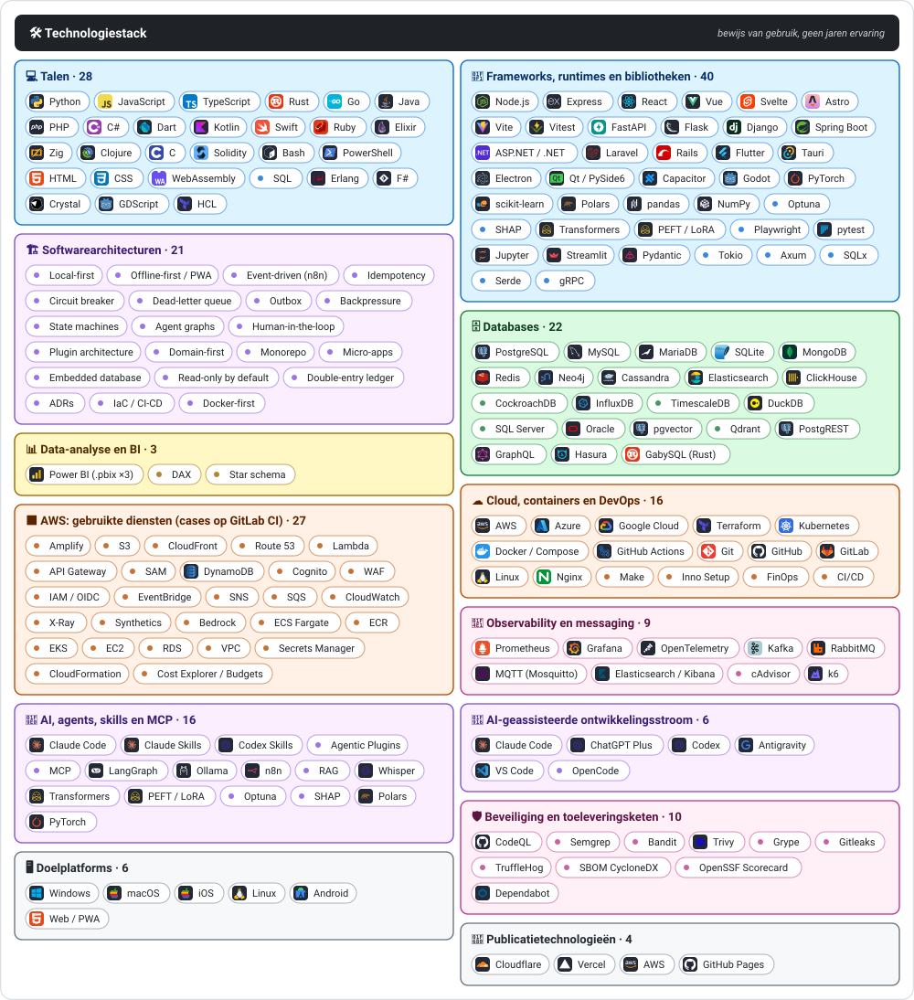
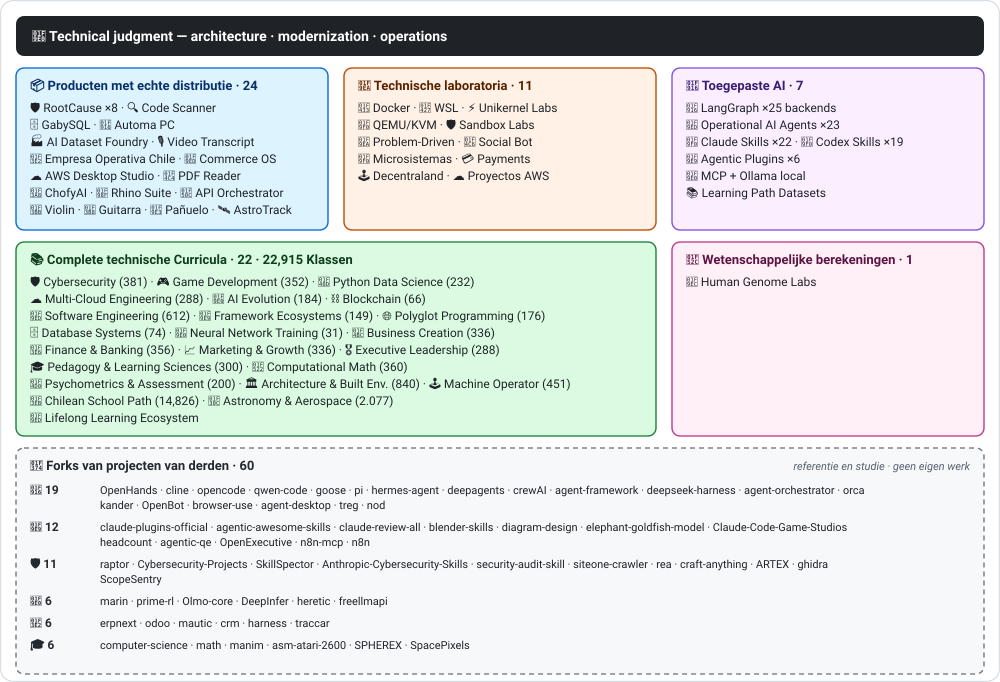

# 👋Vladimir Acuña

## **AI-ingenieur·Oplossingsarchitect·Senior Full-Stack·Digitale transformatie·Beheer en operaties**

**Professioneel opgeleid in Computer Science en Computing Engineering en Business Administration, met 16+ jaar bouw- en besturingssoftware in echte omgevingen. Ik sluit zaken, mensen, processen en technologie aan op het ontwerpen, evalueren, leveren en ondersteunen van oplossingen met technisch oordeel en een operationele visie .. ondersteund door verifieerbaar bewijs in deze GitHub account.**

<!-- STATS:START -->

<!-- STATS:END -->

[🧭 Waar te beginnen](docs/START_HERE.nl.md) ·
[🌐 Portfolio (22 languages)](https://vladimiracunadev-create.github.io/) ·
[🧩 Ecosystem](#ecosysteem-bij-een-glance) ·
[🛠️ Technologiestack](#-technologiestack) ·
[⚡ Evaluate me in 10 minutes](docs/guides/TECH_LEAD.nl.md) ·
[✅ Professional scope](#beroepsterrein) ·
[🧭 Non-coding management](#management-administratie-en-niet-coding-carrièremogelijkheden) ·
[📋 Functiematrix](PROFESIONAL_ROLES.nl.md) ·
[📬 Contact](#contactpersoon)

**🌐 Volledige versies:** [Español](README.md) · [English](README.en.md) · [Português](README.pt.md) · [Italiano](README.it.md) · [Français](README.fr.md) · [简体中文](README.zh.md) · [繁體中文](README.zh-TW.md) · [日本語](README.ja.md) · [한국어](README.ko.md) · [Türkçe](README.tr.md) · [Русский](README.ru.md) · [Tiếng Việt](README.vi.md) · [ไทย](README.th.md) · [Deutsch](README.de.md) · [Українська](README.uk.md) · [Polski](README.pl.md) · [العربية](README.ar.md) · [فارسی](README.fa.md) · [Bahasa Indonesia](README.id.md) · [Nederlands](README.nl.md) · [हिन्दी](README.hi.md) · [Ελληνικά](README.el.md)

**Technische kern:**
PHP 8 · Python · Rust · Go · Node/TS · Java 21 · .NET 8 · Dart/Flutter · WASM
· AWS · Terraform · Kubernetes · Docker · n8n · LangGraph/MCP · CI/CD · FinOps · Observability

**Brug over bedrijfstechnologie:**
proces- en vereistenanalyse·evaluatie van de oplossing·coördinatie van de levering·concrete acties en continuïteit·risicobeheer·product en dienst·technisch onderwijs

---

> [!NOTE]
> Dit profiel maakt van kansen geen ervaring. Bewezen technische ervaring, overdraagbare vaardigheden, levensvatbare toepassingen en toekomstige ontwikkelingsdoelstellingen zijn expliciet gescheiden. Gelinkt GitHub bewijs is uitvoerbaar of documentaire; waar iets is**niet**Het is als zodanig afgewerkt.

## 🧭 Waar te beginnen

Kies je situatie en ga direct naar wat je nodig hebt:

🧑‍💼 [Werving](docs/guides/RECRUITER.nl.md) · 💼 [Klant of freelance](docs/guides/FREELANCE.nl.md) · 🛠️ [Technische beoordeling](docs/guides/TECH_LEAD.nl.md) · 🏢 [Business en management](docs/guides/BUSINESS.nl.md) · 🤝 [Samenwerking en beveiliging](docs/guides/COLLABORATOR.nl.md) · 🎓 [Leren of lesgeven](docs/guides/LEARNER.nl.md)

## 🎯Wat je hier zult vinden

Dit is geen repo: het is een ecosysteem met gedeelde standaarden.

- 🔁 **Demo's die herproduceerbaar zijn**Kloon, rennen, valideren.
- 🧰 **Gestandaardiseerde gereedschappen**`doctor`, en`smoke`per repository.
- 🛡️ **Defense in de diepte**. . geheime scanning, beleid, en expliciet verboden praktijken.
- 📈 **Waarneming** — `/health`, `/ready`, `/metrics`, dashboards, en traceerbaarheid.
- 📚 **Documentatie van het publiek**
- 📦 **Productdistributie**
- 🌍 **Internationalisering** — dit profiel is gepubliceerd in 22 talen en het portfolio biedt 154 openbare pdf's (7 families × 22 talen) (ES · EN · PT · IT · FR · ZH · ZH-TW · JA · KO · TR · RU · VI · TH · DE · UK · PL · AR · FA · ID · NL · HI · EL).
- 🧭 **Technische eerlijkheid**`OPERATIONAL`, `DOCUMENTED/SCAFFOLD`, of`PLANNED`.

## ✅Verifieerbare status

| Oppervlakte | Concrete bewijzen |
|---|---|
| 🧪 **Testdekking** | GabySQL**850 tests**+ fuzzing over**503.8M queries**(0 paniek)·Empresa Operativa Chili**230 tests** ·Automatisch**150 pytest** ·multi-OS CI |
| 🤖 **Productie-kwaliteitsagenten** | LangGraph RealWorld**25/25 operationele backends**(gevallen 01·Operationele AI-agenten**23 agentia**met**69 deterministische evaluaties** |
| 🔗 **Integratie van polygloten** | **20 zaken**afzender→n8n→ ontvanger **19 operationeel**, individueel gecontroleerd met Docker· **18+ DB motoren** · **20+ containers** ·11 patronen |
| 📦 **Distributie** | **166 releases**over een ecosysteem van**68 openbare registers in eigendom** ·installateurs en artefacten`.exe` · `.msi` · `.dmg` · `.apk`met controlesom en bouwbewijs; commerciële/store-handtekeningen, indien van toepassing |
| 🛡️ **Leveringsketen** | CodeQL·Semgrep·Bandiet·Trivy·GrypeCity in New Jersey USA·Gitleaks·Truffelhog·CycloneDX SBOM·Scorecard |
| 📚 **Curricula** | **22,915 klassen**controleerbare in 22 programma's, geteld door[a workflow](.github/workflows/stats.yml)van een echte repositorystructuur of een verifieerbare bron die in het repository is opgegeven .·elk programma verklaart zijn redactionele status en beperkingen |
| 🌐 **Portefeuille** | Installeerbare PWA· **22 talen** · **154 PDF's**door pijpleiding gegenereerd·CV Data API·Android-condensator·Vuurtoren 100 |
| 🔒 **Telemetrie** | Zero telemetrie in forensische producten en Empresa Operativa Chili `INTERNET`toestemming) |
| 🌐 **Gepubliceerde sites** | **57 GitHub Pagina's sites**·alle 57 geverifieerd met HTTP`200` |

## 🛠️ Technologiestack

Technologieën die in de openbare repositories zijn aangetroffen (manifesten, afhankelijkheden, containers en code), gegroepeerd per gebied. Voorkomen in een repository —inclusief labs en curricula— is bewijs van gebruik, geen claim van jarenlange productie-ervaring.

👉 **[Waar de Technologiestack vandaan komt](docs/STACK_SOURCES.nl.md)**

**Softwarearchitecturen**

Local-first → [empresa-operativa-chile](https://github.com/vladimiracunadev-create/empresa-operativa-chile), [ai-dataset-foundry](https://github.com/vladimiracunadev-create/ai-dataset-foundry) · Event-driven → [social-bot-scheduler](https://github.com/vladimiracunadev-create/social-bot-scheduler) · Resilience → [problem-driven-systems-lab](https://github.com/vladimiracunadev-create/problem-driven-systems-lab) · Ledger → [universal-payments-engineering-lab](https://github.com/vladimiracunadev-create/universal-payments-engineering-lab) · Plugins → [agentic-plugins-toolkit](https://github.com/vladimiracunadev-create/agentic-plugins-toolkit) · Agents → [langgraph-realworld](https://github.com/vladimiracunadev-create/langgraph-realworld), [operational-ai-agents](https://github.com/vladimiracunadev-create/operational-ai-agents) · Domain-first → [rhino-suite](https://github.com/vladimiracunadev-create/rhino-suite) · Micro-apps → [microsistemas](https://github.com/vladimiracunadev-create/microsistemas) · Embedded DB → [gabysql](https://github.com/vladimiracunadev-create/gabysql) · IaC → [proyectos-aws](https://github.com/vladimiracunadev-create/proyectos-aws)

**Data-analyse en BI**

Power BI (.pbix ×3) · DAX · Star schema → [social-bot-scheduler](https://github.com/vladimiracunadev-create/social-bot-scheduler)

**AWS: gebruikte diensten (cases op GitLab CI)**

Cases A–P → [proyectos-aws-gitlab](https://gitlab.com/vladimir.acuna.dev-group/proyectos-aws-gitlab) (GitLab CI → AWS; alle 16 als afgerond verklaard; case M alleen fase 1) · [proyectos-aws](https://github.com/vladimiracunadev-create/proyectos-aws) (GitHub Actions) · EC2, RDS, VPC, Secrets Manager, CloudFormation, Cost Explorer → [aws-desktop-studio](https://github.com/vladimiracunadev-create/aws-desktop-studio) (echte inventarisatiequery's; EC2 met starten, stoppen en herstarten onder dubbele controle)

**AI-geassisteerde ontwikkelingsstroom**

| Hulpmiddel | Voornaamste gebruik |
|---|---|
| **Claude Code** | Architectenonderzoek, uitvoering en technische documentatie |
| **ChatGPT Plus** | Analyse, architectuur en iteratie (sinds 2023) |
| **Codex** | Codegeneratie en refactoring |
| **Antizwaartekracht** | Versnelling van de ontwikkeling en automatiseringsstromen |
| **VS Code / OpenCode** | Milieu met geïntegreerde AI-bijstand |

> Ik combineer mijn eigen technische beoordeling, menselijke validatie en architectuur richting. AI versterkt capaciteit, snelheid en bereik .. het vervangt geen ervaring.

**Publicatietechnologieën**

Cloudflare (persoonlijk werk) · Vercel (NASA Space Apps-hackathon) · AWS (operationele websites, gekoppeld aan GitLab) · GitHub Pages

## 🗺️Ecosysteem bij een glance

## 🗂️ Ecosysteem: producten, laboratoria, toegepaste AI, curricula en wetenschappelijk rekenen

Het praktische werk van dit profiel staat in een eigen document: software die je downloadt en installeert, engineeringlabs, toegepaste AI, complete technische curricula en wetenschappelijk rekenen, plus een beschrijving van elke fork van projecten van derden in het account.

- 📦 [**Producten met echte distributie**](docs/ECOSYSTEM.nl.md#products) (24)
- 🧪 [**Technische laboratoria**](docs/ECOSYSTEM.nl.md#labs) (11)
- 🤖 [**Toegepaste AI**](docs/ECOSYSTEM.nl.md#ai) (7)
- 📚 [**Complete technische Curricula**](docs/ECOSYSTEM.nl.md#curricula) (22)
- 🔬 [**Wetenschappelijke berekeningen**](docs/ECOSYSTEM.nl.md#science) (1)
- 🍴 [**Forks van projecten van derden**](docs/ECOSYSTEM.nl.md#forks) (60)

👉 **[Bekijk het volledige ecosysteem](docs/ECOSYSTEM.nl.md)** · [🍴 Forks van projecten van derden](docs/ECOSYSTEM.nl.md#forks)

## 🛰️ NASA Space Apps-hackathon 2026

Ik deed mee aan de **NASA Space Apps Challenge 2026** (Santiago, 14 en 15 november), bij de uitdaging *Planet X and SPHEREx*, in een team van 6 personen. Het product is **AstroTrack · SPHEREx**: een webviewer waarin je hemelcoördinaten invoert en dat gebied als reeks SPHEREx-beelden door de tijd ziet, met data van NASA/IPAC IRSA.

- **Mijn deel:** gegevenstoegang (IRSA-query's met cache en vooraf berekende demovelden), verpakking (PWA, desktopinstallers met Tauri en een Android-APK met Capacitor), de weergave “Downloads” en een consistentie-audit tussen documentatie en code.
- **Verifieerbare oplevering:** [spherex-releases](https://github.com/vladimiracunadev-create/spherex-releases) bundelt 7 releases (v0.1.0 t/m v0.4.2) met SHA-256-checksums · [webapp](https://spherex-planet-x-tau.vercel.app/) · [teamrepository](https://github.com/mauriciovalenzuela742/SPHEREX).
- **Verklaarde grenzen:** de viewer, het ontwerp en de rest van de backend zijn werk van andere teamleden; de installers zijn niet ondertekend en niet op echte apparaten getest; ik gebruikte AI (Claude Code) als assistent, zoals in de repository vermeld. Dit beschrijft mijn bijdrage, geen hackathonresultaat.

## 🧠Standaarden die ik toepaste in alle repositories

- **DX eerst**
- **Waarneming vanaf dag 1**..meters en traceerbaarheid, geen nadacht.
- **Veiligheid als pijpleiding**
- **Echte veerkracht**• Idempotentie, circuitbreker en gecontroleerde afbraak.
- **Polyglot naar ontwerp**. Taal en motor gekozen door use case, nooit door mode.
- **Eerlijkheid over status**`Multisimulador` → `machine-operator-program`) om veelbelovende software die nog niet bestaat te vermijden.
- **Badges zijn signalen, geen bewijs.****wat het NIET doet**.
- **Model naar buiten**. . het domein is eerst ontworpen; de interface is een projectie.
- **Extern werk wordt als extern aangegeven** — de [60 forks](docs/ECOSYSTEM.nl.md#forks) van projecten van derden worden één voor één beschreven en vallen buiten alle cijfers van eigen werk in dit profiel.

## ✅Beroepsterrein

Mijn dubbele achtergrond .**Computerwetenschappen en computersystemen en bedrijfsadministratie**

### 🎯Kernidentiteit

| Rol | Ondersteuning |
|---|---|
| **Oplossingsarchitect** | Modulaire, schaalbare systeemontwerp met evolutionaire beoordeling |
| **Legacy Modernization Architect** | Echte legacy evolutie (PHP 5.x→8.x, incrementele refactoring zonder onderbreking van de operaties) |
| **Senior Full-Stack / Tech Lead** | Architectuur, uitvoering en normen op echte platforms (+16 jaar) |
| **AI-automatiseringsarchitect** | Agentische systemen met LangGraph/MCP en n8n stromen met vangrails |

### ↗ Natuurlijke uitbreiding

**AI Orchestration Engineer** · **Systemen / Rust ingenieur** · **Mobiele ingenieur (Flutter)** · **Oplossingen ingenieur** · **Technische productbouwer** · **Technische trainer** · **Digitale Transformatie Consultant** · **Technisch adviseur (technologie, data en AI)** · **Bedrijfs-/functionele analist** · **Technische productbewerkingen** · **AI Engineer (LLM / ML)** · **Data Engineer** · **DevSecOps / AppSec Engineer** · **QA Automation / Test Engineer** · **Technical Writer** · **Docent / Trainer / Technologie-instructeur** · **Instructional Designer (EdTech)** · **Technical Mentor**

### ⚙️Aanvullende werkingssfeer

Platform ingenieur / IDP·DevOps / CI-CD·Cloud / AWS Engineer·Toepassing SRE·Automatiseringsingenieur·Technisch-commerciële adviseur · Backend / API Engineer · Fintech / Payments Engineer · Developer Advocate / DevRel

## 🧭Management, administratie en niet-coding carrièremogelijkheden

Management-, administratie- en businessfuncties waarin informatica en bedrijfskunde bijdragen zonder dat programmeren de kerntaak is, eerlijk ingedeeld (overdraagbare competentie, sollicitatiemogelijkheid of toekomstdoel) en met de kloof per functie. Behandelde gebieden:

Technologieleiderschap · Projectbeheer · Bedrijfsadministratie · Strategie en verandering · Bedrijfsanalyse · Product en dienst · Cybersecurity-beheer · Handel en verkoop · Financiën en beheerscontrole · Kwaliteit · Onderwijs · Logistiek en leveranciers · Gegevens en AI-governance · Openbare sector

👉 **[Bekijk de volledige kansenmatrix](docs/MANAGEMENT.nl.md)**

## 📌Beschikbaarheid

**Openen voor:**Senior Full-Stack·Architectuur·Modernisering van de legacy·Platform/IDP·Toepassing SRE·pragmatische DevOps·Automatisering·Automatisering van AI·bedrijfs/functionele analyse·Coördinatie van IT-projecten·Productbewerkingen·digitale transformatie·Oplossingen advies/voorverkoop·technisch onderwijs·kwaliteit en continue verbetering·AI-adoptie en -bestuur

**Geevalueerd naar gelang van de rolomvang:**Product Eigenaar / technische Product Manager·Dienstverlening·IT-operaties·GRC / technologierisico·Administratie en operaties·beheerscontrole·modernisering van de openbare sector. Executive en algemeen beheer titels zijn toekomstige ontwikkelingsdoelstellingen, niet geclaimde ervaring.

**Modaliteit:**remote of hybride, afhankelijk van het project.

## 📬Contactpersoon

---

[🤝 Contribute](CONTRIBUTING.nl.md) ·
[🛡️ Security](SECURITY.nl.md) ·
[⚖️ Code of Conduct](CODE_OF_CONDUCT.nl.md)

README gesynchroniseerd met de controleerbare staat van de openbare repositories —cijfers en wijzigingen via de API gelezen— · laatste verificatie: <!-- VERIFIED:START -->2026-11-24<!-- VERIFIED:END -->.

