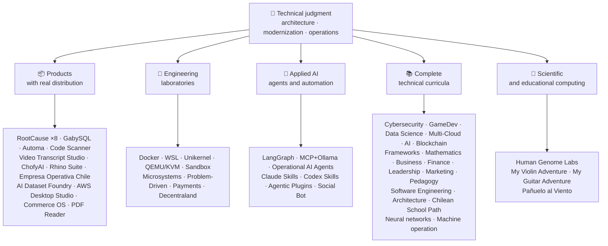

<div align="center">

# 👋Vladimir Acuña

## **Architekt rozwiązania·Senior Full- Stack·Transformacja cyfrowa·Zarządzanie i operacje**

**Profesjonalnie przeszkolony w informatyce i komputerach Inżynierii i Administracji Biznesu, z 16 + lat budowy i oprogramowania operacyjnego w rzeczywistych środowiskach. Łączę biznes, ludzi, procesy i technologię z projektowaniem, oceną, dostarczaniem i podtrzymywaniem rozwiązań z oceną techniczną i widokiem operacyjnym - poparte sprawdzalnymi dowodami na tym koncie GitHub.**

[](https://vladimiracunadev-create.github.io/)
[](https://www.linkedin.com/in/vladimir-acu%C3%B1a-valdebenito-11924a29/)
[](mailto:vladimir.acuna.dev@gmail.com)

[](#zakres-działalności)
[](docs/ECOSYSTEM.pl.md)
[](#kompletne-programy-nauczania-technicznego)

<!-- STATS:START -->
[](https://github.com/vladimiracunadev-create?tab=repositories)
[](https://github.com/vladimiracunadev-create?tab=repositories)
[](#ekosystem-w-odblasku)
[](#kompletne-programy-nauczania-technicznego)
[](https://github.com/vladimiracunadev-create?tab=repositories)
<!-- STATS:END -->

[](https://github.com/vladimiracunadev-create?tab=repositories)
[](https://github.com/vladimiracunadev-create?tab=followers)

[🌐 Portfolio (6 languages)](https://vladimiracunadev-create.github.io/) ·
[🧩 Ecosystem](#ekosystem-w-odblasku) ·
[⚡ Evaluate me in 10 minutes](#jeśli-masz-10-minut-na-ocenę-mnie) ·
[✅ Professional scope](#zakres-działalności) ·
[🧭 Non-coding management](#zarządzanie-administracja-i-niekodujące-szanse-na-karierę) ·
[📋 Role matrix](PROFESIONAL_ROLES.md) ·
[📬 Contact](#kontakt)

**🌐 Pełne wersje:** [Español](README.md) · [English](README.en.md) · [Português](README.pt.md) · [Italiano](README.it.md) · [Français](README.fr.md) · [简体中文](README.zh.md) · [繁體中文](README.zh-TW.md) · [日本語](README.ja.md) · [한국어](README.ko.md) · [Türkçe](README.tr.md) · [Русский](README.ru.md) · [Tiếng Việt](README.vi.md) · [ไทย](README.th.md) · [Deutsch](README.de.md) · [Українська](README.uk.md) · [Polski](README.pl.md) · [العربية](README.ar.md) · [فارسی](README.fa.md) · [Bahasa Indonesia](README.id.md) · [Nederlands](README.nl.md) · [हिन्दी](README.hi.md) · [Ελληνικά](README.el.md)

**Rdzeń techniczny:**
PHP 8 · Python · Rust · Go · Node/TS · Java 21 · .NET 8 · Dart/Flutter · WASM
· AWS · Terraform · Kubernetes · Docker · n8n · LangGraph/MCP · CI/CD · FinOps · Observability

**Most biznesowo-technologiczny:**
analiza procesu i wymogów·Ocena roztworu·koordynacja realizacji·operacje i ciągłość·zarządzanie ryzykiem·produkt i usługa·kształcenie techniczne

</div>

---

> [!NOTE]
> Profil ten nie zmienia możliwości w doświadczenie. Dowodzone doświadczenie techniczne, umiejętności do przenoszenia, wykonalne zastosowania oraz przyszłe cele rozwojowe są wyraźnie oddzielone. Powiązane dowody GitHub są wykonalne lub dokumentalne; gdzie coś jest**nie**wykończone, jest to określone jako takie.

## 🎯Co znajdziesz tutaj

Nie jest to "jeden repo": jest to ekosystem o wspólnych standardach.

- 🔁 **Odtwarzalne demo**- Klon, uciekaj, potwierdzaj.
- 🧰 **Znormalizowane oprzyrządowanie**- Makefiles, Hub CLI,`doctor`, oraz`smoke`w każdym repozytorium.
- 🛡️ **Obrona w głębi**- tajne skanowanie, polityka i wyraźnie zabronione praktyki.
- 📈 **Obserwacja** — `/health`, `/ready`, `/metrics`, deski rozdzielcze i identyfikowalność.
- 📚 **Dokumentacja dotycząca wiedzy o użytkownikach**- rekruter, początkujący, DevOps lub bezpieczeństwo, w zależności od repozytorium.
- 📦 **Dystrybucja produktów**- możliwość pobrania, sumy kontrolne i tworzenia dowodów; podpisy handlowe / sklepowe zadeklarowane jako oczekujące, w stosownych przypadkach.
- 🌍 **Internacjonalizacja**- portfolio w 6 językach (ES)·PL·PT·IT·FR·ZH).
- 🧭 **Szczerość techniczna**- każda sprawa oznaczona`OPERATIONAL`, `DOCUMENTED/SCAFFOLD`lub`PLANNED`.

## ✅Stan weryfikowalny

| Powierzchnia | Betonowe dowody |
|---|---|
| 🧪 **Zakres badania** | GabySQL**828 badań**+ rozmycie**503,8M zapytania**(0 paniki)·Empresa Operativa Chile**158 badań** ·Automa**150 pikseli** ·wieloOS CI |
| 🤖 **Czynniki klasy produkcyjnej** | LangGraph RealWorld**25 / 25 operacyjnych oparć**(sprawy 01- 25, 100%)·Operacyjne środki do zwalczania ptasiej grypy**13**z**39 determinalistycznych wymienników** |
| 🔗 **Integracja poliglotów** | **20 spraw**nadawca → n8n → odbiornik -**19 operacyjne**, indywidualnie skontrolowane z Docker -· **Silniki o mocy 18 + DB** · **20 + pojemniki** ·11 wzorów |
| 📦 **Dystrybucja** | **151 wydaleń**w całym ekosystemie**64 będące własnością repozytoriów publicznych** ·instalatorzy i artefakty`.exe` · `.msi` · `.dmg` · `.apk`z sumami kontrolnymi i dowodami na budowę; w stosownych przypadkach w toku podpisów handlowych / sklepowych |
| 🛡️ **Łańcuch dostaw** | CodeQL·Semgrep·Bandyta·Trivy·Typ·Gitleaks·TruffleHog Przewodniczący·CycloneDX SBOM·Wyniki |
| 📚 **Programy nauczania** | **14 530 klas**weryfikowalne w 21 programach, policzone przez[a workflow](.github/workflows/stats.yml)ze struktury repozytorium rzeczywistego lub źródła weryfikowalnego zadeklarowanego w repozytorium - nie napisane ręcznie -·Każdy program deklaruje swój status redakcyjny i ograniczenia |
| 🌐 **Portfolio** | Instalowalne PWA· **6 języków** · **36 PDF**generowane przez rurociąg·API danych CV·Capacitor Android·Latarnia morska 100 |
| 🔒 **Telemetria** | Zero telemetrii w wyrobach kryminalistycznych i Empresa Operativa Chile - zweryfikowane w każdej budowie (nie Android`INTERNET`(pozwolenie) |
| 🌐 **Published sites** | **56 GitHub Pages sites** —55 landings, one per product, program, or ecosystem navigator, plus the portfolio— each deployed from its own repository · all 56 verified with HTTP `200` |

## 🗺️Ekosystem w odblasku



## 🗂️ Ekosystem: produkty, laboratoria, stosowana AI i obliczenia naukowe

Praktyczna część profilu mieści się w osobnym dokumencie: oprogramowanie do pobrania i instalacji, laboratoria inżynierskie, stosowana AI i obliczenia naukowe oraz opis każdego forka projektów osób trzecich znajdującego się na koncie.

- 📦 **Produkty z dystrybucją rzeczywistą** (22)
- 🧪 **Laboratoria inżynieryjne** (11)
- 🤖 **Stosowana AI** (6)
- 🔬 **Konstrukcja naukowa** (1)
- 🍴 **Forki projektów osób trzecich** (52)

👉 **[Zobacz pełny ekosystem](docs/ECOSYSTEM.pl.md)** · [🍴 Forki projektów osób trzecich](docs/ECOSYSTEM.pl.md#forks)

## 📚Kompletne programy nauczania technicznego

Sekwencyjne programy w języku hiszpańskim, ze statusem i zakresem deklarowanym przez każde repozytorium. 21 programów dodaje się do**14 530 klas**, policzone[a workflow](.github/workflows/stats.yml)z rzeczywistej struktury repozytorium lub źródła weryfikowalnego zadeklarowanego w repozytorium; odznaka odświeża raz w tygodniu i nie jest zapisywana ręcznie.

🧭 [**Lifelong Learning Ecosystem**](https://github.com/vladimiracunadev-create/lifelong-learning-ecosystem)jest federacyjnym kompasem łączącym 30 prawdziwych ścieżek przez 6 obszarów poprzez mapy wizualne i[accessible offline portal](https://vladimiracunadev-create.github.io/lifelong-learning-ecosystem/); nie jest on liczony jako dodatkowy program.

| Program | Klasy | Zakres |
|---|---:|---|
| [🔢 **Computational Mathematics**](https://github.com/vladimiracunadev-create/computational-mathematics-program) | 360 | Od liczenia na palcach do reprodukcji papieru· **360 demonstracje deterministyczne zweryfikowane w CI** ·1,080 notesów·489- termin glosariusz· [site](https://vladimiracunadev-create.github.io/computational-mathematics-program/) |
| [🏦 **Finance and Banking**](https://github.com/vladimiracunadev-create/finance-and-banking-evolution-program) | 356 | 534 h·matematyka finansowa i MSSF → kredyty, ryzyko, Bazylea III, otwarte finanse, DLT, stablecoins, i MiCA· **27 spraw** · **298 testów** · [site](https://vladimiracunadev-create.github.io/finance-and-banking-evolution-program/) |
| [🎮 **GameDev**](https://github.com/vladimiracunadev-create/modern-gamedev-program) | 352 | Matematyka i C # / C + + / GDSscript → cieniarki, AI, multiplayer, VR / AR·GodotCity in Ontario Canada·Jedność·Nierealne· **10 laboratoriów Godota zweryfikowanych w CI**(301 kontroli)· [site](https://vladimiracunadev-create.github.io/modern-gamedev-program/) |
| [🛡️ **Cybersecurity**](https://github.com/vladimiracunadev-create/modern-cybersecurity-program) | 360 | **v1.3.0** ·20 części·fundacje → Red Team, DFIR, bezpieczeństwo w chmurze, wykorzystać dev, CTF, i bezpieczeństwa gry·mapined to**7 certyfikatów** ·offline Android / aplikacja web·Podręcznik PDF·CI, Bezpieczeństwo i Strony zweryfikowane· [site](https://vladimiracunadev-create.github.io/modern-cybersecurity-program/) |
| [📈 **Marketing, Sales, and Growth**](https://github.com/vladimiracunadev-create/marketing-sales-growth-evolution-program) | 336 | 24 części z definicjami operacyjnymi, arkuszami pomiarowymi, weryfikowalną bibliografią oraz chilijskim kontekstem regulacyjnym· **v1.6.0** ·1. 29M słowa·17 ścieżek role-· [site](https://vladimiracunadev-create.github.io/marketing-sales-growth-evolution-program/) |
| [🏢 **Business Creation**](https://github.com/vladimiracunadev-create/modern-business-creation-program) | 336 | Tworzenie i prowadzenie prawdziwej firmy w Chile: od idei do włączenia, organu podatkowego, operacji, kryzysu i wyjścia·360 schematów·Glosariusz o terminie 1,251@@·Podręcznik na stronie 1,548- stronicaName· [site](https://vladimiracunadev-create.github.io/modern-business-creation-program/) |
| [🏛️ **Architecture and Built Environment**](https://github.com/vladimiracunadev-create/architecture-built-environment-learning-program) | 830 | 83 części·60 sesji integracyjnych·34 ścieżki·źródła identyfikowalne·Markdown, czytnik offline i strony GitHub· [site](https://vladimiracunadev-create.github.io/architecture-built-environment-learning-program/) |
| [🇨🇱 **Chilean School Learning Path**](https://github.com/vladimiracunadev-create/chilean-school-learning-path) | 8,841 | Stopnie 1- 12· **4.156 zintegrowane doświadczenia międzyprogramowe** · **2,823 Cele edukacyjne** ·Źródła MINEDUC·brak oczekujących propozycji i specjalistyczny przegląd człowieka nadal w toku· [site](https://vladimiracunadev-create.github.io/chilean-school-learning-path/) |
| [🧭 **Modern Software Engineering**](https://github.com/vladimiracunadev-create/modern-software-engineering-program) | 480 | 40 części i 8 etapów·fundacje → produkty, architektura, bezpieczeństwo, DevOps, SRE, SPEC, AI i systemy wieloagencyjne·status redakcyjny zadeklarowany przez repozytorium· [site](https://vladimiracunadev-create.github.io/modern-software-engineering-program/) |
| [🎓 **Pedagogy and Learning Sciences**](https://github.com/vladimiracunadev-create/education-pedagogy-learning-sciences-program) | 300 | Od tego, jak człowiek uczy się, jak nauczyciele są szkoleni·25 części· **każda klasa deklaruje stan i granice dowodów** ·wczesna umiejętność czytania i pisania, metody porównawcze, szczególne potrzeby edukacyjne, współistnienie, różnorodność kulturowa i dowody międzynarodowe·Słownik 1097- term, 325 diagramów i 60-aktywny bank klasy·14 ścieżek kariery według ról·LMS- exportable· **v2.1.0** · [site](https://vladimiracunadev-create.github.io/education-pedagogy-learning-sciences-program/) |
| [☁️ **Multi-Cloud**](https://github.com/vladimiracunadev-create/multi-cloud-engineering-program) | 288 | AWS·Azure·GCP·Kubernety·Terraform·SRE·Finansowe· **1 288 godzin** ·288 laboratoriów z dowodami JSON·1,032 źródła śledzone·2,884- strona PDF instrukcja· [site](https://vladimiracunadev-create.github.io/multi-cloud-engineering-program/) |
| [🎖️ **Executive Leadership**](https://github.com/vladimiracunadev-create/executive-leadership-founder-program) | 288 | Od posiadania pierwszego wyniku do prowadzenia firmy i zakładania własnych: zespołów, KPI / OKR, finansów, produktów, ryzyka, zarządu i M & A·24 przypadki, 96 laboratoriów i 39 szablonów· [site](https://vladimiracunadev-create.github.io/executive-leadership-founder-program/) |
| [🐍 **Python Data Science**](https://github.com/vladimiracunadev-create/python-data-science-program) | 232 | Polary, ML + Optuna / SHAP, PyTorch / LLMs / LRA, MLOps·natywna aplikacja Windows + Android APK· [site](https://vladimiracunadev-create.github.io/python-data-science-program/) |
| [🧠 **AI Evolution**](https://github.com/vladimiracunadev-create/artificial-intelligence-evolution-program) | 184 | Symboliczne → probabilistic → głębokie uczenie → LLM, RAG, agentów, bezpieczeństwa i granic· **v0.17.0** · **708 notebooków** · **148 dokumentów założycielskich** ·offline aplikacje Windows, Android i PWA· [site](https://vladimiracunadev-create.github.io/artificial-intelligence-evolution-program/) |
| [🌐 **Comparative Programming**](https://github.com/vladimiracunadev-create/polyglot-programming-labs) | 176 | Jedna koncepcja,**10 języków**zweryfikowane w CI -**1,360 implementacje**- plus**1,632 programów**w językach żyjący w stanie spoczynku (COBOL, Fortran, Ada, RPG, MUMPS...) i atlas**60 kart w 15 rodzinach** ·v1.1.0· [site](https://vladimiracunadev-create.github.io/polyglot-programming-labs/) |
| [🧩 **Frameworks Compared**](https://github.com/vladimiracunadev-create/framework-ecosystems-labs) | 149 | Jeden kontrakt wykonywalny, bez adapterów, przeciwko Express, FastaPI, Spring Boot, ASP.NET, Django, Rails, Laravel, React, Vue, Svelte i więcej·12 części· **70 klas zbudowanych** · **397 spraw zweryfikowanych w CI** · **210 ISBN / DOI sources** · [site](https://vladimiracunadev-create.github.io/framework-ecosystems-labs/) |
| [🗄️ **Databases**](https://github.com/vladimiracunadev-create/database-systems-labs) | 74 | **v3.0.0** ·inżynieria bazy danych w 15 częściach·230 godzin· **weryfikowalne źródło dla każdego roszczenia**: 120 źródeł z ISBN, DOI, lub standard·ta sama sprawa rozwiązana w 27 silnikach·Słownik 306- termin·150 pikseli· [site](https://vladimiracunadev-create.github.io/database-systems-labs/) |
| [📐 **Psychometrics and Assessment**](https://github.com/vladimiracunadev-create/psychometrics-and-assessment-program) | 40 | W jaki sposób instrument pomiarowy jest budowany, oceniany, zatwierdzany i poddawany audytowi·8 części·z silnikiem wykonywalnym**5 instrumentów i 344 pozycji, 276 domen publicznych** |
| [⛓️ **Blockchain**](https://github.com/vladimiracunadev-create/blockchain-learning-path) | 66 | **v0.14.0** ·od 0 do programowalnej infrastruktury finansowej i analizy na łańcuchu· **91 praktyk**oraz**363 badania** ·kontrakty z Foundry (fuzing i niezmienni) i Slither static analysis in CI·aplikacje offline zweryfikowane przez otwarcie binarnego i liczenie jego zawartości· [site](https://vladimiracunadev-create.github.io/blockchain-learning-path/) |
| [🧠 **Neural Network Training Labs**](https://github.com/vladimiracunadev-create/neural-network-training-labs) | 31 | 7 modułów·214 godzin· **93 notebooki**- 31 klas, 31 wersji studenckich i 31 rozwiązań -·pytania, mapy wizualne, praktyki i ocena z prawdziwymi danymi publicznymi·PyTorchCity in Germany· [study site](https://vladimiracunadev-create.github.io/neural-network-training-labs/) |
| [🕹️ **Machine Operator**](https://github.com/vladimiracunadev-create/machine-operator-program) | 451 | **41 modułów szkoleniowych**, jeden na maszynę· **502 h 15 min** ·systemy, sterowanie, fizyka, bezpieczeństwo i projektowanie symulacji ze źródłami na klasę·* nie ma jeszcze symulatora wykonywalnego, i jest to zadeklarowane w ten sposób * |

## ⚡Jeśli masz 10 minut na ocenę mnie

Idea nie polega tylko na patrzeniu na kod: to jest zobaczyć**Jak myślę**Jak dokumentuję i jak wszystko wykonywalne.

**Trasa A - Realna obserwacja i orchestracja*** (my favorite) *

```bash
git clone https://github.com/vladimiracunadev-create/social-bot-scheduler.git
```

Zobaczysz przepływ pracy, pomiary, deski rozdzielcze i poręcze w 19 przypadkach i 18 + silniki DB.

**Trasa B - Infrastruktura powtarzalna w minutach**

```bash
git clone https://github.com/vladimiracunadev-create/docker-labs.git
```

**Trasa C - Agenci z wpisanym stanem**

```bash
git clone https://github.com/vladimiracunadev-create/langgraph-realworld.git
```

**Trasa D - Produkt sądowy z rdzy, bez klonowania**

Pobierz instalator lub CLI binarne z[RootCause releases](https://github.com/vladimiracunadev-create/rootcause-windows-inspector/releases)i zweryfikować`SHA256SUMS`.

## 🧠Normy I stosowane w różnych repozytoriach

- **DX pierwszy**- jeśli nie jest to łatwe do uruchomienia, nie jest to przydatne jako demo lub jako baza zespołowa.
- **Obserwacja od pierwszego dnia**- dane pomiarowe i identyfikowalność, nie są to informacje po przemyśleniu.
- **Bezpieczeństwo rurociągu**- tajne skanowanie, SBOM za zwolnienie, wyraźnie zabronione praktyki.
- **Realna odporność**- idempotencja, przerywacz obwodów i kontrolowana degradacja.
- **Poliglot według projektu**- język i silnik wybrany przez przypadek użycia, nigdy przez modę.
- **Szczerość o statusie**- zmieniono nazwę jednego repo (`Multisimulador` → `machine-operator-program`) aby uniknąć obiecującego oprogramowania, które jeszcze nie istnieje.
- **Odznaki to sygnały, nie dowody.**- każdy repo deklaruje również**co nie robi NIE robi**.
- **Wzór na zewnątrz**- domenę zaprojektowano najpierw; interfejs jest projekcją.
- **Praca zewnętrzna jest deklarowana jako zewnętrzna** — [52 forków](docs/ECOSYSTEM.pl.md#forks) projektów osób trzecich opisano pojedynczo i pozostają poza wszystkimi liczbami własnych prac w tym profilu.

## ✅Zakres działalności

Moje podwójne tło...**Informatyka i informatyka + Administracja Biznesu**- pomaga mi przełożyć cele biznesowe na decyzje techniczne i ograniczenia techniczne na jasne opcje dla operacji, produktów, klientów i przywództwa.

### 🎯Tożsamość podstawowa

| Rola | Backing |
|---|---|
| **Architekt rozwiązania** | Modułowa, skalowalna konstrukcja systemu z oceną ewolucyjną |
| **Architekt modernizacji dziedzictwa** | Prawdziwa ewolucja spuścizny (PHP 5.x → 8.x, przyrostowe przeróbki bez przerywania operacji) |
| **Senior Full- Stack / Tech Lead** | Architektura, wykonanie i standardy na platformach rzeczywistych (+ 16 lat) |
| **Architekt automatyzacji AI** | Systemy agentalne z LangGraph / MCP i n8n przepływają z poręczami |

### ↗ Naturalne rozszerzenie

**Inżynier orkiestracji AI** · **Systemy / Inżynier Rust** · **Inżynier mobilny (Flutter)** · **Inżynier rozwiązań** · **Techniczny budowniczy produktów** · **Trener techniczny** · **Cyfrowy konsultant transformacji** · **Business / Functional Analyst** · **Operacje techniczne dotyczące produktu**

### ⚙️Zakres uzupełniający

Inżynier platformy / IDP·Devops / CI- CD·Inżynier chmur / AWS·Program SRE·Inżynier automatyki·Konsultant handlowy

## 🧭Zarządzanie, Administracja i niekodujące szanse na karierę

Role w zarządzaniu, administracji i biznesie, w których informatyka i administracja wnoszą wartość, a programowanie nie jest zadaniem centralnym – uczciwie sklasyfikowane (kompetencja przenośna, możliwość aplikowania lub cel na przyszłość) wraz z luką w każdym przypadku. Omówione obszary:

Liderem technologicznym · Zarządzanie projektami · Administracja biznesowa · Strategia i zmiany · Analiza biznesowa · Produkt i usługi · Zarządzanie bezpieczeństwem cybernetycznym · Sprzedaż i sprzedaż · Kontrola finansów i zarządzania · Jakość · Edukacja · Logistyka i dostawcy · Zarządzanie danymi i ptasimi zwierzętami i ptasimi zwierzętami · Sektor publiczny

👉 **[Zobacz pełną macierz możliwości](docs/MANAGEMENT.pl.md)**

## 🤖Proces rozwoju wspomagany przez AI

| Narzędzie | Główne zastosowanie |
|---|---|
| **Kod Claude 'a** | Przegląd architektoniczny, wdrożenie i dokumentacja techniczna |
| **ChatGPT Plus** | analiza, architektura i iteracja (od 2023) |
| **Kodeks** | Wytwarzanie i refakturowanie kodów |
| **Przeciwgrawitacyjne** | Przyspieszenie rozwoju i automatyzacji przepływu |
| **Kod VS / OpenCode** | Środowisko ze zintegrowaną pomocą w zakresie ptasiej grypy |

> Łączę mój własny osąd techniczny, ludzkie potwierdzenie i kierunek architektoniczny. AI wzmacnia pojemność, szybkość i zasięg - nie zastępuje doświadczenia.

## 📌Dostępność

**Otwórz na:**Senior Full- Stack·Architektura·Modernizacja dziedzictwa·Platforma / IDP·Program SRE·devops pragmatic·Automatyzacja·Automatyzacja AI·analiza biznesowa / funkcjonalna·Koordynacja projektów informatycznych·Operacje produktu·transformacja cyfrowa·rozwiązania konsultingowe / presales·kształcenie techniczne·jakość i ciągłe doskonalenie·Przyjęcie i zarządzanie ptasią grypą

**Oceniany w zależności od zakresu każdej roli:**Właściciel produktu / techniczny menedżer produktu·Dostawa usług·Operacje informatyczne·Ryzyko związane z technologią·administracja i operacje·kontrola zarządzania·modernizacja sektora publicznego. Tytuły wykonawcze i ogólne zarządzania są przyszłymi celami rozwoju, a nie deklarowane doświadczenie.

**Moduł:**zdalne lub hybrydowe, w zależności od projektu.

## 📬Kontakt

[](https://vladimiracunadev-create.github.io/)
[](https://www.linkedin.com/in/vladimir-acu%C3%B1a-valdebenito-11924a29/)
[](https://gitlab.com/vladimir.acuna.dev-group/vladimir.acuna.dev-group)
[](mailto:vladimir.acuna.dev@gmail.com)

---

<div align="center">

[🤝 Contribute](CONTRIBUTING.en.md) ·
[🛡️ Security](SECURITY.en.md) ·
[⚖️ Code of Conduct](CODE_OF_CONDUCT.en.md)

<sub>README zsynchronizowany z weryfikowalnym stanem repozytoriów publicznych - dane liczbowe i zmiany odczytywane za pośrednictwem API -·ostatnia weryfikacja: 12 października 2026 r.</sub>

</div>
