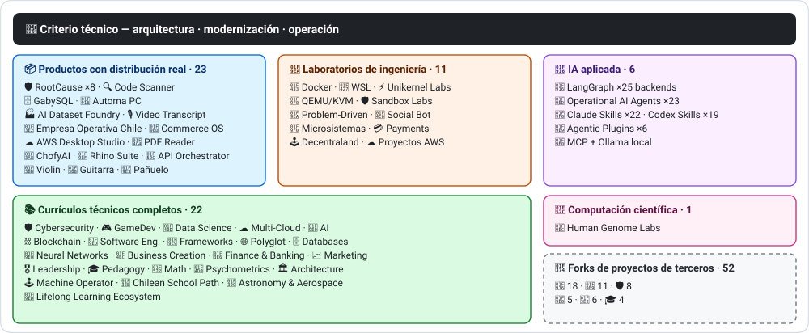

<div align="center">

# 👋Vladimir Acuña

## **Inżynier AI·Architekt rozwiązania·Senior Full- Stack·Transformacja cyfrowa·Zarządzanie i operacje**

**Profesjonalnie przeszkolony w informatyce i komputerach Inżynierii i Administracji Biznesu, z 16 + lat budowy i oprogramowania operacyjnego w rzeczywistych środowiskach. Łączę biznes, ludzi, procesy i technologię z projektowaniem, oceną, dostarczaniem i podtrzymywaniem rozwiązań z oceną techniczną i widokiem operacyjnym - poparte sprawdzalnymi dowodami na tym koncie GitHub.**

[](https://vladimiracunadev-create.github.io/)
[](https://www.linkedin.com/in/vladimir-acu%C3%B1a-valdebenito-11924a29/)
[](mailto:vladimir.acuna.dev@gmail.com)

[](#zakres-działalności)
[](docs/ECOSYSTEM.pl.md)
[](#kompletne-programy-nauczania-technicznego)

<!-- STATS:START -->
[](https://github.com/vladimiracunadev-create?tab=repositories)
[](https://github.com/vladimiracunadev-create?tab=repositories)
[](#ekosystem-w-odblasku)
[](#kompletne-programy-nauczania-technicznego)
[](https://github.com/vladimiracunadev-create?tab=repositories)
[](docs/ECOSYSTEM.pl.md#forks)
[](https://github.com/vladimiracunadev-create?tab=repositories)
[](https://github.com/pulls?q=author%3Avladimiracunadev-create+type%3Apr)
[](https://github.com/issues?q=author%3Avladimiracunadev-create+type%3Aissue)
<!-- STATS:END -->

[](https://github.com/vladimiracunadev-create?tab=repositories)
[](https://github.com/vladimiracunadev-create?tab=followers)

[🧭 Od czego zacząć](docs/START_HERE.pl.md) ·
[🌐 Portfolio (22 languages)](https://vladimiracunadev-create.github.io/) ·
[🧩 Ecosystem](#ekosystem-w-odblasku) ·
[🛠️ Stos technologiczny](#-stos-technologiczny) ·
[⚡ Evaluate me in 10 minutes](#jeśli-masz-10-minut-na-ocenę-mnie) ·
[✅ Professional scope](#zakres-działalności) ·
[🧭 Non-coding management](#zarządzanie-administracja-i-niekodujące-szanse-na-karierę) ·
[📋 Macierz stanowisk](PROFESIONAL_ROLES.pl.md) ·
[📬 Contact](#kontakt)

**🌐 Pełne wersje:** [Español](README.md) · [English](README.en.md) · [Português](README.pt.md) · [Italiano](README.it.md) · [Français](README.fr.md) · [简体中文](README.zh.md) · [繁體中文](README.zh-TW.md) · [日本語](README.ja.md) · [한국어](README.ko.md) · [Türkçe](README.tr.md) · [Русский](README.ru.md) · [Tiếng Việt](README.vi.md) · [ไทย](README.th.md) · [Deutsch](README.de.md) · [Українська](README.uk.md) · [Polski](README.pl.md) · [العربية](README.ar.md) · [فارسی](README.fa.md) · [Bahasa Indonesia](README.id.md) · [Nederlands](README.nl.md) · [हिन्दी](README.hi.md) · [Ελληνικά](README.el.md)

**Rdzeń techniczny:**
PHP 8 · Python · Rust · Go · Node/TS · Java 21 · .NET 8 · Dart/Flutter · WASM
· AWS · Terraform · Kubernetes · Docker · n8n · LangGraph/MCP · CI/CD · FinOps · Observability

**Most biznesowo-technologiczny:**
analiza procesu i wymogów·Ocena roztworu·koordynacja realizacji·operacje i ciągłość·zarządzanie ryzykiem·produkt i usługa·kształcenie techniczne

</div>

---

> [!NOTE]
> Profil ten nie zmienia możliwości w doświadczenie. Dowodzone doświadczenie techniczne, umiejętności do przenoszenia, wykonalne zastosowania oraz przyszłe cele rozwojowe są wyraźnie oddzielone. Powiązane dowody GitHub są wykonalne lub dokumentalne; gdzie coś jest**nie**wykończone, jest to określone jako takie.

## 🧭 Od czego zacząć

Wybierz swój przypadek i przejdź prosto do tego, czego potrzebujesz:

🧑‍💼 [Rekrutacja](docs/guides/RECRUITER.pl.md) · 💼 [Klient lub freelance](docs/guides/FREELANCE.pl.md) · 🛠️ [Ocena techniczna](docs/guides/TECH_LEAD.pl.md) · 🏢 [Biznes i zarządzanie](docs/guides/BUSINESS.pl.md) · 🤝 [Współpraca i bezpieczeństwo](docs/guides/COLLABORATOR.pl.md) · 🎓 [Nauka lub nauczanie](docs/guides/LEARNER.pl.md)

## 🎯Co znajdziesz tutaj

Nie jest to "jeden repo": jest to ekosystem o wspólnych standardach.

- 🔁 **Odtwarzalne demo**- Klon, uciekaj, potwierdzaj.
- 🧰 **Znormalizowane oprzyrządowanie**- Makefiles, Hub CLI,`doctor`, oraz`smoke`w każdym repozytorium.
- 🛡️ **Obrona w głębi**- tajne skanowanie, polityka i wyraźnie zabronione praktyki.
- 📈 **Obserwacja** — `/health`, `/ready`, `/metrics`, deski rozdzielcze i identyfikowalność.
- 📚 **Dokumentacja dotycząca wiedzy o użytkownikach**- rekruter, początkujący, DevOps lub bezpieczeństwo, w zależności od repozytorium.
- 📦 **Dystrybucja produktów**- możliwość pobrania, sumy kontrolne i tworzenia dowodów; podpisy handlowe / sklepowe zadeklarowane jako oczekujące, w stosownych przypadkach.
- 🌍 **Internacjonalizacja** — ten profil jest opublikowany w 22 językach, a portfolio oferuje 154 publiczne pliki PDF (7 rodzin × 22 języki) (ES · EN · PT · IT · FR · ZH · ZH-TW · JA · KO · TR · RU · VI · TH · DE · UK · PL · AR · FA · ID · NL · HI · EL).
- 🧭 **Szczerość techniczna**- każda sprawa oznaczona`OPERATIONAL`, `DOCUMENTED/SCAFFOLD`lub`PLANNED`.

## ✅Stan weryfikowalny

| Powierzchnia | Betonowe dowody |
|---|---|
| 🧪 **Zakres badania** | GabySQL**850 badań**+ rozmycie**503,8M zapytania**(0 paniki)·Empresa Operativa Chile**230 badań** ·Automa**150 pikseli** ·wieloOS CI |
| 🤖 **Czynniki klasy produkcyjnej** | LangGraph RealWorld**25 / 25 operacyjnych oparć**(sprawy 01- 25, 100%)·Operacyjne środki do zwalczania ptasiej grypy**23**z**69 determinalistycznych wymienników** |
| 🔗 **Integracja poliglotów** | **20 spraw**nadawca → n8n → odbiornik -**19 operacyjne**, indywidualnie skontrolowane z Docker -· **Silniki o mocy 18 + DB** · **20 + pojemniki** ·11 wzorów |
| 📦 **Dystrybucja** | **156 wydaleń**w całym ekosystemie**66 będące własnością repozytoriów publicznych** ·instalatorzy i artefakty`.exe` · `.msi` · `.dmg` · `.apk`z sumami kontrolnymi i dowodami na budowę; w stosownych przypadkach w toku podpisów handlowych / sklepowych |
| 🛡️ **Łańcuch dostaw** | CodeQL·Semgrep·Bandyta·Trivy·Typ·Gitleaks·TruffleHog Przewodniczący·CycloneDX SBOM·Wyniki |
| 📚 **Programy nauczania** | **16 798 klas**weryfikowalne w 22 programach, policzone przez[a workflow](.github/workflows/stats.yml)ze struktury repozytorium rzeczywistego lub źródła weryfikowalnego zadeklarowanego w repozytorium - nie napisane ręcznie -·Każdy program deklaruje swój status redakcyjny i ograniczenia |
| 🌐 **Portfolio** | Instalowalne PWA· **22 języków** · **154 PDF**generowane przez rurociąg·API danych CV·Capacitor Android·Latarnia morska 100 |
| 🔒 **Telemetria** | Zero telemetrii w wyrobach kryminalistycznych i Empresa Operativa Chile - zweryfikowane w każdej budowie (nie Android`INTERNET`(pozwolenie) |
| 🌐 **Published sites** | **57 GitHub Pages sites** —56 landings, one per product, program, or ecosystem navigator, plus the portfolio— each deployed from its own repository · all 57 verified with HTTP `200` |

## 🛠️ Stos technologiczny

Technologie wykryte w publicznych repozytoriach (manifesty, zależności, kontenery i kod), pogrupowane według obszarów. Obecność w repozytorium —także w laboratoriach i programach nauczania— jest dowodem użycia, a nie deklaracją lat doświadczenia produkcyjnego.

**Języki**


<sub>Python · JavaScript · TypeScript · Rust · Go · Java · PHP · C# · Dart · Kotlin · Swift · Ruby · Elixir · Zig · Clojure · C · Solidity · Bash · PowerShell · HTML · CSS · WebAssembly · SQL · Erlang · F# · Crystal · GDScript · HCL</sub>

**Frameworki, środowiska uruchomieniowe i biblioteki**


<sub>Node.js · Express · React · Vue · Svelte · Astro · Vite · Vitest · FastAPI · Flask · Django · Spring Boot · ASP.NET / .NET · Laravel · Rails · Flutter · Tauri · Electron · Qt / PySide6 · Capacitor · Godot · PyTorch · scikit-learn · Polars · pandas · NumPy · Optuna · SHAP · Transformers · PEFT / LoRA · Playwright · pytest · Jupyter · Streamlit · Pydantic · Tokio · Axum · SQLx · Serde</sub>

**Architektury oprogramowania**


-0969da?style=flat-square)


<sub>Local-first → [empresa-operativa-chile](https://github.com/vladimiracunadev-create/empresa-operativa-chile), [ai-dataset-foundry](https://github.com/vladimiracunadev-create/ai-dataset-foundry) · Event-driven → [social-bot-scheduler](https://github.com/vladimiracunadev-create/social-bot-scheduler) · Resilience → [problem-driven-systems-lab](https://github.com/vladimiracunadev-create/problem-driven-systems-lab) · Ledger → [universal-payments-engineering-lab](https://github.com/vladimiracunadev-create/universal-payments-engineering-lab) · Plugins → [agentic-plugins-toolkit](https://github.com/vladimiracunadev-create/agentic-plugins-toolkit) · Agents → [langgraph-realworld](https://github.com/vladimiracunadev-create/langgraph-realworld), [operational-ai-agents](https://github.com/vladimiracunadev-create/operational-ai-agents) · Domain-first → [rhino-suite](https://github.com/vladimiracunadev-create/rhino-suite) · Micro-apps → [microsistemas](https://github.com/vladimiracunadev-create/microsistemas) · Embedded DB → [gabysql](https://github.com/vladimiracunadev-create/gabysql) · IaC → [proyectos-aws](https://github.com/vladimiracunadev-create/proyectos-aws)</sub>

**Bazy danych**


<sub>PostgreSQL · MySQL · MariaDB · SQLite · MongoDB · Redis · Neo4j · Cassandra · Elasticsearch · ClickHouse · CockroachDB · InfluxDB · TimescaleDB · DuckDB · SQL Server · Oracle · pgvector · PostgREST · GraphQL · GabySQL (Rust)</sub>

**Chmura, kontenery i DevOps**


<sub>AWS · Terraform · Kubernetes · Docker / Compose · GitHub Actions · Git · GitHub · GitLab · Linux · Nginx · Make · Inno Setup · FinOps · CI/CD</sub>

**Obserwowalność i komunikaty**


<sub>Prometheus · Grafana · OpenTelemetry · Kafka · MQTT (Mosquitto) · Elasticsearch / Kibana · cAdvisor · k6</sub>

**AI, agenci, skille i MCP**


<sub>Claude Code · Claude Skills · Codex Skills · Agentic Plugins · MCP · LangGraph · Ollama · n8n · RAG · Whisper · Transformers · PEFT / LoRA · Optuna · SHAP · Polars · PyTorch</sub>

**Proces rozwoju wspomagany przez AI**


| Narzędzie | Główne zastosowanie |
|---|---|
| **Kod Claude 'a** | Przegląd architektoniczny, wdrożenie i dokumentacja techniczna |
| **ChatGPT Plus** | analiza, architektura i iteracja (od 2023) |
| **Kodeks** | Wytwarzanie i refakturowanie kodów |
| **Przeciwgrawitacyjne** | Przyspieszenie rozwoju i automatyzacji przepływu |
| **Kod VS / OpenCode** | Środowisko ze zintegrowaną pomocą w zakresie ptasiej grypy |

> Łączę mój własny osąd techniczny, ludzkie potwierdzenie i kierunek architektoniczny. AI wzmacnia pojemność, szybkość i zasięg - nie zastępuje doświadczenia.

**Bezpieczeństwo i łańcuch dostaw**


**Platformy docelowe**


<sub>Windows · macOS · iOS · Linux · Android · Web / PWA</sub>

## 🗺️Ekosystem w odblasku



## 🗂️ Ekosystem: produkty, laboratoria, stosowana AI, programy nauczania i obliczenia naukowe

Praktyczna część profilu mieści się w osobnym dokumencie: oprogramowanie do pobrania i instalacji, laboratoria inżynierskie, stosowana AI, kompletne programy nauczania techniczne i obliczenia naukowe oraz opis każdego forka projektów osób trzecich znajdującego się na koncie.

- 📦 **Produkty z dystrybucją rzeczywistą** (23)
- 🧪 **Laboratoria inżynieryjne** (11)
- 🤖 **Stosowana AI** (6)
- 📚 **Kompletne programy nauczania technicznego** (22)
- 🔬 **Konstrukcja naukowa** (1)
- 🍴 **Forki projektów osób trzecich** (52)

👉 **[Zobacz pełny ekosystem](docs/ECOSYSTEM.pl.md)** · [🍴 Forki projektów osób trzecich](docs/ECOSYSTEM.pl.md#forks)

## 📚Kompletne programy nauczania technicznego

Sekwencyjne programy w języku hiszpańskim, ze statusem i zakresem deklarowanym przez każde repozytorium. 22 programów dodaje się do**16 798 klas**, policzone[a workflow](.github/workflows/stats.yml)z rzeczywistej struktury repozytorium lub źródła weryfikowalnego zadeklarowanego w repozytorium; odznaka odświeża raz w tygodniu i nie jest zapisywana ręcznie.

🌌 **Wliczone do zliczania:** [Astronomia, astrofizyka, nauki kosmiczne i inżynieria lotnicza i kosmiczna](https://github.com/vladimiracunadev-create/astronomy-astrophysics-space-sciences-aerospace-engineering-learning-program) — 2.077 zajęć w 12 obszarach i 133 blokach; wszystkie z napisanym tekstem i nadal w stanie E0 (czekają na recenzję merytoryczną i zatwierdzenie autora). Niezależne kształcenie, nie uprawnienia zawodowe · [strona](https://vladimiracunadev-create.github.io/astronomy-astrophysics-space-sciences-aerospace-engineering-learning-program/).

👉 **[Zobacz 22 pełnych programów](docs/ECOSYSTEM.pl.md#curricula)**

## ⚡Jeśli masz 10 minut na ocenę mnie

Idea nie polega tylko na patrzeniu na kod: to jest zobaczyć**Jak myślę**Jak dokumentuję i jak wszystko wykonywalne.

**Trasa A - Realna obserwacja i orchestracja*** (my favorite) *

```bash
git clone https://github.com/vladimiracunadev-create/social-bot-scheduler.git
```

Zobaczysz przepływ pracy, pomiary, deski rozdzielcze i poręcze w 20 przypadkach i 18 + silniki DB.

**Trasa B - Infrastruktura powtarzalna w minutach**

```bash
git clone https://github.com/vladimiracunadev-create/docker-labs.git
```

**Trasa C - Agenci z wpisanym stanem**

```bash
git clone https://github.com/vladimiracunadev-create/langgraph-realworld.git
```

**Trasa D - Produkt sądowy z rdzy, bez klonowania**

Pobierz instalator lub CLI binarne z[RootCause releases](https://github.com/vladimiracunadev-create/rootcause-windows-inspector/releases)i zweryfikować`SHA256SUMS`.

## 🧠Normy I stosowane w różnych repozytoriach

- **DX pierwszy**- jeśli nie jest to łatwe do uruchomienia, nie jest to przydatne jako demo lub jako baza zespołowa.
- **Obserwacja od pierwszego dnia**- dane pomiarowe i identyfikowalność, nie są to informacje po przemyśleniu.
- **Bezpieczeństwo rurociągu**- tajne skanowanie, SBOM za zwolnienie, wyraźnie zabronione praktyki.
- **Realna odporność**- idempotencja, przerywacz obwodów i kontrolowana degradacja.
- **Poliglot według projektu**- język i silnik wybrany przez przypadek użycia, nigdy przez modę.
- **Szczerość o statusie**- zmieniono nazwę jednego repo (`Multisimulador` → `machine-operator-program`) aby uniknąć obiecującego oprogramowania, które jeszcze nie istnieje.
- **Odznaki to sygnały, nie dowody.**- każdy repo deklaruje również**co nie robi NIE robi**.
- **Wzór na zewnątrz**- domenę zaprojektowano najpierw; interfejs jest projekcją.
- **Praca zewnętrzna jest deklarowana jako zewnętrzna** — [52 forków](docs/ECOSYSTEM.pl.md#forks) projektów osób trzecich opisano pojedynczo i pozostają poza wszystkimi liczbami własnych prac w tym profilu.

## ✅Zakres działalności

Moje podwójne tło...**Informatyka i informatyka + Administracja Biznesu**- pomaga mi przełożyć cele biznesowe na decyzje techniczne i ograniczenia techniczne na jasne opcje dla operacji, produktów, klientów i przywództwa.

### 🎯Tożsamość podstawowa

| Rola | Backing |
|---|---|
| **Architekt rozwiązania** | Modułowa, skalowalna konstrukcja systemu z oceną ewolucyjną |
| **Architekt modernizacji dziedzictwa** | Prawdziwa ewolucja spuścizny (PHP 5.x → 8.x, przyrostowe przeróbki bez przerywania operacji) |
| **Senior Full- Stack / Tech Lead** | Architektura, wykonanie i standardy na platformach rzeczywistych (+ 16 lat) |
| **Architekt automatyzacji AI** | Systemy agentalne z LangGraph / MCP i n8n przepływają z poręczami |

### ↗ Naturalne rozszerzenie

**Inżynier orkiestracji AI** · **Systemy / Inżynier Rust** · **Inżynier mobilny (Flutter)** · **Inżynier rozwiązań** · **Techniczny budowniczy produktów** · **Trener techniczny** · **Cyfrowy konsultant transformacji** · **Business / Functional Analyst** · **Operacje techniczne dotyczące produktu** · **AI Engineer (LLM / ML)** · **Data Engineer** · **DevSecOps / AppSec Engineer** · **QA Automation / Test Engineer** · **Technical Writer** · **Wykładowca / Trener / Instruktor technologii** · **Instructional Designer (EdTech)** · **Technical Mentor**

### ⚙️Zakres uzupełniający

Inżynier platformy / IDP·Devops / CI- CD·Inżynier chmur / AWS·Program SRE·Inżynier automatyki·Konsultant handlowy · Backend / API Engineer · Fintech / Payments Engineer · Developer Advocate / DevRel

## 🧭Zarządzanie, Administracja i niekodujące szanse na karierę

Role w zarządzaniu, administracji i biznesie, w których informatyka i administracja wnoszą wartość, a programowanie nie jest zadaniem centralnym – uczciwie sklasyfikowane (kompetencja przenośna, możliwość aplikowania lub cel na przyszłość) wraz z luką w każdym przypadku. Omówione obszary:

Liderem technologicznym · Zarządzanie projektami · Administracja biznesowa · Strategia i zmiany · Analiza biznesowa · Produkt i usługi · Zarządzanie bezpieczeństwem cybernetycznym · Sprzedaż i sprzedaż · Kontrola finansów i zarządzania · Jakość · Edukacja · Logistyka i dostawcy · Zarządzanie danymi i ptasimi zwierzętami i ptasimi zwierzętami · Sektor publiczny

👉 **[Zobacz pełną macierz możliwości](docs/MANAGEMENT.pl.md)**

## 📌Dostępność

**Otwórz na:**Senior Full- Stack·Architektura·Modernizacja dziedzictwa·Platforma / IDP·Program SRE·devops pragmatic·Automatyzacja·Automatyzacja AI·analiza biznesowa / funkcjonalna·Koordynacja projektów informatycznych·Operacje produktu·transformacja cyfrowa·rozwiązania konsultingowe / presales·kształcenie techniczne·jakość i ciągłe doskonalenie·Przyjęcie i zarządzanie ptasią grypą

**Oceniany w zależności od zakresu każdej roli:**Właściciel produktu / techniczny menedżer produktu·Dostawa usług·Operacje informatyczne·Ryzyko związane z technologią·administracja i operacje·kontrola zarządzania·modernizacja sektora publicznego. Tytuły wykonawcze i ogólne zarządzania są przyszłymi celami rozwoju, a nie deklarowane doświadczenie.

**Moduł:**zdalne lub hybrydowe, w zależności od projektu.

## 📬Kontakt

[](https://vladimiracunadev-create.github.io/)
[](https://www.linkedin.com/in/vladimir-acu%C3%B1a-valdebenito-11924a29/)
[](https://gitlab.com/vladimir.acuna.dev-group/vladimir.acuna.dev-group)
[](mailto:vladimir.acuna.dev@gmail.com)

---

<div align="center">

[🤝 Contribute](CONTRIBUTING.pl.md) ·
[🛡️ Security](SECURITY.pl.md) ·
[⚖️ Code of Conduct](CODE_OF_CONDUCT.pl.md)

<sub>README zsynchronizowany z weryfikowalnym stanem publicznych repozytoriów —dane i zmiany odczytywane przez API— · ostatnia weryfikacja: <!-- VERIFIED:START -->2026-11-13<!-- VERIFIED:END -->.</sub>

</div>
