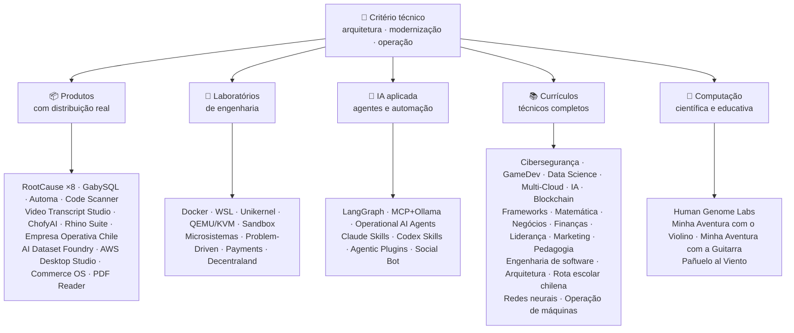

<div align="center">

# 👋 Vladimir Acuña

## **Arquiteto de Soluções · Senior Full-Stack · Transformação Digital · Gestão e Operações**

**Engenheiro em Informática e Computação e Administrador de Empresas, com mais de 16 anos construindo e operando software em ambientes reais. Conecto negócios, pessoas, processos e tecnologia para desenhar, avaliar, entregar e sustentar soluções — com evidência verificável neste GitHub.**

[](https://vladimiracunadev-create.github.io/)
[](https://www.linkedin.com/in/vladimir-acu%C3%B1a-valdebenito-11924a29/)
[](mailto:vladimir.acuna.dev@gmail.com)

[](#-escopo-profissional)
[](docs/ECOSYSTEM.pt.md)
[](#-currículos-técnicos-completos)

<!-- STATS:START -->
[](https://github.com/vladimiracunadev-create?tab=repositories)
[](https://github.com/vladimiracunadev-create?tab=repositories)
[](#-ecossistema-em-uma-visão)
[](#-currículos-técnicos-completos)
[](https://github.com/vladimiracunadev-create?tab=repositories)
<!-- STATS:END -->

[](https://github.com/vladimiracunadev-create?tab=repositories)
[](https://github.com/vladimiracunadev-create?tab=followers)

[🌐 Portfólio (6 idiomas)](https://vladimiracunadev-create.github.io/) ·
[🧩 Ecossistema](#-ecossistema-em-uma-visão) ·
[⚡ Avalie-me em 10 minutos](#-se-você-tem-10-minutos-para-me-avaliar) ·
[✅ Escopo profissional](#-escopo-profissional) ·
[🧭 Gestão sem programação](#-gestão-administração-e-oportunidades-profissionais-sem-programação) ·
[📋 Matriz de cargos](PROFESIONAL_ROLES.md) ·
[📬 Contato](#-contato)

**🌐 Versões completas:** [Español](README.md) · [English](README.en.md) · [Português](README.pt.md) · [Italiano](README.it.md) · [Français](README.fr.md) · [简体中文](README.zh.md) · [繁體中文](README.zh-TW.md) · [日本語](README.ja.md) · [한국어](README.ko.md) · [Türkçe](README.tr.md) · [Русский](README.ru.md) · [Tiếng Việt](README.vi.md) · [ไทย](README.th.md) · [Deutsch](README.de.md) · [Українська](README.uk.md) · [Polski](README.pl.md) · [العربية](README.ar.md) · [فارسی](README.fa.md) · [Bahasa Indonesia](README.id.md) · [Nederlands](README.nl.md) · [हिन्दी](README.hi.md) · [Ελληνικά](README.el.md)

**Núcleo técnico:**
PHP 8 · Python · Rust · Go · Node/TS · Java 21 · .NET 8 · Dart/Flutter · WASM
· AWS · Terraform · Kubernetes · Docker · n8n · LangGraph/MCP · CI/CD · FinOps · Observabilidade

**Ponte negócio–tecnologia:** análise de processos e requisitos · avaliação de soluções · coordenação de entrega · operações e continuidade · riscos · produto e serviço · formação técnica

</div>

---

> [!NOTE]
> Este perfil não transforma possibilidades em experiência. Experiência comprovada, competências transferíveis, possibilidades de candidatura e objetivos futuros são diferenciados explicitamente.

## 🎯 O Que Você Vai Encontrar Aqui

Não é “um repo”: é um ecossistema com padrões comuns.

- 🔁 **Demos reproduzíveis** — clonar, executar, validar.
- 🧰 **Tooling padronizado** — Makefiles, Hub CLI, `doctor` e `smoke` por repositório.
- 🛡️ **Defesa em profundidade** — secret scanning, políticas e práticas proibidas explicitamente.
- 📈 **Observabilidade** — `/health`, `/ready`, `/metrics`, dashboards e rastreabilidade.
- 📚 **Documentação por audiência** — recrutador, iniciante, DevOps ou segurança, conforme o repositório.
- 📦 **Distribuição como produto** — releases baixáveis, checksums e evidência de build; assinaturas comerciais/de loja declaradas como pendentes quando aplicável.
- 🌍 **Internacionalização** — portfólio em 6 idiomas (ES · EN · PT · IT · FR · ZH).
- 🧭 **Honestidade técnica** — cada caso marcado como `OPERACIONAL`, `DOCUMENTADO/SCAFFOLD` ou `PLANEJADO`.

## ✅ Estado Verificável

| Superfície | Evidência concreta |
|---|---|
| 🧪 **Cobertura de testes** | GabySQL **828 testes** + fuzz de **503,8 M queries** (0 panics) · Empresa Operativa Chile **158 testes** · Automa **150 pytest** · CI multi-OS |
| 🤖 **Agentes em produção** | LangGraph RealWorld **25/25 backends operacionais** (casos 01–25, cobertura 100 %) · Operational AI Agents **13 agentes** com **39 evals determinísticos** |
| 🔗 **Integração políglota** | **20 casos** emissor→n8n→receptor —**19 operacionais**, auditados um a um com Docker— · **18+ motores de BD** · **20+ contêineres** · 11 padrões |
| 📦 **Distribuição** | **151 releases** publicadas em um ecossistema de **64 repositórios públicos próprios** · instaladores e artefatos `.exe` · `.msi` · `.dmg` · `.apk` com checksums e evidência de build; assinaturas comerciais/de loja em andamento quando aplicável |
| 🛡️ **Cadeia de suprimentos** | CodeQL · Semgrep · Bandit · Trivy · Grype · Gitleaks · TruffleHog · SBOM CycloneDX · Scorecard |
| 📚 **Currículos** | **14.530 aulas** verificáveis em 21 programas, contadas por [um workflow](.github/workflows/stats.yml) sobre estrutura real ou fonte verificável declarada no repositório —não escritas à mão— · cada programa declara seu estado editorial e seus limites |
| 🌐 **Portfólio** | PWA instalável · **6 idiomas** · **36 PDFs** por pipeline · CV Data API · Capacitor Android · Lighthouse 100 |
| 🔒 **Telemetria** | Zero nos produtos forenses e em Empresa Operativa Chile — verificada em cada build (sem permissão `INTERNET` no Android) |
| 🌐 **Sites publicados** | **56 sites** no GitHub Pages —55 landings, uma por produto, programa ou navegador do ecossistema, mais o portfólio— todos implantados a partir do próprio repositório · os 56 verificados com resposta `200` |

## 🗺️ Ecossistema Em Uma Visão



## 🗂️ Ecossistema: produtos, laboratórios, IA aplicada e computação científica

O trabalho prático do perfil vive em um documento próprio: software que se baixa e instala, laboratórios de engenharia, IA aplicada e computação científica, além da descrição de cada fork de projetos de terceiros presente na conta.

- 📦 **Produtos Com Distribuição Real** (22)
- 🧪 **Laboratórios De Engenharia** (11)
- 🤖 **IA Aplicada** (6)
- 🔬 **Computação Científica** (1)
- 🍴 **Forks de projetos de terceiros** (52)

👉 **[Ver o ecossistema completo](docs/ECOSYSTEM.pt.md)** · [🍴 Forks de projetos de terceiros](docs/ECOSYSTEM.pt.md#forks)

## 📚 Currículos Técnicos Completos

Programas sequenciais em espanhol, com estado e escopo declarados por cada repositório. Os 21 programas somam **14.530 aulas**, contadas por [um workflow](.github/workflows/stats.yml) sobre estrutura real ou fonte verificável declarada no repositório; a insígnia é atualizada semanalmente e não está escrita à mão.

🧭 [**Lifelong Learning Ecosystem**](https://github.com/vladimiracunadev-create/lifelong-learning-ecosystem) é uma bússola federada que conecta 30 percursos reais em 6 áreas, com mapas visuais e um [portal offline acessível](https://vladimiracunadev-create.github.io/lifelong-learning-ecosystem/), sem ser contado como programa adicional.

| Programa | Aulas | Alcance |
|---|---:|---|
| [🔢 **Matemática Computacional**](https://github.com/vladimiracunadev-create/computational-mathematics-program) | 360 | De contar nos dedos a reproduzir um paper · **360 demonstrações determinísticas verificadas em CI** · 1.080 notebooks · glossário de 489 termos · [site](https://vladimiracunadev-create.github.io/computational-mathematics-program/) |
| [🏦 **Finanças e Banca**](https://github.com/vladimiracunadev-create/finance-and-banking-evolution-program) | 356 | 534 h · matemática financeira e IFRS → crédito, riscos, Basileia III, finanças abertas, DLT, stablecoins e MiCA · **27 casos** · **298 testes** · [site](https://vladimiracunadev-create.github.io/finance-and-banking-evolution-program/) |
| [🎮 **GameDev**](https://github.com/vladimiracunadev-create/modern-gamedev-program) | 352 | Matemática e C#/C++/GDScript → shaders, IA, multiplayer, VR/AR · Godot · Unity · Unreal · **10 labs Godot verificados em CI** (301 checagens) · [site](https://vladimiracunadev-create.github.io/modern-gamedev-program/) |
| [🛡️ **Cibersegurança**](https://github.com/vladimiracunadev-create/modern-cybersecurity-program) | 360 | **v1.3.0** · 20 partes · fundamentos → Red Team, DFIR, cloud security, exploit dev, CTF e game security · mapeado a **7 certificações** · app Android/web offline · manual PDF · CI, Security e Pages verificados · [site](https://vladimiracunadev-create.github.io/modern-cybersecurity-program/) |
| [📈 **Marketing, Vendas e Crescimento**](https://github.com/vladimiracunadev-create/marketing-sales-growth-evolution-program) | 336 | 24 partes com definições operacionais, fichas de medição, bibliografia verificável e contexto regulatório chileno · **v1.6.0** · 1,29 M palavras · 17 rotas por papel · [site](https://vladimiracunadev-create.github.io/marketing-sales-growth-evolution-program/) |
| [🏢 **Criação de Empresas**](https://github.com/vladimiracunadev-create/modern-business-creation-program) | 336 | Criar e operar uma empresa real no Chile: da ideia à constituição, SII, operação, crise e saída · 360 diagramas · glossário de 1.251 termos · manual de 1.548 páginas · [site](https://vladimiracunadev-create.github.io/modern-business-creation-program/) |
| [🏛️ **Arquitetura e Ambiente Construído**](https://github.com/vladimiracunadev-create/architecture-built-environment-learning-program) | 830 | 83 partes · 60 sessões integradoras · 34 rotas · fontes rastreáveis · Markdown, leitor offline e GitHub Pages · [site](https://vladimiracunadev-create.github.io/architecture-built-environment-learning-program/) |
| [🇨🇱 **Rota Escolar Chilena**](https://github.com/vladimiracunadev-create/chilean-school-learning-path) | 8.841 | Do 1º ano básico ao 4º ano médio · **4.156 experiências transversais integradas** · **2.823 objetivos de aprendizagem** · fontes MINEDUC · nenhuma proposta pendente e revisão humana especializada ainda pendente · [site](https://vladimiracunadev-create.github.io/chilean-school-learning-path/) |
| [🧭 **Engenharia de software moderna**](https://github.com/vladimiracunadev-create/modern-software-engineering-program) | 480 | 40 partes e 8 etapas · fundamentos → produto, arquitetura, segurança, DevOps, SRE, SPEC, IA e sistemas multiagente · estado editorial declarado pelo repositório · [site](https://vladimiracunadev-create.github.io/modern-software-engineering-program/) |
| [🎓 **Pedagogia e Ciências da Aprendizagem**](https://github.com/vladimiracunadev-create/education-pedagogy-learning-sciences-program) | 300 | De como uma pessoa aprende a como se forma quem ensina · 25 partes · **cada aula declara seu estado de evidência e limites** · alfabetização inicial, metodologias comparadas, necessidades educativas específicas, convivência, diversidade cultural e evidência internacional · glossário de 1.097 termos, 325 diagramas e banco de 60 atividades · 14 rotas de carreira · exportável a LMS · **v2.1.0** · [site](https://vladimiracunadev-create.github.io/education-pedagogy-learning-sciences-program/) |
| [☁️ **Multi-Cloud**](https://github.com/vladimiracunadev-create/multi-cloud-engineering-program) | 288 | AWS · Azure · GCP · Kubernetes · Terraform · SRE · FinOps · **1.288 horas** · 288 labs com evidência JSON · 1.032 fontes rastreadas · manual PDF de 2.884 páginas · [site](https://vladimiracunadev-create.github.io/multi-cloud-engineering-program/) |
| [🎖️ **Liderança Executiva**](https://github.com/vladimiracunadev-create/executive-leadership-founder-program) | 288 | De assumir seu primeiro resultado a dirigir uma empresa e fundar a própria: equipes, KPI/OKR, finanças, produto, risco, conselho e M&A · 24 casos, 96 labs e 39 modelos · [site](https://vladimiracunadev-create.github.io/executive-leadership-founder-program/) |
| [🐍 **Python Data Science**](https://github.com/vladimiracunadev-create/python-data-science-program) | 232 | Polars, ML+Optuna/SHAP, PyTorch/LLMs/LoRA, MLOps · app Windows nativo + APK Android · [site](https://vladimiracunadev-create.github.io/python-data-science-program/) |
| [🧠 **Evolução da IA**](https://github.com/vladimiracunadev-create/artificial-intelligence-evolution-program) | 184 | Simbólica → probabilística → deep learning → LLMs, RAG, agentes, segurança e fronteira · **v0.17.0** · **708 notebooks** · **148 papers fundacionais** · apps Windows, Android e PWA offline · [site](https://vladimiracunadev-create.github.io/artificial-intelligence-evolution-program/) |
| [🌐 **Programação Comparada**](https://github.com/vladimiracunadev-create/polyglot-programming-labs) | 176 | Um conceito, **10 linguagens** verificadas em CI — **1.360 implementações** — mais **1.632 programas** em linguagens ainda vivas (COBOL, Fortran, Ada, RPG, MUMPS…) e atlas de **60 fichas em 15 famílias** · v1.1.0 · [site](https://vladimiracunadev-create.github.io/polyglot-programming-labs/) |
| [🧩 **Frameworks Comparados**](https://github.com/vladimiracunadev-create/framework-ecosystems-labs) | 149 | Um contrato executável contra Express, FastAPI, Spring Boot, ASP.NET, Django, Rails, Laravel, React, Vue, Svelte e mais · 12 partes · **70 aulas construídas** · **397 casos verificados em CI** · **210 fontes** ISBN/DOI · [site](https://vladimiracunadev-create.github.io/framework-ecosystems-labs/) |
| [🗄️ **Bancos de Dados**](https://github.com/vladimiracunadev-create/database-systems-labs) | 74 | **v3.0.0** · engenharia de bancos de dados em 15 partes · 230 horas · **fonte verificável de cada afirmação**: 120 fontes com ISBN, DOI ou norma · o mesmo caso resolvido em 27 motores · glossário de 306 termos · 150 pytest · [site](https://vladimiracunadev-create.github.io/database-systems-labs/) |
| [📐 **Psicometria e Medição**](https://github.com/vladimiracunadev-create/psychometrics-and-assessment-program) | 40 | Como se constrói, pontua, valida e audita um instrumento de medição · 8 partes · motor executável com **5 instrumentos e 344 itens, 276 de domínio público** |
| [⛓️ **Blockchain**](https://github.com/vladimiracunadev-create/blockchain-learning-path) | 66 | **v0.14.0** · do zero à infraestrutura financeira programável e analítica on-chain · **91 práticas** e **363 testes** · contratos com Foundry e análise estática Slither em CI · apps offline verificados abrindo o binário e contando seu conteúdo · [site](https://vladimiracunadev-create.github.io/blockchain-learning-path/) |
| [🧠 **Neural Network Training Labs**](https://github.com/vladimiracunadev-create/neural-network-training-labs) | 31 | 7 módulos · ≈214 horas · **93 notebooks** —31 aulas, 31 versões para estudante e 31 soluções— · perguntas, mapas visuais, práticas e avaliação com dados públicos reais · PyTorch · [site de estudo](https://vladimiracunadev-create.github.io/neural-network-training-labs/) |
| [🕹️ **Machine Operator**](https://github.com/vladimiracunadev-create/machine-operator-program) | 451 | **41 módulos formativos**, um por máquina · **502 h 15 min** · sistemas, comandos, física, segurança e desenho de simulação com fontes por aula · *ainda sem simulador executável, e isso é declarado* |

## ⚡ Se Você Tem 10 Minutos Para Me Avaliar

A ideia não é apenas olhar código: é ver **como penso**, como documento e como faço tudo ser executável.

**Rota A — Observabilidade e orquestração real** *(minha favorita)*

```bash
git clone https://github.com/vladimiracunadev-create/social-bot-scheduler.git
```

Você verá workflows, métricas, dashboards e guardrails sobre 19 casos e 18+ motores de BD.

**Rota B — Infraestrutura reproduzível em minutos**

```bash
git clone https://github.com/vladimiracunadev-create/docker-labs.git
```

**Rota C — Agentes com estado tipado**

```bash
git clone https://github.com/vladimiracunadev-create/langgraph-realworld.git
```

**Rota D — Produto forense em Rust, sem clonar**

Baixe o instalador ou binário CLI em [releases do RootCause](https://github.com/vladimiracunadev-create/rootcause-windows-inspector/releases) e verifique `SHA256SUMS`.

## 🧠 Padrões Que Aplico Em Todos Os Repositórios

- **DX primeiro** — se não roda fácil, não serve como demo nem como base de equipe.
- **Observabilidade desde o dia 1** — métricas e rastreabilidade, não como remendo posterior.
- **Segurança como pipeline** — secret scanning, SBOM por release, práticas proibidas declaradas.
- **Resiliência real** — idempotência, circuit breaker e degradação controlada.
- **Poliglota por desenho** — linguagem e motor escolhidos pelo caso de uso, nunca por moda.
- **Honestidade sobre o estado** — um repo foi renomeado (`Multisimulador` → `machine-operator-program`) para não prometer software que ainda não existe.
- **Badges são sinais, não evidência** — cada repo também declara **o que NÃO faz**.
- **Do modelo para fora** — o domínio é desenhado primeiro; a interface é uma projeção.
- **O que é externo é declarado** — os [52 forks](docs/ECOSYSTEM.pt.md#forks) de projetos de terceiros são descritos um a um e ficam fora de todos os números de obra própria deste perfil.

## ✅ Escopo Profissional

Minha formação dupla —**Engenharia em Informática e Computação + Administração de Empresas**— permite traduzir objetivos de negócio em decisões técnicas e restrições técnicas em opções claras para operações, produto, clientes e direção.

### 🎯 Identidade Principal

| Papel | Respaldo |
|---|---|
| **Arquiteto de Soluções** | Desenho de sistemas modulares, escaláveis e com critério evolutivo |
| **Arquiteto de Modernização de Legado** | Evolução real de legado (PHP 5.x→8.x, refatoração incremental sem interromper operação) |
| **Senior Full-Stack / Tech Lead** | Arquitetura, execução e padrões em plataformas reais (+16 anos) |
| **Arquiteto de Automação com IA** | Sistemas agentic com LangGraph/MCP e fluxos n8n com guardrails |

### ↗ Expansão Natural

**AI Orchestration Engineer** · **Systems / Rust Engineer** · **Mobile Engineer (Flutter)** · **Solutions Engineer** · **Technical Product Builder** · **Technical Trainer** · **Consultor de Transformação Digital** · **Business / Functional Analyst** · **Product Operations Técnico**

### ⚙️ Escopo Complementar

Platform Engineer / IDP · DevOps / CI-CD · Cloud / AWS Engineer · SRE de aplicações · Automation Engineer · Consultor técnico-comercial

## 🧭 Gestão, Administração e Oportunidades Profissionais sem Programação

Cargos de gestão, administração e negócios em que a informática e a administração contribuem sem que programar seja a tarefa central, classificados com honestidade (competência transferível, possibilidade de candidatura ou objetivo futuro) e com a lacuna de cada um. Áreas cobertas:

Direção tecnológica · Projetos · Administração · Estratégia · Análise empresarial · Produto e serviço · GRC e continuidade · Comercial · Finanças e controle · Qualidade · Educação · Logística · Dados e IA · Setor público

👉 **[Ver a matriz completa de oportunidades](docs/MANAGEMENT.pt.md)**

## 🤖 Fluxo De Desenvolvimento Assistido Por IA

| Ferramenta | Uso principal |
|---|---|
| **Claude Code** | Revisão arquitetônica, implementação e documentação técnica |
| **ChatGPT Plus** | Análise, arquitetura e iteração (desde 2023) |
| **Codex** | Geração e refatoração de código |
| **Antigravity** | Aceleração de fluxos de desenvolvimento e automação |
| **VS Code / OpenCode** | Ambientes com assistência IA integrada |

> Combino critério técnico próprio, validação humana e direção arquitetônica. A IA amplia capacidade, velocidade e alcance — não substitui experiência.

## 📌 Disponibilidade

**Aberto a:** Senior Full-Stack · Arquitetura · Modernização de legado · Platform/IDP · SRE · DevOps · Automação · AI Automation · análise de negócio/funcional · coordenação de projetos TI · Product Operations · transformação digital · pré-vendas/soluções · educação tecnológica · qualidade · adoção e governança de IA

**Avaliado conforme o escopo:** Product Owner/Manager técnico · Service Delivery · Operações TI · GRC/risco · administração/operações · controle de gestão · modernização pública. Gerência e direção são objetivos futuros, não experiência declarada.

**Modalidade:** remoto ou híbrido, conforme o projeto.

## 📬 Contato

[](https://vladimiracunadev-create.github.io/)
[](https://www.linkedin.com/in/vladimir-acu%C3%B1a-valdebenito-11924a29/)
[](https://gitlab.com/vladimir.acuna.dev-group/vladimir.acuna.dev-group)
[](mailto:vladimir.acuna.dev@gmail.com)

---

<div align="center">

[🤝 Contribuir](CONTRIBUTING.pt.md) ·
[🛡️ Segurança](SECURITY.pt.md) ·
[⚖️ Código de conduta](CODE_OF_CONDUCT.pt.md)

<sub>README sincronizado com o estado verificável dos repositórios públicos —números e mudanças lidos por API— · última verificação: 12 de outubro de 2026.</sub>

</div>
