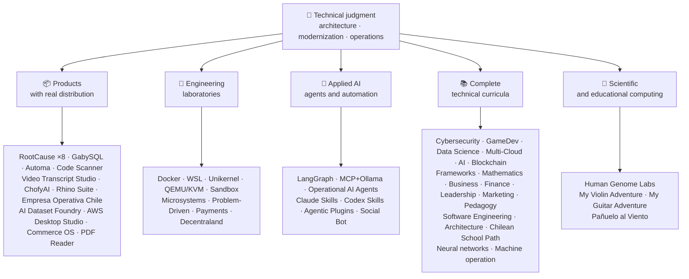

<div align="center">

# 👋Владимир Акунья

## **Архитектор решений·Старший Full-Stack·Цифровая трансформация·Управление и операции**

**Профессионально обучен в области компьютерных наук и вычислительной техники и делового администрирования, с 16+ лет создания и эксплуатации программного обеспечения в реальных средах. Я связываю бизнес, людей, процессы и технологии для разработки, оценки, предоставления и поддержки решений с техническим суждением и оперативным взглядом, подкрепленным проверяемыми доказательствами в этой учетной записи GitHub.**

[](https://vladimiracunadev-create.github.io/)
[](https://www.linkedin.com/in/vladimir-acu%C3%B1a-valdebenito-11924a29/)
[](mailto:vladimir.acuna.dev@gmail.com)

[](#профессиональный-уровень)
[](docs/ECOSYSTEM.ru.md)
[](#полная-техническая-программа)

<!-- STATS:START -->
[](https://github.com/vladimiracunadev-create?tab=repositories)
[](https://github.com/vladimiracunadev-create?tab=repositories)
[](#экосистема-с-первого-взгляда)
[](#полная-техническая-программа)
[](https://github.com/vladimiracunadev-create?tab=repositories)
<!-- STATS:END -->

[](https://github.com/vladimiracunadev-create?tab=repositories)
[](https://github.com/vladimiracunadev-create?tab=followers)

[🌐 Portfolio (6 languages)](https://vladimiracunadev-create.github.io/) ·
[🧩 Ecosystem](#экосистема-с-первого-взгляда) ·
[⚡ Evaluate me in 10 minutes](#если-у-вас-есть-10-минут-чтобы-оценить-меня) ·
[✅ Professional scope](#профессиональный-уровень) ·
[🧭 Non-coding management](#управление-администрирование-и-некодирование-карьерных-возможностей) ·
[📋 Role matrix](PROFESIONAL_ROLES.md) ·
[📬 Contact](#контакт)

**🌐 Полные версии:** [Español](README.md) · [English](README.en.md) · [Português](README.pt.md) · [Italiano](README.it.md) · [Français](README.fr.md) · [简体中文](README.zh.md) · [繁體中文](README.zh-TW.md) · [日本語](README.ja.md) · [한국어](README.ko.md) · [Türkçe](README.tr.md) · [Русский](README.ru.md) · [Tiếng Việt](README.vi.md) · [ไทย](README.th.md) · [Deutsch](README.de.md) · [Українська](README.uk.md) · [Polski](README.pl.md) · [العربية](README.ar.md) · [فارسی](README.fa.md) · [Bahasa Indonesia](README.id.md) · [Nederlands](README.nl.md) · [हिन्दी](README.hi.md) · [Ελληνικά](README.el.md)

**Техническое ядро:**
PHP 8 · Python · Rust · Go · Node/TS · Java 21 · .NET 8 · Dart/Flutter · WASM
· AWS · Terraform · Kubernetes · Docker · n8n · LangGraph/MCP · CI/CD · FinOps · Observability

**Мост бизнес-технологий:**
Процесс и анализ требований·Оценка решений·координация поставок·операций и преемственности·Управление рисками·продукт и услуга·техническое образование

</div>

---

> [!NOTE]
> Этот профиль не превращает возможности в опыт. Доказанный технический опыт, передаваемые навыки, жизнеспособные приложения и будущие цели развития четко разделены. Связанные доказательства GitHub являются исполняемыми или документальными; где что-то может быть использовано.**не**закончено, говорится как таковое.

## 🎯Что вы найдете здесь

Это не «одно РЕПО»: это экосистема с общими стандартами.

- 🔁 **Воспроизводимые демо**- клонировать, бегать, проверять.
- 🧰 **Стандартизированный инструментарий**- Макефилы, Хаб КЛИ,`doctor`и`smoke`на репозиторий.
- 🛡️ **Оборона в глубину**- секретное сканирование, политика и явно запрещенные практики.
- 📈 **наблюдаемость** — `/health`, `/ready`, `/metrics`, приборные панели и прослеживаемость.
- 📚 **Документация, учитывающая аудиторию**— рекрутер, новичок, DevOps или безопасность, в зависимости от хранилища.
- 📦 **Распределение продукции**- загружаемые релизы, контрольные суммы и сбор доказательств; коммерческие / магазинные подписи объявлены незавершенными, когда это применимо.
- 🌍 **Интернационализация**Портфолио на 6 языках (ES)·EN·ПТ·Это·FR·ЗХ).
- 🧭 **Техническая честность**Каждый случай помечен`OPERATIONAL`, `DOCUMENTED/SCAFFOLD`или`PLANNED`.

## ✅Проверяемый статус

| поверхность | Конкретные доказательства |
|---|---|
| 🧪 **Покрытие за счет испытаний** | ГабискВиЛ**828 тестов**+ Поверх**503.8M запросы**(0 паников)·Empresa Operativa Чили**158 тестов** ·автоматика**150 пиастров** ·Multi-OS CI |
| 🤖 **Агенты производственного класса** | Обсуждение RealWorld**25/25 операционные бэкэнды**(случаи 01-25, 100% охват)·Операционные агенты AI**13 Агенты**с**39 детерминированных эвалов** |
| 🔗 **Интеграция Polyglot** | **20 случаев**Для отправителя →n8n → получателя —**19 Операционная**Проверка с помощью Docker —· **18+ ДБ мотор** · **20+ контейнеров** ·11 шаблонов |
| 📦 **Распределение** | **151 выпуск**В рамках экосистемы**64 публичных хранилища** ·установщики и артефакты`.exe` · `.msi` · `.dmg` · `.apk`с контрольными суммами и сбором доказательств; коммерческие / магазинные подписи в процессе, где это применимо |
| 🛡️ **Сеть поставок** | Код QL·Семгреп·бандит·Тривиус·Грип·Гитлак·Трюффлехог·CycloneDX SBOM·Счет |
| 📚 **Учебные планы** | **14 530 классов**Проверяется по 21 программе, подсчитанной[a workflow](.github/workflows/stats.yml)от реальной структуры хранилища или проверяемого источника, объявленного в хранилище, не написанного от руки,·Каждая программа заявляет о своем редакционном статусе и ограничениях. |
| 🌐 **Портфолио** | Установка PWA· **6 языков** · **36 PDF-файлов**Создан трубопроводом·API данных CV·Конденсатор Android·Маяк 100 |
| 🔒 **телеметрия** | Нулевая телеметрия в судебных продуктах и Empresa Operativa Chile — проверена на каждой сборке (без Android)`INTERNET`разрешение |
| 🌐 **Опубликованные сайты** | **56 страниц GitHub**55 посадок, по одной на продукт, программу или навигатор экосистемы, плюс портфель — каждая развернута из собственного хранилища·Все 56 проверены HTTP`200` |

## 🗺️Экосистема с первого взгляда



## 🗂️ Экосистема: продукты, лаборатории, прикладной ИИ и научные вычисления

Практическая работа профиля вынесена в отдельный документ: программы, которые скачивают и устанавливают, инженерные лаборатории, прикладной ИИ и научные вычисления, а также описание каждого форка сторонних проектов в аккаунте.

- 📦 **Продукты с реальным распределением** (22)
- 🧪 **Инженерные лаборатории** (11)
- 🤖 **Прикладной ИИ** (6)
- 🔬 **Научные вычисления** (1)
- 🍴 **Форки сторонних проектов** (52)

👉 **[Смотреть всю экосистему](docs/ECOSYSTEM.ru.md)** · [🍴 Форки сторонних проектов](docs/ECOSYSTEM.ru.md#forks)

## 📚Полная техническая программа

Последовательные программы на испанском языке, с статусом и объемом, объявленным каждым репозиторием. 21 программа, которая включает в себя**14 530 классов**Подсчитано по[a workflow](.github/workflows/stats.yml)от реальной структуры хранилища или проверяемого источника, объявленного в хранилище; значок обновляется еженедельно и не пишется от руки.

🧭 [**Lifelong Learning Ecosystem**](https://github.com/vladimiracunadev-create/lifelong-learning-ecosystem)Это федеративный компас, соединяющий 30 реальных путей через 6 областей через визуальные карты и компьютерные карты.[accessible offline portal](https://vladimiracunadev-create.github.io/lifelong-learning-ecosystem/)Не считается дополнительной программой.

| Программа | Классы | Сфера охвата |
|---|---:|---|
| [🔢 **Computational Mathematics**](https://github.com/vladimiracunadev-create/computational-mathematics-program) | 360 | От подсчета пальцев до воспроизведения бумаги· **360 детерминированных демонстраций, проверенных в CI** ·1080 ноутбуков·489-срочный глоссарий· [site](https://vladimiracunadev-create.github.io/computational-mathematics-program/) |
| [🏦 **Finance and Banking**](https://github.com/vladimiracunadev-create/finance-and-banking-evolution-program) | 356 | 534 ч.·Финансовая математика и МСФО → кредит, риск, Базель III, открытые финансы, DLT, стейблкоины и MiCA· **27 случаев** · **298 тестов** · [site](https://vladimiracunadev-create.github.io/finance-and-banking-evolution-program/) |
| [🎮 **GameDev**](https://github.com/vladimiracunadev-create/modern-gamedev-program) | 352 | Математика и C#/C++/GDScript → шейдеры, AI, мультиплеер, VR/AR·Годо·единство·нереальный· **10 лабораторий Годо, проверенных в CI**(301 проверка)· [site](https://vladimiracunadev-create.github.io/modern-gamedev-program/) |
| [🛡️ **Cybersecurity**](https://github.com/vladimiracunadev-create/modern-cybersecurity-program) | 360 | **v1.3.0** ·20 частей·Red Team, DFIR, облачная безопасность, эксплойт-разработчик, CTF и безопасность игр·на карте**7 Сертификаты** ·Offline Android/web приложение·PDF руководство·CI, безопасность и страницы проверены· [site](https://vladimiracunadev-create.github.io/modern-cybersecurity-program/) |
| [📈 **Marketing, Sales, and Growth**](https://github.com/vladimiracunadev-create/marketing-sales-growth-evolution-program) | 336 | 24 части с рабочими определениями, таблицами измерений, проверяемой библиографией и чилийским нормативным контекстом· **v1.6.0** ·1.29 млн слов·17 ролевых путей· [site](https://vladimiracunadev-create.github.io/marketing-sales-growth-evolution-program/) |
| [🏢 **Business Creation**](https://github.com/vladimiracunadev-create/modern-business-creation-program) | 336 | Создание и управление реальной компанией в Чили: от идеи до регистрации, налогового органа, операций, кризиса и выхода из ЕС.·360 диаграмм·1251-срочный глоссарий·1548-страничное руководство· [site](https://vladimiracunadev-create.github.io/modern-business-creation-program/) |
| [🏛️ **Architecture and Built Environment**](https://github.com/vladimiracunadev-create/architecture-built-environment-learning-program) | 830 | 83 части·60 интегративных сессий·34 пути·отслеживаемые источники·Markdown, офлайн-читатель и страницы GitHub· [site](https://vladimiracunadev-create.github.io/architecture-built-environment-learning-program/) |
| [🇨🇱 **Chilean School Learning Path**](https://github.com/vladimiracunadev-create/chilean-school-learning-path) | 8,841 | 1-12 классы· **4 156 интегрированных кросс-курсов** · **2823 учебных целей** ·Источники MINEDUC·не выдвигаются предложения и не проводится специализированный обзор положения в области людских ресурсов· [site](https://vladimiracunadev-create.github.io/chilean-school-learning-path/) |
| [🧭 **Modern Software Engineering**](https://github.com/vladimiracunadev-create/modern-software-engineering-program) | 480 | 40 частей и 8 этапов·Основы → продукт, архитектура, безопасность, DevOps, SRE, SPEC, AI и мультиагентные системы·редакционный статус, объявленный репозиторием· [site](https://vladimiracunadev-create.github.io/modern-software-engineering-program/) |
| [🎓 **Pedagogy and Learning Sciences**](https://github.com/vladimiracunadev-create/education-pedagogy-learning-sciences-program) | 300 | От того, как человек учится, к тому, как обучаются учителя·25 частей· **Каждый класс заявляет о своем состоянии доказательств и ограничениях.** ·ранняя грамотность, сравнительные методы, конкретные образовательные потребности, сосуществование, культурное разнообразие и международные доказательства·1097-срочный глоссарий, 325 диаграмм и 60-ти развлекательный банк·14 карьерных путей по ролям·LMS-экспортируемый· **v2.1.0** · [site](https://vladimiracunadev-create.github.io/education-pedagogy-learning-sciences-program/) |
| [☁️ **Multi-Cloud**](https://github.com/vladimiracunadev-create/multi-cloud-engineering-program) | 288 | AWS·Азур·ГКП·Куберне·терраформ·Срэ·Финапс· **1288 часов** ·288 лабораторий с доказательствами JSON·1032 источника·2 884-страничное руководство по PDF· [site](https://vladimiracunadev-create.github.io/multi-cloud-engineering-program/) |
| [🎖️ **Executive Leadership**](https://github.com/vladimiracunadev-create/executive-leadership-founder-program) | 288 | От владения первым результатом до руководства компанией и создания собственного: команды, KPI / OKR, финансы, продукт, риск, совет директоров и слияния и поглощения·24 случая, 96 лабораторий и 39 шаблонов· [site](https://vladimiracunadev-create.github.io/executive-leadership-founder-program/) |
| [🐍 **Python Data Science**](https://github.com/vladimiracunadev-create/python-data-science-program) | 232 | Polars, ML+Optuna/SHAP, PyTorch/LLMs/LoRA, MLOps·Нативное приложение Windows + Android APK· [site](https://vladimiracunadev-create.github.io/python-data-science-program/) |
| [🧠 **AI Evolution**](https://github.com/vladimiracunadev-create/artificial-intelligence-evolution-program) | 184 | Символично → вероятностно → глубокое обучение → LLM, RAG, агенты, безопасность и границы· **v0.17-0** · **708 ноутбуков** · **148 основополагающих документов** ·автономные приложения Windows, Android и PWA· [site](https://vladimiracunadev-create.github.io/artificial-intelligence-evolution-program/) |
| [🌐 **Comparative Programming**](https://github.com/vladimiracunadev-create/polyglot-programming-labs) | 176 | Одна концепция,**10 языков**Проверено в CI -**1360 реализаций**- плюс**1632 программы**на еще живых языках (COBOL, Fortran, Ada, RPG, MUMPS...) и атлас**60 карт в 15 семьях** ·v1.1.0· [site](https://vladimiracunadev-create.github.io/polyglot-programming-labs/) |
| [🧩 **Frameworks Compared**](https://github.com/vladimiracunadev-create/framework-ecosystems-labs) | 149 | Один исполняемый контракт без адаптеров против Express, FastAPI, Spring Boot, ASP.NET, Django, Rails, Laravel, React, Vue, Svelte и других.·12 частей· **70 построенных классов** · **397 случаев подтверждено в КИ** · **210 ISBN/DOI источники** · [site](https://vladimiracunadev-create.github.io/framework-ecosystems-labs/) |
| [🗄️ **Databases**](https://github.com/vladimiracunadev-create/database-systems-labs) | 74 | **v3.0.0** ·Инжиниринг баз данных в 15 частях·230 часов· **Проверяемый источник для каждого утверждения**120 источников с ISBN, DOI или стандартом·В том же случае решено 27 двигателей·306-летний глоссарий·150 пиастров· [site](https://vladimiracunadev-create.github.io/database-systems-labs/) |
| [📐 **Psychometrics and Assessment**](https://github.com/vladimiracunadev-create/psychometrics-and-assessment-program) | 40 | Как измерительный инструмент построен, оценен, проверен и проверен·8 частей·Двигатель с исполняемым**5 инструментов и 344 предмета, 276 общественных домен** |
| [⛓️ **Blockchain**](https://github.com/vladimiracunadev-create/blockchain-learning-path) | 66 | **v0.14-0** ·от нуля до программируемой финансовой инфраструктуры и аналитики на цепочке· **91 практика**и**363 испытания** ·контракты с Foundry (нечеткие и инварианты) и Slither статичный анализ в CI·оффлайн приложения, проверенные путем открытия двоичного файла и подсчета его содержимого· [site](https://vladimiracunadev-create.github.io/blockchain-learning-path/) |
| [🧠 **Neural Network Training Labs**](https://github.com/vladimiracunadev-create/neural-network-training-labs) | 31 | 7 модулей·214 часов· **93 ноутбука**31 класс, 31 версия для студентов и 31 решение·вопросы, визуальные карты, методы и оценка с реальными общедоступными данными;·Питорч· [study site](https://vladimiracunadev-create.github.io/neural-network-training-labs/) |
| [🕹️ **Machine Operator**](https://github.com/vladimiracunadev-create/machine-operator-program) | 451 | **41 учебный модуль**Один на машину· **502 ч 15 мин** ·системы, элементы управления, физика, безопасность и дизайн моделирования с источниками на класс·* пока нет исполняемого симулятора, и он объявлен таким образом* |

## ⚡Если у вас есть 10 минут, чтобы оценить меня

Идея не просто посмотреть на код: это увидеть.**Как я думаю**Как я документирую и как делаю все исполняемым.

**Маршрут А — Реальная наблюдательность и оркестровка***(Мой любимый)*

```bash
git clone https://github.com/vladimiracunadev-create/social-bot-scheduler.git
```

Вы увидите рабочие процессы, метрики, панели приборов и ограждения в 19 корпусах и 18 двигателях DB.

**Маршрут B: Воспроизводимая инфраструктура за считанные минуты**

```bash
git clone https://github.com/vladimiracunadev-create/docker-labs.git
```

**Маршрут C — Агенты с типизированным состоянием**

```bash
git clone https://github.com/vladimiracunadev-create/langgraph-realworld.git
```

**Маршрут D — судебный продукт Rust без клонирования**

Скачать инсталлятор или CLI бинарный от[RootCause releases](https://github.com/vladimiracunadev-create/rootcause-windows-inspector/releases)и проверить`SHA256SUMS`.

## 🧠Стандарты, которые я применяю в репозиториях

- **DX первый**Если это не легко запустить, это не полезно в качестве демо или в качестве базы команды.
- **Наблюдение с 1-го дня**— метрики и прослеживаемость, а не запоздалая мысль.
- **Безопасность как трубопровод**— секретное сканирование, СБОМ на релиз, явно запрещенные практики.
- **Реальная устойчивость**— идемпотенция, выключатель и контролируемая деградация.
- **Polyglot по дизайну**- язык и двигатель, выбранные в зависимости от случая использования, а не моды.
- **Честность в отношении статуса**- одно репо было переименовано (`Multisimulador` → `machine-operator-program`) избегать перспективного программного обеспечения, которое еще не существует.
- **Значки - это сигналы, а не доказательства.**Каждый репо также заявляет**Что не делает**.
- **Модель наружу**— домен проектируется первым, интерфейс — проекцией.
- **Внешняя работа объявляется внешней** — [52 форков](docs/ECOSYSTEM.ru.md#forks) сторонних проектов описаны по одному и не входят ни в одну цифру собственных работ этого профиля.

## ✅Профессиональный уровень

Мой двойной фон —**Компьютерные науки и вычислительная техника + бизнес-администрирование**- помогает мне преобразовывать бизнес-цели в технические решения и технические ограничения в четкие варианты операций, продукта, клиентов и лидерства.

### 🎯Основная идентичность

| Роль | Обратная связь |
|---|---|
| **Архитектор решений** | Модульный, масштабируемый дизайн системы с эволюционным суждением |
| **Архитектор модернизации наследия** | Реальная эволюция наследия (PHP 5.x → 8.x, инкрементная рефакторинг без прерывания операций) |
| **Старший Full-Stack / Tech Lead** | Архитектура, исполнение и стандарты на реальных платформах (+16 лет) |
| **Архитектор автоматизации AI** | Агентные системы с LangGraph/MCP и n8n потоками с ограждением |

### ↗ Естественное расширение

**Инженер оркестровки AI** · **Системы / Rust Engineer** · **Мобильный инженер (Flutter)** · **Инженер решений** · **Технический конструктор продукта** · **Технический тренер** · **Консультант по цифровой трансформации** · **Бизнес / Функциональный аналитик** · **Технические операции с продуктом**

### ⚙️Дополнительный охват

Инженер платформы / IDP·DevOps / CI-CD·Облако / Инженер AWS·Приложение SRE·Инженер по автоматизации·Технический коммерческий консультант

## 🧭Управление, администрирование и некодирование карьерных возможностей

Роли в управлении, администрировании и бизнесе, где информатика и менеджмент приносят пользу, а программирование не является главной задачей; классифицированы честно (переносимая компетенция, возможность отклика или цель на будущее) и с указанием пробела по каждой. Охваченные направления:

Технологическое лидерство · Управление проектами · Управление бизнесом · Стратегия и изменения · Бизнес-анализ · Продукт и услуга · Управление кибербезопасностью · Коммерческие и сбытовые · Финансовый и управленческий контроль · Качество · Образование · Логистика и поставщики · Управление данными и ИИ · Государственный сектор

👉 **[Смотреть полную матрицу возможностей](docs/MANAGEMENT.ru.md)**

## 🤖Поток развития с помощью ИИ

| Инструмент | Главное использование |
|---|---|
| **Клод Код** | Архитектурный обзор, внедрение и техническая документация |
| **Чат-ПТП Плюс** | Анализ, архитектура и итерация (с 2023 года) |
| **Кодекс** | Генерация и рефакторинг кода |
| **антигравитация** | Ускорение потоков разработки и автоматизации |
| **VS Code / OpenCode** | Окружающая среда с интегрированной помощью ИИ |

> Я сочетаю свои собственные технические суждения, человеческую оценку и архитектурное направление. ИИ увеличивает емкость, скорость и охват — он не заменяет опыт.

## 📌Доступность

**Открыт для:**Старший Full-Stack·Архитектура·Модернизация наследия·Платформа/IDP·Приложение SRE·прагматичный DevOps·автоматизация·Автоматизация AI·Бизнес/функциональный анализ·Координация проектов·Операции с продуктами·Цифровая трансформация·Консультирование/предпродажи решений·техническое образование·качество и постоянное совершенствование·Принятие ИИ и управление

**Оценка в соответствии с масштабом каждой роли:**Владелец продукта / технический менеджер продукта·Доставка услуг·ИТ-операции·GRC/технологический риск·административное управление и операции·контроль за управлением·Модернизация государственного сектора. Названия руководителей и руководителей общего звена являются будущими целями развития, а не заявленным опытом.

**Модальность:**Удаленный или гибридный, в зависимости от проекта.

## 📬Контакт

[](https://vladimiracunadev-create.github.io/)
[](https://www.linkedin.com/in/vladimir-acu%C3%B1a-valdebenito-11924a29/)
[](https://gitlab.com/vladimir.acuna.dev-group/vladimir.acuna.dev-group)
[](mailto:vladimir.acuna.dev@gmail.com)

---

<div align="center">

[🤝 Contribute](CONTRIBUTING.en.md) ·
[🛡️ Security](SECURITY.en.md) ·
[⚖️ Code of Conduct](CODE_OF_CONDUCT.en.md)

<sub>README синхронизирован с проверяемым состоянием публичных репозиториев — считываемые через API цифры и изменения —·Последняя проверка: 12 октября 2026 года.</sub>

</div>
