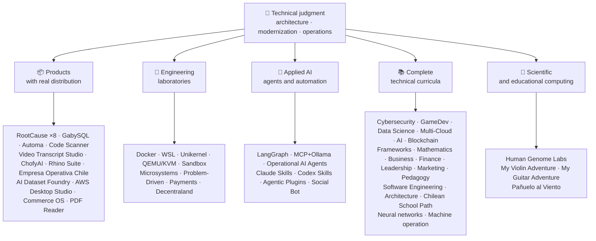

<div align="center">

# 👋Владимир Акунья

## **Архитектор решений·Старший Full-Stack·Цифровая трансформация·Управление и операции**

**Профессионально обучен в области компьютерных наук и вычислительной техники и делового администрирования, с 16+ лет создания и эксплуатации программного обеспечения в реальных средах. Я связываю бизнес, людей, процессы и технологии для разработки, оценки, предоставления и поддержки решений с техническим суждением и оперативным взглядом, подкрепленным проверяемыми доказательствами в этой учетной записи GitHub.**

[](https://vladimiracunadev-create.github.io/)
[](https://www.linkedin.com/in/vladimir-acu%C3%B1a-valdebenito-11924a29/)
[](mailto:vladimir.acuna.dev@gmail.com)

[](#профессиональный-уровень)
[](docs/ECOSYSTEM.ru.md)
[](#полная-техническая-программа)

<!-- STATS:START -->
[](https://github.com/vladimiracunadev-create?tab=repositories)
[](https://github.com/vladimiracunadev-create?tab=repositories)
[](#экосистема-с-первого-взгляда)
[](#полная-техническая-программа)
[](https://github.com/vladimiracunadev-create?tab=repositories)
[](docs/ECOSYSTEM.ru.md#forks)
[](https://github.com/vladimiracunadev-create?tab=repositories)
[](https://github.com/pulls?q=author%3Avladimiracunadev-create+type%3Apr)
[](https://github.com/issues?q=author%3Avladimiracunadev-create+type%3Aissue)
<!-- STATS:END -->

[](https://github.com/vladimiracunadev-create?tab=repositories)
[](https://github.com/vladimiracunadev-create?tab=followers)

[🌐 Portfolio (22 languages)](https://vladimiracunadev-create.github.io/) ·
[🧩 Ecosystem](#экосистема-с-первого-взгляда) ·
[⚡ Evaluate me in 10 minutes](#если-у-вас-есть-10-минут-чтобы-оценить-меня) ·
[✅ Professional scope](#профессиональный-уровень) ·
[🧭 Non-coding management](#управление-администрирование-и-некодирование-карьерных-возможностей) ·
[📋 Role matrix](PROFESIONAL_ROLES.md) ·
[📬 Contact](#контакт)

**🌐 Полные версии:** [Español](README.md) · [English](README.en.md) · [Português](README.pt.md) · [Italiano](README.it.md) · [Français](README.fr.md) · [简体中文](README.zh.md) · [繁體中文](README.zh-TW.md) · [日本語](README.ja.md) · [한국어](README.ko.md) · [Türkçe](README.tr.md) · [Русский](README.ru.md) · [Tiếng Việt](README.vi.md) · [ไทย](README.th.md) · [Deutsch](README.de.md) · [Українська](README.uk.md) · [Polski](README.pl.md) · [العربية](README.ar.md) · [فارسی](README.fa.md) · [Bahasa Indonesia](README.id.md) · [Nederlands](README.nl.md) · [हिन्दी](README.hi.md) · [Ελληνικά](README.el.md)

**Техническое ядро:**
PHP 8 · Python · Rust · Go · Node/TS · Java 21 · .NET 8 · Dart/Flutter · WASM
· AWS · Terraform · Kubernetes · Docker · n8n · LangGraph/MCP · CI/CD · FinOps · Observability

**Мост бизнес-технологий:**
Процесс и анализ требований·Оценка решений·координация поставок·операций и преемственности·Управление рисками·продукт и услуга·техническое образование

</div>

---

> [!NOTE]
> Этот профиль не превращает возможности в опыт. Доказанный технический опыт, передаваемые навыки, жизнеспособные приложения и будущие цели развития четко разделены. Связанные доказательства GitHub являются исполняемыми или документальными; где что-то может быть использовано.**не**закончено, говорится как таковое.

## 🎯Что вы найдете здесь

Это не «одно РЕПО»: это экосистема с общими стандартами.

- 🔁 **Воспроизводимые демо**- клонировать, бегать, проверять.
- 🧰 **Стандартизированный инструментарий**- Макефилы, Хаб КЛИ,`doctor`и`smoke`на репозиторий.
- 🛡️ **Оборона в глубину**- секретное сканирование, политика и явно запрещенные практики.
- 📈 **наблюдаемость** — `/health`, `/ready`, `/metrics`, приборные панели и прослеживаемость.
- 📚 **Документация, учитывающая аудиторию**— рекрутер, новичок, DevOps или безопасность, в зависимости от хранилища.
- 📦 **Распределение продукции**- загружаемые релизы, контрольные суммы и сбор доказательств; коммерческие / магазинные подписи объявлены незавершенными, когда это применимо.
- 🌍 **Интернационализация** — этот профиль опубликован на 22 языках, а портфолио предлагает 154 публичных PDF (7 семейств × 22 языка) (ES · EN · PT · IT · FR · ZH · ZH-TW · JA · KO · TR · RU · VI · TH · DE · UK · PL · AR · FA · ID · NL · HI · EL).
- 🧭 **Техническая честность**Каждый случай помечен`OPERATIONAL`, `DOCUMENTED/SCAFFOLD`или`PLANNED`.

## ✅Проверяемый статус

| поверхность | Конкретные доказательства |
|---|---|
| 🧪 **Покрытие за счет испытаний** | ГабискВиЛ**828 тестов**+ Поверх**503.8M запросы**(0 паников)·Empresa Operativa Чили**217 тестов** ·автоматика**150 пиастров** ·Multi-OS CI |
| 🤖 **Агенты производственного класса** | Обсуждение RealWorld**25/25 операционные бэкэнды**(случаи 01-25, 100% охват)·Операционные агенты AI**13 Агенты**с**39 детерминированных эвалов** |
| 🔗 **Интеграция Polyglot** | **20 случаев**Для отправителя →n8n → получателя —**19 Операционная**Проверка с помощью Docker —· **18+ ДБ мотор** · **20+ контейнеров** ·11 шаблонов |
| 📦 **Распределение** | **155 выпуск**В рамках экосистемы**65 публичных хранилища** ·установщики и артефакты`.exe` · `.msi` · `.dmg` · `.apk`с контрольными суммами и сбором доказательств; коммерческие / магазинные подписи в процессе, где это применимо |
| 🛡️ **Сеть поставок** | Код QL·Семгреп·бандит·Тривиус·Грип·Гитлак·Трюффлехог·CycloneDX SBOM·Счет |
| 📚 **Учебные планы** | **14 550 классов**Проверяется по 21 программе, подсчитанной[a workflow](.github/workflows/stats.yml)от реальной структуры хранилища или проверяемого источника, объявленного в хранилище, не написанного от руки,·Каждая программа заявляет о своем редакционном статусе и ограничениях. |
| 🌐 **Портфолио** | Установка PWA· **22 языков** · **154 PDF-файлов**Создан трубопроводом·API данных CV·Конденсатор Android·Маяк 100 |
| 🔒 **телеметрия** | Нулевая телеметрия в судебных продуктах и Empresa Operativa Chile — проверена на каждой сборке (без Android)`INTERNET`разрешение |
| 🌐 **Опубликованные сайты** | **57 страниц GitHub**56 посадок, по одной на продукт, программу или навигатор экосистемы, плюс портфель — каждая развернута из собственного хранилища·Все 57 проверены HTTP`200` |

## 🛠️ Технологический стек

Технологии, обнаруженные в публичных репозиториях (манифесты, зависимости, контейнеры и код), сгруппированы по областям. Присутствие в репозитории — включая лаборатории и учебные программы — это свидетельство использования, а не заявление о годах производственного опыта.

**Языки**


<sub>Python · JavaScript · TypeScript · Rust · Go · Java · PHP · C# · Dart · Kotlin · Swift · Ruby · Elixir · Zig · Clojure · C · Solidity · Bash · PowerShell · HTML · CSS · WebAssembly · SQL · Erlang · F# · Crystal · GDScript · HCL</sub>

**Фреймворки, среды выполнения и библиотеки**


<sub>Node.js · Express · React · Vue · Svelte · Astro · Vite · Vitest · FastAPI · Flask · Django · Spring Boot · ASP.NET / .NET · Laravel · Rails · Flutter · Tauri · Electron · Qt / PySide6 · Capacitor · Godot · PyTorch · scikit-learn · Polars · pandas · NumPy · Optuna · SHAP · Transformers · PEFT / LoRA · Playwright · pytest · Jupyter · Streamlit · Pydantic · Tokio · Axum · SQLx · Serde</sub>

**Базы данных**


<sub>PostgreSQL · MySQL · MariaDB · SQLite · MongoDB · Redis · Neo4j · Cassandra · Elasticsearch · ClickHouse · CockroachDB · InfluxDB · TimescaleDB · DuckDB · SQL Server · Oracle · pgvector · PostgREST · GraphQL · GabySQL (propio · own · Rust)</sub>

**Облако, контейнеры и DevOps**


<sub>AWS · Terraform · Kubernetes · Docker / Compose · GitHub Actions · Git · GitHub · GitLab · Linux · Nginx · Make · Inno Setup · FinOps · CI/CD</sub>

**Наблюдаемость и обмен сообщениями**


<sub>Prometheus · Grafana · OpenTelemetry · Kafka · MQTT (Mosquitto) · Elasticsearch / Kibana · cAdvisor · k6</sub>

**ИИ, агенты, навыки и MCP**


<sub>Claude Code · Claude Skills · Codex Skills · Agentic Plugins · MCP · LangGraph · Ollama · n8n · RAG · Whisper · Transformers · PEFT / LoRA · Optuna · SHAP · Polars · PyTorch</sub>

**Безопасность и цепочка поставок**


**Целевые платформы**


<sub>Windows · macOS · iOS · Linux · Android · Web / PWA</sub>

## 🗺️Экосистема с первого взгляда



## 🗂️ Экосистема: продукты, лаборатории, прикладной ИИ, учебные программы и научные вычисления

Практическая работа профиля вынесена в отдельный документ: программы, которые скачивают и устанавливают, инженерные лаборатории, прикладной ИИ и научные вычисления, а также описание каждого форка сторонних проектов в аккаунте.

- 📦 **Продукты с реальным распределением** (22)
- 🧪 **Инженерные лаборатории** (11)
- 🤖 **Прикладной ИИ** (6)
- 📚 **Полная техническая программа** (21)
- 🔬 **Научные вычисления** (1)
- 🍴 **Форки сторонних проектов** (52)

👉 **[Смотреть всю экосистему](docs/ECOSYSTEM.ru.md)** · [🍴 Форки сторонних проектов](docs/ECOSYSTEM.ru.md#forks)

## 📚Полная техническая программа

Последовательные программы на испанском языке, с статусом и объемом, объявленным каждым репозиторием. 21 программа, которая включает в себя**14 550 классов**Подсчитано по[a workflow](.github/workflows/stats.yml)от реальной структуры хранилища или проверяемого источника, объявленного в хранилище; значок обновляется еженедельно и не пишется от руки.

👉 **[Смотреть все 21 программу](docs/ECOSYSTEM.ru.md#curricula)**

## ⚡Если у вас есть 10 минут, чтобы оценить меня

Идея не просто посмотреть на код: это увидеть.**Как я думаю**Как я документирую и как делаю все исполняемым.

**Маршрут А — Реальная наблюдательность и оркестровка***(Мой любимый)*

```bash
git clone https://github.com/vladimiracunadev-create/social-bot-scheduler.git
```

Вы увидите рабочие процессы, метрики, панели приборов и ограждения в 19 корпусах и 18 двигателях DB.

**Маршрут B: Воспроизводимая инфраструктура за считанные минуты**

```bash
git clone https://github.com/vladimiracunadev-create/docker-labs.git
```

**Маршрут C — Агенты с типизированным состоянием**

```bash
git clone https://github.com/vladimiracunadev-create/langgraph-realworld.git
```

**Маршрут D — судебный продукт Rust без клонирования**

Скачать инсталлятор или CLI бинарный от[RootCause releases](https://github.com/vladimiracunadev-create/rootcause-windows-inspector/releases)и проверить`SHA256SUMS`.

## 🧠Стандарты, которые я применяю в репозиториях

- **DX первый**Если это не легко запустить, это не полезно в качестве демо или в качестве базы команды.
- **Наблюдение с 1-го дня**— метрики и прослеживаемость, а не запоздалая мысль.
- **Безопасность как трубопровод**— секретное сканирование, СБОМ на релиз, явно запрещенные практики.
- **Реальная устойчивость**— идемпотенция, выключатель и контролируемая деградация.
- **Polyglot по дизайну**- язык и двигатель, выбранные в зависимости от случая использования, а не моды.
- **Честность в отношении статуса**- одно репо было переименовано (`Multisimulador` → `machine-operator-program`) избегать перспективного программного обеспечения, которое еще не существует.
- **Значки - это сигналы, а не доказательства.**Каждый репо также заявляет**Что не делает**.
- **Модель наружу**— домен проектируется первым, интерфейс — проекцией.
- **Внешняя работа объявляется внешней** — [52 форков](docs/ECOSYSTEM.ru.md#forks) сторонних проектов описаны по одному и не входят ни в одну цифру собственных работ этого профиля.

## ✅Профессиональный уровень

Мой двойной фон —**Компьютерные науки и вычислительная техника + бизнес-администрирование**- помогает мне преобразовывать бизнес-цели в технические решения и технические ограничения в четкие варианты операций, продукта, клиентов и лидерства.

### 🎯Основная идентичность

| Роль | Обратная связь |
|---|---|
| **Архитектор решений** | Модульный, масштабируемый дизайн системы с эволюционным суждением |
| **Архитектор модернизации наследия** | Реальная эволюция наследия (PHP 5.x → 8.x, инкрементная рефакторинг без прерывания операций) |
| **Старший Full-Stack / Tech Lead** | Архитектура, исполнение и стандарты на реальных платформах (+16 лет) |
| **Архитектор автоматизации AI** | Агентные системы с LangGraph/MCP и n8n потоками с ограждением |

### ↗ Естественное расширение

**Инженер оркестровки AI** · **Системы / Rust Engineer** · **Мобильный инженер (Flutter)** · **Инженер решений** · **Технический конструктор продукта** · **Технический тренер** · **Консультант по цифровой трансформации** · **Бизнес / Функциональный аналитик** · **Технические операции с продуктом**

### ⚙️Дополнительный охват

Инженер платформы / IDP·DevOps / CI-CD·Облако / Инженер AWS·Приложение SRE·Инженер по автоматизации·Технический коммерческий консультант

## 🧭Управление, администрирование и некодирование карьерных возможностей

Роли в управлении, администрировании и бизнесе, где информатика и менеджмент приносят пользу, а программирование не является главной задачей; классифицированы честно (переносимая компетенция, возможность отклика или цель на будущее) и с указанием пробела по каждой. Охваченные направления:

Технологическое лидерство · Управление проектами · Управление бизнесом · Стратегия и изменения · Бизнес-анализ · Продукт и услуга · Управление кибербезопасностью · Коммерческие и сбытовые · Финансовый и управленческий контроль · Качество · Образование · Логистика и поставщики · Управление данными и ИИ · Государственный сектор

👉 **[Смотреть полную матрицу возможностей](docs/MANAGEMENT.ru.md)**

## 🤖Поток развития с помощью ИИ

| Инструмент | Главное использование |
|---|---|
| **Клод Код** | Архитектурный обзор, внедрение и техническая документация |
| **Чат-ПТП Плюс** | Анализ, архитектура и итерация (с 2023 года) |
| **Кодекс** | Генерация и рефакторинг кода |
| **антигравитация** | Ускорение потоков разработки и автоматизации |
| **VS Code / OpenCode** | Окружающая среда с интегрированной помощью ИИ |

> Я сочетаю свои собственные технические суждения, человеческую оценку и архитектурное направление. ИИ увеличивает емкость, скорость и охват — он не заменяет опыт.

## 📌Доступность

**Открыт для:**Старший Full-Stack·Архитектура·Модернизация наследия·Платформа/IDP·Приложение SRE·прагматичный DevOps·автоматизация·Автоматизация AI·Бизнес/функциональный анализ·Координация проектов·Операции с продуктами·Цифровая трансформация·Консультирование/предпродажи решений·техническое образование·качество и постоянное совершенствование·Принятие ИИ и управление

**Оценка в соответствии с масштабом каждой роли:**Владелец продукта / технический менеджер продукта·Доставка услуг·ИТ-операции·GRC/технологический риск·административное управление и операции·контроль за управлением·Модернизация государственного сектора. Названия руководителей и руководителей общего звена являются будущими целями развития, а не заявленным опытом.

**Модальность:**Удаленный или гибридный, в зависимости от проекта.

## 📬Контакт

[](https://vladimiracunadev-create.github.io/)
[](https://www.linkedin.com/in/vladimir-acu%C3%B1a-valdebenito-11924a29/)
[](https://gitlab.com/vladimir.acuna.dev-group/vladimir.acuna.dev-group)
[](mailto:vladimir.acuna.dev@gmail.com)

---

<div align="center">

[🤝 Contribute](CONTRIBUTING.en.md) ·
[🛡️ Security](SECURITY.en.md) ·
[⚖️ Code of Conduct](CODE_OF_CONDUCT.en.md)

<sub>README синхронизирован с проверяемым состоянием публичных репозиториев — считываемые через API цифры и изменения —·Последняя проверка: 12 октября 2026 года.</sub>

</div>
