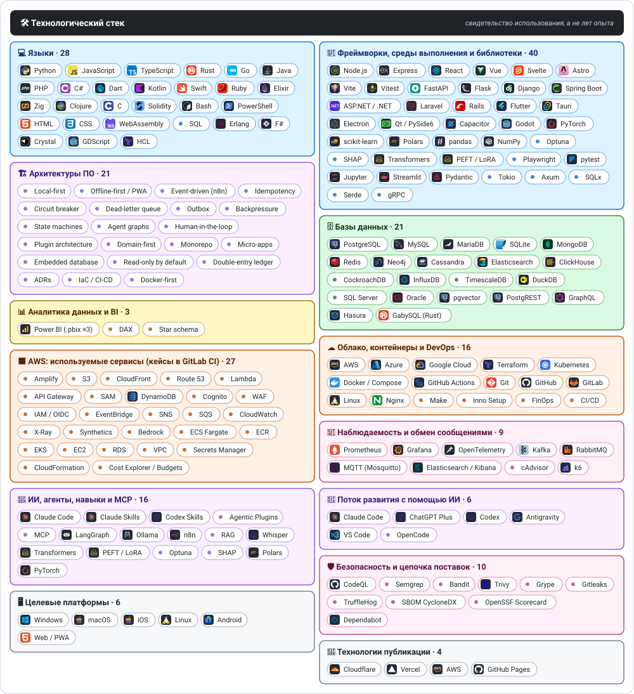
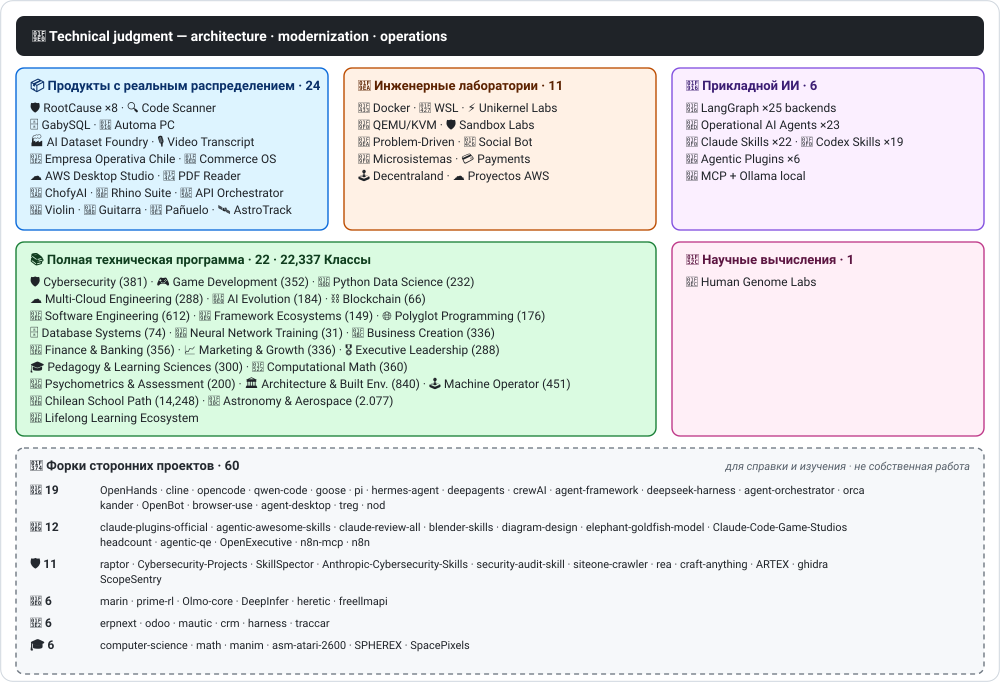

# 👋Владимир Акунья

## **Инженер по ИИ·Архитектор решений·Старший Full-Stack·Цифровая трансформация·Управление и операции**

**Профессионально обучен в области компьютерных наук и вычислительной техники и делового администрирования, с 16+ лет создания и эксплуатации программного обеспечения в реальных средах. Я связываю бизнес, людей, процессы и технологии для разработки, оценки, предоставления и поддержки решений с техническим суждением и оперативным взглядом, подкрепленным проверяемыми доказательствами в этой учетной записи GitHub.**

<!-- STATS:START -->

<!-- STATS:END -->

[🧭 С чего начать](docs/START_HERE.ru.md) ·
[🌐 Portfolio (22 languages)](https://vladimiracunadev-create.github.io/) ·
[🧩 Ecosystem](#экосистема-с-первого-взгляда) ·
[🛠️ Технологический стек](#-технологический-стек) ·
[⚡ Evaluate me in 10 minutes](docs/guides/TECH_LEAD.ru.md) ·
[✅ Professional scope](#профессиональный-уровень) ·
[🧭 Non-coding management](#управление-администрирование-и-некодирование-карьерных-возможностей) ·
[📋 Матрица должностей](PROFESIONAL_ROLES.ru.md) ·
[📬 Contact](#контакт)

**🌐 Полные версии:** [Español](README.md) · [English](README.en.md) · [Português](README.pt.md) · [Italiano](README.it.md) · [Français](README.fr.md) · [简体中文](README.zh.md) · [繁體中文](README.zh-TW.md) · [日本語](README.ja.md) · [한국어](README.ko.md) · [Türkçe](README.tr.md) · [Русский](README.ru.md) · [Tiếng Việt](README.vi.md) · [ไทย](README.th.md) · [Deutsch](README.de.md) · [Українська](README.uk.md) · [Polski](README.pl.md) · [العربية](README.ar.md) · [فارسی](README.fa.md) · [Bahasa Indonesia](README.id.md) · [Nederlands](README.nl.md) · [हिन्दी](README.hi.md) · [Ελληνικά](README.el.md)

**Техническое ядро:**
PHP 8 · Python · Rust · Go · Node/TS · Java 21 · .NET 8 · Dart/Flutter · WASM
· AWS · Terraform · Kubernetes · Docker · n8n · LangGraph/MCP · CI/CD · FinOps · Observability

**Мост бизнес-технологий:**
Процесс и анализ требований·Оценка решений·координация поставок·операций и преемственности·Управление рисками·продукт и услуга·техническое образование

---

> [!NOTE]
> Этот профиль не превращает возможности в опыт. Доказанный технический опыт, передаваемые навыки, жизнеспособные приложения и будущие цели развития четко разделены. Связанные доказательства GitHub являются исполняемыми или документальными; где что-то может быть использовано.**не**закончено, говорится как таковое.

## 🧭 С чего начать

Выберите свой случай и переходите сразу к нужному:

🧑‍💼 [Рекрутинг](docs/guides/RECRUITER.ru.md) · 💼 [Клиент или фриланс](docs/guides/FREELANCE.ru.md) · 🛠️ [Техническая оценка](docs/guides/TECH_LEAD.ru.md) · 🏢 [Бизнес и управление](docs/guides/BUSINESS.ru.md) · 🤝 [Сотрудничество и безопасность](docs/guides/COLLABORATOR.ru.md) · 🎓 [Учиться или преподавать](docs/guides/LEARNER.ru.md)

## 🎯Что вы найдете здесь

Это не «одно РЕПО»: это экосистема с общими стандартами.

- 🔁 **Воспроизводимые демо**- клонировать, бегать, проверять.
- 🧰 **Стандартизированный инструментарий**- Макефилы, Хаб КЛИ,`doctor`и`smoke`на репозиторий.
- 🛡️ **Оборона в глубину**- секретное сканирование, политика и явно запрещенные практики.
- 📈 **наблюдаемость** — `/health`, `/ready`, `/metrics`, приборные панели и прослеживаемость.
- 📚 **Документация, учитывающая аудиторию**— рекрутер, новичок, DevOps или безопасность, в зависимости от хранилища.
- 📦 **Распределение продукции**- загружаемые релизы, контрольные суммы и сбор доказательств; коммерческие / магазинные подписи объявлены незавершенными, когда это применимо.
- 🌍 **Интернационализация** — этот профиль опубликован на 22 языках, а портфолио предлагает 154 публичных PDF (7 семейств × 22 языка) (ES · EN · PT · IT · FR · ZH · ZH-TW · JA · KO · TR · RU · VI · TH · DE · UK · PL · AR · FA · ID · NL · HI · EL).
- 🧭 **Техническая честность**Каждый случай помечен`OPERATIONAL`, `DOCUMENTED/SCAFFOLD`или`PLANNED`.

## ✅Проверяемый статус

| поверхность | Конкретные доказательства |
|---|---|
| 🧪 **Покрытие за счет испытаний** | ГабискВиЛ**850 тестов**+ Поверх**503.8M запросы**(0 паников)·Empresa Operativa Чили**230 тестов** ·автоматика**150 пиастров** ·Multi-OS CI |
| 🤖 **Агенты производственного класса** | Обсуждение RealWorld**25/25 операционные бэкэнды**(случаи 01-25, 100% охват)·Операционные агенты AI**23 Агенты**с**69 детерминированных эвалов** |
| 🔗 **Интеграция Polyglot** | **20 случаев**Для отправителя →n8n → получателя —**19 Операционная**Проверка с помощью Docker —· **18+ ДБ мотор** · **20+ контейнеров** ·11 шаблонов |
| 📦 **Распределение** | **166 выпуск**В рамках экосистемы**67 публичных хранилища** ·установщики и артефакты`.exe` · `.msi` · `.dmg` · `.apk`с контрольными суммами и сбором доказательств; коммерческие / магазинные подписи в процессе, где это применимо |
| 🛡️ **Сеть поставок** | Код QL·Семгреп·бандит·Тривиус·Грип·Гитлак·Трюффлехог·CycloneDX SBOM·Счет |
| 📚 **Учебные планы** | **22 337 классов**Проверяется по 22 программе, подсчитанной[a workflow](.github/workflows/stats.yml)от реальной структуры хранилища или проверяемого источника, объявленного в хранилище, не написанного от руки,·Каждая программа заявляет о своем редакционном статусе и ограничениях. |
| 🌐 **Портфолио** | Установка PWA· **22 языков** · **154 PDF-файлов**Создан трубопроводом·API данных CV·Конденсатор Android·Маяк 100 |
| 🔒 **телеметрия** | Нулевая телеметрия в судебных продуктах и Empresa Operativa Chile — проверена на каждой сборке (без Android)`INTERNET`разрешение |
| 🌐 **Опубликованные сайты** | **57 страниц GitHub**56 посадок, по одной на продукт, программу или навигатор экосистемы, плюс портфель — каждая развернута из собственного хранилища·Все 57 проверены HTTP`200` |

## 🛠️ Технологический стек

Технологии, обнаруженные в публичных репозиториях (манифесты, зависимости, контейнеры и код), сгруппированы по областям. Присутствие в репозитории — включая лаборатории и учебные программы — это свидетельство использования, а не заявление о годах производственного опыта.

**Архитектуры ПО**

Local-first → [empresa-operativa-chile](https://github.com/vladimiracunadev-create/empresa-operativa-chile), [ai-dataset-foundry](https://github.com/vladimiracunadev-create/ai-dataset-foundry) · Event-driven → [social-bot-scheduler](https://github.com/vladimiracunadev-create/social-bot-scheduler) · Resilience → [problem-driven-systems-lab](https://github.com/vladimiracunadev-create/problem-driven-systems-lab) · Ledger → [universal-payments-engineering-lab](https://github.com/vladimiracunadev-create/universal-payments-engineering-lab) · Plugins → [agentic-plugins-toolkit](https://github.com/vladimiracunadev-create/agentic-plugins-toolkit) · Agents → [langgraph-realworld](https://github.com/vladimiracunadev-create/langgraph-realworld), [operational-ai-agents](https://github.com/vladimiracunadev-create/operational-ai-agents) · Domain-first → [rhino-suite](https://github.com/vladimiracunadev-create/rhino-suite) · Micro-apps → [microsistemas](https://github.com/vladimiracunadev-create/microsistemas) · Embedded DB → [gabysql](https://github.com/vladimiracunadev-create/gabysql) · IaC → [proyectos-aws](https://github.com/vladimiracunadev-create/proyectos-aws)

**Аналитика данных и BI**

Power BI (.pbix ×3) · DAX · Star schema → [social-bot-scheduler](https://github.com/vladimiracunadev-create/social-bot-scheduler)

**AWS: используемые сервисы (кейсы в GitLab CI)**

Кейсы A–P → [proyectos-aws-gitlab](https://gitlab.com/vladimir.acuna.dev-group/proyectos-aws-gitlab) (GitLab CI → AWS; все 16 заявлены как завершённые; кейс M — только фаза 1) · [proyectos-aws](https://github.com/vladimiracunadev-create/proyectos-aws) (GitHub Actions) · EC2, RDS, VPC, Secrets Manager, CloudFormation, Cost Explorer → [aws-desktop-studio](https://github.com/vladimiracunadev-create/aws-desktop-studio) (реальные запросы инвентаризации; EC2 с запуском, остановкой и перезагрузкой под двойным контролем)

**Поток развития с помощью ИИ**

| Инструмент | Главное использование |
|---|---|
| **Клод Код** | Архитектурный обзор, внедрение и техническая документация |
| **Чат-ПТП Плюс** | Анализ, архитектура и итерация (с 2023 года) |
| **Кодекс** | Генерация и рефакторинг кода |
| **антигравитация** | Ускорение потоков разработки и автоматизации |
| **VS Code / OpenCode** | Окружающая среда с интегрированной помощью ИИ |

> Я сочетаю свои собственные технические суждения, человеческую оценку и архитектурное направление. ИИ увеличивает емкость, скорость и охват — он не заменяет опыт.

**Технологии публикации**

Cloudflare (личная работа) · Vercel (хакатон NASA Space Apps) · AWS (рабочие веб-сайты, связанные с GitLab) · GitHub Pages

## 🗺️Экосистема с первого взгляда

## 🗂️ Экосистема: продукты, лаборатории, прикладной ИИ, учебные программы и научные вычисления

Практическая работа профиля вынесена в отдельный документ: программы, которые скачивают и устанавливают, инженерные лаборатории, прикладной ИИ, полные технические учебные программы и научные вычисления, а также описание каждого форка сторонних проектов в аккаунте.

- 📦 [**Продукты с реальным распределением**](docs/ECOSYSTEM.ru.md#products) (24)
- 🧪 [**Инженерные лаборатории**](docs/ECOSYSTEM.ru.md#labs) (11)
- 🤖 [**Прикладной ИИ**](docs/ECOSYSTEM.ru.md#ai) (6)
- 📚 [**Полная техническая программа**](docs/ECOSYSTEM.ru.md#curricula) (22)
- 🔬 [**Научные вычисления**](docs/ECOSYSTEM.ru.md#science) (1)
- 🍴 [**Форки сторонних проектов**](docs/ECOSYSTEM.ru.md#forks) (60)

👉 **[Смотреть всю экосистему](docs/ECOSYSTEM.ru.md)** · [🍴 Форки сторонних проектов](docs/ECOSYSTEM.ru.md#forks)

## 🛰️ Хакатон NASA Space Apps 2026

Я участвовал в **NASA Space Apps Challenge 2026** (Сантьяго, 14–15 ноября) в задаче *Planet X and SPHEREx* в команде из 6 человек. Продукт — **AstroTrack · SPHEREx**: веб-просмотрщик, где вводятся координаты неба, а эта область показывается как последовательность снимков SPHEREx во времени, на данных NASA/IPAC IRSA.

- **Моя часть:** доступ к данным (запросы к IRSA с кэшем и заранее рассчитанные поля демо), упаковка (PWA, настольные установщики на Tauri и APK для Android на Capacitor), раздел «Загрузки» и аудит согласованности документации и кода.
- **Проверяемая поставка:** [spherex-releases](https://github.com/vladimiracunadev-create/spherex-releases) собирает 7 релизов (от v0.1.0 до v0.4.2) с контрольными суммами SHA-256 · [веб-приложение](https://spherex-planet-x-tau.vercel.app/) · [репозиторий команды](https://github.com/mauriciovalenzuela742/SPHEREX).
- **Заявленные ограничения:** просмотрщик, дизайн и остальной бэкенд — работа других участников команды; установщики не подписаны и не проверялись на реальных устройствах; я использовал ИИ (Claude Code) как помощника, что указано в репозитории. Это описывает мой вклад, а не результат хакатона.

## 🧠Стандарты, которые я применяю в репозиториях

- **DX первый**Если это не легко запустить, это не полезно в качестве демо или в качестве базы команды.
- **Наблюдение с 1-го дня**— метрики и прослеживаемость, а не запоздалая мысль.
- **Безопасность как трубопровод**— секретное сканирование, СБОМ на релиз, явно запрещенные практики.
- **Реальная устойчивость**— идемпотенция, выключатель и контролируемая деградация.
- **Polyglot по дизайну**- язык и двигатель, выбранные в зависимости от случая использования, а не моды.
- **Честность в отношении статуса**- одно репо было переименовано (`Multisimulador` → `machine-operator-program`) избегать перспективного программного обеспечения, которое еще не существует.
- **Значки - это сигналы, а не доказательства.**Каждый репо также заявляет**Что не делает**.
- **Модель наружу**— домен проектируется первым, интерфейс — проекцией.
- **Внешняя работа объявляется внешней** — [60 форков](docs/ECOSYSTEM.ru.md#forks) сторонних проектов описаны по одному и не входят ни в одну цифру собственных работ этого профиля.

## ✅Профессиональный уровень

Мой двойной фон —**Компьютерные науки и вычислительная техника + бизнес-администрирование**- помогает мне преобразовывать бизнес-цели в технические решения и технические ограничения в четкие варианты операций, продукта, клиентов и лидерства.

### 🎯Основная идентичность

| Роль | Обратная связь |
|---|---|
| **Архитектор решений** | Модульный, масштабируемый дизайн системы с эволюционным суждением |
| **Архитектор модернизации наследия** | Реальная эволюция наследия (PHP 5.x → 8.x, инкрементная рефакторинг без прерывания операций) |
| **Старший Full-Stack / Tech Lead** | Архитектура, исполнение и стандарты на реальных платформах (+16 лет) |
| **Архитектор автоматизации AI** | Агентные системы с LangGraph/MCP и n8n потоками с ограждением |

### ↗ Естественное расширение

**Инженер оркестровки AI** · **Системы / Rust Engineer** · **Мобильный инженер (Flutter)** · **Инженер решений** · **Технический конструктор продукта** · **Технический тренер** · **Консультант по цифровой трансформации** · **Бизнес / Функциональный аналитик** · **Технические операции с продуктом** · **AI Engineer (LLM / ML)** · **Data Engineer** · **DevSecOps / AppSec Engineer** · **QA Automation / Test Engineer** · **Technical Writer** · **Преподаватель / Тренер / Инструктор по технологиям** · **Instructional Designer (EdTech)** · **Technical Mentor**

### ⚙️Дополнительный охват

Инженер платформы / IDP·DevOps / CI-CD·Облако / Инженер AWS·Приложение SRE·Инженер по автоматизации·Технический коммерческий консультант · Backend / API Engineer · Fintech / Payments Engineer · Developer Advocate / DevRel

## 🧭Управление, администрирование и некодирование карьерных возможностей

Роли в управлении, администрировании и бизнесе, где информатика и менеджмент приносят пользу, а программирование не является главной задачей; классифицированы честно (переносимая компетенция, возможность отклика или цель на будущее) и с указанием пробела по каждой. Охваченные направления:

Технологическое лидерство · Управление проектами · Управление бизнесом · Стратегия и изменения · Бизнес-анализ · Продукт и услуга · Управление кибербезопасностью · Коммерческие и сбытовые · Финансовый и управленческий контроль · Качество · Образование · Логистика и поставщики · Управление данными и ИИ · Государственный сектор

👉 **[Смотреть полную матрицу возможностей](docs/MANAGEMENT.ru.md)**

## 📌Доступность

**Открыт для:**Старший Full-Stack·Архитектура·Модернизация наследия·Платформа/IDP·Приложение SRE·прагматичный DevOps·автоматизация·Автоматизация AI·Бизнес/функциональный анализ·Координация проектов·Операции с продуктами·Цифровая трансформация·Консультирование/предпродажи решений·техническое образование·качество и постоянное совершенствование·Принятие ИИ и управление

**Оценка в соответствии с масштабом каждой роли:**Владелец продукта / технический менеджер продукта·Доставка услуг·ИТ-операции·GRC/технологический риск·административное управление и операции·контроль за управлением·Модернизация государственного сектора. Названия руководителей и руководителей общего звена являются будущими целями развития, а не заявленным опытом.

**Модальность:**Удаленный или гибридный, в зависимости от проекта.

## 📬Контакт

---

[🤝 Contribute](CONTRIBUTING.ru.md) ·
[🛡️ Security](SECURITY.ru.md) ·
[⚖️ Code of Conduct](CODE_OF_CONDUCT.ru.md)

README синхронизирован с проверяемым состоянием публичных репозиториев —цифры и изменения читаются через API— · последняя проверка: <!-- VERIFIED:START -->2026-11-24<!-- VERIFIED:END -->.

