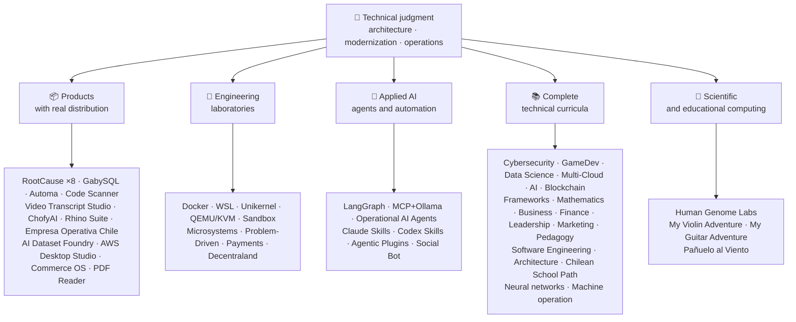

<div align="center">

# 👋ว ลาดิ อุส อา คูญา

## **สถาปัตยกรรม ทาง แก้·แพ็ครุ่นน้อง·การแปลงภาพดิจิทัล·ปฏิบัติการการจัดการ**

**ผู้เชี่ยวชาญได้รับการอบรมในสาขาวิทยาศาสตร์คอมพิวเตอร์ และวิศวกรรมและการบริหารธุรกิจ โดยมีอาคาร 16+ ปีและซอฟต์แวร์ปฏิบัติการในสภาพแวดล้อมจริง ผม เชื่อม โยง ธุรกิจ, ผู้ คน, กระบวนการ, และ เทคโนโลยี เข้า กับ การ ออก แบบ, การ ประเมิน, การ ส่ง, และ การ ค้ําจุน ทาง แก้ ด้วย การ ตัดสิน โดย ทาง เทคนิค และ ทัศนะ ที่ ดําเนิน งาน — โดย หลัก ฐาน ที่ ยืน ยัน ได้ ใน บัญชี กิตติฮับ นี้.**

[](https://vladimiracunadev-create.github.io/)
[](https://www.linkedin.com/in/vladimir-acu%C3%B1a-valdebenito-11924a29/)
[](mailto:vladimir.acuna.dev@gmail.com)

[](#ขอบเขตงาน)
[](docs/ECOSYSTEM.th.md)
[](#หลักสูตรเทคนิคฉบับสมบูรณ์)

<!-- STATS:START -->
[](https://github.com/vladimiracunadev-create?tab=repositories)
[](https://github.com/vladimiracunadev-create?tab=repositories)
[](#ภาพรวมระบบนิเวศ)
[](#หลักสูตรเทคนิคฉบับสมบูรณ์)
[](https://github.com/vladimiracunadev-create?tab=repositories)
[](docs/ECOSYSTEM.th.md#forks)
[](https://github.com/vladimiracunadev-create?tab=repositories)
[](https://github.com/pulls?q=author%3Avladimiracunadev-create+type%3Apr)
[](https://github.com/issues?q=author%3Avladimiracunadev-create+type%3Aissue)
<!-- STATS:END -->

[](https://github.com/vladimiracunadev-create?tab=repositories)
[](https://github.com/vladimiracunadev-create?tab=followers)

[🌐 Portfolio (22 languages)](https://vladimiracunadev-create.github.io/) ·
[🧩 Ecosystem](#ภาพรวมระบบนิเวศ) ·
[⚡ Evaluate me in 10 minutes](#หากคุณมีเวลา-10-นาทีเพื่อประเมินผม) ·
[✅ Professional scope](#ขอบเขตงาน) ·
[🧭 Non-coding management](#การจัดการ-การบริหาร-และโอกาสงานที่ไม่ประสบความสําเร็จ) ·
[📋 Role matrix](PROFESIONAL_ROLES.md) ·
[📬 Contact](#ติดต่อ)

**🌐 ฉบับเต็ม:** [Español](README.md) · [English](README.en.md) · [Português](README.pt.md) · [Italiano](README.it.md) · [Français](README.fr.md) · [简体中文](README.zh.md) · [繁體中文](README.zh-TW.md) · [日本語](README.ja.md) · [한국어](README.ko.md) · [Türkçe](README.tr.md) · [Русский](README.ru.md) · [Tiếng Việt](README.vi.md) · [ไทย](README.th.md) · [Deutsch](README.de.md) · [Українська](README.uk.md) · [Polski](README.pl.md) · [العربية](README.ar.md) · [فارسی](README.fa.md) · [Bahasa Indonesia](README.id.md) · [Nederlands](README.nl.md) · [हिन्दी](README.hi.md) · [Ελληνικά](README.el.md)

**แกนเทคนิค:**
PHP 8 · Python · Rust · Go · Node/TS · Java 21 · .NET 8 · Dart/Flutter · WASM
· AWS · Terraform · Kubernetes · Docker · n8n · LangGraph/MCP · CI/CD · FinOps · Observability

**สะพาน สาขา ธุรกิจ – เทคโนโลยี:**
ประมวลผลและวิเคราะห์ความต้องการ·การประมาณคําตอบ·การจัดวาง·การปฏิบัติการและต่อเนื่อง·การจัดการความเสี่ยง·ผลิตภัณฑ์และบริการ·การศึกษาทางเทคนิค

</div>

---

> [!NOTE]
> โปรไฟล์นี้ไม่ได้เปลี่ยนโอกาสให้กลายเป็นประสบการณ์ ประสบการณ์ ทาง เทคนิค ที่ พิสูจน์ ว่า มี ความ สามารถ ที่ จะ ย้าย ได้ การ ใช้ ประโยชน์ ได้ และ เป้า หมาย ใน การ พัฒนา อนาคต ก็ แยก กัน อย่าง ชัดเจน. เชื่อมโยงหลักฐาน Githoub มีกระบวนการประมวลผลหรือสารคดี; ที่บางสิ่งบางอย่าง**ไม่**เสร็จ สิ้น การ ประชุม นี้ ได้ รับ การ กล่าว ถึง ว่า เป็น เช่น นั้น.

## 🎯สิ่งที่คุณจะพบที่นี่

นี่ ไม่ ใช่ “การ กลับ มา ใหม่ อย่าง เดียว กัน ”: เป็น ระบบ นิเวศ ที่ มี มาตรฐาน การ ใช้ ร่วม กัน.

- 🔁 **โม เด็ค ที่ สามารถ ทํา งาน ได้**-โคลน วิ่ง มั่นใจ
- 🧰 **ตัวเล่นมาตรฐาน**-เมคเฟช, ฮับ ซีแอลไอ`doctor`และ`smoke`ต่อคลังเก็บของ
- 🛡️ **การป้องกันในความลึก**-การสแกนลับ นโยบาย และกิจกรรมต้องห้าม
- 📈 **ความไวแสง** — `/health`, `/ready`, `/metrics`หนวดและรอยขีดข่วน
- 📚 **เอกสารที่ปรากฏแก่ผู้ชม**-คนรับสมัคร มือใหม่ เดวอป หรือ รปภ. ขึ้นอยู่กับคลังสินค้า
- 📦 **การกระจายตัวของโปรดักต์**— เปิดตัวแบบดาวน์โหลดได้, Checksums, และสร้างหลักฐาน; ลายเซ็นการค้า/สโตร์ ที่ประกาศว่าใช้ได้ชั่วคราว
- 🌍 **การแบ่งเขตการปกครอง** — โปรไฟล์นี้เผยแพร่ใน 22 ภาษา และพอร์ตโฟลิโอมี PDF สาธารณะ 154 ไฟล์ (7 กลุ่ม × 22 ภาษา) (ES · EN · PT · IT · FR · ZH · ZH-TW · JA · KO · TR · RU · VI · TH · DE · UK · PL · AR · FA · ID · NL · HI · EL).
- 🧭 **ความซื่อสัตย์เชิงเทคนิค**-ทุกคดีที่ถูกติดป้าย`OPERATIONAL`, `DOCUMENTED/SCAFFOLD`หรือ`PLANNED`.

## ✅สถานะที่ใช้ได้

| พื้นผิว | หลักฐานที่สรุปได้ |
|---|---|
| 🧪 **นําเสนอผลการตรวจสอบ** | แกบบีเอสQL**828 ทดสอบ**# พ่นน้ําออกมา**สี่เหลี่ยม**(0 ความตื่นตระหนก)·ชิลี**217 ทดสอบ** ·อัตโนมัติ**ไพย์ 150** ·CI หลายแบบ |
| 🤖 **ตัวแสดงเกรดของการผลิต** | ลังกราฟเรียลเวิลด์**25/ 25 โปรแกรมเบื้องหลังการทํางาน**(เคสที่ 01–25, 100% ออกอากาศ)·ปฏิบัติการเอไอเอเจ้นท์**13 เจ้าหน้าที่**ด้วย**39 การ ประเมิน โดย ไม่ มี เงื่อนไข** |
| 🔗 **การรวมพาราเมทริก** | **20 คดี**ผู้ ส่ง ส่ง (Transs Itter) —**19 ปฏิบัติการ**แต่ละคนตรวจสอบกับโดเกอร์· **18+ เครื่องยนต์ DB** · **ภาชนะบรรจุ 20+** ·11 รูปแบบ |
| 📦 **การกระจายตัว** | **158 เผยแพร่**ไปทั่วระบบนิเวศของ**การประชุมมหาชน 65 แห่ง** ·ตัวติดตั้งและวัตถุ`.exe` · `.msi` · `.dmg` · `.apk`ด้วย checksums และการสร้างหลักฐาน; ลายเซ็นพาณิชย์/ storition ในความคืบหน้าที่นําไปใช้ |
| 🛡️ **ห่วงโซ่อุปทาน** | รหัสQL·เซ ม รี ป·แบนดิต·ไตรวี่·กราฟแสดงความถี่·กิตติม จิ·สับปะรด·CyloonDX SBOM·ไพ่คะแนน |
| 📚 **เคอร์ริคูลา** | **14,550 คลาสเรียน พ.ศ.**ตรวจสอบได้ทั้ง 21 โปรแกรม นับด้วย[a workflow](.github/workflows/stats.yml)จากโครงสร้างของคลังสินค้า หรือแหล่งที่รับรองได้ ที่ถูกประกาศไว้ในคลังสินค้า·ทุกโปรแกรมประกาศสถานะและข้อจํากัดของรายการ |
| 🌐 **พอร์ตโฟลิโอ้** | โปรแกรม PWA ที่ติดตั้งได้· **22 ภาษา** · **154 PDF**สร้างโดยท่อส่งแก๊ส·API ข้อมูล CV·แคปซิเตอร์ แอนดรอยด์·ไลท์เฮาส์ 100 |
| 🔒 **เส้นพริ้วไหว** | ซีโร่โทรเมชันในผลิตภัณฑ์นิติเวช และเอ็มพริซา โอเปราตีวา ชิลี — ได้รับการยืนยันในทุกอาคาร (โน อันดรอยด์)`INTERNET`อนุญาต |
| 🌐 **เผยแพร่เว็บไซต์** | **57 เว็บไซต์ GitHub Pages**-56 เครื่องลงจอด 1 เครื่อง ต่อผลิตภัณฑ์ โปรแกรม หรือระบบนําทางระบบนิเวศ รวมกับชุดผลงาน แต่ละอันใช้จากคลังเก็บ·ทั้ง 57 คนตรวจสอบกับ HTTP`200` |

## 🛠️ เทคโนโลยีสแตก

เทคโนโลยีที่ตรวจพบในคลังสาธารณะ (ไฟล์ manifest, ไลบรารีที่พึ่งพา, คอนเทนเนอร์ และโค้ด) จัดกลุ่มตามด้าน การปรากฏในคลังใด ๆ — รวมห้องปฏิบัติการและหลักสูตร — เป็นหลักฐานการใช้งาน ไม่ใช่การอ้างประสบการณ์ใช้งานจริงหลายปี

**ภาษา**


<sub>Python · JavaScript · TypeScript · Rust · Go · Java · PHP · C# · Dart · Kotlin · Swift · Ruby · Elixir · Zig · Clojure · C · Solidity · Bash · PowerShell · HTML · CSS · WebAssembly · SQL · Erlang · F# · Crystal · GDScript · HCL</sub>

**เฟรมเวิร์ก รันไทม์ และไลบรารี**


<sub>Node.js · Express · React · Vue · Svelte · Astro · Vite · Vitest · FastAPI · Flask · Django · Spring Boot · ASP.NET / .NET · Laravel · Rails · Flutter · Tauri · Electron · Qt / PySide6 · Capacitor · Godot · PyTorch · scikit-learn · Polars · pandas · NumPy · Optuna · SHAP · Transformers · PEFT / LoRA · Playwright · pytest · Jupyter · Streamlit · Pydantic · Tokio · Axum · SQLx · Serde</sub>

**ฐานข้อมูล**


<sub>PostgreSQL · MySQL · MariaDB · SQLite · MongoDB · Redis · Neo4j · Cassandra · Elasticsearch · ClickHouse · CockroachDB · InfluxDB · TimescaleDB · DuckDB · SQL Server · Oracle · pgvector · PostgREST · GraphQL · GabySQL (propio · own · Rust)</sub>

**คลาวด์ คอนเทนเนอร์ และ DevOps**


<sub>AWS · Terraform · Kubernetes · Docker / Compose · GitHub Actions · Git · GitHub · GitLab · Linux · Nginx · Make · Inno Setup · FinOps · CI/CD</sub>

**การสังเกตการณ์ระบบและการส่งข้อความ**


<sub>Prometheus · Grafana · OpenTelemetry · Kafka · MQTT (Mosquitto) · Elasticsearch / Kibana · cAdvisor · k6</sub>

**AI เอเจนต์ สกิล และ MCP**


<sub>Claude Code · Claude Skills · Codex Skills · Agentic Plugins · MCP · LangGraph · Ollama · n8n · RAG · Whisper · Transformers · PEFT / LoRA · Optuna · SHAP · Polars · PyTorch</sub>

**ความปลอดภัยและห่วงโซ่อุปทาน**


**แพลตฟอร์มเป้าหมาย**


<sub>Windows · macOS · iOS · Linux · Android · Web / PWA</sub>

## 🗺️ภาพรวมระบบนิเวศ



## 🗂️ ระบบนิเวศ: ผลิตภัณฑ์ ห้องปฏิบัติการ AI ประยุกต์ หลักสูตร และการคำนวณเชิงวิทยาศาสตร์

ผลงานเชิงปฏิบัติของโปรไฟล์นี้อยู่ในเอกสารแยกต่างหาก ได้แก่ ซอฟต์แวร์ที่ดาวน์โหลดและติดตั้งได้ ห้องปฏิบัติการวิศวกรรม AI ประยุกต์ และการคำนวณเชิงวิทยาศาสตร์ พร้อมคำอธิบายของ fork โปรเจกต์ของบุคคลที่สามทุกรายการในบัญชี

- 📦 **ผลิตภัณฑ์ที่มีการเผยแพร่จริง** (22)
- 🧪 **ห้องปฏิบัติการวิศวกรรม** (11)
- 🤖 **ปรับใช้ AI** (6)
- 📚 **หลักสูตรเทคนิคฉบับสมบูรณ์** (21)
- 🔬 **การประมวลผลเชิงวิทยาศาสตร์** (1)
- 🍴 **Fork ของโปรเจกต์บุคคลที่สาม** (52)

👉 **[ดูระบบนิเวศทั้งหมด](docs/ECOSYSTEM.th.md)** · [🍴 Fork ของโปรเจกต์บุคคลที่สาม](docs/ECOSYSTEM.th.md#forks)

## 📚หลักสูตรเทคนิคฉบับสมบูรณ์

รายการ ที่ มี การ จัด ใน ภาษา สเปน ซึ่ง มี สถานะ และ ขอบ เขต ที่ แต่ ละ ห้อง เก็บ ของ ได้ ประกาศ. 21 โครงการรวมกันเป็น**14,550 คลาสเรียน พ.ศ.**นับจํานวน[a workflow](.github/workflows/stats.yml)จากโครงสร้างคลังสินค้าที่แท้จริง หรือแหล่งที่ตรวจสอบได้ เปิดใช้งานในคลังสินค้า; ตรารีเฟรชรายสัปดาห์และไม่ได้เขียนด้วยมือ

👉 **[ดูทั้ง 21 หลักสูตร](docs/ECOSYSTEM.th.md#curricula)**

## ⚡หากคุณมีเวลา 10 นาทีเพื่อประเมินผม

แนวคิดไม่ใช่แค่ดูรหัสเท่านั้น คือต้องมอง**ที่ฉันคิด**ผมบันทึกเอกสารอย่างไร และทําทุกสิ่งให้สําเร็จได้อย่างไร

**เส้น ทาง เอ — ความ ทุกข์ จริง ๆ และ การ ร้อง เพลง บรรเลง ออร์ เคส ตรา**♪ (โปรดของฉัน) ♪

```bash
git clone https://github.com/vladimiracunadev-create/social-bot-scheduler.git
```

คุณจะเห็นการไหลของแรงงาน เมตริก แผงหน้าปัด และรางรถข้าม 19 กรณี และเครื่องยนต์ DB 18+

**เส้น ทาง บี — โครง สร้าง แบบ โครงสร้าง ที่ สามารถ ทดแทน ได้ ใน เวลา ไม่ กี่ นาที**

```bash
git clone https://github.com/vladimiracunadev-create/docker-labs.git
```

**เส้น ทาง C — เจ้า หน้าที่ ที่ มี ขนาด พิมพ์**

```bash
git clone https://github.com/vladimiracunadev-create/langgraph-realworld.git
```

**เส้น ทาง ดี — สินค้า ทาง การ แพทย์ ที่ แยบยล ปราศจาก การ ปลอม แปลง**

ดาวน์โหลดตัวติดตั้งหรือเลขฐานสองของ CLI จาก[RootCause releases](https://github.com/vladimiracunadev-create/rootcause-windows-inspector/releases)และตรวจสอบ`SHA256SUMS`.

## 🧠มาตรฐานที่ผมใช้ในทุกคลัง

- **DX ก่อน**-ถ้าไม่ง่ายในการวิ่ง มันก็ไม่มีประโยชน์ที่จะเข้ารับบทเป็นเดโม หรือเป็นฐานทีม
- **ความ สามารถ ใน การ เลือก ตั้ง ตั้ง แต่ วัน ที่ 1**-วัดและติดตามไม่ได้
- **ความปลอดภัยเป็นท่อส่ง**-การสแกนลับ เอสบีเอ็มต่อปลดปล่อย การปฏิบัติต้องห้ามอย่างชัดเจน
- **ความยืดหยุ่นจริง**-ไร้สมรรถภาพ วงจรไฟฟ้า และควบคุมความเสื่อมโทรม
- **โพ ลิ กลอท โดย การ ออก แบบ**-ภาษาและเครื่องยนต์ที่ถูกเลือกโดยคดีที่ไม่เคยถูกเลือกโดยแฟชั่น
- **ความซื่อสัตย์เกี่ยวกับสถานะ**— อีก หนึ่ง เรโป ถูก เปลี่ยน ชื่อ (ค.ศ.`Multisimulador` → `machine-operator-program`เพื่อหลีกเลี่ยงซอฟท์แวร์ที่ยังไม่มีอยู่
- **แบดเจอร์เป็นสัญญาณ ไม่ใช่หลักฐาน**-การยึดทรัพย์สินของแต่ละฝ่ายยังประกาศ**สิ่งที่มันไม่ทํา**.
- **โมเดลภายนอก**— โดเมน ถูก ออก แบบ มา ก่อน ส่วน ต่อ นี้ เป็น การ ฉาย ภาพ.
- **งานภายนอกถูกประกาศเป็นภายนอก** — [52 fork](docs/ECOSYSTEM.th.md#forks) ของโปรเจกต์บุคคลที่สามอธิบายทีละรายการ และไม่นับรวมในตัวเลขผลงานของตนเองใดๆ ในโปรไฟล์นี้

## ✅ขอบเขตงาน

ภูมิ หลัง ของ ผม ทั้ง สอง —**วิทยาศาสตร์คอมพิวเตอร์และวิศวกรรมคอมพิวเตอร์ + สํานักงานบริหารธุรกิจ**ช่วยผมให้แปลเป้าหมายทางธุรกิจ เป็นการตัดสินใจทางเทคนิคและข้อจํากัดทางเทคนิค ให้เป็นทางเลือกที่ชัดเจนสําหรับการดําเนินการ ผลิตภัณฑ์ ลูกค้า และผู้นํา

### 🎯การแสดงตัวของแกนหลัก

| บทบาท | การสํารองข้อมูล |
|---|---|
| **สถาปัตยกรรม ทาง แก้** | ระบบออกแบบแบบเคลื่อนไหวได้ ด้วยการตัดสินวิวัฒนาการ |
| **สถาปัตยกรรม สมัย ใหม่** | วิวัฒนาการที่แท้จริง (PHP 5.x/8.x, การเพิ่มการเพิ่มการ อนุมานโดยไม่รบกวนดําเนินการ) |
| **จ่าฝูง/ เทคโนโลยีอาวุโส** | สถาปัตยกรรม, การ ประหาร ชีวิต, และ มาตรฐาน บน เวที จริง (+16 ปี) |
| **สถาปัตยกรรม AI อัตโนมัติ** | ระบบเอเจนท์ที่มี แลงกราฟ/เอ็มซีพี และ n8n flow ด้วยรางป้องกัน |

### ↗ การขยายตามธรรมชาติ

**วิศวกรการเพิ่มเสียง AI** · **ระบบ / กลไกการหมุน** · **เครื่องกลโมบายล์ (เสียงฟลัช)** · **ตัวช่วยแก้ปัญหา** · **ผู้สร้างโปรดักต์เชิงเทคนิค** · **ผู้ ฝึก อบรม ด้าน เทคนิค** · **ที่ปรึกษาการแปลงภาพดิจิทัล** · **การ วิเคราะห์ ธุรกิจ / การ ทํา งาน** · **ปฏิบัติการ Production ทางเทคนิค**

### ⚙️ขอบเขตเสริม

ตัวช่วยสร้างแพลตฟอร์ม / IDP·เด โวป / ซีซีดี·เมฆ / เครื่อง ยนต์ เอ ดับเบิล ยู เอส·โปรแกรม SER·ตัวสร้างอัตโนมัติ·ที่ปรึกษาด้านเทคนิค

## 🧭การจัดการ, การบริหาร, และโอกาสงานที่ไม่ประสบความสําเร็จ

ตำแหน่งงานด้านการจัดการ การบริหาร และธุรกิจ ที่ความรู้ด้านสารสนเทศและการบริหารสร้างคุณค่าได้โดยการเขียนโปรแกรมไม่ใช่งานหลัก จัดประเภทอย่างตรงไปตรงมา (ทักษะที่ถ่ายโอนได้ โอกาสสมัครงาน หรือเป้าหมายในอนาคต) พร้อมช่องว่างของแต่ละตำแหน่ง ขอบเขตที่ครอบคลุม:

ผู้นําเทคโนโลยี · การจัดการโครงการ · การ บริหาร ธุรกิจ · วางแผนและเปลี่ยนแปลง · วิเคราะห์ธุรกิจ · โปรดักต์และบริการ · การจัดการความปลอดภัยทางไซเบอร์ · การ ค้า และ การ ขาย · การเงินและการจัดการควบคุม · คุณภาพ · การศึกษา · ผู้ จัด จําหน่าย และ ผู้ ผลิต ไม้ ซุง · ข้อมูล และ การ ควบคุม AI · ภาคต่อ

👉 **[ดูเมทริกซ์โอกาสทั้งหมด](docs/MANAGEMENT.th.md)**

## 🤖กระบวนการพัฒนาที่มี AI ช่วย

| เครื่องมือ | ใช้หลัก |
|---|---|
| **รหัสของน้ํามือ** | การ ทบทวน ด้าน สถาปัตยกรรม, การ จัด ระเบียบ, และ เอกสาร ทาง เทคนิค |
| **chartGPT Plute** | การ วิเคราะห์, สถาปัตยกรรม, และ การ ทํา ศัลยกรรม (ตั้งแต่ ปี 2023) |
| **โค เดก ซ์** | รุ่นโค้ดและการจําลอง |
| **ความไม่ต่อเนื่อง** | การเร่งพัฒนาและระบบการไหล |
| **รหัส VS /  OpenCode** | สภาพแวดล้อมที่ประกอบด้วยความช่วยเหลือ AI |

> ผมรวมการตัดสินใจทางเทคนิคของผม ความถูกต้องของมนุษย์ และทิศทางสถาปัตยกรรมของผมเข้าด้วยกัน การ ทํา เช่น นี้ ช่วย ให้ ความ สามารถ, ความ เร็ว, และ ความ สามารถ ของ คุณ มี มาก ขึ้น.

## 📌ความสามารถ

**เปิดไปยัง:**แพ็ครุ่นน้อง·สถาปัตยกรรม·การ ทํา ให้ เป็น แบบ สมัย ใหม่·แพลตฟอร์ม/ หมายเลขไอพี·โปรแกรม SER·ปฏิรูป·อัตโนมัติ·การอัตโนมัติ AI·การวิเคราะห์ธุรกิจ/ ขอบเขตงาน·โครงการนี้ร่วมมือกัน·ปฏิบัติการโปรดักต์·การแปลงภาพดิจิทัล·ที่ปรึกษา/ พรีเซล·การศึกษาทางเทคนิค·คุณภาพและการปรับปรุงอย่างต่อเนื่อง·การ รับ เป็น บุตร บุญธรรม และ การ ปกครอง ของ AI

**การ แบ่ง แยก ตาม ขอบ เขต แต่ ละ อย่าง:**Production Hist / เทคนิกโปรดักต์·บริการ·ปฏิบัติ การ ของ IT·ความเสี่ยงของ GRC / เทคโนโลยี·การ บริหาร และ การ ดําเนิน งาน·การควบคุมการจัดการ·นักแสดงยุคปัจจุบัน ตําแหน่งผู้บริหารและผู้จัดการทั่วไป คือเป้าหมายการพัฒนาในอนาคต ไม่ใช่การอ้างประสบการณ์

**ความสมบูรณ์:**ห่างไกลหรือลูกผสม ขึ้นอยู่กับโครงการ

## 📬ติดต่อ

[](https://vladimiracunadev-create.github.io/)
[](https://www.linkedin.com/in/vladimir-acu%C3%B1a-valdebenito-11924a29/)
[](https://gitlab.com/vladimir.acuna.dev-group/vladimir.acuna.dev-group)
[](mailto:vladimir.acuna.dev@gmail.com)

---

<div align="center">

[🤝 Contribute](CONTRIBUTING.en.md) ·
[🛡️ Security](SECURITY.en.md) ·
[⚖️ Code of Conduct](CODE_OF_CONDUCT.en.md)

<sub>RecodeME ตรงกับสภาพที่ตรวจสอบได้ของสถานสงเคราะห์สาธารณะ การแปลงและเปลี่ยนแปลงการอ่านผ่านเครื่องเอไอ --·2560. สืบค้นครั้งสุดท้าย: 12 ตุลาคม 2026.</sub>

</div>
