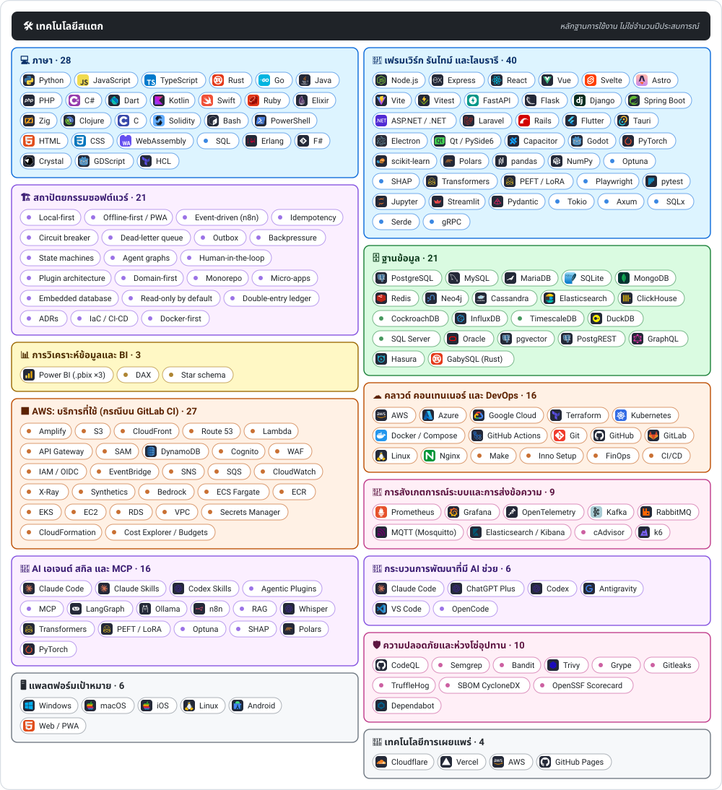
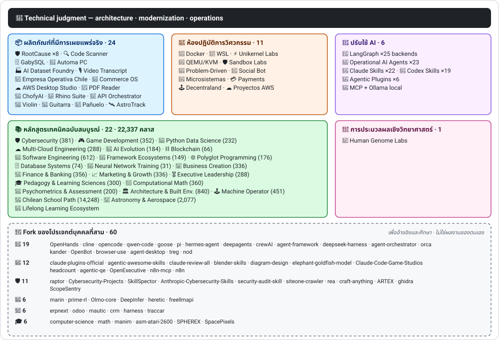

# 👋ว ลาดิ อุส อา คูญา

## **วิศวกร AI · สถาปัตยกรรม ทาง แก้·แพ็ครุ่นน้อง·การแปลงภาพดิจิทัล·ปฏิบัติการการจัดการ**

**ผู้เชี่ยวชาญได้รับการอบรมในสาขาวิทยาศาสตร์คอมพิวเตอร์ และวิศวกรรมและการบริหารธุรกิจ โดยมีอาคาร 16+ ปีและซอฟต์แวร์ปฏิบัติการในสภาพแวดล้อมจริง ผม เชื่อม โยง ธุรกิจ, ผู้ คน, กระบวนการ, และ เทคโนโลยี เข้า กับ การ ออก แบบ, การ ประเมิน, การ ส่ง, และ การ ค้ําจุน ทาง แก้ ด้วย การ ตัดสิน โดย ทาง เทคนิค และ ทัศนะ ที่ ดําเนิน งาน — โดย หลัก ฐาน ที่ ยืน ยัน ได้ ใน บัญชี กิตติฮับ นี้.**

<!-- STATS:START -->

<!-- STATS:END -->

[🧭 เริ่มต้นที่ไหน](docs/START_HERE.th.md) ·
[🌐 Portfolio (22 languages)](https://vladimiracunadev-create.github.io/) ·
[🧩 Ecosystem](#ภาพรวมระบบนิเวศ) ·
[🛠️ เทคโนโลยีสแตก](#-เทคโนโลยีสแตก) ·
[⚡ Evaluate me in 10 minutes](docs/guides/TECH_LEAD.th.md) ·
[✅ Professional scope](#ขอบเขตงาน) ·
[🧭 Non-coding management](#การจัดการ-การบริหาร-และโอกาสงานที่ไม่ประสบความสําเร็จ) ·
[📋 เมทริกซ์ตำแหน่งงาน](PROFESIONAL_ROLES.th.md) ·
[📬 Contact](#ติดต่อ)

**🌐 ฉบับเต็ม:** [Español](README.md) · [English](README.en.md) · [Português](README.pt.md) · [Italiano](README.it.md) · [Français](README.fr.md) · [简体中文](README.zh.md) · [繁體中文](README.zh-TW.md) · [日本語](README.ja.md) · [한국어](README.ko.md) · [Türkçe](README.tr.md) · [Русский](README.ru.md) · [Tiếng Việt](README.vi.md) · [ไทย](README.th.md) · [Deutsch](README.de.md) · [Українська](README.uk.md) · [Polski](README.pl.md) · [العربية](README.ar.md) · [فارسی](README.fa.md) · [Bahasa Indonesia](README.id.md) · [Nederlands](README.nl.md) · [हिन्दी](README.hi.md) · [Ελληνικά](README.el.md)

**แกนเทคนิค:**
PHP 8 · Python · Rust · Go · Node/TS · Java 21 · .NET 8 · Dart/Flutter · WASM
· AWS · Terraform · Kubernetes · Docker · n8n · LangGraph/MCP · CI/CD · FinOps · Observability

**สะพาน สาขา ธุรกิจ – เทคโนโลยี:**
ประมวลผลและวิเคราะห์ความต้องการ·การประมาณคําตอบ·การจัดวาง·การปฏิบัติการและต่อเนื่อง·การจัดการความเสี่ยง·ผลิตภัณฑ์และบริการ·การศึกษาทางเทคนิค

---

> [!NOTE]
> โปรไฟล์นี้ไม่ได้เปลี่ยนโอกาสให้กลายเป็นประสบการณ์ ประสบการณ์ ทาง เทคนิค ที่ พิสูจน์ ว่า มี ความ สามารถ ที่ จะ ย้าย ได้ การ ใช้ ประโยชน์ ได้ และ เป้า หมาย ใน การ พัฒนา อนาคต ก็ แยก กัน อย่าง ชัดเจน. เชื่อมโยงหลักฐาน Githoub มีกระบวนการประมวลผลหรือสารคดี; ที่บางสิ่งบางอย่าง**ไม่**เสร็จ สิ้น การ ประชุม นี้ ได้ รับ การ กล่าว ถึง ว่า เป็น เช่น นั้น.

## 🧭 เริ่มต้นที่ไหน

เลือกกรณีของคุณแล้วไปยังสิ่งที่ต้องการได้ทันที:

🧑‍💼 [การสรรหาบุคลากร](docs/guides/RECRUITER.th.md) · 💼 [ลูกค้าหรือฟรีแลนซ์](docs/guides/FREELANCE.th.md) · 🛠️ [การประเมินทางเทคนิค](docs/guides/TECH_LEAD.th.md) · 🏢 [ธุรกิจและการจัดการ](docs/guides/BUSINESS.th.md) · 🤝 [ความร่วมมือและความปลอดภัย](docs/guides/COLLABORATOR.th.md) · 🎓 [เรียนหรือสอน](docs/guides/LEARNER.th.md)

## 🎯สิ่งที่คุณจะพบที่นี่

นี่ ไม่ ใช่ “การ กลับ มา ใหม่ อย่าง เดียว กัน ”: เป็น ระบบ นิเวศ ที่ มี มาตรฐาน การ ใช้ ร่วม กัน.

- 🔁 **โม เด็ค ที่ สามารถ ทํา งาน ได้**-โคลน วิ่ง มั่นใจ
- 🧰 **ตัวเล่นมาตรฐาน**-เมคเฟช, ฮับ ซีแอลไอ`doctor`และ`smoke`ต่อคลังเก็บของ
- 🛡️ **การป้องกันในความลึก**-การสแกนลับ นโยบาย และกิจกรรมต้องห้าม
- 📈 **ความไวแสง** — `/health`, `/ready`, `/metrics`หนวดและรอยขีดข่วน
- 📚 **เอกสารที่ปรากฏแก่ผู้ชม**-คนรับสมัคร มือใหม่ เดวอป หรือ รปภ. ขึ้นอยู่กับคลังสินค้า
- 📦 **การกระจายตัวของโปรดักต์**— เปิดตัวแบบดาวน์โหลดได้, Checksums, และสร้างหลักฐาน; ลายเซ็นการค้า/สโตร์ ที่ประกาศว่าใช้ได้ชั่วคราว
- 🌍 **การแบ่งเขตการปกครอง** — โปรไฟล์นี้เผยแพร่ใน 22 ภาษา และพอร์ตโฟลิโอมี PDF สาธารณะ 154 ไฟล์ (7 กลุ่ม × 22 ภาษา) (ES · EN · PT · IT · FR · ZH · ZH-TW · JA · KO · TR · RU · VI · TH · DE · UK · PL · AR · FA · ID · NL · HI · EL).
- 🧭 **ความซื่อสัตย์เชิงเทคนิค**-ทุกคดีที่ถูกติดป้าย`OPERATIONAL`, `DOCUMENTED/SCAFFOLD`หรือ`PLANNED`.

## ✅สถานะที่ใช้ได้

| พื้นผิว | หลักฐานที่สรุปได้ |
|---|---|
| 🧪 **นําเสนอผลการตรวจสอบ** | แกบบีเอสQL**850 ทดสอบ**# พ่นน้ําออกมา**สี่เหลี่ยม**(0 ความตื่นตระหนก)·ชิลี**230 ทดสอบ** ·อัตโนมัติ**ไพย์ 150** ·CI หลายแบบ |
| 🤖 **ตัวแสดงเกรดของการผลิต** | ลังกราฟเรียลเวิลด์**25/ 25 โปรแกรมเบื้องหลังการทํางาน**(เคสที่ 01–25, 100% ออกอากาศ)·ปฏิบัติการเอไอเอเจ้นท์**23 เจ้าหน้าที่**ด้วย**69 การ ประเมิน โดย ไม่ มี เงื่อนไข** |
| 🔗 **การรวมพาราเมทริก** | **20 คดี**ผู้ ส่ง ส่ง (Transs Itter) —**19 ปฏิบัติการ**แต่ละคนตรวจสอบกับโดเกอร์· **18+ เครื่องยนต์ DB** · **ภาชนะบรรจุ 20+** ·11 รูปแบบ |
| 📦 **การกระจายตัว** | **166 เผยแพร่**ไปทั่วระบบนิเวศของ**การประชุมมหาชน 67 แห่ง** ·ตัวติดตั้งและวัตถุ`.exe` · `.msi` · `.dmg` · `.apk`ด้วย checksums และการสร้างหลักฐาน; ลายเซ็นพาณิชย์/ storition ในความคืบหน้าที่นําไปใช้ |
| 🛡️ **ห่วงโซ่อุปทาน** | รหัสQL·เซ ม รี ป·แบนดิต·ไตรวี่·กราฟแสดงความถี่·กิตติม จิ·สับปะรด·CyloonDX SBOM·ไพ่คะแนน |
| 📚 **เคอร์ริคูลา** | **22,337 คลาสเรียน พ.ศ.**ตรวจสอบได้ทั้ง 22 โปรแกรม นับด้วย[a workflow](.github/workflows/stats.yml)จากโครงสร้างของคลังสินค้า หรือแหล่งที่รับรองได้ ที่ถูกประกาศไว้ในคลังสินค้า·ทุกโปรแกรมประกาศสถานะและข้อจํากัดของรายการ |
| 🌐 **พอร์ตโฟลิโอ้** | โปรแกรม PWA ที่ติดตั้งได้· **22 ภาษา** · **154 PDF**สร้างโดยท่อส่งแก๊ส·API ข้อมูล CV·แคปซิเตอร์ แอนดรอยด์·ไลท์เฮาส์ 100 |
| 🔒 **เส้นพริ้วไหว** | ซีโร่โทรเมชันในผลิตภัณฑ์นิติเวช และเอ็มพริซา โอเปราตีวา ชิลี — ได้รับการยืนยันในทุกอาคาร (โน อันดรอยด์)`INTERNET`อนุญาต |
| 🌐 **เผยแพร่เว็บไซต์** | **57 เว็บไซต์ GitHub Pages**-56 เครื่องลงจอด 1 เครื่อง ต่อผลิตภัณฑ์ โปรแกรม หรือระบบนําทางระบบนิเวศ รวมกับชุดผลงาน แต่ละอันใช้จากคลังเก็บ·ทั้ง 57 คนตรวจสอบกับ HTTP`200` |

## 🛠️ เทคโนโลยีสแตก

เทคโนโลยีที่ตรวจพบในคลังสาธารณะ (ไฟล์ manifest, ไลบรารีที่พึ่งพา, คอนเทนเนอร์ และโค้ด) จัดกลุ่มตามด้าน การปรากฏในคลังใด ๆ — รวมห้องปฏิบัติการและหลักสูตร — เป็นหลักฐานการใช้งาน ไม่ใช่การอ้างประสบการณ์ใช้งานจริงหลายปี

**สถาปัตยกรรมซอฟต์แวร์**

Local-first → [empresa-operativa-chile](https://github.com/vladimiracunadev-create/empresa-operativa-chile), [ai-dataset-foundry](https://github.com/vladimiracunadev-create/ai-dataset-foundry) · Event-driven → [social-bot-scheduler](https://github.com/vladimiracunadev-create/social-bot-scheduler) · Resilience → [problem-driven-systems-lab](https://github.com/vladimiracunadev-create/problem-driven-systems-lab) · Ledger → [universal-payments-engineering-lab](https://github.com/vladimiracunadev-create/universal-payments-engineering-lab) · Plugins → [agentic-plugins-toolkit](https://github.com/vladimiracunadev-create/agentic-plugins-toolkit) · Agents → [langgraph-realworld](https://github.com/vladimiracunadev-create/langgraph-realworld), [operational-ai-agents](https://github.com/vladimiracunadev-create/operational-ai-agents) · Domain-first → [rhino-suite](https://github.com/vladimiracunadev-create/rhino-suite) · Micro-apps → [microsistemas](https://github.com/vladimiracunadev-create/microsistemas) · Embedded DB → [gabysql](https://github.com/vladimiracunadev-create/gabysql) · IaC → [proyectos-aws](https://github.com/vladimiracunadev-create/proyectos-aws)

**การวิเคราะห์ข้อมูลและ BI**

Power BI (.pbix ×3) · DAX · Star schema → [social-bot-scheduler](https://github.com/vladimiracunadev-create/social-bot-scheduler)

**AWS: บริการที่ใช้ (กรณีบน GitLab CI)**

กรณี A–P → [proyectos-aws-gitlab](https://gitlab.com/vladimir.acuna.dev-group/proyectos-aws-gitlab) (GitLab CI → AWS; ประกาศว่าเสร็จครบทั้ง 16 กรณี ยกเว้นกรณี M ที่เสร็จเฉพาะเฟส 1) · [proyectos-aws](https://github.com/vladimiracunadev-create/proyectos-aws) (GitHub Actions) · EC2, RDS, VPC, Secrets Manager, CloudFormation, Cost Explorer → [aws-desktop-studio](https://github.com/vladimiracunadev-create/aws-desktop-studio) (การสืบค้นรายการทรัพยากรจริง EC2 เริ่ม หยุด และรีบูตภายใต้การควบคุมสองชั้น)

**กระบวนการพัฒนาที่มี AI ช่วย**

| เครื่องมือ | ใช้หลัก |
|---|---|
| **รหัสของน้ํามือ** | การ ทบทวน ด้าน สถาปัตยกรรม, การ จัด ระเบียบ, และ เอกสาร ทาง เทคนิค |
| **chartGPT Plute** | การ วิเคราะห์, สถาปัตยกรรม, และ การ ทํา ศัลยกรรม (ตั้งแต่ ปี 2023) |
| **โค เดก ซ์** | รุ่นโค้ดและการจําลอง |
| **ความไม่ต่อเนื่อง** | การเร่งพัฒนาและระบบการไหล |
| **รหัส VS /  OpenCode** | สภาพแวดล้อมที่ประกอบด้วยความช่วยเหลือ AI |

> ผมรวมการตัดสินใจทางเทคนิคของผม ความถูกต้องของมนุษย์ และทิศทางสถาปัตยกรรมของผมเข้าด้วยกัน การ ทํา เช่น นี้ ช่วย ให้ ความ สามารถ, ความ เร็ว, และ ความ สามารถ ของ คุณ มี มาก ขึ้น.

**เทคโนโลยีการเผยแพร่**

Cloudflare (งานส่วนตัว) · Vercel (แฮกกาธอน NASA Space Apps) · AWS (เว็บไซต์ที่ใช้งานจริง เชื่อมกับ GitLab) · GitHub Pages

## 🗺️ภาพรวมระบบนิเวศ

## 🗂️ ระบบนิเวศ: ผลิตภัณฑ์ ห้องปฏิบัติการ AI ประยุกต์ หลักสูตร และการคำนวณเชิงวิทยาศาสตร์

ผลงานเชิงปฏิบัติของโปรไฟล์นี้อยู่ในเอกสารแยกต่างหาก ได้แก่ ซอฟต์แวร์ที่ดาวน์โหลดและติดตั้งได้ ห้องปฏิบัติการวิศวกรรม AI ประยุกต์ หลักสูตรเทคนิคฉบับสมบูรณ์ และการคำนวณเชิงวิทยาศาสตร์ พร้อมคำอธิบายของ fork โปรเจกต์ของบุคคลที่สามทุกรายการในบัญชี

- 📦 [**ผลิตภัณฑ์ที่มีการเผยแพร่จริง**](docs/ECOSYSTEM.th.md#products) (24)
- 🧪 [**ห้องปฏิบัติการวิศวกรรม**](docs/ECOSYSTEM.th.md#labs) (11)
- 🤖 [**ปรับใช้ AI**](docs/ECOSYSTEM.th.md#ai) (6)
- 📚 [**หลักสูตรเทคนิคฉบับสมบูรณ์**](docs/ECOSYSTEM.th.md#curricula) (22)
- 🔬 [**การประมวลผลเชิงวิทยาศาสตร์**](docs/ECOSYSTEM.th.md#science) (1)
- 🍴 [**Fork ของโปรเจกต์บุคคลที่สาม**](docs/ECOSYSTEM.th.md#forks) (60)

👉 **[ดูระบบนิเวศทั้งหมด](docs/ECOSYSTEM.th.md)** · [🍴 Fork ของโปรเจกต์บุคคลที่สาม](docs/ECOSYSTEM.th.md#forks)

## 🛰️ แฮกกาธอน NASA Space Apps 2026

ฉันเข้าร่วม **NASA Space Apps Challenge 2026** (ซันติอาโก 14–15 พฤศจิกายน) ในโจทย์ *Planet X and SPHEREx* ในทีม 6 คน ผลงานคือ **AstroTrack · SPHEREx** ซึ่งเป็นตัวแสดงผลบนเว็บที่ให้ใส่พิกัดบนท้องฟ้าแล้วดูบริเวณนั้นเป็นลำดับภาพ SPHEREx ตามเวลา โดยใช้ข้อมูลจาก NASA/IPAC IRSA

- **ส่วนของฉัน:** การเข้าถึงข้อมูล (คิวรี IRSA พร้อมแคชและคำนวณพื้นที่เดโมล่วงหน้า) การแพ็กเกจ (PWA ตัวติดตั้งเดสก์ท็อปด้วย Tauri และ APK Android ด้วย Capacitor) หน้า “ดาวน์โหลด” และการตรวจสอบความสอดคล้องระหว่างเอกสารกับโค้ด
- **ส่งมอบที่ตรวจสอบได้:** [spherex-releases](https://github.com/vladimiracunadev-create/spherex-releases) รวม 7 รีลีส (v0.1.0 ถึง v0.4.2) พร้อมค่า SHA-256 · [เว็บแอป](https://spherex-planet-x-tau.vercel.app/) · [ที่เก็บของทีม](https://github.com/mauriciovalenzuela742/SPHEREX)
- **ข้อจำกัดที่แจ้งไว้:** ตัวแสดงผล การออกแบบ และแบ็กเอนด์ส่วนที่เหลือเป็นผลงานของสมาชิกคนอื่นในทีม ตัวติดตั้งไม่ได้ลงนามและยังไม่ได้ทดสอบบนอุปกรณ์จริง ฉันใช้ AI (Claude Code) เป็นผู้ช่วยตามที่ระบุไว้ในที่เก็บ นี่คือการอธิบายส่วนที่ฉันทำ ไม่ใช่ผลการแข่งขัน

## 🧠มาตรฐานที่ผมใช้ในทุกคลัง

- **DX ก่อน**-ถ้าไม่ง่ายในการวิ่ง มันก็ไม่มีประโยชน์ที่จะเข้ารับบทเป็นเดโม หรือเป็นฐานทีม
- **ความ สามารถ ใน การ เลือก ตั้ง ตั้ง แต่ วัน ที่ 1**-วัดและติดตามไม่ได้
- **ความปลอดภัยเป็นท่อส่ง**-การสแกนลับ เอสบีเอ็มต่อปลดปล่อย การปฏิบัติต้องห้ามอย่างชัดเจน
- **ความยืดหยุ่นจริง**-ไร้สมรรถภาพ วงจรไฟฟ้า และควบคุมความเสื่อมโทรม
- **โพ ลิ กลอท โดย การ ออก แบบ**-ภาษาและเครื่องยนต์ที่ถูกเลือกโดยคดีที่ไม่เคยถูกเลือกโดยแฟชั่น
- **ความซื่อสัตย์เกี่ยวกับสถานะ**— อีก หนึ่ง เรโป ถูก เปลี่ยน ชื่อ (ค.ศ.`Multisimulador` → `machine-operator-program`เพื่อหลีกเลี่ยงซอฟท์แวร์ที่ยังไม่มีอยู่
- **แบดเจอร์เป็นสัญญาณ ไม่ใช่หลักฐาน**-การยึดทรัพย์สินของแต่ละฝ่ายยังประกาศ**สิ่งที่มันไม่ทํา**.
- **โมเดลภายนอก**— โดเมน ถูก ออก แบบ มา ก่อน ส่วน ต่อ นี้ เป็น การ ฉาย ภาพ.
- **งานภายนอกถูกประกาศเป็นภายนอก** — [60 fork](docs/ECOSYSTEM.th.md#forks) ของโปรเจกต์บุคคลที่สามอธิบายทีละรายการ และไม่นับรวมในตัวเลขผลงานของตนเองใดๆ ในโปรไฟล์นี้

## ✅ขอบเขตงาน

ภูมิ หลัง ของ ผม ทั้ง สอง —**วิทยาศาสตร์คอมพิวเตอร์และวิศวกรรมคอมพิวเตอร์ + สํานักงานบริหารธุรกิจ**ช่วยผมให้แปลเป้าหมายทางธุรกิจ เป็นการตัดสินใจทางเทคนิคและข้อจํากัดทางเทคนิค ให้เป็นทางเลือกที่ชัดเจนสําหรับการดําเนินการ ผลิตภัณฑ์ ลูกค้า และผู้นํา

### 🎯การแสดงตัวของแกนหลัก

| บทบาท | การสํารองข้อมูล |
|---|---|
| **สถาปัตยกรรม ทาง แก้** | ระบบออกแบบแบบเคลื่อนไหวได้ ด้วยการตัดสินวิวัฒนาการ |
| **สถาปัตยกรรม สมัย ใหม่** | วิวัฒนาการที่แท้จริง (PHP 5.x/8.x, การเพิ่มการเพิ่มการ อนุมานโดยไม่รบกวนดําเนินการ) |
| **จ่าฝูง/ เทคโนโลยีอาวุโส** | สถาปัตยกรรม, การ ประหาร ชีวิต, และ มาตรฐาน บน เวที จริง (+16 ปี) |
| **สถาปัตยกรรม AI อัตโนมัติ** | ระบบเอเจนท์ที่มี แลงกราฟ/เอ็มซีพี และ n8n flow ด้วยรางป้องกัน |

### ↗ การขยายตามธรรมชาติ

**วิศวกรการเพิ่มเสียง AI** · **ระบบ / กลไกการหมุน** · **เครื่องกลโมบายล์ (เสียงฟลัช)** · **ตัวช่วยแก้ปัญหา** · **ผู้สร้างโปรดักต์เชิงเทคนิค** · **ผู้ ฝึก อบรม ด้าน เทคนิค** · **ที่ปรึกษาการแปลงภาพดิจิทัล** · **การ วิเคราะห์ ธุรกิจ / การ ทํา งาน** · **ปฏิบัติการ Production ทางเทคนิค** · **AI Engineer (LLM / ML)** · **Data Engineer** · **DevSecOps / AppSec Engineer** · **QA Automation / Test Engineer** · **Technical Writer** · **อาจารย์ / วิทยากร / ผู้สอนเทคโนโลยี** · **Instructional Designer (EdTech)** · **Technical Mentor**

### ⚙️ขอบเขตเสริม

ตัวช่วยสร้างแพลตฟอร์ม / IDP·เด โวป / ซีซีดี·เมฆ / เครื่อง ยนต์ เอ ดับเบิล ยู เอส·โปรแกรม SER·ตัวสร้างอัตโนมัติ·ที่ปรึกษาด้านเทคนิค · Backend / API Engineer · Fintech / Payments Engineer · Developer Advocate / DevRel

## 🧭การจัดการ, การบริหาร, และโอกาสงานที่ไม่ประสบความสําเร็จ

ตำแหน่งงานด้านการจัดการ การบริหาร และธุรกิจ ที่ความรู้ด้านสารสนเทศและการบริหารสร้างคุณค่าได้โดยการเขียนโปรแกรมไม่ใช่งานหลัก จัดประเภทอย่างตรงไปตรงมา (ทักษะที่ถ่ายโอนได้ โอกาสสมัครงาน หรือเป้าหมายในอนาคต) พร้อมช่องว่างของแต่ละตำแหน่ง ขอบเขตที่ครอบคลุม:

ผู้นําเทคโนโลยี · การจัดการโครงการ · การ บริหาร ธุรกิจ · วางแผนและเปลี่ยนแปลง · วิเคราะห์ธุรกิจ · โปรดักต์และบริการ · การจัดการความปลอดภัยทางไซเบอร์ · การ ค้า และ การ ขาย · การเงินและการจัดการควบคุม · คุณภาพ · การศึกษา · ผู้ จัด จําหน่าย และ ผู้ ผลิต ไม้ ซุง · ข้อมูล และ การ ควบคุม AI · ภาคต่อ

👉 **[ดูเมทริกซ์โอกาสทั้งหมด](docs/MANAGEMENT.th.md)**

## 📌ความสามารถ

**เปิดไปยัง:**แพ็ครุ่นน้อง·สถาปัตยกรรม·การ ทํา ให้ เป็น แบบ สมัย ใหม่·แพลตฟอร์ม/ หมายเลขไอพี·โปรแกรม SER·ปฏิรูป·อัตโนมัติ·การอัตโนมัติ AI·การวิเคราะห์ธุรกิจ/ ขอบเขตงาน·โครงการนี้ร่วมมือกัน·ปฏิบัติการโปรดักต์·การแปลงภาพดิจิทัล·ที่ปรึกษา/ พรีเซล·การศึกษาทางเทคนิค·คุณภาพและการปรับปรุงอย่างต่อเนื่อง·การ รับ เป็น บุตร บุญธรรม และ การ ปกครอง ของ AI

**การ แบ่ง แยก ตาม ขอบ เขต แต่ ละ อย่าง:**Production Hist / เทคนิกโปรดักต์·บริการ·ปฏิบัติ การ ของ IT·ความเสี่ยงของ GRC / เทคโนโลยี·การ บริหาร และ การ ดําเนิน งาน·การควบคุมการจัดการ·นักแสดงยุคปัจจุบัน ตําแหน่งผู้บริหารและผู้จัดการทั่วไป คือเป้าหมายการพัฒนาในอนาคต ไม่ใช่การอ้างประสบการณ์

**ความสมบูรณ์:**ห่างไกลหรือลูกผสม ขึ้นอยู่กับโครงการ

## 📬ติดต่อ

---

[🤝 Contribute](CONTRIBUTING.th.md) ·
[🛡️ Security](SECURITY.th.md) ·
[⚖️ Code of Conduct](CODE_OF_CONDUCT.th.md)

README ซิงก์กับสถานะที่ตรวจสอบได้ของคลังสาธารณะ —ตัวเลขและการเปลี่ยนแปลงอ่านผ่าน API— · ตรวจสอบล่าสุด: <!-- VERIFIED:START -->2026-11-24<!-- VERIFIED:END -->

