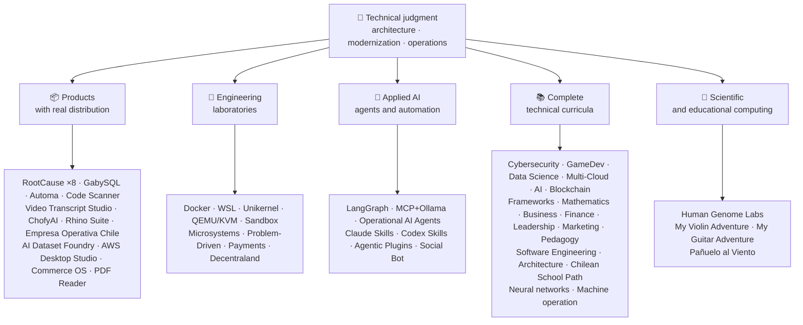

<div align="center">

# 👋ว ลาดิ อุส อา คูญา

## **สถาปัตยกรรม ทาง แก้·แพ็ครุ่นน้อง·การแปลงภาพดิจิทัล·ปฏิบัติการการจัดการ**

**ผู้เชี่ยวชาญได้รับการอบรมในสาขาวิทยาศาสตร์คอมพิวเตอร์ และวิศวกรรมและการบริหารธุรกิจ โดยมีอาคาร 16+ ปีและซอฟต์แวร์ปฏิบัติการในสภาพแวดล้อมจริง ผม เชื่อม โยง ธุรกิจ, ผู้ คน, กระบวนการ, และ เทคโนโลยี เข้า กับ การ ออก แบบ, การ ประเมิน, การ ส่ง, และ การ ค้ําจุน ทาง แก้ ด้วย การ ตัดสิน โดย ทาง เทคนิค และ ทัศนะ ที่ ดําเนิน งาน — โดย หลัก ฐาน ที่ ยืน ยัน ได้ ใน บัญชี กิตติฮับ นี้.**

[](https://vladimiracunadev-create.github.io/)
[](https://www.linkedin.com/in/vladimir-acu%C3%B1a-valdebenito-11924a29/)
[](mailto:vladimir.acuna.dev@gmail.com)

[](#ขอบเขตงาน)
[](docs/ECOSYSTEM.th.md)
[](#หลักสูตรเทคนิคฉบับสมบูรณ์)

<!-- STATS:START -->
[](https://github.com/vladimiracunadev-create?tab=repositories)
[](https://github.com/vladimiracunadev-create?tab=repositories)
[](#ภาพรวมระบบนิเวศ)
[](#หลักสูตรเทคนิคฉบับสมบูรณ์)
[](https://github.com/vladimiracunadev-create?tab=repositories)
<!-- STATS:END -->

[](https://github.com/vladimiracunadev-create?tab=repositories)
[](https://github.com/vladimiracunadev-create?tab=followers)

[🌐 Portfolio (6 languages)](https://vladimiracunadev-create.github.io/) ·
[🧩 Ecosystem](#ภาพรวมระบบนิเวศ) ·
[⚡ Evaluate me in 10 minutes](#หากคุณมีเวลา-10-นาทีเพื่อประเมินผม) ·
[✅ Professional scope](#ขอบเขตงาน) ·
[🧭 Non-coding management](#การจัดการ-การบริหาร-และโอกาสงานที่ไม่ประสบความสําเร็จ) ·
[📋 Role matrix](PROFESIONAL_ROLES.md) ·
[📬 Contact](#ติดต่อ)

**🌐 ฉบับเต็ม:** [Español](README.md) · [English](README.en.md) · [Português](README.pt.md) · [Italiano](README.it.md) · [Français](README.fr.md) · [简体中文](README.zh.md) · [繁體中文](README.zh-TW.md) · [日本語](README.ja.md) · [한국어](README.ko.md) · [Türkçe](README.tr.md) · [Русский](README.ru.md) · [Tiếng Việt](README.vi.md) · [ไทย](README.th.md) · [Deutsch](README.de.md) · [Українська](README.uk.md) · [Polski](README.pl.md) · [العربية](README.ar.md) · [فارسی](README.fa.md) · [Bahasa Indonesia](README.id.md) · [Nederlands](README.nl.md) · [हिन्दी](README.hi.md) · [Ελληνικά](README.el.md)

**แกนเทคนิค:**
PHP 8 · Python · Rust · Go · Node/TS · Java 21 · .NET 8 · Dart/Flutter · WASM
· AWS · Terraform · Kubernetes · Docker · n8n · LangGraph/MCP · CI/CD · FinOps · Observability

**สะพาน สาขา ธุรกิจ – เทคโนโลยี:**
ประมวลผลและวิเคราะห์ความต้องการ·การประมาณคําตอบ·การจัดวาง·การปฏิบัติการและต่อเนื่อง·การจัดการความเสี่ยง·ผลิตภัณฑ์และบริการ·การศึกษาทางเทคนิค

</div>

---

> [!NOTE]
> โปรไฟล์นี้ไม่ได้เปลี่ยนโอกาสให้กลายเป็นประสบการณ์ ประสบการณ์ ทาง เทคนิค ที่ พิสูจน์ ว่า มี ความ สามารถ ที่ จะ ย้าย ได้ การ ใช้ ประโยชน์ ได้ และ เป้า หมาย ใน การ พัฒนา อนาคต ก็ แยก กัน อย่าง ชัดเจน. เชื่อมโยงหลักฐาน Githoub มีกระบวนการประมวลผลหรือสารคดี; ที่บางสิ่งบางอย่าง**ไม่**เสร็จ สิ้น การ ประชุม นี้ ได้ รับ การ กล่าว ถึง ว่า เป็น เช่น นั้น.

## 🎯สิ่งที่คุณจะพบที่นี่

นี่ ไม่ ใช่ “การ กลับ มา ใหม่ อย่าง เดียว กัน ”: เป็น ระบบ นิเวศ ที่ มี มาตรฐาน การ ใช้ ร่วม กัน.

- 🔁 **โม เด็ค ที่ สามารถ ทํา งาน ได้**-โคลน วิ่ง มั่นใจ
- 🧰 **ตัวเล่นมาตรฐาน**-เมคเฟช, ฮับ ซีแอลไอ`doctor`และ`smoke`ต่อคลังเก็บของ
- 🛡️ **การป้องกันในความลึก**-การสแกนลับ นโยบาย และกิจกรรมต้องห้าม
- 📈 **ความไวแสง** — `/health`, `/ready`, `/metrics`หนวดและรอยขีดข่วน
- 📚 **เอกสารที่ปรากฏแก่ผู้ชม**-คนรับสมัคร มือใหม่ เดวอป หรือ รปภ. ขึ้นอยู่กับคลังสินค้า
- 📦 **การกระจายตัวของโปรดักต์**— เปิดตัวแบบดาวน์โหลดได้, Checksums, และสร้างหลักฐาน; ลายเซ็นการค้า/สโตร์ ที่ประกาศว่าใช้ได้ชั่วคราว
- 🌍 **การแบ่งเขตการปกครอง**— ประวัติ ย่อ ใน 6 ภาษา (ส.·เอ็น·ขนาด PT·มัน·ฟิล์ม FR·ZH).
- 🧭 **ความซื่อสัตย์เชิงเทคนิค**-ทุกคดีที่ถูกติดป้าย`OPERATIONAL`, `DOCUMENTED/SCAFFOLD`หรือ`PLANNED`.

## ✅สถานะที่ใช้ได้

| พื้นผิว | หลักฐานที่สรุปได้ |
|---|---|
| 🧪 **นําเสนอผลการตรวจสอบ** | แกบบีเอสQL**828 ทดสอบ**# พ่นน้ําออกมา**สี่เหลี่ยม**(0 ความตื่นตระหนก)·ชิลี**158 ทดสอบ** ·อัตโนมัติ**ไพย์ 150** ·CI หลายแบบ |
| 🤖 **ตัวแสดงเกรดของการผลิต** | ลังกราฟเรียลเวิลด์**25/ 25 โปรแกรมเบื้องหลังการทํางาน**(เคสที่ 01–25, 100% ออกอากาศ)·ปฏิบัติการเอไอเอเจ้นท์**13 เจ้าหน้าที่**ด้วย**39 การ ประเมิน โดย ไม่ มี เงื่อนไข** |
| 🔗 **การรวมพาราเมทริก** | **20 คดี**ผู้ ส่ง ส่ง (Transs Itter) —**19 ปฏิบัติการ**แต่ละคนตรวจสอบกับโดเกอร์· **18+ เครื่องยนต์ DB** · **ภาชนะบรรจุ 20+** ·11 รูปแบบ |
| 📦 **การกระจายตัว** | **151 เผยแพร่**ไปทั่วระบบนิเวศของ**การประชุมมหาชน 64 แห่ง** ·ตัวติดตั้งและวัตถุ`.exe` · `.msi` · `.dmg` · `.apk`ด้วย checksums และการสร้างหลักฐาน; ลายเซ็นพาณิชย์/ storition ในความคืบหน้าที่นําไปใช้ |
| 🛡️ **ห่วงโซ่อุปทาน** | รหัสQL·เซ ม รี ป·แบนดิต·ไตรวี่·กราฟแสดงความถี่·กิตติม จิ·สับปะรด·CyloonDX SBOM·ไพ่คะแนน |
| 📚 **เคอร์ริคูลา** | **14,530 คลาสเรียน พ.ศ.**ตรวจสอบได้ทั้ง 21 โปรแกรม นับด้วย[a workflow](.github/workflows/stats.yml)จากโครงสร้างของคลังสินค้า หรือแหล่งที่รับรองได้ ที่ถูกประกาศไว้ในคลังสินค้า·ทุกโปรแกรมประกาศสถานะและข้อจํากัดของรายการ |
| 🌐 **พอร์ตโฟลิโอ้** | โปรแกรม PWA ที่ติดตั้งได้· **6 ภาษา** · **36 PDF**สร้างโดยท่อส่งแก๊ส·API ข้อมูล CV·แคปซิเตอร์ แอนดรอยด์·ไลท์เฮาส์ 100 |
| 🔒 **เส้นพริ้วไหว** | ซีโร่โทรเมชันในผลิตภัณฑ์นิติเวช และเอ็มพริซา โอเปราตีวา ชิลี — ได้รับการยืนยันในทุกอาคาร (โน อันดรอยด์)`INTERNET`อนุญาต |
| 🌐 **เผยแพร่เว็บไซต์** | **56 เว็บไซต์ GitHub Pages**-55 เครื่องลงจอด 1 เครื่อง ต่อผลิตภัณฑ์ โปรแกรม หรือระบบนําทางระบบนิเวศ รวมกับชุดผลงาน แต่ละอันใช้จากคลังเก็บ·ทั้ง 56 คนตรวจสอบกับ HTTP`200` |

## 🗺️ภาพรวมระบบนิเวศ



## 🗂️ ระบบนิเวศ: ผลิตภัณฑ์ ห้องปฏิบัติการ AI ประยุกต์ และการคำนวณเชิงวิทยาศาสตร์

ผลงานเชิงปฏิบัติของโปรไฟล์นี้อยู่ในเอกสารแยกต่างหาก ได้แก่ ซอฟต์แวร์ที่ดาวน์โหลดและติดตั้งได้ ห้องปฏิบัติการวิศวกรรม AI ประยุกต์ และการคำนวณเชิงวิทยาศาสตร์ พร้อมคำอธิบายของ fork โปรเจกต์ของบุคคลที่สามทุกรายการในบัญชี

- 📦 **ผลิตภัณฑ์ที่มีการเผยแพร่จริง** (22)
- 🧪 **ห้องปฏิบัติการวิศวกรรม** (11)
- 🤖 **ปรับใช้ AI** (6)
- 🔬 **การประมวลผลเชิงวิทยาศาสตร์** (1)
- 🍴 **Fork ของโปรเจกต์บุคคลที่สาม** (52)

👉 **[ดูระบบนิเวศทั้งหมด](docs/ECOSYSTEM.th.md)** · [🍴 Fork ของโปรเจกต์บุคคลที่สาม](docs/ECOSYSTEM.th.md#forks)

## 📚หลักสูตรเทคนิคฉบับสมบูรณ์

รายการ ที่ มี การ จัด ใน ภาษา สเปน ซึ่ง มี สถานะ และ ขอบ เขต ที่ แต่ ละ ห้อง เก็บ ของ ได้ ประกาศ. 21 โครงการรวมกันเป็น**14,530 คลาสเรียน พ.ศ.**นับจํานวน[a workflow](.github/workflows/stats.yml)จากโครงสร้างคลังสินค้าที่แท้จริง หรือแหล่งที่ตรวจสอบได้ เปิดใช้งานในคลังสินค้า; ตรารีเฟรชรายสัปดาห์และไม่ได้เขียนด้วยมือ

🧭 [**Lifelong Learning Ecosystem**](https://github.com/vladimiracunadev-create/lifelong-learning-ecosystem)เป็นเข็มทิศที่ดูดซึม เชื่อมต่อ 30 เส้นทางจริงผ่านพื้นที่ 6 ผ่านแผนที่และ[accessible offline portal](https://vladimiracunadev-create.github.io/lifelong-learning-ecosystem/);; ไม่ ได้ ถือ ว่า เป็น รายการ อื่น ๆ.

| โปรแกรม | คลาส | ขอบเขต |
|---|---:|---|
| [🔢 **Computational Mathematics**](https://github.com/vladimiracunadev-create/computational-mathematics-program) | 360 | จากการนับนิ้วเพื่อสร้างกระดาษ· **360 การสาธิตแบบระบุตัวตน ยืนยันใน CI** ·สมุด บันทึก 1,080 เล่ม·เคลือบด้วยน้ํามัน 489 ภาค· [site](https://vladimiracunadev-create.github.io/computational-mathematics-program/) |
| [🏦 **Finance and Banking**](https://github.com/vladimiracunadev-create/finance-and-banking-evolution-program) | 356 | 534 h·สืบค้นเมื่อ 3 ปีก่อน สืบค้นเมื่อ 3 มิถุนายน พ.ศ.· **27 กรณี** · **298 ทดสอบ** · [site](https://vladimiracunadev-create.github.io/finance-and-banking-evolution-program/) |
| [🎮 **GameDev**](https://github.com/vladimiracunadev-create/modern-gamedev-program) | 352 | คณิตศาสตร์และ C#/C+/GDScript paraders, AI, multipleplayer, VR/AR·พระเจ้า·เอกภาพ·ไม่ใช้เอฟเฟ็คต์· **10 ห้อง ปฏิบัติ การ ของ โก โดต ที่ ตรวจ สอบ ใน ซี ไอ**(301 เช็ค)· [site](https://vladimiracunadev-create.github.io/modern-gamedev-program/) |
| [🛡️ **Cybersecurity**](https://github.com/vladimiracunadev-create/modern-cybersecurity-program) | 360 | **v1.3.0** ·20 ส่วน·→ ทีมแดง, DFIR, ความปลอดภัยเมฆ, ใช้ประโยชน์จากเดวอน, CTF และความปลอดภัยในเกม·ผังแป้นพิมพ์**7 การ รับรอง** ·แอพพลิเคชันของแอนดรอยด์/ web ออฟไลน์·คู่มือ PDF·CI, รักษาความปลอดภัย และเพจตรวจสอบ· [site](https://vladimiracunadev-create.github.io/modern-cybersecurity-program/) |
| [📈 **Marketing, Sales, and Growth**](https://github.com/vladimiracunadev-create/marketing-sales-growth-evolution-program) | 336 | 24 ส่วนที่มีนิยามการทํางาน, แผ่นวัด, ชีวประวัติแบบวัดได้, และบริบทควบคุมชิลี· **v1.6. 0** ·1. 29M คํา·เส้นทางบนบทบาท 17· [site](https://vladimiracunadev-create.github.io/marketing-sales-growth-evolution-program/) |
| [🏢 **Business Creation**](https://github.com/vladimiracunadev-create/modern-business-creation-program) | 336 | สร้างและดําเนินกิจการจริงในชิลี : จากความคิดไปในทางการเข้าครอบครอง, อํานาจภาษี, การดําเนินงาน, วิกฤตการณ์และออก·แผนภูมิ 360·อภิธานศัพท์ 1,2111 ระยะเวลา·คู่มือ 1,548 หน้า· [site](https://vladimiracunadev-create.github.io/modern-business-creation-program/) |
| [🏛️ **Architecture and Built Environment**](https://github.com/vladimiracunadev-create/architecture-built-environment-learning-program) | 830 | 83 ส่วน·วาระงานของส่วนท้าย 60·34 เส้นทาง·แหล่งข้อมูลที่แกะรอยได้·พิมพ์แบบ Countดาวน์, โปรแกรมอ่านแบบออฟไลน์, และหน้าแบบ GitHub· [site](https://vladimiracunadev-create.github.io/architecture-built-environment-learning-program/) |
| [🇨🇱 **Chilean School Learning Path**](https://github.com/vladimiracunadev-create/chilean-school-learning-path) | 8,841 | คะแนน 1–12· **4,156 ผนวกประสบการณ์การข้ามห้อง** · **2,823 วัตถุประสงค์การเรียนรู้** ·แหล่ง ที่ มา ของ ความ สําเร็จ·ไม่มีการเสนองานและวิจารณ์มนุษย์เป็นพิเศษ ที่ยังคงอยู่· [site](https://vladimiracunadev-create.github.io/chilean-school-learning-path/) |
| [🧭 **Modern Software Engineering**](https://github.com/vladimiracunadev-create/modern-software-engineering-program) | 480 | 40 ส่วน และ 8 ขั้น ตอน·ฐานราก → ผลิตภัณฑ์ สถาปัตยกรรม ความปลอดภัย เดวิสส์ เอสรี เอสพีซี ไอ และระบบหลาย ๆ หน่วยงาน·สถานะส่วนแก้ไขข้อความประกาศโดยคลังเก็บ· [site](https://vladimiracunadev-create.github.io/modern-software-engineering-program/) |
| [🎓 **Pedagogy and Learning Sciences**](https://github.com/vladimiracunadev-create/education-pedagogy-learning-sciences-program) | 300 | จากวิธีที่คนเรียนรู้ ถึงวิธีสอนครู·25 ส่วน· **แต่ ละ ชั้น ประกาศ สภาพ และ ขีด จํากัด ของ หลัก ฐาน** ·การ อ่าน หนังสือ, วิธี การ ที่ ไม่ มี การ ควบคุม ใน ตอน แรก, ความ ต้องการ ทาง การ ศึกษา เฉพาะ อย่าง, การ อยู่ ร่วม กัน, ความ หลาก หลาย ทาง วัฒนธรรม, และ หลัก ฐาน จาก นานา ชาติ·1,097 แว่นขยาย 325 แผนภาพ และธนาคารห้องเรียน 60 มาตรา·14 เส้นทางอาชีพตามบทบาท·นําเข้าได้โดย LMM· **v2.1.0** · [site](https://vladimiracunadev-create.github.io/education-pedagogy-learning-sciences-program/) |
| [☁️ **Multi-Cloud**](https://github.com/vladimiracunadev-create/multi-cloud-engineering-program) | 288 | ขนาด AWS·เสน่ห์·เข้ารหัสแบบ GCP·คูแบร์เน็ตส์·เทอร์ราฟอร์ม·ครี·ฟอสเฟต· **1,288 ชั่วโมง** ·288 ห้องแล็ปพร้อมหลักฐาน Json·1,032 แกะรอยแหล่ง·ขนาด 2,884 หน้าคู่มือ PDF· [site](https://vladimiracunadev-create.github.io/multi-cloud-engineering-program/) |
| [🎖️ **Executive Leadership**](https://github.com/vladimiracunadev-create/executive-leadership-founder-program) | 288 | จากการเป็นเจ้าของผลลัพธ์แรกของคุณ เพื่อเป็นผู้นําบริษัท และก่อตั้งบริษัทของคุณเอง: ทีม, PDF/OKR, การเงิน, ผลิตภัณฑ์, ความเสี่ยง, คณะกรรมการและ M&A·24 คดี, 96 ห้องปฏิบัติการ และเอกสาร 39 ฉบับ· [site](https://vladimiracunadev-create.github.io/executive-leadership-founder-program/) |
| [🐍 **Python Data Science**](https://github.com/vladimiracunadev-create/python-data-science-program) | 232 | โพลาส, ML+Optuna/SHAP, Py Torch/LLM/LORA, MLLps·แอพพลิเคชันของวินโดวส์ + แอนดรอยด์ APK· [site](https://vladimiracunadev-create.github.io/python-data-science-program/) |
| [🧠 **AI Evolution**](https://github.com/vladimiracunadev-create/artificial-intelligence-evolution-program) | 184 | Symbolic → probabilistic → deep learning → LLMs, RAG, agents, safety, and frontier · **v0.17.0** · **708 notebooks** · **148 foundational papers** · offline Windows, Android, and PWA apps · [site](https://vladimiracunadev-create.github.io/artificial-intelligence-evolution-program/) |
| [🌐 **Comparative Programming**](https://github.com/vladimiracunadev-create/polyglot-programming-labs) | 176 | หนึ่งแนวคิด**10 ภาษา**การ ตรวจ สอบ ใน ซี ไอ —**1,360 อุปกรณ์**-บวก**1,62 โปรแกรม**ในภาษายังคงมีชีวิตอยู่ (Cobol, Fortran, Ada, RGB, MAMMMS...) และ atlas of**60 ใบใน 15 ครอบครัว** ·v1. 0· [site](https://vladimiracunadev-create.github.io/polyglot-programming-labs/) |
| [🧩 **Frameworks Compared**](https://github.com/vladimiracunadev-create/framework-ecosystems-labs) | 149 | หนึ่งสัญญาประมวลผลโดยไม่ต้องปรับกับ Express, SportAPI, Spring Boot, AP.NET, Jangle, Rail, Laravel, React, Vue, Sevelte, และอื่น ๆ·12 ส่วน· **70 คลาสที่สร้าง** · **397 คดีตรวจสอบใน CI** · **210 ISBN/ DOI แหล่งที่มา** · [site](https://vladimiracunadev-create.github.io/framework-ecosystems-labs/) |
| [🗄️ **Databases**](https://github.com/vladimiracunadev-create/database-systems-labs) | 74 | **v3. 0** ·วิศวกรรมฐานข้อมูลใน 15 ส่วน·230 ชั่วโมง· **แหล่งที่มาที่เชื่อถือได้สําหรับทุกคําอ้าง**120 แหล่งที่มาจาก ISBN, ดอยดี หรือมาตรฐาน·ตัวพิมพ์เดียวกันได้ในเครื่องยนต์ 27 ตัว·เคลือบด้วยน้ํามัน 306 ภาค·ไพย์ 150· [site](https://vladimiracunadev-create.github.io/database-systems-labs/) |
| [📐 **Psychometrics and Assessment**](https://github.com/vladimiracunadev-create/psychometrics-and-assessment-program) | 40 | วิธี ที่ เครื่อง วัด ถูก สร้าง ขึ้น, ได้ คะแนน, ได้ รับ การ ตรวจ สอบ, และ ตรวจ สอบ·8 ส่วน·กลไกประมวลผลด้วย**5 เครื่องดนตรี 344 ชิ้น 276 ชิ้นสาธารณะ-มหาชน พ.ศ.** |
| [⛓️ **Blockchain**](https://github.com/vladimiracunadev-create/blockchain-learning-path) | 66 | **v0.14. 0** ·จากศูนย์ถึงโปรแกรมโครงสร้างพื้นฐานการเงินและบนเครื่องมือวิเคราะห์· **91 กิจ.**และ**ทดสอบ 363** ·สัญญากับผู้ก่อตั้ง (การพ้องและ diversants) และการวิเคราะห์ความต่อเนื่องของสลิเธอร์ใน CI·แอพพลิเคชันที่ทํางานอยู่สําหรับตรวจสอบอัตโนมัติ โดยจะเปิดส่วนย่อยของข้อมูล (bign) และทําการนับเนื้อหา· [site](https://vladimiracunadev-create.github.io/blockchain-learning-path/) |
| [🧠 **Neural Network Training Labs**](https://github.com/vladimiracunadev-create/neural-network-training-labs) | 31 | 7 มอดูล·≈214 ชั่วโมง· **สมุดบันทึก 93 เล่ม**-31 ห้องเรียน รุ่นนักเรียน 31 และทางออก 31 ฉบับ -·คํา ถาม, แผนที่ ภาพ, การ ปฏิบัติ, และ การ ประเมิน ด้วย ข้อมูล ของ ประชาชน จริง ๆ·พ.ศ.· [study site](https://vladimiracunadev-create.github.io/neural-network-training-labs/) |
| [🕹️ **Machine Operator**](https://github.com/vladimiracunadev-create/machine-operator-program) | 451 | **มอดูลฝึก 41**หนึ่งเครื่อง· **502 h 15 นาที** ·ระบบ, การควบคุม, ฟิสิกส์, ความปลอดภัย, และแบบจําลองออกแบบกับแหล่งข้อมูลต่อชั้นเรียน·♪ยังไม่มีโปรแกรมจําลองการประมวลผลยังและมันก็ประกาศวิธีการที่♪ |

## ⚡หากคุณมีเวลา 10 นาทีเพื่อประเมินผม

แนวคิดไม่ใช่แค่ดูรหัสเท่านั้น คือต้องมอง**ที่ฉันคิด**ผมบันทึกเอกสารอย่างไร และทําทุกสิ่งให้สําเร็จได้อย่างไร

**เส้น ทาง เอ — ความ ทุกข์ จริง ๆ และ การ ร้อง เพลง บรรเลง ออร์ เคส ตรา**♪ (โปรดของฉัน) ♪

```bash
git clone https://github.com/vladimiracunadev-create/social-bot-scheduler.git
```

คุณจะเห็นการไหลของแรงงาน เมตริก แผงหน้าปัด และรางรถข้าม 19 กรณี และเครื่องยนต์ DB 18+

**เส้น ทาง บี — โครง สร้าง แบบ โครงสร้าง ที่ สามารถ ทดแทน ได้ ใน เวลา ไม่ กี่ นาที**

```bash
git clone https://github.com/vladimiracunadev-create/docker-labs.git
```

**เส้น ทาง C — เจ้า หน้าที่ ที่ มี ขนาด พิมพ์**

```bash
git clone https://github.com/vladimiracunadev-create/langgraph-realworld.git
```

**เส้น ทาง ดี — สินค้า ทาง การ แพทย์ ที่ แยบยล ปราศจาก การ ปลอม แปลง**

ดาวน์โหลดตัวติดตั้งหรือเลขฐานสองของ CLI จาก[RootCause releases](https://github.com/vladimiracunadev-create/rootcause-windows-inspector/releases)และตรวจสอบ`SHA256SUMS`.

## 🧠มาตรฐานที่ผมใช้ในทุกคลัง

- **DX ก่อน**-ถ้าไม่ง่ายในการวิ่ง มันก็ไม่มีประโยชน์ที่จะเข้ารับบทเป็นเดโม หรือเป็นฐานทีม
- **ความ สามารถ ใน การ เลือก ตั้ง ตั้ง แต่ วัน ที่ 1**-วัดและติดตามไม่ได้
- **ความปลอดภัยเป็นท่อส่ง**-การสแกนลับ เอสบีเอ็มต่อปลดปล่อย การปฏิบัติต้องห้ามอย่างชัดเจน
- **ความยืดหยุ่นจริง**-ไร้สมรรถภาพ วงจรไฟฟ้า และควบคุมความเสื่อมโทรม
- **โพ ลิ กลอท โดย การ ออก แบบ**-ภาษาและเครื่องยนต์ที่ถูกเลือกโดยคดีที่ไม่เคยถูกเลือกโดยแฟชั่น
- **ความซื่อสัตย์เกี่ยวกับสถานะ**— อีก หนึ่ง เรโป ถูก เปลี่ยน ชื่อ (ค.ศ.`Multisimulador` → `machine-operator-program`เพื่อหลีกเลี่ยงซอฟท์แวร์ที่ยังไม่มีอยู่
- **แบดเจอร์เป็นสัญญาณ ไม่ใช่หลักฐาน**-การยึดทรัพย์สินของแต่ละฝ่ายยังประกาศ**สิ่งที่มันไม่ทํา**.
- **โมเดลภายนอก**— โดเมน ถูก ออก แบบ มา ก่อน ส่วน ต่อ นี้ เป็น การ ฉาย ภาพ.
- **งานภายนอกถูกประกาศเป็นภายนอก** — [52 fork](docs/ECOSYSTEM.th.md#forks) ของโปรเจกต์บุคคลที่สามอธิบายทีละรายการ และไม่นับรวมในตัวเลขผลงานของตนเองใดๆ ในโปรไฟล์นี้

## ✅ขอบเขตงาน

ภูมิ หลัง ของ ผม ทั้ง สอง —**วิทยาศาสตร์คอมพิวเตอร์และวิศวกรรมคอมพิวเตอร์ + สํานักงานบริหารธุรกิจ**ช่วยผมให้แปลเป้าหมายทางธุรกิจ เป็นการตัดสินใจทางเทคนิคและข้อจํากัดทางเทคนิค ให้เป็นทางเลือกที่ชัดเจนสําหรับการดําเนินการ ผลิตภัณฑ์ ลูกค้า และผู้นํา

### 🎯การแสดงตัวของแกนหลัก

| บทบาท | การสํารองข้อมูล |
|---|---|
| **สถาปัตยกรรม ทาง แก้** | ระบบออกแบบแบบเคลื่อนไหวได้ ด้วยการตัดสินวิวัฒนาการ |
| **สถาปัตยกรรม สมัย ใหม่** | วิวัฒนาการที่แท้จริง (PHP 5.x/8.x, การเพิ่มการเพิ่มการ อนุมานโดยไม่รบกวนดําเนินการ) |
| **จ่าฝูง/ เทคโนโลยีอาวุโส** | สถาปัตยกรรม, การ ประหาร ชีวิต, และ มาตรฐาน บน เวที จริง (+16 ปี) |
| **สถาปัตยกรรม AI อัตโนมัติ** | ระบบเอเจนท์ที่มี แลงกราฟ/เอ็มซีพี และ n8n flow ด้วยรางป้องกัน |

### ↗ การขยายตามธรรมชาติ

**วิศวกรการเพิ่มเสียง AI** · **ระบบ / กลไกการหมุน** · **เครื่องกลโมบายล์ (เสียงฟลัช)** · **ตัวช่วยแก้ปัญหา** · **ผู้สร้างโปรดักต์เชิงเทคนิค** · **ผู้ ฝึก อบรม ด้าน เทคนิค** · **ที่ปรึกษาการแปลงภาพดิจิทัล** · **การ วิเคราะห์ ธุรกิจ / การ ทํา งาน** · **ปฏิบัติการ Production ทางเทคนิค**

### ⚙️ขอบเขตเสริม

ตัวช่วยสร้างแพลตฟอร์ม / IDP·เด โวป / ซีซีดี·เมฆ / เครื่อง ยนต์ เอ ดับเบิล ยู เอส·โปรแกรม SER·ตัวสร้างอัตโนมัติ·ที่ปรึกษาด้านเทคนิค

## 🧭การจัดการ, การบริหาร, และโอกาสงานที่ไม่ประสบความสําเร็จ

ตำแหน่งงานด้านการจัดการ การบริหาร และธุรกิจ ที่ความรู้ด้านสารสนเทศและการบริหารสร้างคุณค่าได้โดยการเขียนโปรแกรมไม่ใช่งานหลัก จัดประเภทอย่างตรงไปตรงมา (ทักษะที่ถ่ายโอนได้ โอกาสสมัครงาน หรือเป้าหมายในอนาคต) พร้อมช่องว่างของแต่ละตำแหน่ง ขอบเขตที่ครอบคลุม:

ผู้นําเทคโนโลยี · การจัดการโครงการ · การ บริหาร ธุรกิจ · วางแผนและเปลี่ยนแปลง · วิเคราะห์ธุรกิจ · โปรดักต์และบริการ · การจัดการความปลอดภัยทางไซเบอร์ · การ ค้า และ การ ขาย · การเงินและการจัดการควบคุม · คุณภาพ · การศึกษา · ผู้ จัด จําหน่าย และ ผู้ ผลิต ไม้ ซุง · ข้อมูล และ การ ควบคุม AI · ภาคต่อ

👉 **[ดูเมทริกซ์โอกาสทั้งหมด](docs/MANAGEMENT.th.md)**

## 🤖กระบวนการพัฒนาที่มี AI ช่วย

| เครื่องมือ | ใช้หลัก |
|---|---|
| **รหัสของน้ํามือ** | การ ทบทวน ด้าน สถาปัตยกรรม, การ จัด ระเบียบ, และ เอกสาร ทาง เทคนิค |
| **chartGPT Plute** | การ วิเคราะห์, สถาปัตยกรรม, และ การ ทํา ศัลยกรรม (ตั้งแต่ ปี 2023) |
| **โค เดก ซ์** | รุ่นโค้ดและการจําลอง |
| **ความไม่ต่อเนื่อง** | การเร่งพัฒนาและระบบการไหล |
| **รหัส VS /  OpenCode** | สภาพแวดล้อมที่ประกอบด้วยความช่วยเหลือ AI |

> ผมรวมการตัดสินใจทางเทคนิคของผม ความถูกต้องของมนุษย์ และทิศทางสถาปัตยกรรมของผมเข้าด้วยกัน การ ทํา เช่น นี้ ช่วย ให้ ความ สามารถ, ความ เร็ว, และ ความ สามารถ ของ คุณ มี มาก ขึ้น.

## 📌ความสามารถ

**เปิดไปยัง:**แพ็ครุ่นน้อง·สถาปัตยกรรม·การ ทํา ให้ เป็น แบบ สมัย ใหม่·แพลตฟอร์ม/ หมายเลขไอพี·โปรแกรม SER·ปฏิรูป·อัตโนมัติ·การอัตโนมัติ AI·การวิเคราะห์ธุรกิจ/ ขอบเขตงาน·โครงการนี้ร่วมมือกัน·ปฏิบัติการโปรดักต์·การแปลงภาพดิจิทัล·ที่ปรึกษา/ พรีเซล·การศึกษาทางเทคนิค·คุณภาพและการปรับปรุงอย่างต่อเนื่อง·การ รับ เป็น บุตร บุญธรรม และ การ ปกครอง ของ AI

**การ แบ่ง แยก ตาม ขอบ เขต แต่ ละ อย่าง:**Production Hist / เทคนิกโปรดักต์·บริการ·ปฏิบัติ การ ของ IT·ความเสี่ยงของ GRC / เทคโนโลยี·การ บริหาร และ การ ดําเนิน งาน·การควบคุมการจัดการ·นักแสดงยุคปัจจุบัน ตําแหน่งผู้บริหารและผู้จัดการทั่วไป คือเป้าหมายการพัฒนาในอนาคต ไม่ใช่การอ้างประสบการณ์

**ความสมบูรณ์:**ห่างไกลหรือลูกผสม ขึ้นอยู่กับโครงการ

## 📬ติดต่อ

[](https://vladimiracunadev-create.github.io/)
[](https://www.linkedin.com/in/vladimir-acu%C3%B1a-valdebenito-11924a29/)
[](https://gitlab.com/vladimir.acuna.dev-group/vladimir.acuna.dev-group)
[](mailto:vladimir.acuna.dev@gmail.com)

---

<div align="center">

[🤝 Contribute](CONTRIBUTING.en.md) ·
[🛡️ Security](SECURITY.en.md) ·
[⚖️ Code of Conduct](CODE_OF_CONDUCT.en.md)

<sub>RecodeME ตรงกับสภาพที่ตรวจสอบได้ของสถานสงเคราะห์สาธารณะ การแปลงและเปลี่ยนแปลงการอ่านผ่านเครื่องเอไอ --·2560. สืบค้นครั้งสุดท้าย: 12 ตุลาคม 2026.</sub>

</div>
