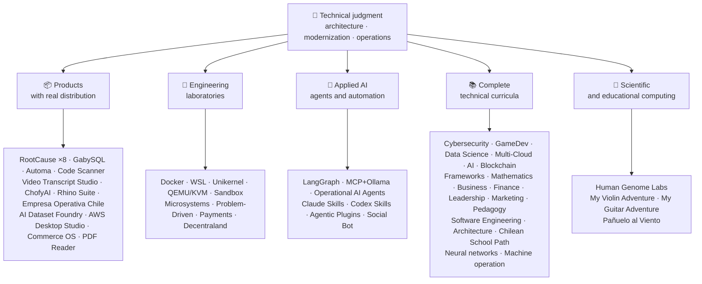

<div align="center">

# 👋Vladimir Acuña

## **Çözüm Mimarı·Senior Full-Stack·Dijital Dönüşüm·Yönetim ve Operasyonlar**

**Bilgisayar Bilimi ve Bilişim Mühendisliği ve İşletmesinde profesyonel olarak eğitilmiş, 16+ yıl bina ve gerçek ortamlarda işletim yazılımı ile. İşi, insanları, süreçleri ve teknolojiyi tasarım, değerlendirme, teslim etmek ve teknik yargı ve operasyonel bir görüşle çözümler sürdürmek için birleştiriyorum - bu GitHub hesabında doğrulanabilir kanıtlarla desteklendi.**

[](https://vladimiracunadev-create.github.io/)
[](https://www.linkedin.com/in/vladimir-acu%C3%B1a-valdebenito-11924a29/)
[](mailto:vladimir.acuna.dev@gmail.com)

[](#profesyonel-kapsam)
[](#gerçek-dağıtım-ile-ürünler)
[](#eksiksiz-teknik-müfredatlar)

<!-- STATS:START -->
[](https://github.com/vladimiracunadev-create?tab=repositories)
[](https://github.com/vladimiracunadev-create?tab=repositories)
[](#bir-bakışta-ekosistem)
[](#eksiksiz-teknik-müfredatlar)
[](https://github.com/vladimiracunadev-create?tab=repositories)
<!-- STATS:END -->

[](https://github.com/vladimiracunadev-create?tab=repositories)
[](https://github.com/vladimiracunadev-create?tab=followers)

[🌐 Portfolio (6 languages)](https://vladimiracunadev-create.github.io/) ·
[🧩 Ecosystem](#bir-bakışta-ekosistem) ·
[⚡ Evaluate me in 10 minutes](#beni-değerlendirmek-için-10-dakikanız-varsa) ·
[✅ Professional scope](#profesyonel-kapsam) ·
[🧭 Non-coding management](#yönetim-yönetim-ve-kariyer-fırsatları) ·
[📋 Role matrix](PROFESIONAL_ROLES.md) ·
[📬 Contact](#iletişim)

**🌐 Tam sürümler:** [Español](README.md) · [English](README.en.md) · [Português](README.pt.md) · [Italiano](README.it.md) · [Français](README.fr.md) · [简体中文](README.zh.md) · [繁體中文](README.zh-TW.md) · [日本語](README.ja.md) · [한국어](README.ko.md) · [Türkçe](README.tr.md) · [Русский](README.ru.md) · [Tiếng Việt](README.vi.md) · [ไทย](README.th.md) · [Deutsch](README.de.md) · [Українська](README.uk.md) · [Polski](README.pl.md) · [العربية](README.ar.md) · [فارسی](README.fa.md) · [Bahasa Indonesia](README.id.md) · [Nederlands](README.nl.md) · [हिन्दी](README.hi.md) · [Ελληνικά](README.el.md)

**Teknik temel:**
PHP 8 PHP 8·Python Python Python Python·Rust·Go Go Go Go Go Go Go Go Go Go Go Go Go Go Go Go Go Go Go Go Go Go Go Go Go Go Go Go Go Go Go Go Go Go Go Go Go Go Go Go Go Go Go Go Go Go Go Go Go Go Go Go Go Go Go Go Go Go Go Go Go Go Go Go Go Go Go Go Go Go Go Go Go Go Go Go Go Go Go Go Go Go Go Go Go Go Go Go Go Go Go Go Go Go Go Go Go Go Go Go Go Go Go Go Go Go Go Go Go Go Go Go Go Go Go Go Go Go Go Go Go Go Go Go Go Go Go Go Go Go Go Go Go Go Go Go Go Go Go Go Go Go Go Go Go Go Go Go Go Go Go Go Go Go Go Go Go Go Go Go Go Go Go Go Go Go Go Go Go Go Go Go Go Go Go Go Go Go Go Go Go Go Go Go Go Go Go Go Go Go Go Go Go Go Go Go Go Go Go Go Go Go Go Go Go Go Go Go Go Go Go Go Go Go Go Go Go Go Go Go Go Go Go Go Go Go Go Go Go Go Go Go Go Go Go Go Go Go Go Go Go Go Go Go Go Go·Node/TS·Java 21·.NET 8·Dart /Flutter·WASM
·AWS·Terraform·Kubernetes·Docker·n8n·LangGraph/MCP·CI /CD·FinOps·Observability

**Business-teknoloji köprüsü:**
Süreç ve gereksinimleri analiz·Çözüm değerlendirme çözümü·teslimat koordinasyon koordinasyon koordinasyon koordinasyon koordinasyonu·Operasyonlar ve Sürekli Süreklilik·Risk Yönetimi Risk Yönetimi·Ürün ve hizmet·Teknik eğitim teknik eğitim

</div>

---

> [!NOTE]
> Bu profil, fırsatlara deneyim haline gelmiyor. Proven teknik deneyim, transfer edilebilir beceriler, uygulanabilir uygulamalar ve gelecekteki gelişim hedefleri açıkça ayrıdır. Linked GitHub kanıtları aşırı ya da belgeseldir; bir şeyin nerede olduğu**Değil değil değil değil değil değil**Tamamlanan, böyle olduğu söylenir.

## 🎯Burada neler bulacaksınız

Bu “bir repo” değil: paylaşılan standartlarla bir ekosistemdir.

- 🔁 **Reproducible demos**- klon, koşmak, doğrulama.
- 🧰 **Standartlaştırılmış araç**- Makefiles, Hub CLI,`doctor`Ve`smoke`per repository.
- 🛡️ **Savunma derinlikte**- gizli tarama, politikalar ve açıkça yasak uygulamalar.
- 📈 **Observability** — `/health`, `/ready`, `/metrics`, panolar ve izlenebilirlik.
- 📚 **İzleyici-aware belgeleri**- işe alımcı, başlangıçta DevOps veya güvenlik, depolara bağlı olarak.
- 📦 **Ürün dağıtım**- indirilebilir sürümler, çekler ve kanıtlar inşa; ticari / mağaza imzaları geçerli olduğunda beklemeye karar verdi.
- 🌍 **Uluslararasılaşma**- 6 dilde portföy (ESES)·EN EN EN EN EN·PT·IT IT IT IT IT IT IT IT IT IT IT IT IT IT IT IT IT IT IT IT IT IT IT IT IT IT IT IT IT IT IT IT IT IT IT IT IT IT IT IT IT IT IT IT IT IT IT IT IT IT IT IT IT IT IT IT IT IT IT IT IT IT·FR FR FR·ZH.
- 🧭 **Teknik dürüstlük**- Her vaka etiketli`OPERATIONAL`, `DOCUMENTED/SCAFFOLD`, ya da`PLANNED`.

## ✅Doğrulanabilir durum

| Yüzey Yüzey Yüzey Yüzey Yüzey Yüzey Yüzey Yüzey Yüzey Yüzey Yüzey Yüzey Yüzey Yüzey Yüzey Yüzey Yüzey Yüzey Yüzey Yüzey Yüzey Yüzey Yüzey Yüzey Yüzey Yüzey Yüzey Yüzey Yüzey Yüzey Yüzey Yüzey Yüzey Yüzey Yüzey Yüzey Yüzey Yüzey Yüzey Yüzey Yüzey Yüzey Yüzey Yüzey Yüzey Yüzey Yüzey Yüzey Yüzey Yüzey Yüzey Yüzey Yüzey Yüzey Yüzey Yüzey Yüzey Yüzey Yüzey Yüzey Yüzey Yüzey Yüzey Yüzey Yüzey Yüzey Yüzey Yüzey Yüzey Yüzey Yüzey Yüzey Yüzey Yüzey Yüzey Yüzey Yüzey Yüzey Yüzey Yüzey Yüzey Yüzey Yüzey Yüzey Yüzey Yüzey Yüzey Yüzey Yüzey Yüzey Yüzey Yüzey Yüzey Yüzey Yüzey Yüzey Yüzey Yüzey Yüzey Yüzey Yüzey Yüzey Yüzey Yüzey Yüzey Yüzey Yüzey Yüzey Yüzey Yüzey Yüzey Yüzey Yüzey Yüzey Yüzey Yüzey Yüzey Yüzey Yüzey Yüzey Yüzey Yüzey Yüzey Yüzey Yüzey Yüzey Yüzey Yüzey Yüzey Yüzey Yüzey Yüzey Yüzey Yüzey Yüzey Yüzey Yüzey Yüzey Yüzey Yüzey Yüzey Yüzey Yüzey Yüzey Yüzey Yüzey Yüzey Yüzey Yüzey Yüzey Yüzey Yüzey Yüzey Yüzey Yüzey Yüzey Yüzey Yüzey Yüzey Yüzey Yüzey Yüzey Yüzey Yüzey Yüzey Yüzey Yüzey Yüzey Yüzey Yüzey Yüzey Yüzey Yüzey Yüzey Yüzey Yüzey Yüzey Yüzey Yüzey Yüzey Yüzey Yüzey Yüzey Yüzey Yüzey Yüzey Yüzey Yüzey Yüzey Yüzey Yüzey Yüzey Yüzey Yüzey Yüzey Yüzey Yüzey Yüzey Yüzey Yüzey Yüzey Yüzey Yüzey Yüzey Yüzey Yüzey Yüzey Yüzey Yüzey Yüzey Yüzey Yüzey Yüzey Yüzey Yüzey Yüzey Yüzey Yüzey Yüzey Yüzey Yüzey Yüzey Yüzey Yüzey Yüzey Yüzey Yüzey Yüzey Yüzey Yüzey Yüzey Yüzey Yüzey Yüzey Yüzey Yüzey Yüzey Yüzey Yüzey Yüzey Yüzey Yüzey Yüzey Yüzey Yüzey Yüzey Yüzey Yüzey Yüzey Yüzey Yüzey Yüzey Yüzey Yüzey Yüzey Yüzey | Beton kanıtı |
|---|---|
| 🧪 **Test kapsamı** | GabySQL**828 test testleri**+ söndürücü**503.8M sorguları**(0 Panik)·Empresa Operativa Chile**158 Test testleri** ·Automa**150 pytest** ·multi-OS CI |
| 🤖 **Üretim-grad ajanlar** | LangGraph RealWorld**25/25 operasyonel geri dönüşler**(kahkahalar 01-25,% 100 kapsama)·Operasyonel AI Agents**13 ajan**with with with with with with with with with with with with with with with with with with with with with with with with with with with with with with with with with with with with with with with with with with with with with with with with with with with with with with with with with with with with with with with with with with with with with with with with with with with with with with with with with with with with with with with with with with with with with with with with with with with with with with with with with with with with with with with with with with with with with with with with with with with with with with with with with with with with with with with with with with with with with with with with with with with with with with with with with with with with with with with with with with with with with with with with with with with with with with with with with with with with with with with with with with with with with with with with with with with with with with with with with with with with with with with with with with with with with with with with with with with with with with with with with with with with with with with with with with with with with with with with with with with with with with with with with with with with with with with with**39 deterministic evals** |
| 🔗 **Polyglot entegrasyonu** | **20 vaka**gönderici→n8n→receiver –**19 Operasyon Operasyon Operasyon 19**Docker ile bireysel olarak denetime alındı –· **18+ DB motorları** · **20+ konteyner** ·11 desen |
| 📦 **Dağıtım Dağıtım Dağıtım Dağıtım Dağıtım Dağıtım Dağıtım Dağıtım Dağıtım Dağıtım** | **151 sürüm sürüm**Bir ekosistem boyunca**64'ü kamu depoları sahip** ·Yüklemeciler ve eserler`.exe` · `.msi` · `.dmg` · `.apk`checksums ile kanıt inşa; ticari / mağaza imzaları, uygulanabilir olan ilerlemede uygulanabilir |
| 🛡️ **Tedarik zinciri** | KodQL·Semgrep·Bandit·Trivy·Grype·Gitleaks·TruffleHog·CycloneDX SBOM·Scorecard |
| 📚 **Curricula** | **14.530 sınıf sınıf sınıf dersleri**21 programda doğrulanabilir, sayılabilir[a workflow](.github/workflows/stats.yml)Gerçek depo yapısı veya depolarda ilan edilen doğrulanabilir bir kaynaktan - el tarafından yazılmamış - el tarafından yazılmamış -·Her program editör statüsünü ve sınırlamalarını ilan ediyor |
| 🌐 **Portföy Portföyü** | Yükleme edilebilir PWA· **6 dil dili** · **36 PDFs**Boru hattı tarafından üretilen·CV Data API·Capacitor Android·Lighthouse 100 |
| 🔒 **Telemetri** | Adli ürünler ve Empresa Operativa Chile'de Sıfır telemetri - her binada doğrulandı (no Android`INTERNET`İzin) |
| 🌐 **Yayınlanmış siteleri** | **56 GitHub Pages siteleri**-55 iniş, bir ürün, program veya ekosistem navigator, artı portföy - her biri kendi depolarından dağıtıldı·56 kişi HTTP ile doğrulandı`200` |

## 🗺️Bir bakışta ekosistem



## 📦Gerçek Dağıtım ile Ürünler

İndirilen yazılımlar, yüklü ve kullanılır - sadece klonlanmış değil.

| Ürün Ürün Ürün Ürün Ürün Ürün Ürün Ürün Ürün | Nedir bu | Stack Stack Stack | Teslimat Teslimatı |
|---|---|---|---|
| [🔍 **RootCause Windows**](https://github.com/vladimiracunadev-create/rootcause-windows-inspector) | Siber güvenlik adlileri: Her anormal kaynak bozulması bir tehditin ilk işareti olabilir. İlk önce Diagnose müdahale etti, daha sonra müdahale et | Rust🦀 ·ETW /WPR | **v0.19.0** · **16 sürüm** · **5 baskı**: GUI·Portatif·(Sla)·PowerShell·VS Kod· [landing](https://vladimiracunadev-create.github.io/rootcause-windows-inspector/) |
| [📱 **RootCause Mobile**](https://github.com/vladimiracunadev-create/rootcause-mobile-inspector) | Mobil sibling: her uygulamayı kendi başına karşılaştıran bir adli sensör, bayraklar stalkerware ve sadece talep edilenlerden ayrı izinler verilir | Flutter·Kotlin·Swift Swift | **v0.8.0** ·Doğrulanabilir Android Plus·5 dil dili· **sıfır telemetri** · [landing](https://vladimiracunadev-create.github.io/rootcause-mobile-inspector/) |
| [🍎 **RootCause macOS**](https://github.com/vladimiracunadev-create/rootcause-macos-inspector) | Macon baskı:`launchd`Süreklilik, kapıcı, SIP, FileVault, X Koruma, TCC izinleri, imzalanmış süreçler ve ağ komşuları - bilinen iyi bir devlet aleyhine kontrol edilen her yüzey | Rust🦀 ·Macon 13+ | **v0.1.0** ·İlk yayınlanan salım serbest salıveren ilk·Apache-2.0· [landing](https://vladimiracunadev-create.github.io/rootcause-macos-inspector/) |
| [🖥️ **RootCause Server**](https://github.com/vladimiracunadev-create/rootcause-server) | Sunucu sibling: tek bir girişin birlikte görmediği şeyi ilişkilendirir - yüzey, erişim-attempt patlamaları, aynı adrese verilen bir seans, kritik dosya bütünlüğü ve sensör sessizliğine - ve bir eylemde bulunulabilir cümle haline getirir | Rust🦀 ·Windows Windows Windows Windows Windows Windows Windows Windows Windows Windows Windows Windows Windows Windows Windows Windows Windows Windows Windows Windows Windows Windows Windows Windows Windows Windows Windows Windows Windows Windows Windows Windows Windows Windows Windows Windows Windows Windows Windows Windows Windows Windows Windows Windows Windows Windows Windows Windows Windows Windows Windows Windows Windows Windows Windows Windows Windows Windows Windows Windows Windows Windows Windows Windows Windows Windows Windows Windows Windows Windows Windows Windows Windows Windows Windows Windows Windows Windows Windows Windows Windows Windows Windows Windows Windows Windows Windows Windows Windows Windows Windows Windows Windows Windows Windows Windows Windows Windows Windows Windows Windows Windows Windows Windows Windows Windows Windows Windows Windows Windows Windows Windows Windows Windows Windows Windows Windows Windows Windows Windows Windows Windows Windows Windows Windows Windows Windows Windows Windows Windows Windows Windows Windows Windows Windows Windows Windows Windows Windows Windows Windows Windows Windows Windows Windows Windows Windows Windows Windows Windows Windows Windows Windows Windows Windows Windows Windows Windows Windows Windows Windows Windows Windows Windows Windows Windows Windows Windows Windows Windows Windows Windows Windows Windows Windows Windows Windows Windows Windows Windows Windows Windows Windows Windows Windows Windows Windows Windows Windows Windows Windows Windows Windows Windows Windows Windows Windows Windows Windows Windows Windows Windows Windows Windows Windows Windows Windows Windows Windows Windows Windows Windows Windows Windows Windows Windows Windows Windows Windows Windows Windows Windows Windows Windows Windows Windows Windows Windows Windows Windows Windows Windows Windows Windows Windows Windows Windows Windows Windows Windows Windows Windows Windows Windows Windows Windows Windows Windows Windows Windows Windows Windows Windows Windows Windows Windows·Linux Linux Linux·MacOS | **v0.2.0** · **18 kural**Kanıtlar ve runbook·Kendi eylemleri asla kendi başına yürütmez·Web bağımlılıksız yerel konsol· **Henüz yayınlanmamış bir serbestlik henüz yayınlanmadı** · [landing](https://vladimiracunadev-create.github.io/rootcause-server/) |
| [🌐 **RootCause Web**](https://github.com/vladimiracunadev-create/rootcause-web-inspector) | Tarayıcı adli sensör: kurabiye, e-posta seansları, uzantılar, indirmeler, izinler ve gerçek bir pencere taklit eden sayfalar | JavaScript JavaScript JavaScript JavaScript JavaScript JavaScript JavaScript JavaScript JavaScript JavaScript JavaScript JavaScript JavaScript JavaScript JavaScript JavaScript JavaScript JavaScript JavaScript JavaScript JavaScript JavaScript JavaScript JavaScript JavaScript JavaScript JavaScript JavaScript JavaScript JavaScript JavaScript JavaScript JavaScript JavaScript JavaScript JavaScript JavaScript JavaScript JavaScript JavaScript JavaScript JavaScript JavaScript JavaScript JavaScript JavaScript JavaScript JavaScript JavaScript JavaScript JavaScript JavaScript JavaScript JavaScript JavaScript JavaScript JavaScript JavaScript JavaScript JavaScript JavaScript JavaScript JavaScript JavaScript JavaScript JavaScript JavaScript JavaScript JavaScript JavaScript JavaScript JavaScript JavaScript JavaScript JavaScript JavaScript JavaScript JavaScript JavaScript JavaScript JavaScript JavaScript JavaScript JavaScript JavaScript JavaScript JavaScript JavaScript JavaScript JavaScript JavaScript JavaScript JavaScript JavaScript JavaScript JavaScript JavaScript JavaScript JavaScript JavaScript JavaScript JavaScript JavaScript JavaScript JavaScript JavaScript JavaScript JavaScript JavaScript JavaScript JavaScript JavaScript JavaScript JavaScript JavaScript JavaScript JavaScript JavaScript JavaScript JavaScript JavaScript JavaScript JavaScript JavaScript JavaScript JavaScript JavaScript JavaScript JavaScript JavaScript JavaScript JavaScript JavaScript JavaScript JavaScript JavaScript JavaScript JavaScript JavaScript JavaScript JavaScript JavaScript JavaScript JavaScript JavaScript JavaScript JavaScript JavaScript JavaScript JavaScript JavaScript JavaScript JavaScript JavaScript JavaScript JavaScript JavaScript JavaScript JavaScript JavaScript JavaScript JavaScript JavaScript JavaScript JavaScript JavaScript JavaScript JavaScript JavaScript JavaScript JavaScript JavaScript JavaScript JavaScript JavaScript JavaScript JavaScript JavaScript JavaScript JavaScript JavaScript JavaScript JavaScript JavaScript JavaScript JavaScript JavaScript JavaScript JavaScript JavaScript JavaScript JavaScript JavaScript JavaScript JavaScript JavaScript JavaScript JavaScript JavaScript JavaScript JavaScript JavaScript JavaScript JavaScript JavaScript JavaScript JavaScript JavaScript JavaScript JavaScript JavaScript JavaScript JavaScript JavaScript JavaScript JavaScript JavaScript JavaScript JavaScript JavaScript JavaScript JavaScript JavaScript JavaScript JavaScript JavaScript JavaScript JavaScript JavaScript JavaScript JavaScript JavaScript JavaScript JavaScript JavaScript JavaScript JavaScript JavaScript JavaScript JavaScript JavaScript JavaScript JavaScript JavaScript JavaScript JavaScript JavaScript JavaScript JavaScript JavaScript JavaScript JavaScript JavaScript JavaScript JavaScript JavaScript·MV3 uzantı | **v0.2.0** ·Henüz yayınlanmamış bir serbestlik henüz yayınlanmadı·Panel on panel on panel on`127.0.0.1` ·sıfır bağımlılık·CI'de doğrulanmış sıfır telemetri· [landing](https://vladimiracunadev-create.github.io/rootcause-web-inspector/) |
| [₿ **RootCause Bitcoin Defense**](https://github.com/vladimiracunadev-create/rootcause-bitcoin-defense) | Bitcoin’in gözaltına alınması için sadece savunma: her anahtarın kökenini icat eder, yayımlanmış uyarılarla geçer ve kanıtla neden açıklar. | JavaScript JavaScript JavaScript JavaScript JavaScript JavaScript JavaScript JavaScript JavaScript JavaScript JavaScript JavaScript JavaScript JavaScript JavaScript JavaScript JavaScript JavaScript JavaScript JavaScript JavaScript JavaScript JavaScript JavaScript JavaScript JavaScript JavaScript JavaScript JavaScript JavaScript JavaScript JavaScript JavaScript JavaScript JavaScript JavaScript JavaScript JavaScript JavaScript JavaScript JavaScript JavaScript JavaScript JavaScript JavaScript JavaScript JavaScript JavaScript JavaScript JavaScript JavaScript JavaScript JavaScript JavaScript JavaScript JavaScript JavaScript JavaScript JavaScript JavaScript JavaScript JavaScript JavaScript JavaScript JavaScript JavaScript JavaScript JavaScript JavaScript JavaScript JavaScript JavaScript JavaScript JavaScript JavaScript JavaScript JavaScript JavaScript JavaScript JavaScript JavaScript JavaScript JavaScript JavaScript JavaScript JavaScript JavaScript JavaScript JavaScript JavaScript JavaScript JavaScript JavaScript JavaScript JavaScript JavaScript JavaScript JavaScript JavaScript JavaScript JavaScript JavaScript JavaScript JavaScript JavaScript JavaScript JavaScript JavaScript JavaScript JavaScript JavaScript JavaScript JavaScript JavaScript JavaScript JavaScript JavaScript JavaScript JavaScript JavaScript JavaScript JavaScript JavaScript JavaScript JavaScript JavaScript JavaScript JavaScript JavaScript JavaScript JavaScript JavaScript JavaScript JavaScript JavaScript JavaScript JavaScript JavaScript JavaScript JavaScript JavaScript JavaScript JavaScript JavaScript JavaScript JavaScript JavaScript JavaScript JavaScript JavaScript JavaScript JavaScript JavaScript JavaScript JavaScript JavaScript JavaScript JavaScript JavaScript JavaScript JavaScript JavaScript JavaScript JavaScript JavaScript JavaScript JavaScript JavaScript JavaScript JavaScript JavaScript JavaScript JavaScript JavaScript JavaScript JavaScript JavaScript JavaScript JavaScript JavaScript JavaScript JavaScript JavaScript JavaScript JavaScript JavaScript JavaScript JavaScript JavaScript JavaScript JavaScript JavaScript JavaScript JavaScript JavaScript JavaScript JavaScript JavaScript JavaScript JavaScript JavaScript JavaScript JavaScript JavaScript JavaScript JavaScript JavaScript JavaScript JavaScript JavaScript JavaScript JavaScript JavaScript JavaScript JavaScript JavaScript JavaScript JavaScript JavaScript JavaScript JavaScript JavaScript JavaScript JavaScript JavaScript JavaScript JavaScript JavaScript JavaScript JavaScript JavaScript JavaScript JavaScript JavaScript JavaScript JavaScript JavaScript JavaScript JavaScript JavaScript JavaScript JavaScript JavaScript JavaScript JavaScript JavaScript JavaScript JavaScript JavaScript JavaScript JavaScript JavaScript JavaScript JavaScript JavaScript JavaScript·Windows uygulaması·yerel panel | **v0.3.0** · **2 sürüm** ·sıfır bağımlılık·Hiçbir zaman tohumları isteme·CI'de doğrulanmış· [landing](https://vladimiracunadev-create.github.io/rootcause-bitcoin-defense/) |
| [⛓️ **RootCause Blockchain Security**](https://github.com/vladimiracunadev-create/rootcause-blockchain-security) | Multi-chain watch-only konsol: mucitler sözleşmeler, proxylar, oracles, köprüler, yönetişim ve bağımlılıklar ve kök-çünkü yönetilen kitaplar üretir ve kök üretirler. | JavaScript JavaScript JavaScript JavaScript JavaScript JavaScript JavaScript JavaScript JavaScript JavaScript JavaScript JavaScript JavaScript JavaScript JavaScript JavaScript JavaScript JavaScript JavaScript JavaScript JavaScript JavaScript JavaScript JavaScript JavaScript JavaScript JavaScript JavaScript JavaScript JavaScript JavaScript JavaScript JavaScript JavaScript JavaScript JavaScript JavaScript JavaScript JavaScript JavaScript JavaScript JavaScript JavaScript JavaScript JavaScript JavaScript JavaScript JavaScript JavaScript JavaScript JavaScript JavaScript JavaScript JavaScript JavaScript JavaScript JavaScript JavaScript JavaScript JavaScript JavaScript JavaScript JavaScript JavaScript JavaScript JavaScript JavaScript JavaScript JavaScript JavaScript JavaScript JavaScript JavaScript JavaScript JavaScript JavaScript JavaScript JavaScript JavaScript JavaScript JavaScript JavaScript JavaScript JavaScript JavaScript JavaScript JavaScript JavaScript JavaScript JavaScript JavaScript JavaScript JavaScript JavaScript JavaScript JavaScript JavaScript JavaScript JavaScript JavaScript JavaScript JavaScript JavaScript JavaScript JavaScript JavaScript JavaScript JavaScript JavaScript JavaScript JavaScript JavaScript JavaScript JavaScript JavaScript JavaScript JavaScript JavaScript JavaScript JavaScript JavaScript JavaScript JavaScript JavaScript JavaScript JavaScript JavaScript JavaScript JavaScript JavaScript JavaScript JavaScript JavaScript JavaScript JavaScript JavaScript JavaScript JavaScript JavaScript JavaScript JavaScript JavaScript JavaScript JavaScript JavaScript JavaScript JavaScript JavaScript JavaScript JavaScript JavaScript JavaScript JavaScript JavaScript JavaScript JavaScript JavaScript JavaScript JavaScript JavaScript JavaScript JavaScript JavaScript JavaScript JavaScript JavaScript JavaScript JavaScript JavaScript JavaScript JavaScript JavaScript JavaScript JavaScript JavaScript JavaScript JavaScript JavaScript JavaScript JavaScript JavaScript JavaScript JavaScript JavaScript JavaScript JavaScript JavaScript JavaScript JavaScript JavaScript JavaScript JavaScript JavaScript JavaScript JavaScript JavaScript JavaScript JavaScript JavaScript JavaScript JavaScript JavaScript JavaScript JavaScript JavaScript JavaScript JavaScript JavaScript JavaScript JavaScript JavaScript JavaScript JavaScript JavaScript JavaScript JavaScript JavaScript JavaScript JavaScript JavaScript JavaScript JavaScript JavaScript JavaScript JavaScript JavaScript JavaScript JavaScript JavaScript JavaScript JavaScript JavaScript JavaScript JavaScript JavaScript JavaScript JavaScript JavaScript JavaScript JavaScript JavaScript JavaScript JavaScript JavaScript JavaScript JavaScript JavaScript JavaScript JavaScript JavaScript JavaScript JavaScript JavaScript JavaScript JavaScript JavaScript·Windows uygulaması·yerel panel | **v0.3.0**In the repository·Yayınlanma:`v0.1.0` ·sıfır bağımlılık·Hiçbir zaman özel anahtarlar için soru sorma·CI'de doğrulanmış· [landing](https://vladimiracunadev-create.github.io/rootcause-blockchain-security/) |
| [📷 **RootCause QR Inspector**](https://github.com/vladimiracunadev-create/rootcause-qr-inspector) | Aktif etmeden önce QR kodları incelemek için yerel Android uygulaması: 26 sinyalleri açıklıyor, hipotezlerden ayrı gerçekler ve kırmızıacted kanıtları ihraç ediyor | Flutter·Dart | **v0.1.4** · **5 sürüm** · **107 test** ·Android Plus·Doğrulanabilir SHA-256·Teknik Pul paketi imzası; ilerlemedeki ticari / mağaza imzaları·sıfır telemetri· [landing](https://vladimiracunadev-create.github.io/rootcause-qr-inspector/) |
| [🏢 **Empresa Operativa Chile**](https://github.com/vladimiracunadev-create/empresa-operativa-chile) | Bir SpA'yı her ay yakın bir yere dahil etmeden önce kılavuzlar: kanıtlarla birlikte, KDV taşıma- ileri, F29 taslak, mutable yakın ve denetim log. Her kural resmi kaynağına işaret eder | JavaScript JavaScript JavaScript JavaScript JavaScript JavaScript JavaScript JavaScript JavaScript JavaScript JavaScript JavaScript JavaScript JavaScript JavaScript JavaScript JavaScript JavaScript JavaScript JavaScript JavaScript JavaScript JavaScript JavaScript JavaScript JavaScript JavaScript JavaScript JavaScript JavaScript JavaScript JavaScript JavaScript JavaScript JavaScript JavaScript JavaScript JavaScript JavaScript JavaScript JavaScript JavaScript JavaScript JavaScript JavaScript JavaScript JavaScript JavaScript JavaScript JavaScript JavaScript JavaScript JavaScript JavaScript JavaScript JavaScript JavaScript JavaScript JavaScript JavaScript JavaScript JavaScript JavaScript JavaScript JavaScript JavaScript JavaScript JavaScript JavaScript JavaScript JavaScript JavaScript JavaScript JavaScript JavaScript JavaScript JavaScript JavaScript JavaScript JavaScript JavaScript JavaScript JavaScript JavaScript JavaScript JavaScript JavaScript JavaScript JavaScript JavaScript JavaScript JavaScript JavaScript JavaScript JavaScript JavaScript JavaScript JavaScript JavaScript JavaScript JavaScript JavaScript JavaScript JavaScript JavaScript JavaScript JavaScript JavaScript JavaScript JavaScript JavaScript JavaScript JavaScript JavaScript JavaScript JavaScript JavaScript JavaScript JavaScript JavaScript JavaScript JavaScript JavaScript JavaScript JavaScript JavaScript JavaScript JavaScript JavaScript JavaScript JavaScript JavaScript JavaScript JavaScript JavaScript JavaScript JavaScript JavaScript JavaScript JavaScript JavaScript JavaScript JavaScript JavaScript JavaScript JavaScript JavaScript JavaScript JavaScript JavaScript JavaScript JavaScript JavaScript JavaScript JavaScript JavaScript JavaScript JavaScript JavaScript JavaScript JavaScript JavaScript JavaScript JavaScript JavaScript JavaScript JavaScript JavaScript JavaScript JavaScript JavaScript JavaScript JavaScript JavaScript JavaScript JavaScript JavaScript JavaScript JavaScript JavaScript JavaScript JavaScript JavaScript JavaScript JavaScript JavaScript JavaScript JavaScript JavaScript JavaScript JavaScript JavaScript JavaScript JavaScript JavaScript JavaScript JavaScript JavaScript JavaScript JavaScript JavaScript JavaScript JavaScript JavaScript JavaScript JavaScript JavaScript JavaScript JavaScript JavaScript JavaScript JavaScript JavaScript JavaScript JavaScript JavaScript JavaScript JavaScript JavaScript JavaScript JavaScript JavaScript JavaScript JavaScript JavaScript JavaScript JavaScript JavaScript JavaScript JavaScript JavaScript JavaScript JavaScript JavaScript JavaScript JavaScript JavaScript JavaScript JavaScript JavaScript JavaScript JavaScript JavaScript JavaScript JavaScript JavaScript JavaScript JavaScript JavaScript JavaScript JavaScript JavaScript JavaScript JavaScript JavaScript JavaScript·Rust·PWA | **v1.5.0** ·Android Android Android Android Android Android Android Android Android Android Android Android Android Android Android Android Android Android Android Android Android Android Android Android Android Android Android Android Android Android Android Android Android Android Android Android Android Android Android Android Android Android Android Android Android Android Android Android Android Android Android Android Android Android Android Android Android Android Android Android Android Android Android Android Android Android Android Android Android Android Android Android Android Android Android Android Android Android Android Android Android Android Android Android Android Android Android Android Android Android Android Android Android Android Android Android Android Android Android Android Android Android Android Android Android Android Android Android Android Android Android Android Android Android Android Android Android Android Android Android Android Android Android Android Android Android Android Android Android Android Android Android Android Android Android Android Android Android Android Android Android Android Android Android Android Android Android Android Android Android Android Android Android Android Android Android Android Android Android Android Android Android Android Android Android Android Android Android Android Android Android Android Android Android Android Android Android Android Android Android Android Android Android Android Android Android Android Android Android Android Android Android Android Android Android Android Android Android Android Android Android Android Android Android Android Android Android Android Android Android Android Android Android Android Android Android Android Android Android Android Android Android Android Android Android Android Android Android Android Android Android Android Android Android Android Android Android Android Android Android Android Android Android Android Android Android Android Android Android Android Android Android Android Android Android Android·Windows Windows Windows Windows Windows Windows Windows Windows Windows Windows Windows Windows Windows Windows Windows Windows Windows Windows Windows Windows Windows Windows Windows Windows Windows Windows Windows Windows Windows Windows Windows Windows Windows Windows Windows Windows Windows Windows Windows Windows Windows Windows Windows Windows Windows Windows Windows Windows Windows Windows Windows Windows Windows Windows Windows Windows Windows Windows Windows Windows Windows Windows Windows Windows Windows Windows Windows Windows Windows Windows Windows Windows Windows Windows Windows Windows Windows Windows Windows Windows Windows Windows Windows Windows Windows Windows Windows Windows Windows Windows Windows Windows Windows Windows Windows Windows Windows Windows Windows Windows Windows Windows Windows Windows Windows Windows Windows Windows Windows Windows Windows Windows Windows Windows Windows Windows Windows Windows Windows Windows Windows Windows Windows Windows Windows Windows Windows Windows Windows Windows Windows Windows Windows Windows Windows Windows Windows Windows Windows Windows Windows Windows Windows Windows Windows Windows Windows Windows Windows Windows Windows Windows Windows Windows Windows Windows Windows Windows Windows Windows Windows Windows Windows Windows Windows Windows Windows Windows Windows Windows Windows Windows Windows Windows Windows Windows Windows Windows Windows Windows Windows Windows Windows Windows Windows Windows Windows Windows Windows Windows Windows Windows Windows Windows Windows Windows Windows Windows Windows Windows Windows Windows Windows Windows Windows Windows Windows Windows Windows Windows Windows Windows Windows Windows Windows Windows Windows Windows Windows Windows Windows Windows Windows Windows Windows Windows Windows Windows Windows Windows Windows Windows Windows Windows Windows Windows Windows Windows Windows Windows Windows Windows Windows Windows Windows Windows Windows Windows Windows Windows Windows Windows Windows Windows Windows Windows·tarayıcı tarayıcı tarayıcı tarayıcı tarayıcı tarayıcı tarayıcı tarayıcı tarayıcı tarayıcı tarayıcı tarayıcı tarayıcı tarayıcı tarayıcı tarayıcı tarayıcı tarayıcı tarayıcı tarayıcı tarayıcı tarayıcı tarayıcı tarayıcı tarayıcı tarayıcı tarayıcı tarayıcı tarayıcı tarayıcı tarayıcı tarayıcı tarayıcı tarayıcı tarayıcı tarayıcı tarayıcı tarayıcı tarayıcı tarayıcı tarayıcı tarayıcı tarayıcı tarayıcı tarayıcı tarayıcı tarayıcı tarayıcı tarayıcı tarayıcı tarayıcı tarayıcı tarayıcı tarayıcı tarayıcı tarayıcı tarayıcı tarayıcı tarayıcı tarayıcı tarayıcı tarayıcı tarayıcı tarayıcı tarayıcı tarayıcı tarayıcı tarayıcı tarayıcı tarayıcı tarayıcı tarayıcı tarayıcı tarayıcı tarayıcı tarayıcı tarayıcı tarayıcı tarayıcı tarayıcı tarayıcı tarayıcı tarayıcı tarayıcı tarayıcı tarayıcı tarayıcı tarayıcı tarayıcı tarayıcı tarayıcı tarayıcı tarayıcı tarayıcı tarayıcı tarayıcı tarayıcı tarayıcı tarayıcı tarayıcı tarayıcı tarayıcı tarayıcı tarayıcı tarayıcı tarayıcı tarayıcı tarayıcı tarayıcı tarayıcı tarayıcı tarayıcı tarayıcı tarayıcı tarayıcı tarayıcı tarayıcı tarayıcı tarayıcı tarayıcı tarayıcı tarayıcı tarayıcı tarayıcı tarayıcı tarayıcı tarayıcı tarayıcı tarayıcı tarayıcı tarayıcı tarayıcı tarayıcı tarayıcı tarayıcı tarayıcı tarayıcı· **158 Test testleri** · **0 üretim bağımlılıklara bağlı** ·sıfır telemetri· [landing](https://vladimiracunadev-create.github.io/empresa-operativa-chile/) |
| [🔍 **Universal Code Scanner**](https://github.com/vladimiracunadev-create/universal-code-scanner) | QR ve barkod okuyucusu**Hareket etmeden önce yorumlar**: 16 yerel URL risk sinyalleri ve açık onay | Flutter·Dart | **v1.1.0** ·Android Android Android Android Android Android Android Android Android Android Android Android Android Android Android Android Android Android Android Android Android Android Android Android Android Android Android Android Android Android Android Android Android Android Android Android Android Android Android Android Android Android Android Android Android Android Android Android Android Android Android Android Android Android Android Android Android Android Android Android Android Android Android Android Android Android Android Android Android Android Android Android Android Android Android Android Android Android Android Android Android Android Android Android Android Android Android Android Android Android Android Android Android Android Android Android Android Android Android Android Android Android Android Android Android Android Android Android Android Android Android Android Android Android Android Android Android Android Android Android Android Android Android Android Android Android Android Android Android Android Android Android Android Android Android Android Android Android Android Android Android Android Android Android Android Android Android Android Android Android Android Android Android Android Android Android Android Android Android Android Android Android Android Android Android Android Android Android Android Android Android Android Android Android Android Android Android Android Android Android Android Android Android Android Android Android Android Android Android Android Android Android Android Android Android Android Android Android Android Android Android Android Android Android Android Android Android Android Android Android Android Android Android Android Android Android Android Android Android Android Android Android Android Android Android Android Android Android Android Android Android Android Android Android Android Android Android Android Android Android Android Android Android Android Android Android Android Android Android Android Android Android Android Android Android Android·iOS iOS iOS iOS iOS iOS iOS iOS iOS iOS iOS iOS iOS iOS iOS iOS iOS iOS iOS iOS iOS iOS iOS iOS iOS iOS iOS iOS iOS iOS iOS iOS iOS iOS iOS iOS iOS iOS iOS iOS iOS iOS iOS iOS iOS iOS iOS iOS iOS iOS iOS iOS iOS iOS iOS iOS iOS iOS iOS iOS iOS iOS iOS iOS iOS iOS iOS iOS iOS iOS iOS iOS iOS iOS iOS iOS iOS iOS iOS iOS iOS iOS iOS iOS iOS iOS iOS iOS iOS iOS iOS iOS iOS iOS iOS iOS iOS iOS iOS iOS iOS iOS iOS iOS iOS iOS iOS iOS iOS iOS iOS iOS iOS iOS iOS iOS iOS iOS iOS iOS iOS iOS iOS iOS iOS iOS iOS iOS iOS iOS iOS iOS iOS iOS iOS iOS iOS iOS iOS iOS iOS iOS iOS iOS iOS iOS iOS iOS iOS iOS iOS iOS iOS iOS iOS iOS iOS iOS iOS iOS iOS iOS iOS iOS iOS iOS iOS iOS iOS iOS iOS iOS iOS iOS iOS iOS iOS iOS iOS iOS iOS iOS iOS iOS iOS iOS iOS iOS iOS iOS iOS iOS iOS iOS iOS iOS iOS iOS iOS iOS iOS iOS iOS iOS iOS iOS iOS iOS iOS iOS iOS iOS iOS iOS iOS iOS iOS iOS iOS iOS iOS iOS iOS iOS iOS iOS iOS iOS iOS iOS iOS iOS iOS iOS iOS iOS iOS iOS iOS iOS iOS iOS iOS iOS iOS iOS iOS iOS iOS iOS iOS iOS iOS iOS iOS iOS·MacOS·PWA·Şifreli tarih**AES-256-GCM** · [landing](https://vladimiracunadev-create.github.io/universal-code-scanner/) |
| [🗄️ **GabySQL**](https://github.com/vladimiracunadev-create/gabysql) | Gömülü veritabanı: tek tek tek tek`.db`Dosya, WAL, maliyet tabanlı optimize, HTTP/JSON API | Rust🦀 | Windows Windows Windows Windows Windows Windows Windows Windows Windows Windows Windows Windows Windows Windows Windows Windows Windows Windows Windows Windows Windows Windows Windows Windows Windows Windows Windows Windows Windows Windows Windows Windows Windows Windows Windows Windows Windows Windows Windows Windows Windows Windows Windows Windows Windows Windows Windows Windows Windows Windows Windows Windows Windows Windows Windows Windows Windows Windows Windows Windows Windows Windows Windows Windows Windows Windows Windows Windows Windows Windows Windows Windows Windows Windows Windows Windows Windows Windows Windows Windows Windows Windows Windows Windows Windows Windows Windows Windows Windows Windows Windows Windows Windows Windows Windows Windows Windows Windows Windows Windows Windows Windows Windows Windows Windows Windows Windows Windows Windows Windows Windows Windows Windows Windows Windows Windows Windows Windows Windows Windows Windows Windows Windows Windows Windows Windows Windows Windows Windows Windows Windows Windows Windows Windows Windows Windows Windows Windows Windows Windows Windows Windows Windows Windows Windows Windows Windows Windows Windows Windows Windows Windows Windows Windows Windows Windows Windows Windows Windows Windows Windows Windows Windows Windows Windows Windows Windows Windows Windows Windows Windows Windows Windows Windows Windows Windows Windows Windows Windows Windows Windows Windows Windows Windows Windows Windows Windows Windows Windows Windows Windows Windows Windows Windows Windows Windows Windows Windows Windows Windows Windows Windows Windows Windows Windows Windows Windows Windows Windows Windows Windows Windows Windows Windows Windows Windows Windows Windows Windows Windows Windows Windows Windows Windows Windows Windows Windows Windows Windows Windows Windows Windows Windows Windows Windows Windows Windows Windows Windows Windows Windows Windows Windows Windows Windows Windows Windows Windows Windows Windows Windows Windows Windows Windows Windows Windows·MacOS·Linux Linux Linux· [landing](https://vladimiracunadev-create.github.io/gabysql/) |
| [🤖 **Automa PC**](https://github.com/vladimiracunadev-create/automa-pc) | Yerel orkestracı: JSON gerçek pencereleri açan, DOM ile etkileşime girer ve kanıtları bırakın | Python Python Python Python·Playwright·pywebview | **v0.3.0** · **27 akış akış akış** ·Yayınlanmış ve doğrulanabilir yükleyici· [landing](https://vladimiracunadev-create.github.io/automa-pc/) |
| [🏭 **AI Dataset Foundry**](https://github.com/vladimiracunadev-create/ai-dataset-foundry) | PDF, Word, web, Git, JSON ve CSV'ı ön eğitim, iyi eğitim, RAG ve değerlendirme için denetim edilebilir veri setlerine dönüştüren yerel ilk fabrika, RAG ve değerlendirme | Python Python Python Python | **v0.2.0** ·Windows + çevrimdışı Android·İlk yayınlanan salım serbest salıveren ilk· [landing](https://vladimiracunadev-create.github.io/ai-dataset-foundry/) |
| [☁️ **AWS Desktop Studio**](https://github.com/vladimiracunadev-create/aws-desktop-studio) | 15 AWS envanter entegrasyonları ile yerel ilk uygulama, 20 öğretici, K/SSO ve sadece varsayılanları; ilerlemede uygulama, evrensel erişim değil, evrensel erişimde uygulama; | JavaScript JavaScript JavaScript JavaScript JavaScript JavaScript JavaScript JavaScript JavaScript JavaScript JavaScript JavaScript JavaScript JavaScript JavaScript JavaScript JavaScript JavaScript JavaScript JavaScript JavaScript JavaScript JavaScript JavaScript JavaScript JavaScript JavaScript JavaScript JavaScript JavaScript JavaScript JavaScript JavaScript JavaScript JavaScript JavaScript JavaScript JavaScript JavaScript JavaScript JavaScript JavaScript JavaScript JavaScript JavaScript JavaScript JavaScript JavaScript JavaScript JavaScript JavaScript JavaScript JavaScript JavaScript JavaScript JavaScript JavaScript JavaScript JavaScript JavaScript JavaScript JavaScript JavaScript JavaScript JavaScript JavaScript JavaScript JavaScript JavaScript JavaScript JavaScript JavaScript JavaScript JavaScript JavaScript JavaScript JavaScript JavaScript JavaScript JavaScript JavaScript JavaScript JavaScript JavaScript JavaScript JavaScript JavaScript JavaScript JavaScript JavaScript JavaScript JavaScript JavaScript JavaScript JavaScript JavaScript JavaScript JavaScript JavaScript JavaScript JavaScript JavaScript JavaScript JavaScript JavaScript JavaScript JavaScript JavaScript JavaScript JavaScript JavaScript JavaScript JavaScript JavaScript JavaScript JavaScript JavaScript JavaScript JavaScript JavaScript JavaScript JavaScript JavaScript JavaScript JavaScript JavaScript JavaScript JavaScript JavaScript JavaScript JavaScript JavaScript JavaScript JavaScript JavaScript JavaScript JavaScript JavaScript JavaScript JavaScript JavaScript JavaScript JavaScript JavaScript JavaScript JavaScript JavaScript JavaScript JavaScript JavaScript JavaScript JavaScript JavaScript JavaScript JavaScript JavaScript JavaScript JavaScript JavaScript JavaScript JavaScript JavaScript JavaScript JavaScript JavaScript JavaScript JavaScript JavaScript JavaScript JavaScript JavaScript JavaScript JavaScript JavaScript JavaScript JavaScript JavaScript JavaScript JavaScript JavaScript JavaScript JavaScript JavaScript JavaScript JavaScript JavaScript JavaScript JavaScript JavaScript JavaScript JavaScript JavaScript JavaScript JavaScript JavaScript JavaScript JavaScript JavaScript JavaScript JavaScript JavaScript JavaScript JavaScript JavaScript JavaScript JavaScript JavaScript JavaScript JavaScript JavaScript JavaScript JavaScript JavaScript JavaScript JavaScript JavaScript JavaScript JavaScript JavaScript JavaScript JavaScript JavaScript JavaScript JavaScript JavaScript JavaScript JavaScript JavaScript JavaScript JavaScript JavaScript JavaScript JavaScript JavaScript JavaScript JavaScript JavaScript JavaScript JavaScript JavaScript JavaScript JavaScript JavaScript JavaScript JavaScript JavaScript JavaScript JavaScript JavaScript JavaScript JavaScript JavaScript JavaScript JavaScript JavaScript JavaScript·Windows Windows Windows Windows Windows Windows Windows Windows Windows Windows Windows Windows Windows Windows Windows Windows Windows Windows Windows Windows Windows Windows Windows Windows Windows Windows Windows Windows Windows Windows Windows Windows Windows Windows Windows Windows Windows Windows Windows Windows Windows Windows Windows Windows Windows Windows Windows Windows Windows Windows Windows Windows Windows Windows Windows Windows Windows Windows Windows Windows Windows Windows Windows Windows Windows Windows Windows Windows Windows Windows Windows Windows Windows Windows Windows Windows Windows Windows Windows Windows Windows Windows Windows Windows Windows Windows Windows Windows Windows Windows Windows Windows Windows Windows Windows Windows Windows Windows Windows Windows Windows Windows Windows Windows Windows Windows Windows Windows Windows Windows Windows Windows Windows Windows Windows Windows Windows Windows Windows Windows Windows Windows Windows Windows Windows Windows Windows Windows Windows Windows Windows Windows Windows Windows Windows Windows Windows Windows Windows Windows Windows Windows Windows Windows Windows Windows Windows Windows Windows Windows Windows Windows Windows Windows Windows Windows Windows Windows Windows Windows Windows Windows Windows Windows Windows Windows Windows Windows Windows Windows Windows Windows Windows Windows Windows Windows Windows Windows Windows Windows Windows Windows Windows Windows Windows Windows Windows Windows Windows Windows Windows Windows Windows Windows Windows Windows Windows Windows Windows Windows Windows Windows Windows Windows Windows Windows Windows Windows Windows Windows Windows Windows Windows Windows Windows Windows Windows Windows Windows Windows Windows Windows Windows Windows Windows Windows Windows Windows Windows Windows Windows Windows Windows Windows Windows Windows Windows Windows Windows Windows Windows Windows Windows Windows Windows Windows Windows Windows Windows Windows Windows Windows Windows Windows Windows Windows | **v0.1.1** ·İlk yayınlanan salım serbest salıveren ilk· [landing](https://vladimiracunadev-create.github.io/aws-desktop-studio/) |
| [🧭 **Commerce OS**](https://github.com/vladimiracunadev-create/commerce-operating-system) | Ticari operasyonların kavramsal demolarını gözden geçirin: katalog, stok, CRM, siparişler, suç ödemeleri ve izlenebilirlik | JavaScript JavaScript JavaScript JavaScript JavaScript JavaScript JavaScript JavaScript JavaScript JavaScript JavaScript JavaScript JavaScript JavaScript JavaScript JavaScript JavaScript JavaScript JavaScript JavaScript JavaScript JavaScript JavaScript JavaScript JavaScript JavaScript JavaScript JavaScript JavaScript JavaScript JavaScript JavaScript JavaScript JavaScript JavaScript JavaScript JavaScript JavaScript JavaScript JavaScript JavaScript JavaScript JavaScript JavaScript JavaScript JavaScript JavaScript JavaScript JavaScript JavaScript JavaScript JavaScript JavaScript JavaScript JavaScript JavaScript JavaScript JavaScript JavaScript JavaScript JavaScript JavaScript JavaScript JavaScript JavaScript JavaScript JavaScript JavaScript JavaScript JavaScript JavaScript JavaScript JavaScript JavaScript JavaScript JavaScript JavaScript JavaScript JavaScript JavaScript JavaScript JavaScript JavaScript JavaScript JavaScript JavaScript JavaScript JavaScript JavaScript JavaScript JavaScript JavaScript JavaScript JavaScript JavaScript JavaScript JavaScript JavaScript JavaScript JavaScript JavaScript JavaScript JavaScript JavaScript JavaScript JavaScript JavaScript JavaScript JavaScript JavaScript JavaScript JavaScript JavaScript JavaScript JavaScript JavaScript JavaScript JavaScript JavaScript JavaScript JavaScript JavaScript JavaScript JavaScript JavaScript JavaScript JavaScript JavaScript JavaScript JavaScript JavaScript JavaScript JavaScript JavaScript JavaScript JavaScript JavaScript JavaScript JavaScript JavaScript JavaScript JavaScript JavaScript JavaScript JavaScript JavaScript JavaScript JavaScript JavaScript JavaScript JavaScript JavaScript JavaScript JavaScript JavaScript JavaScript JavaScript JavaScript JavaScript JavaScript JavaScript JavaScript JavaScript JavaScript JavaScript JavaScript JavaScript JavaScript JavaScript JavaScript JavaScript JavaScript JavaScript JavaScript JavaScript JavaScript JavaScript JavaScript JavaScript JavaScript JavaScript JavaScript JavaScript JavaScript JavaScript JavaScript JavaScript JavaScript JavaScript JavaScript JavaScript JavaScript JavaScript JavaScript JavaScript JavaScript JavaScript JavaScript JavaScript JavaScript JavaScript JavaScript JavaScript JavaScript JavaScript JavaScript JavaScript JavaScript JavaScript JavaScript JavaScript JavaScript JavaScript JavaScript JavaScript JavaScript JavaScript JavaScript JavaScript JavaScript JavaScript JavaScript JavaScript JavaScript JavaScript JavaScript JavaScript JavaScript JavaScript JavaScript JavaScript JavaScript JavaScript JavaScript JavaScript JavaScript JavaScript JavaScript JavaScript JavaScript JavaScript JavaScript JavaScript JavaScript JavaScript JavaScript JavaScript JavaScript JavaScript JavaScript JavaScript JavaScript JavaScript JavaScript JavaScript JavaScript·Web Web Web Web Web Web Web Web Web Web Web Web Web Web Web Web Web Web Web Web Web Web Web Web Web Web Web Web Web Web Web Web Web Web Web Web Web Web Web Web Web Web Web Web Web Web Web Web Web Web Web Web Web Web Web Web Web Web Web Web Web Web Web Web Web Web Web Web Web Web Web Web Web Web Web Web Web Web Web Web Web Web Web Web Web Web Web Web Web Web Web Web Web Web Web Web Web Web Web Web Web Web Web Web Web Web Web Web Web Web Web Web Web Web Web Web Web Web Web Web Web Web Web Web Web Web Web Web Web Web Web Web Web Web Web Web Web Web Web Web Web Web Web Web Web Web Web Web Web Web Web Web Web Web Web Web Web Web Web Web Web Web Web Web Web Web Web Web Web Web Web Web Web Web Web Web Web Web Web Web Web Web Web Web Web Web Web Web Web Web Web Web Web Web Web Web Web Web Web Web Web Web Web Web Web Web Web Web Web Web Web Web Web Web Web Web Web Web Web Web Web Web Web Web Web Web Web Web Web Web Web Web Web Web Web Web Web Web Web Web Web Web Web Web Web Web Web Web Web Web Web Web Web Web Web Web·Windows Windows Windows Windows Windows Windows Windows Windows Windows Windows Windows Windows Windows Windows Windows Windows Windows Windows Windows Windows Windows Windows Windows Windows Windows Windows Windows Windows Windows Windows Windows Windows Windows Windows Windows Windows Windows Windows Windows Windows Windows Windows Windows Windows Windows Windows Windows Windows Windows Windows Windows Windows Windows Windows Windows Windows Windows Windows Windows Windows Windows Windows Windows Windows Windows Windows Windows Windows Windows Windows Windows Windows Windows Windows Windows Windows Windows Windows Windows Windows Windows Windows Windows Windows Windows Windows Windows Windows Windows Windows Windows Windows Windows Windows Windows Windows Windows Windows Windows Windows Windows Windows Windows Windows Windows Windows Windows Windows Windows Windows Windows Windows Windows Windows Windows Windows Windows Windows Windows Windows Windows Windows Windows Windows Windows Windows Windows Windows Windows Windows Windows Windows Windows Windows Windows Windows Windows Windows Windows Windows Windows Windows Windows Windows Windows Windows Windows Windows Windows Windows Windows Windows Windows Windows Windows Windows Windows Windows Windows Windows Windows Windows Windows Windows Windows Windows Windows Windows Windows Windows Windows Windows Windows Windows Windows Windows Windows Windows Windows Windows Windows Windows Windows Windows Windows Windows Windows Windows Windows Windows Windows Windows Windows Windows Windows Windows Windows Windows Windows Windows Windows Windows Windows Windows Windows Windows Windows Windows Windows Windows Windows Windows Windows Windows Windows Windows Windows Windows Windows Windows Windows Windows Windows Windows Windows Windows Windows Windows Windows Windows Windows Windows Windows Windows Windows Windows Windows Windows Windows Windows Windows Windows Windows Windows Windows Windows Windows Windows Windows Windows Windows Windows Windows Windows Windows Windows·Android Android Android Android Android Android Android Android Android Android Android Android Android Android Android Android Android Android Android Android Android Android Android Android Android Android Android Android Android Android Android Android Android Android Android Android Android Android Android Android Android Android Android Android Android Android Android Android Android Android Android Android Android Android Android Android Android Android Android Android Android Android Android Android Android Android Android Android Android Android Android Android Android Android Android Android Android Android Android Android Android Android Android Android Android Android Android Android Android Android Android Android Android Android Android Android Android Android Android Android Android Android Android Android Android Android Android Android Android Android Android Android Android Android Android Android Android Android Android Android Android Android Android Android Android Android Android Android Android Android Android Android Android Android Android Android Android Android Android Android Android Android Android Android Android Android Android Android Android Android Android Android Android Android Android Android Android Android Android Android Android Android Android Android Android Android Android Android Android Android Android Android Android Android Android Android Android Android Android Android Android Android Android Android Android Android Android Android Android Android Android Android Android Android Android Android Android Android Android Android Android Android Android Android Android Android Android Android Android Android Android Android Android Android Android Android Android Android Android Android Android Android Android Android Android Android Android Android Android Android Android Android Android Android Android Android Android Android Android Android Android Android Android Android Android Android Android Android Android Android Android Android Android Android Android Android | **v0.3.0** · **2 sürüm** ·Gerçek para veya Şili vergi otoritesi entegrasyon· [landing](https://vladimiracunadev-create.github.io/commerce-operating-system/) |
| [📄 **PDF Reader**](https://github.com/vladimiracunadev-create/pdf-reader-windows-android) | Android-ilk yerel okuma-sadece okuyucu, no-crop zoom, yenidenlanabilir tarih, WhatsApp paylaşımı ve varsayılan seçim | HTML HTML HTML HTML HTML HTML HTML HTML HTML HTML HTML HTML HTML HTML HTML HTML HTML HTML HTML HTML HTML HTML HTML HTML HTML HTML HTML HTML HTML HTML HTML HTML HTML HTML HTML HTML HTML HTML HTML HTML HTML HTML HTML HTML HTML HTML HTML HTML HTML HTML HTML HTML HTML HTML HTML HTML HTML HTML HTML HTML HTML HTML HTML HTML HTML HTML HTML HTML HTML HTML HTML HTML HTML HTML HTML HTML HTML HTML HTML HTML HTML HTML HTML HTML HTML HTML HTML HTML HTML HTML HTML HTML HTML HTML HTML HTML HTML HTML HTML HTML HTML HTML HTML HTML HTML HTML HTML HTML HTML HTML HTML HTML HTML HTML HTML HTML HTML HTML HTML HTML HTML HTML HTML HTML HTML HTML HTML HTML HTML HTML HTML HTML HTML HTML HTML HTML HTML HTML HTML HTML HTML HTML HTML HTML HTML HTML HTML HTML HTML HTML HTML HTML HTML HTML HTML HTML HTML HTML HTML HTML HTML HTML HTML HTML HTML HTML HTML HTML HTML HTML HTML HTML HTML HTML HTML HTML HTML HTML HTML HTML HTML HTML HTML HTML HTML HTML HTML HTML HTML HTML HTML HTML HTML HTML HTML HTML HTML HTML HTML HTML HTML HTML HTML HTML HTML HTML HTML HTML HTML HTML HTML HTML HTML HTML HTML HTML HTML HTML HTML HTML HTML HTML HTML HTML HTML HTML HTML HTML HTML HTML HTML HTML HTML HTML HTML HTML HTML HTML HTML HTML HTML HTML HTML HTML HTML HTML HTML HTML HTML HTML HTML HTML HTML HTML HTML HTML·Web Web Web Web Web Web Web Web Web Web Web Web Web Web Web Web Web Web Web Web Web Web Web Web Web Web Web Web Web Web Web Web Web Web Web Web Web Web Web Web Web Web Web Web Web Web Web Web Web Web Web Web Web Web Web Web Web Web Web Web Web Web Web Web Web Web Web Web Web Web Web Web Web Web Web Web Web Web Web Web Web Web Web Web Web Web Web Web Web Web Web Web Web Web Web Web Web Web Web Web Web Web Web Web Web Web Web Web Web Web Web Web Web Web Web Web Web Web Web Web Web Web Web Web Web Web Web Web Web Web Web Web Web Web Web Web Web Web Web Web Web Web Web Web Web Web Web Web Web Web Web Web Web Web Web Web Web Web Web Web Web Web Web Web Web Web Web Web Web Web Web Web Web Web Web Web Web Web Web Web Web Web Web Web Web Web Web Web Web Web Web Web Web Web Web Web Web Web Web Web Web Web Web Web Web Web Web Web Web Web Web Web Web Web Web Web Web Web Web Web Web Web Web Web Web Web Web Web Web Web Web Web Web Web Web Web Web Web Web Web Web Web Web Web Web Web Web Web Web Web Web Web Web Web Web Web·Android Android Android Android Android Android Android Android Android Android Android Android Android Android Android Android Android Android Android Android Android Android Android Android Android Android Android Android Android Android Android Android Android Android Android Android Android Android Android Android Android Android Android Android Android Android Android Android Android Android Android Android Android Android Android Android Android Android Android Android Android Android Android Android Android Android Android Android Android Android Android Android Android Android Android Android Android Android Android Android Android Android Android Android Android Android Android Android Android Android Android Android Android Android Android Android Android Android Android Android Android Android Android Android Android Android Android Android Android Android Android Android Android Android Android Android Android Android Android Android Android Android Android Android Android Android Android Android Android Android Android Android Android Android Android Android Android Android Android Android Android Android Android Android Android Android Android Android Android Android Android Android Android Android Android Android Android Android Android Android Android Android Android Android Android Android Android Android Android Android Android Android Android Android Android Android Android Android Android Android Android Android Android Android Android Android Android Android Android Android Android Android Android Android Android Android Android Android Android Android Android Android Android Android Android Android Android Android Android Android Android Android Android Android Android Android Android Android Android Android Android Android Android Android Android Android Android Android Android Android Android Android Android Android Android Android Android Android Android Android Android Android Android Android Android Android Android Android Android Android Android Android Android Android Android Android·Windows Windows Windows Windows Windows Windows Windows Windows Windows Windows Windows Windows Windows Windows Windows Windows Windows Windows Windows Windows Windows Windows Windows Windows Windows Windows Windows Windows Windows Windows Windows Windows Windows Windows Windows Windows Windows Windows Windows Windows Windows Windows Windows Windows Windows Windows Windows Windows Windows Windows Windows Windows Windows Windows Windows Windows Windows Windows Windows Windows Windows Windows Windows Windows Windows Windows Windows Windows Windows Windows Windows Windows Windows Windows Windows Windows Windows Windows Windows Windows Windows Windows Windows Windows Windows Windows Windows Windows Windows Windows Windows Windows Windows Windows Windows Windows Windows Windows Windows Windows Windows Windows Windows Windows Windows Windows Windows Windows Windows Windows Windows Windows Windows Windows Windows Windows Windows Windows Windows Windows Windows Windows Windows Windows Windows Windows Windows Windows Windows Windows Windows Windows Windows Windows Windows Windows Windows Windows Windows Windows Windows Windows Windows Windows Windows Windows Windows Windows Windows Windows Windows Windows Windows Windows Windows Windows Windows Windows Windows Windows Windows Windows Windows Windows Windows Windows Windows Windows Windows Windows Windows Windows Windows Windows Windows Windows Windows Windows Windows Windows Windows Windows Windows Windows Windows Windows Windows Windows Windows Windows Windows Windows Windows Windows Windows Windows Windows Windows Windows Windows Windows Windows Windows Windows Windows Windows Windows Windows Windows Windows Windows Windows Windows Windows Windows Windows Windows Windows Windows Windows Windows Windows Windows Windows Windows Windows Windows Windows Windows Windows Windows Windows Windows Windows Windows Windows Windows Windows Windows Windows Windows Windows Windows Windows Windows Windows Windows Windows Windows Windows Windows Windows Windows Windows Windows Windows | **v0.3.3** ·İmzalanmış Pul·Hesap yok, hassas izinler veya telemetri· [landing](https://vladimiracunadev-create.github.io/pdf-reader-windows-android/) |
| [🎙️ **Video Transcript Studio**](https://github.com/vladimiracunadev-create/video-transcript-studio) | Bir video, listeler, veya**Tüm YouTube kanalı**Zamanlar ile metin. Mevcut alt başlıklara güvenmez: Whisper seslerini tanır**makinenizde**Ancak API, hesap veya yapılandırma anahtarı ile | Python Python Python Python·Pisa6·Hızlı API·Daha hızlı-whisper | **v0.2.0** ·Windows masaüstü + yerel panel`127.0.0.1`+**Aynı kuyruğu paylaşmak** ·MD MD MD MD MD MD MD·PDF PDF PDF PDF PDF PDF PDF PDF PDF PDF PDF PDF PDF PDF PDF PDF PDF PDF PDF PDF PDF PDF PDF PDF PDF PDF PDF PDF PDF PDF PDF PDF PDF PDF PDF PDF PDF PDF PDF PDF PDF PDF PDF PDF PDF PDF PDF PDF PDF PDF PDF PDF PDF PDF PDF PDF PDF PDF PDF PDF PDF PDF PDF PDF PDF PDF PDF PDF PDF PDF PDF PDF PDF PDF PDF PDF PDF PDF PDF PDF PDF PDF PDF PDF PDF PDF PDF PDF PDF PDF PDF PDF PDF PDF PDF PDF PDF PDF PDF PDF PDF PDF PDF PDF PDF PDF PDF PDF PDF PDF PDF PDF PDF PDF PDF PDF PDF PDF PDF PDF PDF PDF PDF PDF PDF PDF PDF PDF PDF PDF PDF PDF PDF PDF PDF PDF PDF PDF PDF PDF PDF PDF PDF PDF PDF PDF PDF PDF PDF PDF PDF PDF PDF PDF PDF PDF PDF PDF PDF PDF PDF PDF PDF PDF PDF PDF PDF PDF PDF PDF PDF PDF PDF PDF PDF PDF PDF PDF PDF PDF PDF PDF PDF PDF PDF PDF PDF PDF PDF PDF PDF PDF PDF PDF PDF PDF PDF PDF PDF PDF PDF PDF PDF PDF PDF PDF PDF PDF PDF PDF PDF PDF PDF PDF PDF PDF PDF PDF PDF PDF PDF PDF PDF PDF PDF PDF PDF PDF PDF PDF PDF PDF PDF PDF PDF PDF PDF PDF PDF PDF PDF PDF PDF PDF PDF PDF PDF PDF PDF PDF PDF PDF PDF PDF PDF PDF·TXT·SRT·VTT·JSON·MP3·OGGGGGG· **89 test testi** ·paketlenmiş FFmpeg·sıfır telemetri· [landing](https://vladimiracunadev-create.github.io/video-transcript-studio/) |
| [🎨 **ChofyAI Studio**](https://github.com/vladimiracunadev-create/chofyai-studio) | Yerel yaratıcı AI başlatıcısı: orkestralar Qwen3-TTS, fısılda.cpp, FaceFusion, AceForge ve ComfyUIUI | Tauri 2·Rust·Reaks Reaks | v0.5.1· **Gerçek inference ile 5/5 araç** ·Mac·Deneysel Windows· **Henüz yayınlanmamış bir serbestlik henüz yayınlanmadı** · [site](https://vladimiracunadev-create.github.io/chofyai-studio/) |
| [🦏 **Rhino Suite**](https://github.com/vladimiracunadev-create/rhino-suite) | Ofis paketi sıfırdan: belge kuralları DOM'ye bağlı değildir - HTML sadece bir projeksiyondur | Rust /WASM·Go Go Go Go Go Go Go Go Go Go Go Go Go Go Go Go Go Go Go Go Go Go Go Go Go Go Go Go Go Go Go Go Go Go Go Go Go Go Go Go Go Go Go Go Go Go Go Go Go Go Go Go Go Go Go Go Go Go Go Go Go Go Go Go Go Go Go Go Go Go Go Go Go Go Go Go Go Go Go Go Go Go Go Go Go Go Go Go Go Go Go Go Go Go Go Go Go Go Go Go Go Go Go Go Go Go Go Go Go Go Go Go Go Go Go Go Go Go Go Go Go Go Go Go Go Go Go Go Go Go Go Go Go Go Go Go Go Go Go Go Go Go Go Go Go Go Go Go Go Go Go Go Go Go Go Go Go Go Go Go Go Go Go Go Go Go Go Go Go Go Go Go Go Go Go Go Go Go Go Go Go Go Go Go Go Go Go Go Go Go Go Go Go Go Go Go Go Go Go Go Go Go Go Go Go Go Go Go Go Go Go Go Go Go Go Go Go Go Go Go Go Go Go Go Go Go Go Go Go Go Go Go Go Go Go Go Go Go Go Go Go Go Go Go Go Go·Reak 19 Reak 19 | Evrimsel monorepo, aşamalar· [landing](https://vladimiracunadev-create.github.io/rhino-suite/) |
| [🎻 **My Violin Adventure**](https://github.com/vladimiracunadev-create/violin-adventure) | Çocuklar için Eğitim Uygulama: kronolojik melodi, ses-saat-akcurate metronome, gerçek keman ile şarkılar | Tauri 2·Reaks Reaks·TS TS TS | **v1.3.0** ·Windows Windows Windows Windows Windows Windows Windows Windows Windows Windows Windows Windows Windows Windows Windows Windows Windows Windows Windows Windows Windows Windows Windows Windows Windows Windows Windows Windows Windows Windows Windows Windows Windows Windows Windows Windows Windows Windows Windows Windows Windows Windows Windows Windows Windows Windows Windows Windows Windows Windows Windows Windows Windows Windows Windows Windows Windows Windows Windows Windows Windows Windows Windows Windows Windows Windows Windows Windows Windows Windows Windows Windows Windows Windows Windows Windows Windows Windows Windows Windows Windows Windows Windows Windows Windows Windows Windows Windows Windows Windows Windows Windows Windows Windows Windows Windows Windows Windows Windows Windows Windows Windows Windows Windows Windows Windows Windows Windows Windows Windows Windows Windows Windows Windows Windows Windows Windows Windows Windows Windows Windows Windows Windows Windows Windows Windows Windows Windows Windows Windows Windows Windows Windows Windows Windows Windows Windows Windows Windows Windows Windows Windows Windows Windows Windows Windows Windows Windows Windows Windows Windows Windows Windows Windows Windows Windows Windows Windows Windows Windows Windows Windows Windows Windows Windows Windows Windows Windows Windows Windows Windows Windows Windows Windows Windows Windows Windows Windows Windows Windows Windows Windows Windows Windows Windows Windows Windows Windows Windows Windows Windows Windows Windows Windows Windows Windows Windows Windows Windows Windows Windows Windows Windows Windows Windows Windows Windows Windows Windows Windows Windows Windows Windows Windows Windows Windows Windows Windows Windows Windows Windows Windows Windows Windows Windows Windows Windows Windows Windows Windows Windows Windows Windows Windows Windows Windows Windows Windows Windows Windows Windows Windows Windows Windows Windows Windows Windows Windows Windows Windows Windows Windows Windows Windows Windows Windows·Android Android Android Android Android Android Android Android Android Android Android Android Android Android Android Android Android Android Android Android Android Android Android Android Android Android Android Android Android Android Android Android Android Android Android Android Android Android Android Android Android Android Android Android Android Android Android Android Android Android Android Android Android Android Android Android Android Android Android Android Android Android Android Android Android Android Android Android Android Android Android Android Android Android Android Android Android Android Android Android Android Android Android Android Android Android Android Android Android Android Android Android Android Android Android Android Android Android Android Android Android Android Android Android Android Android Android Android Android Android Android Android Android Android Android Android Android Android Android Android Android Android Android Android Android Android Android Android Android Android Android Android Android Android Android Android Android Android Android Android Android Android Android Android Android Android Android Android Android Android Android Android Android Android Android Android Android Android Android Android Android Android Android Android Android Android Android Android Android Android Android Android Android Android Android Android Android Android Android Android Android Android Android Android Android Android Android Android Android Android Android Android Android Android Android Android Android Android Android Android Android Android Android Android Android Android Android Android Android Android Android Android Android Android Android Android Android Android Android Android Android Android Android Android Android Android Android Android Android Android Android Android Android Android Android Android Android Android Android Android Android Android Android Android Android Android Android Android Android Android Android Android Android Android Android Android·Linux Linux Linux·MacOS·PWA· [landing](https://vladimiracunadev-create.github.io/violin-adventure/) |
| [🎸 **My Guitar Adventure**](https://github.com/vladimiracunadev-create/guitarra-adventure) | Çiçeği döven sibling: 6 dünyadaki 24 ders, 6string melodi, sürüklenmeyen metronom ve 11 gerçek gitar notu | Tauri 2·Reaks Reaks·TS TS TS | **v1.0.0** ·Windows Windows Windows Windows Windows Windows Windows Windows Windows Windows Windows Windows Windows Windows Windows Windows Windows Windows Windows Windows Windows Windows Windows Windows Windows Windows Windows Windows Windows Windows Windows Windows Windows Windows Windows Windows Windows Windows Windows Windows Windows Windows Windows Windows Windows Windows Windows Windows Windows Windows Windows Windows Windows Windows Windows Windows Windows Windows Windows Windows Windows Windows Windows Windows Windows Windows Windows Windows Windows Windows Windows Windows Windows Windows Windows Windows Windows Windows Windows Windows Windows Windows Windows Windows Windows Windows Windows Windows Windows Windows Windows Windows Windows Windows Windows Windows Windows Windows Windows Windows Windows Windows Windows Windows Windows Windows Windows Windows Windows Windows Windows Windows Windows Windows Windows Windows Windows Windows Windows Windows Windows Windows Windows Windows Windows Windows Windows Windows Windows Windows Windows Windows Windows Windows Windows Windows Windows Windows Windows Windows Windows Windows Windows Windows Windows Windows Windows Windows Windows Windows Windows Windows Windows Windows Windows Windows Windows Windows Windows Windows Windows Windows Windows Windows Windows Windows Windows Windows Windows Windows Windows Windows Windows Windows Windows Windows Windows Windows Windows Windows Windows Windows Windows Windows Windows Windows Windows Windows Windows Windows Windows Windows Windows Windows Windows Windows Windows Windows Windows Windows Windows Windows Windows Windows Windows Windows Windows Windows Windows Windows Windows Windows Windows Windows Windows Windows Windows Windows Windows Windows Windows Windows Windows Windows Windows Windows Windows Windows Windows Windows Windows Windows Windows Windows Windows Windows Windows Windows Windows Windows Windows Windows Windows Windows Windows Windows Windows Windows Windows Windows Windows Windows Windows Windows Windows Windows·Android Android Android Android Android Android Android Android Android Android Android Android Android Android Android Android Android Android Android Android Android Android Android Android Android Android Android Android Android Android Android Android Android Android Android Android Android Android Android Android Android Android Android Android Android Android Android Android Android Android Android Android Android Android Android Android Android Android Android Android Android Android Android Android Android Android Android Android Android Android Android Android Android Android Android Android Android Android Android Android Android Android Android Android Android Android Android Android Android Android Android Android Android Android Android Android Android Android Android Android Android Android Android Android Android Android Android Android Android Android Android Android Android Android Android Android Android Android Android Android Android Android Android Android Android Android Android Android Android Android Android Android Android Android Android Android Android Android Android Android Android Android Android Android Android Android Android Android Android Android Android Android Android Android Android Android Android Android Android Android Android Android Android Android Android Android Android Android Android Android Android Android Android Android Android Android Android Android Android Android Android Android Android Android Android Android Android Android Android Android Android Android Android Android Android Android Android Android Android Android Android Android Android Android Android Android Android Android Android Android Android Android Android Android Android Android Android Android Android Android Android Android Android Android Android Android Android Android Android Android Android Android Android Android Android Android Android Android Android Android Android Android Android Android Android Android Android Android Android Android Android Android Android Android Android Android·Linux Linux Linux·MacOS·iOS iOS iOS iOS iOS iOS iOS iOS iOS iOS iOS iOS iOS iOS iOS iOS iOS iOS iOS iOS iOS iOS iOS iOS iOS iOS iOS iOS iOS iOS iOS iOS iOS iOS iOS iOS iOS iOS iOS iOS iOS iOS iOS iOS iOS iOS iOS iOS iOS iOS iOS iOS iOS iOS iOS iOS iOS iOS iOS iOS iOS iOS iOS iOS iOS iOS iOS iOS iOS iOS iOS iOS iOS iOS iOS iOS iOS iOS iOS iOS iOS iOS iOS iOS iOS iOS iOS iOS iOS iOS iOS iOS iOS iOS iOS iOS iOS iOS iOS iOS iOS iOS iOS iOS iOS iOS iOS iOS iOS iOS iOS iOS iOS iOS iOS iOS iOS iOS iOS iOS iOS iOS iOS iOS iOS iOS iOS iOS iOS iOS iOS iOS iOS iOS iOS iOS iOS iOS iOS iOS iOS iOS iOS iOS iOS iOS iOS iOS iOS iOS iOS iOS iOS iOS iOS iOS iOS iOS iOS iOS iOS iOS iOS iOS iOS iOS iOS iOS iOS iOS iOS iOS iOS iOS iOS iOS iOS iOS iOS iOS iOS iOS iOS iOS iOS iOS iOS iOS iOS iOS iOS iOS iOS iOS iOS iOS iOS iOS iOS iOS iOS iOS iOS iOS iOS iOS iOS iOS iOS iOS iOS iOS iOS iOS iOS iOS iOS iOS iOS iOS iOS iOS iOS iOS iOS iOS iOS iOS iOS iOS iOS iOS iOS iOS iOS iOS iOS iOS iOS iOS iOS iOS iOS iOS iOS iOS iOS iOS iOS iOS iOS iOS iOS iOS iOS iOS·PWA·Hesap yok, reklamlar veya online bağımlılık· [landing](https://vladimiracunadev-create.github.io/guitarra-adventure/) |
| [🧣 **Pañuelo al Viento**](https://github.com/vladimiracunadev-create/panuelo-al-viento-cueca-app) | 10 yaşından itibaren Cueca: 8 seviyede 24 sınıf, 72 aktivite, altı-pulse laboratuvarı (3+3 ve 2+2) ve erişilebilir zemin diyagramları. Bu, bunun onun olduğunu belirtmektedir**Tamamlar, değiştirmiyor**Öğretmenler ve kültür ayıcılar | Flutter·Dart | **v0.2.0** ·Android 7++·Windows 10/11·APK·EXE·MSI·taşınabilir portatif taşınabilir portatif· **29 test + 2 geçerli yazıcı** ·Kamera, mikrofon, hesap, reklamlar veya internet· [landing](https://vladimiracunadev-create.github.io/panuelo-al-viento-cueca-app/) |

## 🧪Mühendislik Laboratuvarları

| Repo | Ne gösterir |
|---|---|
| [🐳 **Problem-Driven Systems Lab**](https://github.com/vladimiracunadev-create/problem-driven-systems-lab) | **20 gerçek problem**(Çalış altında, N+1, yeniden deneme fırtınaları, sızıntılar, monoliths, önbellek, arka baskı, sıfır zaman göçü, unutulmuş DLQ) yüksek sadakatli başarısızlıklarla çözüldü, çözülür**7 yığın**PHP 8·Python Python Python Python·Node.js·Java 21·.NET 8· **1.23** · **Rust 1.83** · [landing](https://vladimiracunadev-create.github.io/problem-driven-systems-lab/) |
| [📆 **Social Bot Scheduler**](https://github.com/vladimiracunadev-create/social-bot-scheduler) | **v4.10.00.00.00.0** · **20 vaka**Kaynak: Kaynak: 8n→receiver over**18+ DB motorları** —**19 Operasyon Operasyon Operasyon 19**Docker ile bireysel olarak denetime alındı –**8-kat**denetim, idempotency guardrails, devre kesici ve DLQ· [landing](https://vladimiracunadev-create.github.io/social-bot-scheduler/) |
| [🧰 **Microsistemas**](https://github.com/vladimiracunadev-create/microsistemas) | **12 tanı ve modernizasyon mikroapps**PHP için·Yerel okuma-sadece MCP sunucusu·3 aşamada sertleşme· [landing](https://vladimiracunadev-create.github.io/microsistemas/) |
| [🧪 **Docker Labs**](https://github.com/vladimiracunadev-create/docker-labs) | **13 laboratuvar**4 hizmet platformunda + otomatik`.exe`installer with starter· [landing](https://vladimiracunadev-create.github.io/docker-labs/) |
| [🐳 **WSL Labs**](https://github.com/vladimiracunadev-create/wsl-labs) | **12 vaka**Onda`wslc`, yerli WSL konteyner motoru -**Docker Masaüstü olmadan** · [landing](https://vladimiracunadev-create.github.io/wsl-labs/) |
| [⚡ **Unikernel Labs**](https://github.com/vladimiracunadev-create/unikernel-labs) | "Docker Desktop for unikernels": Windows kontrolü WSL2 backend ile Unikraft üzerinde,`kraft`+ QEMU /KV· [landing](https://vladimiracunadev-create.github.io/unikernel-labs/) |
| [🧰 **QEMU/KVM Labs**](https://github.com/vladimiracunadev-create/qemu-kvm-labs) | **12 laboratuvar**QEMU, KVM, libvirt, bulut-init ve`vm-manager`Linux ve WSL2· [landing](https://vladimiracunadev-create.github.io/qemu-kvm-labs/) |
| [🛡️ **Sandbox Labs**](https://github.com/vladimiracunadev-create/sandbox-labs) | Linux izolasyon: ilan edilen politikalar ve iş modelleri altında üçüncü taraf kodu, dosyaları ve iş modellerini çalıştırın**Bu kontrollerin aslında uygulanan kanıtları imzalar.** · **36 vaka**İki ailede -15 teknik ve 21 sermaye-pazarı -·Deneysel ve eğitim ilan etti, * bir güvenlik ürünü değil*· [landing](https://vladimiracunadev-create.github.io/sandbox-labs/) |
| [💳 **Universal Payments Engineering Lab**](https://github.com/vladimiracunadev-create/universal-payments-engineering-lab) | **28 ödeme ailesi**Yerel bir kendini açık bir demoda: devletler, liderlik, uzlaşma, güvenlik ve uygulama rehberleri· [landing](https://vladimiracunadev-create.github.io/universal-payments-engineering-lab/) |
| [🕹️ **Decentraland Social Arcade**](https://github.com/vladimiracunadev-create/decentraland-social-arcade) | Yerli Demerkezve sosyal 3D deneyimi: bir MVP ve SDK7, ECS ve TypeScript ile çok oyun mimarisi·İspanyolca belgeleri·Ödemeler veya telemetri yok |
| [☁️ **AWS Projects**](https://github.com/vladimiracunadev-create/proyectos-aws) | Her birinin bir AWS hizmeti verdiği progresif vakalar**ve**Yeni bir GitHub Actions yeteneği·SAA-C03·DVA-C02·SOA-C02 kapsamı |

## 🤖Uygulamalı yapay zekâ

| Repo | Ne gösterir |
|---|---|
| [🤖 **LangGraph RealWorld**](https://github.com/vladimiracunadev-create/langgraph-realworld) | **25/25 operasyonel geri dönüşler**- tip devlet, koşullu rotalar, NDJSON akış, DEMO/LIVE mod, 8 güvenlik katmanı, SHA-256 tutuklama zinciri |
| [🧭 **Operational AI Agents**](https://github.com/vladimiracunadev-create/operational-ai-agents) | **13 operasyonel ajan**Claude Code ve uyumlu runtimes için: her biri tam bir görev alır -repory evrimi, mirası modernizasyon, müfredat tasarımı, portföy yayımlaması, güvenlik aracılık, olay analizi – ilan edilen bir sözleşme altında, insan kapıları ve doğrulanabilir kanıtlar alır.· **39 deterministic evals** ·34 Test testleri·sıfır-deps (stdlib sadece)·Linux Linux Linux·MacOS·Windows Windows Windows Windows Windows Windows Windows Windows Windows Windows Windows Windows Windows Windows Windows Windows Windows Windows Windows Windows Windows Windows Windows Windows Windows Windows Windows Windows Windows Windows Windows Windows Windows Windows Windows Windows Windows Windows Windows Windows Windows Windows Windows Windows Windows Windows Windows Windows Windows Windows Windows Windows Windows Windows Windows Windows Windows Windows Windows Windows Windows Windows Windows Windows Windows Windows Windows Windows Windows Windows Windows Windows Windows Windows Windows Windows Windows Windows Windows Windows Windows Windows Windows Windows Windows Windows Windows Windows Windows Windows Windows Windows Windows Windows Windows Windows Windows Windows Windows Windows Windows Windows Windows Windows Windows Windows Windows Windows Windows Windows Windows Windows Windows Windows Windows Windows Windows Windows Windows Windows Windows Windows Windows Windows Windows Windows Windows Windows Windows Windows Windows Windows Windows Windows Windows Windows Windows Windows Windows Windows Windows Windows Windows Windows Windows Windows Windows Windows Windows Windows Windows Windows Windows Windows Windows Windows Windows Windows Windows Windows Windows Windows Windows Windows Windows Windows Windows Windows Windows Windows Windows Windows Windows Windows Windows Windows Windows Windows Windows Windows Windows Windows Windows Windows Windows Windows Windows Windows Windows Windows Windows Windows Windows Windows Windows Windows Windows Windows Windows Windows Windows Windows Windows Windows Windows Windows Windows Windows Windows Windows Windows Windows Windows Windows Windows Windows Windows Windows Windows Windows Windows Windows Windows Windows Windows Windows Windows Windows Windows Windows Windows Windows Windows Windows Windows Windows Windows Windows Windows Windows Windows Windows Windows Windows Windows Windows Windows Windows Windows Windows Windows Windows Windows Windows Windows Windows· [site](https://vladimiracunadev-create.github.io/operational-ai-agents/) |
| [🧠 **MCP + Ollama Local**](https://github.com/vladimiracunadev-create/mcp-ollama-local) | Bir kumbox'ta MCP araçlarıyla Yerel-ilk AI· `127.0.0.1`Bağlan Bağır Bağ·multikatliman güven profili·Sınırları hakkında dürüstçe |
| [🧩 **Agentic Plugins Toolkit**](https://github.com/vladimiracunadev-create/agentic-plugins-toolkit) | **6 ajank eklentileri**Claude Code, OpenAI/Kox, Copilot, Gemini ve MCP'de tek bir kaynaktan kullanılabilir:`repository-engineering`, `legacy-modernization`, `learning-program-studio`, `product-evolution`, `portfolio-governance`Ve`rootcause-response` · **69, sürüklenmeden oluşturulan görüşler**- Her zaman aynı sözleşmeden format alır -·sıfır-deps·Linux Linux Linux·MacOS·Windows Windows Windows Windows Windows Windows Windows Windows Windows Windows Windows Windows Windows Windows Windows Windows Windows Windows Windows Windows Windows Windows Windows Windows Windows Windows Windows Windows Windows Windows Windows Windows Windows Windows Windows Windows Windows Windows Windows Windows Windows Windows Windows Windows Windows Windows Windows Windows Windows Windows Windows Windows Windows Windows Windows Windows Windows Windows Windows Windows Windows Windows Windows Windows Windows Windows Windows Windows Windows Windows Windows Windows Windows Windows Windows Windows Windows Windows Windows Windows Windows Windows Windows Windows Windows Windows Windows Windows Windows Windows Windows Windows Windows Windows Windows Windows Windows Windows Windows Windows Windows Windows Windows Windows Windows Windows Windows Windows Windows Windows Windows Windows Windows Windows Windows Windows Windows Windows Windows Windows Windows Windows Windows Windows Windows Windows Windows Windows Windows Windows Windows Windows Windows Windows Windows Windows Windows Windows Windows Windows Windows Windows Windows Windows Windows Windows Windows Windows Windows Windows Windows Windows Windows Windows Windows Windows Windows Windows Windows Windows Windows Windows Windows Windows Windows Windows Windows Windows Windows Windows Windows Windows Windows Windows Windows Windows Windows Windows Windows Windows Windows Windows Windows Windows Windows Windows Windows Windows Windows Windows Windows Windows Windows Windows Windows Windows Windows Windows Windows Windows Windows Windows Windows Windows Windows Windows Windows Windows Windows Windows Windows Windows Windows Windows Windows Windows Windows Windows Windows Windows Windows Windows Windows Windows Windows Windows Windows Windows Windows Windows Windows Windows Windows Windows Windows Windows Windows Windows Windows Windows Windows Windows Windows Windows Windows Windows Windows Windows Windows Windows Windows Windows Windows Windows Windows Windows· [site](https://vladimiracunadev-create.github.io/agentic-plugins-toolkit/) |
| [🧰 **Claude Skills Toolkit**](https://github.com/vladimiracunadev-create/claude-skills-toolkit) | **15 ajank beceriler**Claude Code için· **güvenlik güvenliği güvenlik güvenliği**: 12 katmanlı`security-audit`(OSVV·KEV·EPSS·SAST·konteyner konteyner konteyner konteyner konteyner konteyner konteyner·Sırlar ve 14 aşamalı`bitcoin-custody-audit` · **Repo kapıları**: `pre-commit-guard`, `pre-push-guard`, `yaml-control`, `md-lint-fix`, `python-lint-guard` · **Coherence**: `repo-coherence-audit`, `version-bump`, `python-version-control`, `python-deps-pinning` · **Docker**: `docker-cleanup`, `docker-compose-doctor` · **Docs**: `md-to-doc` ·sıfır-deps·çapraz- platform |
| [🧰 **Codex Skills Toolkit**](https://github.com/vladimiracunadev-create/codex-skills-toolkit) | **19 ajank beceriler**Kodx için: güvenlik ve tedarik zinciri, ön ışık, fonksiyonel akışlar, dayanıklılık ve devlet, salıverme kanıtları, Python/YAML/Markdown kapılar, sürümleme, bağımlılıklar, Docker ve belgeler·Python-ilk· `pnpm` ·Linux Linux Linux·MacOS·Windows Windows Windows Windows Windows Windows Windows Windows Windows Windows Windows Windows Windows Windows Windows Windows Windows Windows Windows Windows Windows Windows Windows Windows Windows Windows Windows Windows Windows Windows Windows Windows Windows Windows Windows Windows Windows Windows Windows Windows Windows Windows Windows Windows Windows Windows Windows Windows Windows Windows Windows Windows Windows Windows Windows Windows Windows Windows Windows Windows Windows Windows Windows Windows Windows Windows Windows Windows Windows Windows Windows Windows Windows Windows Windows Windows Windows Windows Windows Windows Windows Windows Windows Windows Windows Windows Windows Windows Windows Windows Windows Windows Windows Windows Windows Windows Windows Windows Windows Windows Windows Windows Windows Windows Windows Windows Windows Windows Windows Windows Windows Windows Windows Windows Windows Windows Windows Windows Windows Windows Windows Windows Windows Windows Windows Windows Windows Windows Windows Windows Windows Windows Windows Windows Windows Windows Windows Windows Windows Windows Windows Windows Windows Windows Windows Windows Windows Windows Windows Windows Windows Windows Windows Windows Windows Windows Windows Windows Windows Windows Windows Windows Windows Windows Windows Windows Windows Windows Windows Windows Windows Windows Windows Windows Windows Windows Windows Windows Windows Windows Windows Windows Windows Windows Windows Windows Windows Windows Windows Windows Windows Windows Windows Windows Windows Windows Windows Windows Windows Windows Windows Windows Windows Windows Windows Windows Windows Windows Windows Windows Windows Windows Windows Windows Windows Windows Windows Windows Windows Windows Windows Windows Windows Windows Windows Windows Windows Windows Windows Windows Windows Windows Windows Windows Windows Windows Windows Windows Windows Windows Windows Windows Windows Windows Windows Windows Windows Windows Windows Windows Windows Windows Windows Windows Windows Windows· [site](https://vladimiracunadev-create.github.io/codex-skills-toolkit/) |

## 📚Eksiksiz teknik müfredatlar

İspanyolca'da eşdeğer programlar, her depo tarafından ilan edilen statü ve kapsamı ile. 21 program ekleniyor tolere**14.530 sınıf sınıf sınıf dersleri**, sayarak[a workflow](.github/workflows/stats.yml)Gerçek depo yapısı veya depolarda ilan edilen doğrulanabilir bir kaynaktan; haftalık kötü yenilemeler ve el tarafından yazılmamıştır.

🧭 [**Lifelong Learning Ecosystem**](https://github.com/vladimiracunadev-create/lifelong-learning-ecosystem)6 alanda görsel haritalar ve bir akış ile 30 gerçek yol birbirine bağlayan bir pupassdir.[accessible offline portal](https://vladimiracunadev-create.github.io/lifelong-learning-ecosystem/); ek bir program olarak sayılmıyor.

| Program Programı Programı Programı Programı Programı Programı Programı Programı Programı Programı Programı Programı | Sınıf Sınıfları Sınıflar | Kapsam |
|---|---:|---|
| [🔢 **Computational Mathematics**](https://github.com/vladimiracunadev-create/computational-mathematics-program) | 360 | Bir kağıt oluşturmak için parmak saymak· **CII'de doğrulanan 360 deterministic gösteriler** ·1.080 Notlar·489-term· [site](https://vladimiracunadev-create.github.io/computational-mathematics-program/) |
| [🏦 **Finance and Banking**](https://github.com/vladimiracunadev-create/finance-and-banking-evolution-program) | 356 | 534 h·Finansal matematik ve IFRS → kredi, risk, Basel III, açık finans, DLT, stabilcoins ve MiCA· **27 vaka** · **298 test testleri** · [site](https://vladimiracunadev-create.github.io/finance-and-banking-evolution-program/) |
| [🎮 **GameDev**](https://github.com/vladimiracunadev-create/modern-gamedev-program) | 352 | Matematik ve C#/C++/GDScript → gölgeler, AI, multiplayer, VR/AR·Godot·Unity Unity Unity Unity Unity Unity Unity Unity Unity Unity Unity Unity Unity Unity Unity Unity Unity Unity Unity Unity Unity Unity Unity Unity Unity Unity Unity Unity Unity Unity Unity Unity Unity Unity Unity Unity Unity Unity Unity Unity Unity Unity Unity Unity Unity Unity Unity Unity Unity Unity Unity Unity Unity Unity Unity Unity Unity Unity Unity Unity Unity Unity Unity Unity Unity Unity Unity Unity Unity Unity Unity Unity Unity Unity Unity Unity Unity Unity Unity Unity Unity Unity Unity Unity Unity Unity Unity Unity Unity Unity Unity Unity Unity Unity Unity Unity Unity Unity Unity Unity Unity Unity Unity Unity Unity Unity Unity Unity Unity Unity Unity Unity Unity Unity Unity Unity Unity Unity Unity Unity Unity Unity Unity Unity Unity Unity Unity Unity Unity Unity Unity Unity Unity Unity Unity Unity Unity Unity Unity Unity Unity Unity Unity Unity Unity Unity Unity Unity Unity Unity Unity Unity Unity Unity Unity Unity Unity Unity Unity Unity Unity Unity Unity Unity Unity Unity Unity Unity Unity Unity Unity Unity Unity Unity Unity Unity Unity Unity Unity Unity Unity Unity Unity Unity Unity Unity Unity Unity Unity Unity Unity Unity Unity Unity Unity Unity Unity Unity Unity Unity Unity Unity Unity Unity Unity Unity Unity Unity Unity Unity Unity Unity Unity Unity Unity Unity Unity Unity Unity Unity Unity Unity Unity Unity Unity Unity Unity Unity Unity Unity Unity Unity Unity Unity Unity Unity Unity Unity Unity Unity Unity Unity Unity Unity Unity Unity Unity Unity Unity Unity Unity Unity Unity Unity Unity Unity·Gerçek Gerçek Gerçek Gerçek Gerçek Gerçek Gerçek Gerçek Gerçek Gerçek Gerçek Gerçek Gerçek Gerçek Gerçek Gerçek Gerçek Gerçek Gerçek Gerçek Gerçek Gerçek Gerçek Gerçek Gerçek Gerçek Gerçek Gerçek Gerçek Gerçek Gerçek Gerçek Gerçek Gerçek Gerçek Gerçek Gerçek Gerçek Gerçek Gerçek Gerçek Gerçek Gerçek Gerçek Gerçek Gerçek Gerçek Gerçek Gerçek Gerçek Gerçek· **CI'de 10 Godot laboratuvarı doğrulandı**(301 çek)· [site](https://vladimiracunadev-create.github.io/modern-gamedev-program/) |
| [🛡️ **Cybersecurity**](https://github.com/vladimiracunadev-create/modern-cybersecurity-program) | 360 | **v1.3.0** ·20 parça·Temeller → Kızıl Takım, DFIR, bulut güvenliği, Dev, CTF ve oyun güvenliği·haritalandı**7 sertifikasyon** ·çevrimdışı Android /web uygulaması·PDF manuel·CI, Güvenlik ve Sayfalar doğrulandı· [site](https://vladimiracunadev-create.github.io/modern-cybersecurity-program/) |
| [📈 **Marketing, Sales, and Growth**](https://github.com/vladimiracunadev-create/marketing-sales-growth-evolution-program) | 336 | Operasyonel tanımlarla 24 parça, ölçüm çarşafları, doğrulanabilir bibliyografi ve Şili düzenleyici bağlam· **v1.6.0** ·1.29M kelime sözleri·17 rol tabanlı yol· [site](https://vladimiracunadev-create.github.io/marketing-sales-growth-evolution-program/) |
| [🏢 **Business Creation**](https://github.com/vladimiracunadev-create/modern-business-creation-program) | 336 | Şili'de gerçek bir şirket oluşturun: katılmak, vergi otoritesi, operasyonları, kriz ve çıkış yapmak için fikirden·360 diyagramlar·1.251-term·1.548-sayfa manuel· [site](https://vladimiracunadev-create.github.io/modern-business-creation-program/) |
| [🏛️ **Architecture and Built Environment**](https://github.com/vladimiracunadev-create/architecture-built-environment-learning-program) | 830 | 83 parça parça parça·60 Bütünleştirici seanslar·34 yol yolları·İzlenebilir kaynaklar·Markdown, çevrimdışı okuyucu ve GitHub Pages· [site](https://vladimiracunadev-create.github.io/architecture-built-environment-learning-program/) |
| [🇨🇱 **Chilean School Learning Path**](https://github.com/vladimiracunadev-create/chilean-school-learning-path) | 8,841 | 1. Sınıflar 1-12· **4,156 bütünleşik çapraz-kullanıcı deneyimler** · **2,823 öğrenme hedefleri** ·MINEDUC kaynakları·Beklenmeyen teklifler ve uzman insan incelemesi hala beklemeye devam· [site](https://vladimiracunadev-create.github.io/chilean-school-learning-path/) |
| [🧭 **Modern Software Engineering**](https://github.com/vladimiracunadev-create/modern-software-engineering-program) | 480 | 40 parça ve 8 aşama·Temeller → ürün, mimarlık, güvenlik, DevOps, SRE, SPEC, AI ve multi-agent sistemler·Editör statüsü, havuz tarafından ilan edildi· [site](https://vladimiracunadev-create.github.io/modern-software-engineering-program/) |
| [🎓 **Pedagogy and Learning Sciences**](https://github.com/vladimiracunadev-create/education-pedagogy-learning-sciences-program) | 300 | Bir kişinin öğretmenlerin nasıl eğitildiğini nasıl öğrendiğinden·25 parça· **Her sınıf kanıt durumunu ve sınırları ilan eder** ·Erken okuryazarlık, karşılaştırmalı yöntemler, özel eğitim ihtiyaçları, karşılıklılık, kültürel çeşitlilik ve uluslararası kanıtlar·1.097-term parlak, 325 diyagramlar ve 60-aktivite sınıfı banka·rolü ile 14 kariyer yolu·LMS-exportable· **v2.1.0** · [site](https://vladimiracunadev-create.github.io/education-pedagogy-learning-sciences-program/) |
| [☁️ **Multi-Cloud**](https://github.com/vladimiracunadev-create/multi-cloud-engineering-program) | 288 | AWS·Azure Azure Azure Azure Azure Azure Azure Azure Azure Azure Azure Azure Azure Azure Azure Azure Azure Azure Azure Azure Azure Azure Azure Azure Azure Azure Azure Azure Azure Azure Azure Azure Azure Azure Azure Azure Azure Azure Azure Azure Azure Azure Azure Azure Azure Azure Azure Azure Azure Azure Azure Azure Azure Azure Azure Azure Azure Azure Azure Azure Azure Azure Azure Azure Azure Azure Azure Azure Azure Azure Azure Azure Azure Azure Azure Azure Azure Azure Azure Azure Azure Azure Azure Azure Azure Azure Azure Azure Azure Azure Azure Azure Azure Azure Azure Azure Azure Azure Azure Azure Azure Azure Azure Azure Azure Azure Azure Azure Azure Azure Azure Azure Azure Azure Azure Azure Azure Azure Azure Azure Azure Azure Azure Azure Azure Azure Azure Azure Azure Azure Azure Azure Azure Azure Azure Azure Azure Azure Azure Azure Azure Azure Azure Azure Azure Azure Azure Azure Azure Azure Azure Azure Azure Azure Azure Azure Azure Azure Azure Azure Azure Azure Azure Azure Azure Azure Azure Azure Azure Azure Azure Azure Azure Azure Azure Azure Azure Azure Azure Azure Azure Azure Azure Azure Azure Azure Azure Azure Azure Azure Azure Azure Azure Azure Azure Azure Azure Azure Azure Azure Azure Azure Azure Azure Azure Azure Azure Azure Azure Azure Azure Azure Azure Azure Azure Azure Azure Azure Azure Azure Azure Azure Azure Azure Azure Azure Azure Azure Azure Azure Azure Azure Azure Azure Azure Azure Azure Azure Azure Azure Azure Azure Azure Azure Azure Azure Azure Azure Azure Azure Azure Azure Azure Azure Azure Azure·GCP·Kubernetes·Terraform·SRE·FinOps· **1.288 saat** ·JSON kanıtları ile 288 laboratuvar·1.032 izd kaynakları·2,884- Sayfa PDF manuel· [site](https://vladimiracunadev-create.github.io/multi-cloud-engineering-program/) |
| [🎖️ **Executive Leadership**](https://github.com/vladimiracunadev-create/executive-leadership-founder-program) | 288 | Bir şirketin lider ve kendi kurucu için ilk sonucunuzu kendi: takımlar, KPI/OKR, finans, ürün, risk, yönetim ve M&A·24 vaka, 96 laboratuvar ve 39 şablon· [site](https://vladimiracunadev-create.github.io/executive-leadership-founder-program/) |
| [🐍 **Python Data Science**](https://github.com/vladimiracunadev-create/python-data-science-program) | 232 | Polars, ML+Optuna/SHAP, PyTorch /LLMs /LoRA, MLOps·yerli Windows uygulaması + Android Plus· [site](https://vladimiracunadev-create.github.io/python-data-science-program/) |
| [🧠 **AI Evolution**](https://github.com/vladimiracunadev-create/artificial-intelligence-evolution-program) | 184 | Sembolik → olasılıksal → derin öğrenme → LLMs, RAG, ajanlar, güvenlik ve sınır ötesi· **v0.17.0** · **708 Notlar** · **148 temel kağıt kağıt** ·çevrimdışı Windows, Android ve PWA uygulamaları· [site](https://vladimiracunadev-create.github.io/artificial-intelligence-evolution-program/) |
| [🌐 **Comparative Programming**](https://github.com/vladimiracunadev-create/polyglot-programming-labs) | 176 | Bir konsept,**10 dil dili**CI'de doğrulandı -**1,360 uygulamaları**- artı**1632 program programları**Hala hayatta kalan diller (COBOL, Fortran, Ada, RPG, MUMPS...) ve bir atlas of of**15 ailede 60 kart** ·v1.1.0· [site](https://vladimiracunadev-create.github.io/polyglot-programming-labs/) |
| [🧩 **Frameworks Compared**](https://github.com/vladimiracunadev-create/framework-ecosystems-labs) | 149 | Bir executable sözleşme, adaptör olmadan, Express, FastAPI, Spring Boot, ASP.NET, Django, Rails, Laravel, Reak, Vue, Svelte ve daha fazlası·12 parça parça· **70 inşa sınıf inşa edilmiş sınıf** · **397 CI'de doğrulanan vakalar** · **210 ISBN/DOI kaynakları** · [site](https://vladimiracunadev-create.github.io/framework-ecosystems-labs/) |
| [🗄️ **Databases**](https://github.com/vladimiracunadev-create/database-systems-labs) | 74 | **v3.0.0** ·15 bölümde veritabanı mühendisliği·230 saat· **Her iddia için doğrulanabilir kaynak**: ISBN ile 120 kaynak, DOI veya standart standart·Aynı durum 27 motorda çözülmüş·306-term·150 pytest· [site](https://vladimiracunadev-create.github.io/database-systems-labs/) |
| [📐 **Psychometrics and Assessment**](https://github.com/vladimiracunadev-create/psychometrics-and-assessment-program) | 40 | Bir ölçüm cihazı nasıl inşa edilir, puanlanır, doğrulanır ve denetim edilir·8 parça·executable motor with executable motor with with**5 enstrüman ve 344 eşya, 276 kamu-domain** |
| [⛓️ **Blockchain**](https://github.com/vladimiracunadev-create/blockchain-learning-path) | 66 | **v0.14.04.0** ·programlanabilir finansal altyapı ve zincir analizi· **91 uygulama pratik uygulama pratik uygulama pratik uygulama 91 uygulama**ve**363 testleri** ·Foundry (fuzzing and invariants) ve CI'de Slither statik analiz ile sözleşmeler·İkili açarak doğrulanan çevrimdışı uygulamalar ve içeriklerini sayarak doğrulandı· [site](https://vladimiracunadev-create.github.io/blockchain-learning-path/) |
| [🧠 **Neural Network Training Labs**](https://github.com/vladimiracunadev-create/neural-network-training-labs) | 31 | 7 modül·≈214 saat· **93 Notlar**- 31 sınıflar, 31 öğrenci versiyonu ve 31 çözüm -·Sorular, görsel haritalar, uygulamalar ve gerçek halk verileri ile değerlendirme·PisaTorch· [study site](https://vladimiracunadev-create.github.io/neural-network-training-labs/) |
| [🕹️ **Machine Operator**](https://github.com/vladimiracunadev-create/machine-operator-program) | 451 | **41 eğitim modülleri**Bir makine başına· **502 h 15 min** ·sistemler, kontroller, fizik, güvenlik ve simülasyon tasarımı sınıf başına kaynaklarla tasarım·* Henüz executable simülatörü yok ve bu şekilde ilan edilir* |

## 🔬Bilimsel Bilgi

| Repo | Ne gösterir |
|---|---|
| [🧬 **Human Genome Labs**](https://github.com/vladimiracunadev-create/human-genome-labs) | Reproducible genomics platformu: tipd`ScientificResult<T>`sözleşmeler, FASTA/GFF3/VCF, modüller with with with**Açık olgunluk ve kanıtlar**Radikal dürüstlük: * klinik tanıyı yapmaz *· [site](https://vladimiracunadev-create.github.io/human-genome-labs/) |

## ⚡Beni değerlendirmek için 10 dakikanız varsa

Fikir sadece koda bakmak değildir: görmektir**Nasıl düşündüğümü nasıl düşünüyorum**Nasıl belgeliyim ve her şeyi nasıl genişletebilirim.

**Yol A - Gerçek gözlemlenebilirlik ve orkestration***(En sevdiğim)*

```bash
git clone https://github.com/vladimiracunadev-create/social-bot-scheduler.git
```

İş akışlarını, ölçümleri, panoları ve 19 vaka ve 18+ DB motorlarında bekçileri göreceksiniz.

**B - Reproducible altyapı dakikalar içinde**

```bash
git clone https://github.com/vladimiracunadev-create/docker-labs.git
```

**Yol C - Tiplenmiş devletli Ajanlar**

```bash
git clone https://github.com/vladimiracunadev-create/langgraph-realworld.git
```

**Route D – Rust adli ürün, klonlama olmadan**

Yüklemeci veya Küçlüyü İndirin[RootCause releases](https://github.com/vladimiracunadev-create/rootcause-windows-inspector/releases)ve doğruyu doğrulayın`SHA256SUMS`.

## 🧠Tüm depolarda uyguladığım standartlar

- **DX ilk önce**- koşmak kolay değilse, bir demo veya takım üssü olarak yararlı değildir.
- **1 gün hayatta kalabilite 1**- metrikler ve izlenebilirlik, bir After Stillt değil.
- **Boru hattı olarak güvenlik**- gizli tarama, SBOM salıverme başına, açıkça yasak uygulamalar.
- **Gerçek direniş**- idempotency, devre kesici ve kontrollü bozulma.
- **Polyglot by design**- dil ve motor, hiçbir zaman moda tarafından seçilmez.
- **Dürüst statü hakkında**– bir repo yeniden adlandırılmıştı (`Multisimulador` → `machine-operator-program`Henüz mevcut olmayan umut verici yazılımlardan kaçınmak.
- **İşaretler sinyalleridir, kanıt değil**Her bir repo da aynı zamanda ilan eder**Ne yapmaz**.
- **Model dış dış dış dış dış model**- Alan ilk olarak tasarlanmıştır; arayüz bir projeksiyondur.
- **Dış çalışma dışsal olarak ilan edilir**- hesabın 70 kamu havuzu, 64 kendi işim. Diğer altı -[`agentic-qe`](https://github.com/vladimiracunadev-create/agentic-qe), [`Anthropic-Cybersecurity-Skills`](https://github.com/vladimiracunadev-create/Anthropic-Cybersecurity-Skills), [`erpnext`](https://github.com/vladimiracunadev-create/erpnext), [`OpenExecutive`](https://github.com/vladimiracunadev-create/OpenExecutive), [`raptor`](https://github.com/vladimiracunadev-create/raptor)Ve[`security-audit-skill`](https://github.com/vladimiracunadev-create/security-audit-skill)- çatallar ve kendi işim için tüm rakamlardan dışlanır.

## ✅Profesyonel Kapsam

Çift geçmişim –**Bilgisayar Bilimi ve Bilgisayar Mühendisliği + İşletme Yönetimi**- iş hedeflerini teknik kararlara ve teknik kısıtlamalara, operasyonlar, ürün, müşteriler ve liderlik için açık seçeneklere dönüştürmeme yardımcı olur.

### 🎯Temel kimlik

| Rol Rol Rol Rol Rol Rol Rol Rol Rol Rol Rol Rol Rol Rol Rol Rol Rol Rol Rol Rol Rol Rol Rol Rol Rol Rol Rol Rol Rol Rol Rol Rol Rol Rol Rol Rol Rol Rol Rol Rol Rol Rol Rol Rol Rol Rol Rol Rol Rol Rol Rol | Geri Dönüş |
|---|---|
| **Çözüm Mimarı** | modüler, ölçeklenebilir sistem tasarımı evrimsel yargı ile |
| **Legacy Modernizasyon Mimarlığı** | Gerçek miras evrimi (PHP 5.x→8.x, kesintiye uğratmadan artarak yeniden yeniden bir araya gelmek) |
| **Senior Full-Stack / Tech Lead** | Mimari, yürütme ve gerçek platformlarda standartlar (+16 yıl) |
| **AI Otomasyon Mimar** | LangGraph/MCP ile Agentic sistemler ve n8n bekçilerle akışlar |

### ↗ Doğal genişleme

**AI Oryantasyon Mühendisi** · **Systems / Rust Mühendis** · **Mobile Mühendis (Flutter)** · **Çözümleri Mühendis** · **Teknik Ürün Builder** · **Teknik Trener** · **Dijital Dönüşüm Danışmanı** · **İş / Fonksiyonel Analist** · **Teknik Ürün Operasyonları**

### ⚙️Tamamlayıcı Kapsam

Platform Mühendis / IDP·DevOps / CI-CD·Bulut / AWS Mühendisi·Uygulama SRE·Otomasyon Mühendisi·Teknik-kommercial danışman

## 🧭Yönetim, Yönetim ve Kariyer Fırsatları

Bu bağlamda her unvanın yapıldığı iddia edilmez. Bilgisayar, işletme yönetimi ve halk kanıtlarının kombinasyonu temel görev olmadan değer yaratabilir.

| Profesyonel aile | Tanımlanmış roller | Dürüst sınıflandırma | Coding Coding | Kanıt ve koşul |
|---|---|---|---|---|
| **Teknoloji liderliği** | IT Head of IT·IT Operations Manager·Dijital Dönüşüm Yöneticisi·CIO | **Uygulama potansiyel / gelecekteki hedef** | Yok /occasional | Güçlü teknik temel; insanlar, bütçe, satıcı ve yönetici hesaplarının ayrı ayrı ayrı kanıtlanmalıdır. |
| **Proje Yönetimi** | IT Project Koordinatörü /Manager·PMO·Scrum Master·Çevik Teslimat | **Transferable / uygulama potansiyel** | Yok /occasional | Teslimat ve yayın kanıtları; resmi ekip, bütçe ve sponsor sorumluluğu bir boşluk olarak kalır |
| **İş Yönetimi** | Business Manager·Yönetim / Operasyon Yöneticisi·Anlaşma Yöneticisi | **Uygulama potansiyel potansiyel potansiyel** | Hiçbir şey yok | İş derecesi ve operasyonel eserler; kaynakların, insanların ve tedarikçilerin doğrulanmış mülkiyetine ihtiyaç duyar |
| **Strateji ve değişim** | Strateji Danışmanı·Change Manager·Kurumsal Planlama·Yenilik / Dönüşüm / Dönüşüm / Dönüşüm | **Transferable / uygulama potansiyel** | Hiçbir şey yok | Miras modernizasyon ve çözüm değerlendirme; örgütsel kabul sonuçları gösterilmelidir |
| **Business analysis** | İş Analisti·Fonksiyonel /Requirements Analisti·BPM·Sürekli İyileştirme Sürekli Sürekli İyileştirme Sürekli Sürekli İyileştirme | **Transferable / uygulama potansiyel** | Yok /occasional | Domain modelleme ve gereksinimleri kanıtları; dış pay sahipleri davaları iddia edilen iddiayı güçlendirecektir |
| **Ürün ve hizmet** | Ürün Sahibi / Manager·Ürün Operasyonları·Servis Teslimatı·Müşteri Başarısı | **Transferable / uygulama potansiyel** | Yok /occasional | Roadmaps, yaşam döngüsü, serbest bırak ve operasyonlar; P&L, müşteri portföy ve SLA kanıtları rolle değişir |
| **Siber güvenlik yönetimi yönetimi yönetimi** | GRC·IT Controls Denetimor·Teknoloji Riski·Bilgi Güvenliği / Süreklilik | **Uygulama potansiyel potansiyel potansiyel** | Yok /occasional | Kontroller ve Kök Çünkü Kanıtlar; Organizasyonel denetimler ve ilgili kimlikler bekliyor |
| **Ticari ve satış** | Teknoloji Presat·Çözümleri Danışman·Teknik KAM·B2B Business Development | **Transferable / uygulama potansiyel** | Hiçbir şey yok | Güçlü çözüm/değer çevirisi; kota, hesap portföyü ve sözleşme müzakeresi iddia edilmez |
| **Finans ve yönetim kontrolü** | Bütçe/Cost Analisti·Proje Değerlendirme Proje Değerlendirme·FP&A·Yönetim Kontrolü | **Uygulama potansiyel potansiyel potansiyel** | Hiçbir şey yok | Finans/FinOps eserleri; gerçek bütçeler, finansal açıklamalar ve şirket KPI'lar gereklidir. |
| **Kalite Kalite Kalite Kalite Kalite Kalite Kalite Kalite Kalite Kalite Kalite Kalite Kalite Kalite Kalite Kalite Kalite Kalite Kalite Kalite Kalite Kalite Kalite Kalite Kalite Kalite Kalite Kalite Kalite Kalite Kalite Kalite Kalite Kalite Kalite Kalite Kalite Kalite Kalite Kalite Kalite Kalite Kalite Kalite Kalite Kalite Kalite Kalite Kalite Kalite Kalite Kalite Kalite Kalite Kalite Kalite Kalite Kalite Kalite Kalite Kalite Kalite Kalite Kalite Kalite Kalite Kalite Kalite Kalite Kalite Kalite Kalite Kalite Kalite Kalite Kalite Kalite Kalite Kalite Kalite Kalite Kalite Kalite Kalite Kalite Kalite Kalite Kalite Kalite Kalite Kalite Kalite Kalite Kalite Kalite Kalite Kalite Kalite Kalite Kalite Kalite Kalite Kalite Kalite Kalite Kalite Kalite Kalite Kalite Kalite Kalite Kalite Kalite Kalite Kalite Kalite Kalite Kalite Kalite Kalite Kalite Kalite Kalite Kalite Kalite Kalite Kalite Kalite Kalite Kalite Kalite Kalite Kalite Kalite Kalite Kalite Kalite Kalite Kalite Kalite Kalite Kalite Kalite Kalite Kalite Kalite Kalite Kalite Kalite Kalite Kalite Kalite Kalite Kalite Kalite Kalite Kalite Kalite Kalite Kalite Kalite Kalite Kalite Kalite Kalite Kalite Kalite Kalite Kalite Kalite Kalite Kalite Kalite Kalite Kalite Kalite Kalite Kalite Kalite Kalite Kalite Kalite Kalite Kalite Kalite Kalite Kalite Kalite Kalite Kalite Kalite Kalite Kalite Kalite Kalite Kalite Kalite Kalite Kalite Kalite Kalite Kalite Kalite Kalite Kalite Kalite Kalite Kalite Kalite Kalite Kalite Kalite Kalite Kalite Kalite Kalite Kalite Kalite Kalite Kalite Kalite Kalite Kalite Kalite Kalite Kalite Kalite Kalite Kalite Kalite Kalite Kalite Kalite Kalite Kalite Kalite Kalite Kalite Kalite Kalite Kalite Kalite Kalite Kalite Kalite Kalite Kalite Kalite Kalite Kalite Kalite Kalite Kalite Kalite Kalite Kalite** | Süreç /Kalite Analisti·Süreç Denetimor·Sürekli İyileştirme Sürekli Sürekli İyileştirme Sürekli Sürekli İyileştirme | **Transferable / uygulama potansiyel** | Yok /occasional | Gates, testler, metrikler ve reproducability; formal kaliteli sistem mülkiyeti bir boşluk olarak kalır |
| **Eğitim Eğitimi** | Teknik Trener·Facilitator·Akademik Koordinatör·EdTech / Öğretim Tasarımcısı | **Transferable / uygulama potansiyel** | Yok /occasional | 21 program ve 14.530 sınıf; resmi öğretim ve öğrenme sonuçları ayrı ayrı ayrı kanıtlanmalıdır |
| **Lojistik ve tedarikçiler** | Satınalma·Supply/Operations Koordinatörleri·Satış /Kontrat Manager | **Uygulama potansiyel potansiyel potansiyel** | Hiçbir şey yok | Süreç ve yönetim üssü; gerçek tedarik, envanter ve tedarikçi performansı gereklidir |
| **Data and AI Governance** | Data Steward·Data Governance Data Governance Data·AI Kabul / Yönetişim | **Transferable / uygulama potansiyel** | Yok /occasional | Denetimli veri kümeleri ve insan kaynaklı ajanlar; örgütsel politikalar ve komiteler bir boşluk olarak kalır |
| **Kamu sektörü** | Kurumsal Modernizasyon·ICT Koordinatörü·Dijital Projeler·Kamu Planlaması | **Uygulama potansiyel potansiyel potansiyel** | Hiçbir şey yok | Şilili-context sistemleri ve izlenebilirlik; kamu satın alma ve sektör deneyimi iddia edilmez |

The The The The The The The The The The The The The The The The The The The The The The The The The The The The The The The The The The The The The The The The The The The The The The The The The The The The The The The The The The The The The The The The The The The The The The The The The The The The The The The The The The The The The The The The The The The The The The The The The The The The The The The The The The The The The The The The The The The The The The The The The The The The The The The The The The The The The The The The The The The The The The The The The The The The The The The The The The The The The The The The The The The The The The The The The The The The The The The The The The The The The The The The The The The The The The The The The The The The The The The The The The The The The The The The The The The The The The The The The The The The The The The The The The The The The The The The The The The The The The The The The The The The The The The The The The The The The The The The[full Spanish role matrix](PROFESIONAL_ROLES.md)Detaylar hedefleri, sorumluluklar, piyasa deneyimi, tamamlayıcı bilgi, kanıtlar, uyumluluk ve tüm 14 ailede boşluklar.

## 🤖Yapay zekâ destekli geliştirme akışı

| Tool Tool Tool Tool | Main use Main use |
|---|---|
| **Claude Code** | Mimari inceleme, uygulama ve teknik dokümantasyon |
| **ChatGPT Plus** | Analiz, mimarlık ve iterasyon ( 2023'ten beri) |
| **Kod** | Kod nesli ve yeniden faktörleme |
| **Antika** | Geliştirme ve otomasyon akışlarının hızlandırılması |
| **VS Code / OpenKo** | Entegre AI yardımı ile çevreler |

> Kendi teknik yargıımı, insan doğrulamasını ve mimari yönünü birleştiriyorum. AI kapasiteyi, hızı ve ulaşmak - deneyimi değiştirmiyor.

## 📌Kullanılabilirlik

**Açık:**Senior Full-Stack·Mimari Mimari Mimari Mimari Mimari Mimari·Miras modernizasyon·Platform/IDP·Uygulama SRE·pragmatik·Otomasyon Otomasyon Otomasyon Otomasyon Otomasyon·AI Otomasyon·İş / fonksiyonel analiz·IT Proje koordinasyonu·Ürün Operasyonları·Dijital dönüşüm·Çözümleri danışmanlık / presatsat·Teknik eğitim teknik eğitim·kalite ve sürekli gelişme·AI kabul ve yönetişim

**Her role göre Evaluated:**Ürün Sahibi / Teknik Ürün Yöneticisi·Servis Teslimatı·IT Operations·GRC / teknoloji riski·Yönetim ve operasyonlar·yönetim kontrolü·Kamu-sector modernizasyon. Yönetici ve genel yönetim başlıkları gelecekteki gelişim hedefleridir, deneyim iddia edilmez.

**Modality:**Uzak veya hibrit, projeye bağlı olarak.

## 📬İletişim

[](https://vladimiracunadev-create.github.io/)
[](https://www.linkedin.com/in/vladimir-acu%C3%B1a-valdebenito-11924a29/)
[](https://gitlab.com/vladimir.acuna.dev-group/vladimir.acuna.dev-group)
[](mailto:vladimir.acuna.dev@gmail.com)

---

<div align="center">

[🤝 Contribute](CONTRIBUTING.en.md) ·
[🛡️ Security](SECURITY.en.md) ·
[⚖️ Code of Conduct](CODE_OF_CONDUCT.en.md)

<sub>DME, kamu depolarının gerçekleştirilebilir durumuyla senkronize edildi - API aracılığıyla okunan değişiklikler ve değişiklikler -·Son doğrulama: 12 Ekim 2026.</sub>

</div>
