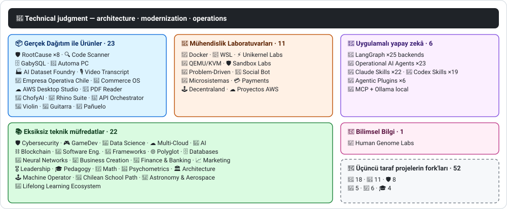

<div align="center">

# 👋Vladimir Acuña

## **Çözüm Mimarı·Senior Full-Stack·Dijital Dönüşüm·Yönetim ve Operasyonlar**

**Bilgisayar Bilimi ve Bilişim Mühendisliği ve İşletmesinde profesyonel olarak eğitilmiş, 16+ yıl bina ve gerçek ortamlarda işletim yazılımı ile. İşi, insanları, süreçleri ve teknolojiyi tasarım, değerlendirme, teslim etmek ve teknik yargı ve operasyonel bir görüşle çözümler sürdürmek için birleştiriyorum - bu GitHub hesabında doğrulanabilir kanıtlarla desteklendi.**

[](https://vladimiracunadev-create.github.io/)
[](https://www.linkedin.com/in/vladimir-acu%C3%B1a-valdebenito-11924a29/)
[](mailto:vladimir.acuna.dev@gmail.com)

[](#profesyonel-kapsam)
[](docs/ECOSYSTEM.tr.md)
[](#eksiksiz-teknik-müfredatlar)

<!-- STATS:START -->
[](https://github.com/vladimiracunadev-create?tab=repositories)
[](https://github.com/vladimiracunadev-create?tab=repositories)
[](#bir-bakışta-ekosistem)
[](#eksiksiz-teknik-müfredatlar)
[](https://github.com/vladimiracunadev-create?tab=repositories)
[](docs/ECOSYSTEM.tr.md#forks)
[](https://github.com/vladimiracunadev-create?tab=repositories)
[](https://github.com/pulls?q=author%3Avladimiracunadev-create+type%3Apr)
[](https://github.com/issues?q=author%3Avladimiracunadev-create+type%3Aissue)
<!-- STATS:END -->

[](https://github.com/vladimiracunadev-create?tab=repositories)
[](https://github.com/vladimiracunadev-create?tab=followers)

[🧭 Nereden başlamalı](docs/START_HERE.en.md) ·
[🌐 Portfolio (22 languages)](https://vladimiracunadev-create.github.io/) ·
[🧩 Ecosystem](#bir-bakışta-ekosistem) ·
[🛠️ Teknoloji yığını](#-teknoloji-yığını) ·
[⚡ Evaluate me in 10 minutes](#beni-değerlendirmek-için-10-dakikanız-varsa) ·
[✅ Professional scope](#profesyonel-kapsam) ·
[🧭 Non-coding management](#yönetim-yönetim-ve-kariyer-fırsatları) ·
[📋 Role matrix](PROFESIONAL_ROLES.md) ·
[📬 Contact](#i̇letişim)

**🌐 Tam sürümler:** [Español](README.md) · [English](README.en.md) · [Português](README.pt.md) · [Italiano](README.it.md) · [Français](README.fr.md) · [简体中文](README.zh.md) · [繁體中文](README.zh-TW.md) · [日本語](README.ja.md) · [한국어](README.ko.md) · [Türkçe](README.tr.md) · [Русский](README.ru.md) · [Tiếng Việt](README.vi.md) · [ไทย](README.th.md) · [Deutsch](README.de.md) · [Українська](README.uk.md) · [Polski](README.pl.md) · [العربية](README.ar.md) · [فارسی](README.fa.md) · [Bahasa Indonesia](README.id.md) · [Nederlands](README.nl.md) · [हिन्दी](README.hi.md) · [Ελληνικά](README.el.md)

**Teknik temel:**
PHP 8 · Python · Rust · Go · Node/TS · Java 21 · .NET 8 · Dart/Flutter · WASM
· AWS · Terraform · Kubernetes · Docker · n8n · LangGraph/MCP · CI/CD · FinOps · Observability

**Business-teknoloji köprüsü:**
process and requirements analysis · solution evaluation · delivery coordination · operations and continuity · risk management · product and service · technical education

</div>

---

> [!NOTE]
> This profile does not turn opportunities into experience. Proven technical experience, transferable skills, viable applications, and future development goals are explicitly separated. Linked GitHub evidence is executable or documentary; where something is **not** finished, it is stated as such.

## 🧭 Nereden başlamalı

Durumunuzu seçin ve doğrudan ihtiyacınız olana gidin:

🧑‍💼 [İşe alım](docs/guides/RECRUITER.en.md) · 💼 [Müşteri veya freelance](docs/guides/FREELANCE.en.md) · 🛠️ [Teknik değerlendirme](docs/guides/TECH_LEAD.en.md) · 🏢 [İş ve yönetim](docs/guides/BUSINESS.en.md) · 🤝 [İş birliği ve güvenlik](docs/guides/COLLABORATOR.en.md) · 🎓 [Öğrenme veya öğretme](docs/guides/LEARNER.en.md)

<sub>(English)</sub>

## 🎯Burada neler bulacaksınız

Bu “bir repo” değil: paylaşılan standartlarla bir ekosistemdir.

- 🔁 **Reproducible demos**- klon, koşmak, doğrulama.
- 🧰 **Standartlaştırılmış araç**- Makefiles, Hub CLI,`doctor`Ve`smoke`per repository.
- 🛡️ **Savunma derinlikte**- gizli tarama, politikalar ve açıkça yasak uygulamalar.
- 📈 **Observability** — `/health`, `/ready`, `/metrics`, panolar ve izlenebilirlik.
- 📚 **İzleyici-aware belgeleri**- işe alımcı, başlangıçta DevOps veya güvenlik, depolara bağlı olarak.
- 📦 **Ürün dağıtım**- indirilebilir sürümler, çekler ve kanıtlar inşa; ticari / mağaza imzaları geçerli olduğunda beklemeye karar verdi.
- 🌍 **Internationalization** — bu profil 22 dilde yayımlanıyor ve portfolyo 154 herkese açık PDF sunuyor (7 aile × 22 dil) (ES · EN · PT · IT · FR · ZH · ZH-TW · JA · KO · TR · RU · VI · TH · DE · UK · PL · AR · FA · ID · NL · HI · EL).
- 🧭 **Teknik dürüstlük**- Her vaka etiketli`OPERATIONAL`, `DOCUMENTED/SCAFFOLD`, ya da`PLANNED`.

## ✅Doğrulanabilir durum

| Surface | Concrete evidence |
|---|---|
| 🧪 **Test kapsamı** | GabySQL**850 test testleri**+ söndürücü**503.8M sorguları**(0 Panik)·Empresa Operativa Chile**230 Test testleri** ·Automa**150 pytest** ·multi-OS CI |
| 🤖 **Production-grade agents** | LangGraph RealWorld **25/25 operational backends** (cases 01–25, 100% coverage) · Operational AI Agents **23 agents** with **69 deterministic evals** |
| 🔗 **Polyglot integration** | **20 cases** sender→n8n→receiver —**19 operational**, individually audited with Docker— · **18+ DB engines** · **20+ containers** · 11 patterns |
| 📦 **Distribution** | **155 releases** across an ecosystem of **65 owned public repositories** · installers and artifacts `.exe` · `.msi` · `.dmg` · `.apk` with checksums and build evidence; commercial/store signatures in progress where applicable |
| 🛡️ **Tedarik zinciri** | KodQL·Semgrep·Bandit·Trivy·Grype·Gitleaks·TruffleHog·CycloneDX SBOM·Scorecard |
| 📚 **Curricula** | **14,550 classes** verifiable across 21 programs, counted by [a workflow](.github/workflows/stats.yml) from real repository structure or a verifiable source declared in the repository —not written by hand— · every program declares its editorial status and limitations |
| 🌐 **Portföy Portföyü** | Yükleme edilebilir PWA· **22 dil dili** · **154 PDFs**Boru hattı tarafından üretilen·CV Data API·Capacitor Android·Lighthouse 100 |
| 🔒 **Telemetri** | Adli ürünler ve Empresa Operativa Chile'de Sıfır telemetri - her binada doğrulandı (no Android`INTERNET`İzin) |
| 🌐 **Yayınlanmış siteleri** | **57 GitHub Pages siteleri**-56 iniş, bir ürün, program veya ekosistem navigator, artı portföy - her biri kendi depolarından dağıtıldı·57 kişi HTTP ile doğrulandı`200` |

## 🛠️ Teknoloji yığını

Herkese açık depolarda tespit edilen teknolojiler (manifestolar, bağımlılıklar, konteynerler ve kod), alanlara göre gruplanmıştır. Bir depoda yer almak —laboratuvarlar ve müfredatlar dahil— kullanım kanıtıdır, yıllarca üretim deneyimi iddiası değildir.

**Diller**


<sub>Python · JavaScript · TypeScript · Rust · Go · Java · PHP · C# · Dart · Kotlin · Swift · Ruby · Elixir · Zig · Clojure · C · Solidity · Bash · PowerShell · HTML · CSS · WebAssembly · SQL · Erlang · F# · Crystal · GDScript · HCL</sub>

**Çerçeveler, çalışma zamanları ve kütüphaneler**


<sub>Node.js · Express · React · Vue · Svelte · Astro · Vite · Vitest · FastAPI · Flask · Django · Spring Boot · ASP.NET / .NET · Laravel · Rails · Flutter · Tauri · Electron · Qt / PySide6 · Capacitor · Godot · PyTorch · scikit-learn · Polars · pandas · NumPy · Optuna · SHAP · Transformers · PEFT / LoRA · Playwright · pytest · Jupyter · Streamlit · Pydantic · Tokio · Axum · SQLx · Serde</sub>

**Yazılım mimarileri**


-0969da?style=flat-square)


<sub>Local-first → [empresa-operativa-chile](https://github.com/vladimiracunadev-create/empresa-operativa-chile), [ai-dataset-foundry](https://github.com/vladimiracunadev-create/ai-dataset-foundry) · Event-driven → [social-bot-scheduler](https://github.com/vladimiracunadev-create/social-bot-scheduler) · Resilience → [problem-driven-systems-lab](https://github.com/vladimiracunadev-create/problem-driven-systems-lab) · Ledger → [universal-payments-engineering-lab](https://github.com/vladimiracunadev-create/universal-payments-engineering-lab) · Plugins → [agentic-plugins-toolkit](https://github.com/vladimiracunadev-create/agentic-plugins-toolkit) · Agents → [langgraph-realworld](https://github.com/vladimiracunadev-create/langgraph-realworld), [operational-ai-agents](https://github.com/vladimiracunadev-create/operational-ai-agents) · Domain-first → [rhino-suite](https://github.com/vladimiracunadev-create/rhino-suite) · Micro-apps → [microsistemas](https://github.com/vladimiracunadev-create/microsistemas) · Embedded DB → [gabysql](https://github.com/vladimiracunadev-create/gabysql) · IaC → [proyectos-aws](https://github.com/vladimiracunadev-create/proyectos-aws)</sub>

**Veritabanları**


<sub>PostgreSQL · MySQL · MariaDB · SQLite · MongoDB · Redis · Neo4j · Cassandra · Elasticsearch · ClickHouse · CockroachDB · InfluxDB · TimescaleDB · DuckDB · SQL Server · Oracle · pgvector · PostgREST · GraphQL · GabySQL (Rust)</sub>

**Bulut, konteynerler ve DevOps**


<sub>AWS · Terraform · Kubernetes · Docker / Compose · GitHub Actions · Git · GitHub · GitLab · Linux · Nginx · Make · Inno Setup · FinOps · CI/CD</sub>

**Gözlemlenebilirlik ve mesajlaşma**


<sub>Prometheus · Grafana · OpenTelemetry · Kafka · MQTT (Mosquitto) · Elasticsearch / Kibana · cAdvisor · k6</sub>

**Yapay zekâ, ajanlar, skill'ler ve MCP**


<sub>Claude Code · Claude Skills · Codex Skills · Agentic Plugins · MCP · LangGraph · Ollama · n8n · RAG · Whisper · Transformers · PEFT / LoRA · Optuna · SHAP · Polars · PyTorch</sub>

**Güvenlik ve tedarik zinciri**


**Hedef platformlar**


<sub>Windows · macOS · iOS · Linux · Android · Web / PWA</sub>

## 🗺️Bir bakışta ekosistem



## 🗂️ Ekosistem: ürünler, laboratuvarlar, uygulamalı yapay zekâ, müfredatlar ve bilimsel hesaplama

Profilin uygulamalı işleri ayrı bir belgede yer alır: indirilip kurulan yazılımlar, mühendislik laboratuvarları, uygulamalı yapay zekâ, eksiksiz teknik müfredatlar ve bilimsel hesaplama ile hesaptaki üçüncü taraf projelerin her bir fork'unun açıklaması.

- 📦 **Gerçek Dağıtım ile Ürünler** (22)
- 🧪 **Mühendislik Laboratuvarları** (11)
- 🤖 **Uygulamalı yapay zekâ** (6)
- 📚 **Eksiksiz teknik müfredatlar** (21)
- 🔬 **Bilimsel Bilgi** (1)
- 🍴 **Üçüncü taraf projelerin fork'ları** (52)

👉 **[Ekosistemin tamamını gör](docs/ECOSYSTEM.tr.md)** · [🍴 Üçüncü taraf projelerin fork'ları](docs/ECOSYSTEM.tr.md#forks)

## 📚Eksiksiz teknik müfredatlar

Sequential programs in Spanish, with status and scope declared by each repository. The 21 programs add up to **14,550 classes**, counted by [a workflow](.github/workflows/stats.yml) from real repository structure or a verifiable source declared in the repository; the badge refreshes weekly and is not written by hand.

🌌 **Planlama aşamasında, sayımın dışında:** [Astronomi, astrofizik, uzay bilimleri ve havacılık-uzay mühendisliği](https://github.com/vladimiracunadev-create/astronomy-astrophysics-space-sciences-aerospace-engineering-learning-program) — 12 alanda ve 133 blokta 2.077 planlanmış ders; 397'sinin metni yazılmış, hepsi hâlâ E0 durumunda. Bağımsız eğitim, mesleki yetkilendirme değil · [site](https://vladimiracunadev-create.github.io/astronomy-astrophysics-space-sciences-aerospace-engineering-learning-program/).

👉 **[21 programın tamamını gör](docs/ECOSYSTEM.tr.md#curricula)**

## ⚡Beni değerlendirmek için 10 dakikanız varsa

Fikir sadece koda bakmak değildir: görmektir**Nasıl düşündüğümü nasıl düşünüyorum**Nasıl belgeliyim ve her şeyi nasıl genişletebilirim.

**Yol A - Gerçek gözlemlenebilirlik ve orkestration***(En sevdiğim)*

```bash
git clone https://github.com/vladimiracunadev-create/social-bot-scheduler.git
```

İş akışlarını, ölçümleri, panoları ve 20 vaka ve 18+ DB motorlarında bekçileri göreceksiniz.

**B - Reproducible altyapı dakikalar içinde**

```bash
git clone https://github.com/vladimiracunadev-create/docker-labs.git
```

**Yol C - Tiplenmiş devletli Ajanlar**

```bash
git clone https://github.com/vladimiracunadev-create/langgraph-realworld.git
```

**Route D – Rust adli ürün, klonlama olmadan**

Yüklemeci veya Küçlüyü İndirin[RootCause releases](https://github.com/vladimiracunadev-create/rootcause-windows-inspector/releases)ve doğruyu doğrulayın`SHA256SUMS`.

## 🧠Tüm depolarda uyguladığım standartlar

- **DX ilk önce**- koşmak kolay değilse, bir demo veya takım üssü olarak yararlı değildir.
- **1 gün hayatta kalabilite 1**- metrikler ve izlenebilirlik, bir After Stillt değil.
- **Boru hattı olarak güvenlik**- gizli tarama, SBOM salıverme başına, açıkça yasak uygulamalar.
- **Gerçek direniş**- idempotency, devre kesici ve kontrollü bozulma.
- **Polyglot by design**- dil ve motor, hiçbir zaman moda tarafından seçilmez.
- **Dürüst statü hakkında**– bir repo yeniden adlandırılmıştı (`Multisimulador` → `machine-operator-program`Henüz mevcut olmayan umut verici yazılımlardan kaçınmak.
- **İşaretler sinyalleridir, kanıt değil**Her bir repo da aynı zamanda ilan eder**Ne yapmaz**.
- **Model outward** — the domain is designed first; the interface is a projection.
- **Dış çalışma dışsal olarak ilan edilir** — üçüncü taraf projelerin [52 fork'u](docs/ECOSYSTEM.tr.md#forks) tek tek açıklanır ve bu profildeki tüm kendi eser rakamlarının dışında kalır.

## ✅Profesyonel Kapsam

Çift geçmişim –**Bilgisayar Bilimi ve Bilgisayar Mühendisliği + İşletme Yönetimi**- iş hedeflerini teknik kararlara ve teknik kısıtlamalara, operasyonlar, ürün, müşteriler ve liderlik için açık seçeneklere dönüştürmeme yardımcı olur.

### 🎯Temel kimlik

| Role | Backing |
|---|---|
| **Çözüm Mimarı** | modüler, ölçeklenebilir sistem tasarımı evrimsel yargı ile |
| **Legacy Modernization Architect** | Real legacy evolution (PHP 5.x→8.x, incremental refactoring without interrupting operations) |
| **Senior Full-Stack / Tech Lead** | Mimari, yürütme ve gerçek platformlarda standartlar (+16 yıl) |
| **AI Otomasyon Mimar** | LangGraph/MCP ile Agentic sistemler ve n8n bekçilerle akışlar |

### ↗ Doğal genişleme

**AI Oryantasyon Mühendisi** · **Systems / Rust Mühendis** · **Mobile Mühendis (Flutter)** · **Çözümleri Mühendis** · **Teknik Ürün Builder** · **Teknik Trener** · **Dijital Dönüşüm Danışmanı** · **İş / Fonksiyonel Analist** · **Teknik Ürün Operasyonları** · **AI Engineer (LLM / ML)** · **Data Engineer** · **DevSecOps / AppSec Engineer** · **QA Automation / Test Engineer** · **Technical Writer** · **Öğretmen / Eğitmen / Teknoloji Eğitmeni** · **Instructional Designer (EdTech)** · **Technical Mentor**

### ⚙️Tamamlayıcı Kapsam

Platform Mühendis / IDP·DevOps / CI-CD·Bulut / AWS Mühendisi·Uygulama SRE·Otomasyon Mühendisi·Teknik-kommercial danışman · Backend / API Engineer · Fintech / Payments Engineer · Developer Advocate / DevRel

## 🧭Yönetim, Yönetim ve Kariyer Fırsatları

Bilişim ile işletmenin, programlama temel görev olmadan katkı sağladığı yönetim, idare ve iş rolleri; dürüstçe sınıflandırılmış (aktarılabilir yetkinlik, başvuru olasılığı veya gelecek hedefi) ve her birinin açığıyla birlikte. Kapsanan alanlar:

Technology leadership · Proje Yönetimi · Business administration · Strateji ve değişim · Business analysis · Ürün ve hizmet · Cybersecurity management · Ticari ve satış · Finance and management control · Quality · Education · Logistics and suppliers · Data and AI Governance · Public sector

👉 **[Fırsat matrisinin tamamını gör](docs/MANAGEMENT.tr.md)**

## 🤖Yapay zekâ destekli geliştirme akışı

| Tool | Main use |
|---|---|
| **Claude Code** | Mimari inceleme, uygulama ve teknik dokümantasyon |
| **ChatGPT Plus** | Analiz, mimarlık ve iterasyon ( 2023'ten beri) |
| **Kod** | Kod nesli ve yeniden faktörleme |
| **Antika** | Geliştirme ve otomasyon akışlarının hızlandırılması |
| **VS Code / OpenKo** | Entegre AI yardımı ile çevreler |

> Kendi teknik yargıımı, insan doğrulamasını ve mimari yönünü birleştiriyorum. AI kapasiteyi, hızı ve ulaşmak - deneyimi değiştirmiyor.

## 📌Kullanılabilirlik

**Open to:** Senior Full-Stack · Architecture · Legacy modernization · Platform/IDP · Application SRE · pragmatic DevOps · Automation · AI Automation · business/functional analysis · IT project coordination · Product Operations · digital transformation · solutions consulting/presales · technical education · quality and continuous improvement · AI adoption and governance

**Her role göre Evaluated:**Ürün Sahibi / Teknik Ürün Yöneticisi·Servis Teslimatı·IT Operations·GRC / teknoloji riski·Yönetim ve operasyonlar·yönetim kontrolü·Kamu-sector modernizasyon. Yönetici ve genel yönetim başlıkları gelecekteki gelişim hedefleridir, deneyim iddia edilmez.

**Modality:**Uzak veya hibrit, projeye bağlı olarak.

## 📬İletişim

[](https://vladimiracunadev-create.github.io/)
[](https://www.linkedin.com/in/vladimir-acu%C3%B1a-valdebenito-11924a29/)
[](https://gitlab.com/vladimir.acuna.dev-group/vladimir.acuna.dev-group)
[](mailto:vladimir.acuna.dev@gmail.com)

---

<div align="center">

[🤝 Contribute](CONTRIBUTING.en.md) ·
[🛡️ Security](SECURITY.en.md) ·
[⚖️ Code of Conduct](CODE_OF_CONDUCT.en.md)

<sub>README, herkese açık depoların doğrulanabilir durumuyla eşitlenmiştir —rakamlar ve değişiklikler API üzerinden okunur— · son doğrulama: <!-- VERIFIED:START -->2026-11-09<!-- VERIFIED:END -->.</sub>

</div>
