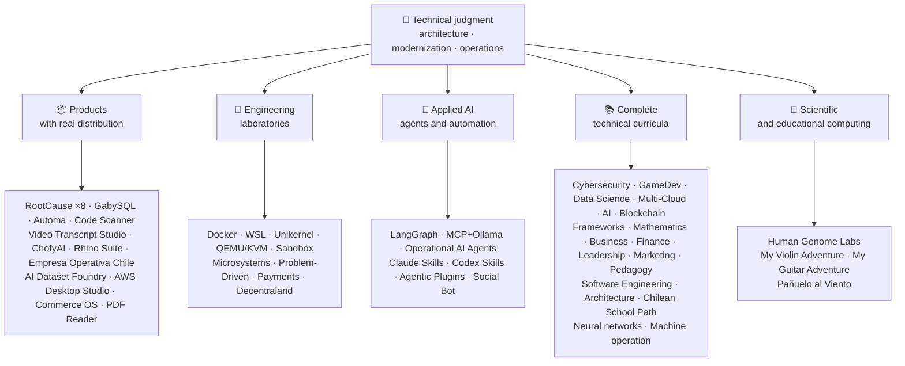

<div align="center">

# 👋Vladimir Acuña

## **Çözüm Mimarı·Senior Full-Stack·Dijital Dönüşüm·Yönetim ve Operasyonlar**

**Bilgisayar Bilimi ve Bilişim Mühendisliği ve İşletmesinde profesyonel olarak eğitilmiş, 16+ yıl bina ve gerçek ortamlarda işletim yazılımı ile. İşi, insanları, süreçleri ve teknolojiyi tasarım, değerlendirme, teslim etmek ve teknik yargı ve operasyonel bir görüşle çözümler sürdürmek için birleştiriyorum - bu GitHub hesabında doğrulanabilir kanıtlarla desteklendi.**

[](https://vladimiracunadev-create.github.io/)
[](https://www.linkedin.com/in/vladimir-acu%C3%B1a-valdebenito-11924a29/)
[](mailto:vladimir.acuna.dev@gmail.com)

[](#profesyonel-kapsam)
[](docs/ECOSYSTEM.tr.md)
[](#eksiksiz-teknik-müfredatlar)

<!-- STATS:START -->
[](https://github.com/vladimiracunadev-create?tab=repositories)
[](https://github.com/vladimiracunadev-create?tab=repositories)
[](#bir-bakışta-ekosistem)
[](#eksiksiz-teknik-müfredatlar)
[](https://github.com/vladimiracunadev-create?tab=repositories)
<!-- STATS:END -->

[](https://github.com/vladimiracunadev-create?tab=repositories)
[](https://github.com/vladimiracunadev-create?tab=followers)

[🌐 Portfolio (6 languages)](https://vladimiracunadev-create.github.io/) ·
[🧩 Ecosystem](#bir-bakışta-ekosistem) ·
[⚡ Evaluate me in 10 minutes](#beni-değerlendirmek-için-10-dakikanız-varsa) ·
[✅ Professional scope](#profesyonel-kapsam) ·
[🧭 Non-coding management](#yönetim-yönetim-ve-kariyer-fırsatları) ·
[📋 Role matrix](PROFESIONAL_ROLES.md) ·
[📬 Contact](#i̇letişim)

**🌐 Tam sürümler:** [Español](README.md) · [English](README.en.md) · [Português](README.pt.md) · [Italiano](README.it.md) · [Français](README.fr.md) · [简体中文](README.zh.md) · [繁體中文](README.zh-TW.md) · [日本語](README.ja.md) · [한국어](README.ko.md) · [Türkçe](README.tr.md) · [Русский](README.ru.md) · [Tiếng Việt](README.vi.md) · [ไทย](README.th.md) · [Deutsch](README.de.md) · [Українська](README.uk.md) · [Polski](README.pl.md) · [العربية](README.ar.md) · [فارسی](README.fa.md) · [Bahasa Indonesia](README.id.md) · [Nederlands](README.nl.md) · [हिन्दी](README.hi.md) · [Ελληνικά](README.el.md)

**Teknik temel:**
PHP 8 · Python · Rust · Go · Node/TS · Java 21 · .NET 8 · Dart/Flutter · WASM
· AWS · Terraform · Kubernetes · Docker · n8n · LangGraph/MCP · CI/CD · FinOps · Observability

**Business-teknoloji köprüsü:**
process and requirements analysis · solution evaluation · delivery coordination · operations and continuity · risk management · product and service · technical education

</div>

---

> [!NOTE]
> This profile does not turn opportunities into experience. Proven technical experience, transferable skills, viable applications, and future development goals are explicitly separated. Linked GitHub evidence is executable or documentary; where something is **not** finished, it is stated as such.

## 🎯Burada neler bulacaksınız

Bu “bir repo” değil: paylaşılan standartlarla bir ekosistemdir.

- 🔁 **Reproducible demos**- klon, koşmak, doğrulama.
- 🧰 **Standartlaştırılmış araç**- Makefiles, Hub CLI,`doctor`Ve`smoke`per repository.
- 🛡️ **Savunma derinlikte**- gizli tarama, politikalar ve açıkça yasak uygulamalar.
- 📈 **Observability** — `/health`, `/ready`, `/metrics`, panolar ve izlenebilirlik.
- 📚 **İzleyici-aware belgeleri**- işe alımcı, başlangıçta DevOps veya güvenlik, depolara bağlı olarak.
- 📦 **Ürün dağıtım**- indirilebilir sürümler, çekler ve kanıtlar inşa; ticari / mağaza imzaları geçerli olduğunda beklemeye karar verdi.
- 🌍 **Internationalization** — portfolio in 6 languages (ES · EN · PT · IT · FR · ZH).
- 🧭 **Teknik dürüstlük**- Her vaka etiketli`OPERATIONAL`, `DOCUMENTED/SCAFFOLD`, ya da`PLANNED`.

## ✅Doğrulanabilir durum

| Surface | Concrete evidence |
|---|---|
| 🧪 **Test kapsamı** | GabySQL**828 test testleri**+ söndürücü**503.8M sorguları**(0 Panik)·Empresa Operativa Chile**158 Test testleri** ·Automa**150 pytest** ·multi-OS CI |
| 🤖 **Production-grade agents** | LangGraph RealWorld **25/25 operational backends** (cases 01–25, 100% coverage) · Operational AI Agents **13 agents** with **39 deterministic evals** |
| 🔗 **Polyglot integration** | **20 cases** sender→n8n→receiver —**19 operational**, individually audited with Docker— · **18+ DB engines** · **20+ containers** · 11 patterns |
| 📦 **Distribution** | **151 releases** across an ecosystem of **64 owned public repositories** · installers and artifacts `.exe` · `.msi` · `.dmg` · `.apk` with checksums and build evidence; commercial/store signatures in progress where applicable |
| 🛡️ **Tedarik zinciri** | KodQL·Semgrep·Bandit·Trivy·Grype·Gitleaks·TruffleHog·CycloneDX SBOM·Scorecard |
| 📚 **Curricula** | **14,530 classes** verifiable across 21 programs, counted by [a workflow](.github/workflows/stats.yml) from real repository structure or a verifiable source declared in the repository —not written by hand— · every program declares its editorial status and limitations |
| 🌐 **Portföy Portföyü** | Yükleme edilebilir PWA· **6 dil dili** · **36 PDFs**Boru hattı tarafından üretilen·CV Data API·Capacitor Android·Lighthouse 100 |
| 🔒 **Telemetri** | Adli ürünler ve Empresa Operativa Chile'de Sıfır telemetri - her binada doğrulandı (no Android`INTERNET`İzin) |
| 🌐 **Yayınlanmış siteleri** | **56 GitHub Pages siteleri**-55 iniş, bir ürün, program veya ekosistem navigator, artı portföy - her biri kendi depolarından dağıtıldı·56 kişi HTTP ile doğrulandı`200` |

## 🗺️Bir bakışta ekosistem



## 🗂️ Ekosistem: ürünler, laboratuvarlar, uygulamalı yapay zekâ ve bilimsel hesaplama

Profilin uygulamalı işleri ayrı bir belgede yer alır: indirilip kurulan yazılımlar, mühendislik laboratuvarları, uygulamalı yapay zekâ ve bilimsel hesaplama ile hesaptaki üçüncü taraf projelerin her bir fork'unun açıklaması.

- 📦 **Gerçek Dağıtım ile Ürünler** (22)
- 🧪 **Mühendislik Laboratuvarları** (11)
- 🤖 **Uygulamalı yapay zekâ** (6)
- 🔬 **Bilimsel Bilgi** (1)
- 🍴 **Üçüncü taraf projelerin fork'ları** (52)

👉 **[Ekosistemin tamamını gör](docs/ECOSYSTEM.tr.md)** · [🍴 Üçüncü taraf projelerin fork'ları](docs/ECOSYSTEM.tr.md#forks)

## 📚Eksiksiz teknik müfredatlar

Sequential programs in Spanish, with status and scope declared by each repository. The 21 programs add up to **14,530 classes**, counted by [a workflow](.github/workflows/stats.yml) from real repository structure or a verifiable source declared in the repository; the badge refreshes weekly and is not written by hand.

🧭 [**Lifelong Learning Ecosystem**](https://github.com/vladimiracunadev-create/lifelong-learning-ecosystem)6 alanda görsel haritalar ve bir akış ile 30 gerçek yol birbirine bağlayan bir pupassdir.[accessible offline portal](https://vladimiracunadev-create.github.io/lifelong-learning-ecosystem/); ek bir program olarak sayılmıyor.

| Program | Classes | Scope |
|---|---:|---|
| [🔢 **Computational Mathematics**](https://github.com/vladimiracunadev-create/computational-mathematics-program) | 360 | Bir kağıt oluşturmak için parmak saymak· **CII'de doğrulanan 360 deterministic gösteriler** ·1.080 Notlar·489-term· [site](https://vladimiracunadev-create.github.io/computational-mathematics-program/) |
| [🏦 **Finance and Banking**](https://github.com/vladimiracunadev-create/finance-and-banking-evolution-program) | 356 | 534 h·Finansal matematik ve IFRS → kredi, risk, Basel III, açık finans, DLT, stabilcoins ve MiCA· **27 vaka** · **298 test testleri** · [site](https://vladimiracunadev-create.github.io/finance-and-banking-evolution-program/) |
| [🎮 **GameDev**](https://github.com/vladimiracunadev-create/modern-gamedev-program) | 352 | Mathematics and C#/C++/GDScript → shaders, AI, multiplayer, VR/AR · Godot · Unity · Unreal · **10 Godot labs verified in CI** (301 checks) · [site](https://vladimiracunadev-create.github.io/modern-gamedev-program/) |
| [🛡️ **Cybersecurity**](https://github.com/vladimiracunadev-create/modern-cybersecurity-program) | 360 | **v1.3.0** ·20 parça·Temeller → Kızıl Takım, DFIR, bulut güvenliği, Dev, CTF ve oyun güvenliği·haritalandı**7 sertifikasyon** ·çevrimdışı Android /web uygulaması·PDF manuel·CI, Güvenlik ve Sayfalar doğrulandı· [site](https://vladimiracunadev-create.github.io/modern-cybersecurity-program/) |
| [📈 **Marketing, Sales, and Growth**](https://github.com/vladimiracunadev-create/marketing-sales-growth-evolution-program) | 336 | Operasyonel tanımlarla 24 parça, ölçüm çarşafları, doğrulanabilir bibliyografi ve Şili düzenleyici bağlam· **v1.6.0** ·1.29M kelime sözleri·17 rol tabanlı yol· [site](https://vladimiracunadev-create.github.io/marketing-sales-growth-evolution-program/) |
| [🏢 **Business Creation**](https://github.com/vladimiracunadev-create/modern-business-creation-program) | 336 | Şili'de gerçek bir şirket oluşturun: katılmak, vergi otoritesi, operasyonları, kriz ve çıkış yapmak için fikirden·360 diyagramlar·1.251-term·1.548-sayfa manuel· [site](https://vladimiracunadev-create.github.io/modern-business-creation-program/) |
| [🏛️ **Architecture and Built Environment**](https://github.com/vladimiracunadev-create/architecture-built-environment-learning-program) | 830 | 83 parts · 60 integrative sessions · 34 paths · traceable sources · Markdown, offline reader, and GitHub Pages · [site](https://vladimiracunadev-create.github.io/architecture-built-environment-learning-program/) |
| [🇨🇱 **Chilean School Learning Path**](https://github.com/vladimiracunadev-create/chilean-school-learning-path) | 8,841 | 1. Sınıflar 1-12· **4,156 bütünleşik çapraz-kullanıcı deneyimler** · **2,823 öğrenme hedefleri** ·MINEDUC kaynakları·Beklenmeyen teklifler ve uzman insan incelemesi hala beklemeye devam· [site](https://vladimiracunadev-create.github.io/chilean-school-learning-path/) |
| [🧭 **Modern Software Engineering**](https://github.com/vladimiracunadev-create/modern-software-engineering-program) | 480 | 40 parça ve 8 aşama·Temeller → ürün, mimarlık, güvenlik, DevOps, SRE, SPEC, AI ve multi-agent sistemler·Editör statüsü, havuz tarafından ilan edildi· [site](https://vladimiracunadev-create.github.io/modern-software-engineering-program/) |
| [🎓 **Pedagogy and Learning Sciences**](https://github.com/vladimiracunadev-create/education-pedagogy-learning-sciences-program) | 300 | Bir kişinin öğretmenlerin nasıl eğitildiğini nasıl öğrendiğinden·25 parça· **Her sınıf kanıt durumunu ve sınırları ilan eder** ·Erken okuryazarlık, karşılaştırmalı yöntemler, özel eğitim ihtiyaçları, karşılıklılık, kültürel çeşitlilik ve uluslararası kanıtlar·1.097-term parlak, 325 diyagramlar ve 60-aktivite sınıfı banka·rolü ile 14 kariyer yolu·LMS-exportable· **v2.1.0** · [site](https://vladimiracunadev-create.github.io/education-pedagogy-learning-sciences-program/) |
| [☁️ **Multi-Cloud**](https://github.com/vladimiracunadev-create/multi-cloud-engineering-program) | 288 | AWS · Azure · GCP · Kubernetes · Terraform · SRE · FinOps · **1,288 hours** · 288 labs with JSON evidence · 1,032 traced sources · 2,884-page PDF manual · [site](https://vladimiracunadev-create.github.io/multi-cloud-engineering-program/) |
| [🎖️ **Executive Leadership**](https://github.com/vladimiracunadev-create/executive-leadership-founder-program) | 288 | Bir şirketin lider ve kendi kurucu için ilk sonucunuzu kendi: takımlar, KPI/OKR, finans, ürün, risk, yönetim ve M&A·24 vaka, 96 laboratuvar ve 39 şablon· [site](https://vladimiracunadev-create.github.io/executive-leadership-founder-program/) |
| [🐍 **Python Data Science**](https://github.com/vladimiracunadev-create/python-data-science-program) | 232 | Polars, ML+Optuna/SHAP, PyTorch /LLMs /LoRA, MLOps·yerli Windows uygulaması + Android Plus· [site](https://vladimiracunadev-create.github.io/python-data-science-program/) |
| [🧠 **AI Evolution**](https://github.com/vladimiracunadev-create/artificial-intelligence-evolution-program) | 184 | Symbolic → probabilistic → deep learning → LLMs, RAG, agents, safety, and frontier · **v0.17.0** · **708 notebooks** · **148 foundational papers** · offline Windows, Android, and PWA apps · [site](https://vladimiracunadev-create.github.io/artificial-intelligence-evolution-program/) |
| [🌐 **Comparative Programming**](https://github.com/vladimiracunadev-create/polyglot-programming-labs) | 176 | Bir konsept,**10 dil dili**CI'de doğrulandı -**1,360 uygulamaları**- artı**1632 program programları**Hala hayatta kalan diller (COBOL, Fortran, Ada, RPG, MUMPS...) ve bir atlas of of**15 ailede 60 kart** ·v1.1.0· [site](https://vladimiracunadev-create.github.io/polyglot-programming-labs/) |
| [🧩 **Frameworks Compared**](https://github.com/vladimiracunadev-create/framework-ecosystems-labs) | 149 | One executable contract, without adapters, against Express, FastAPI, Spring Boot, ASP.NET, Django, Rails, Laravel, React, Vue, Svelte, and more · 12 parts · **70 built classes** · **397 cases verified in CI** · **210 ISBN/DOI sources** · [site](https://vladimiracunadev-create.github.io/framework-ecosystems-labs/) |
| [🗄️ **Databases**](https://github.com/vladimiracunadev-create/database-systems-labs) | 74 | **v3.0.0** · database engineering in 15 parts · 230 hours · **the verifiable source for every claim**: 120 sources with ISBN, DOI, or standard · same case solved in 27 engines · 306-term glossary · 150 pytest · [site](https://vladimiracunadev-create.github.io/database-systems-labs/) |
| [📐 **Psychometrics and Assessment**](https://github.com/vladimiracunadev-create/psychometrics-and-assessment-program) | 40 | How a measurement instrument is built, scored, validated, and audited · 8 parts · executable engine with **5 instruments and 344 items, 276 public-domain** |
| [⛓️ **Blockchain**](https://github.com/vladimiracunadev-create/blockchain-learning-path) | 66 | **v0.14.04.0** ·programlanabilir finansal altyapı ve zincir analizi· **91 uygulama pratik uygulama pratik uygulama pratik uygulama 91 uygulama**ve**363 testleri** ·Foundry (fuzzing and invariants) ve CI'de Slither statik analiz ile sözleşmeler·İkili açarak doğrulanan çevrimdışı uygulamalar ve içeriklerini sayarak doğrulandı· [site](https://vladimiracunadev-create.github.io/blockchain-learning-path/) |
| [🧠 **Neural Network Training Labs**](https://github.com/vladimiracunadev-create/neural-network-training-labs) | 31 | 7 modül·≈214 saat· **93 Notlar**- 31 sınıflar, 31 öğrenci versiyonu ve 31 çözüm -·Sorular, görsel haritalar, uygulamalar ve gerçek halk verileri ile değerlendirme·PisaTorch· [study site](https://vladimiracunadev-create.github.io/neural-network-training-labs/) |
| [🕹️ **Machine Operator**](https://github.com/vladimiracunadev-create/machine-operator-program) | 451 | **41 eğitim modülleri**Bir makine başına· **502 h 15 min** ·sistemler, kontroller, fizik, güvenlik ve simülasyon tasarımı sınıf başına kaynaklarla tasarım·* Henüz executable simülatörü yok ve bu şekilde ilan edilir* |

## ⚡Beni değerlendirmek için 10 dakikanız varsa

Fikir sadece koda bakmak değildir: görmektir**Nasıl düşündüğümü nasıl düşünüyorum**Nasıl belgeliyim ve her şeyi nasıl genişletebilirim.

**Yol A - Gerçek gözlemlenebilirlik ve orkestration***(En sevdiğim)*

```bash
git clone https://github.com/vladimiracunadev-create/social-bot-scheduler.git
```

İş akışlarını, ölçümleri, panoları ve 19 vaka ve 18+ DB motorlarında bekçileri göreceksiniz.

**B - Reproducible altyapı dakikalar içinde**

```bash
git clone https://github.com/vladimiracunadev-create/docker-labs.git
```

**Yol C - Tiplenmiş devletli Ajanlar**

```bash
git clone https://github.com/vladimiracunadev-create/langgraph-realworld.git
```

**Route D – Rust adli ürün, klonlama olmadan**

Yüklemeci veya Küçlüyü İndirin[RootCause releases](https://github.com/vladimiracunadev-create/rootcause-windows-inspector/releases)ve doğruyu doğrulayın`SHA256SUMS`.

## 🧠Tüm depolarda uyguladığım standartlar

- **DX ilk önce**- koşmak kolay değilse, bir demo veya takım üssü olarak yararlı değildir.
- **1 gün hayatta kalabilite 1**- metrikler ve izlenebilirlik, bir After Stillt değil.
- **Boru hattı olarak güvenlik**- gizli tarama, SBOM salıverme başına, açıkça yasak uygulamalar.
- **Gerçek direniş**- idempotency, devre kesici ve kontrollü bozulma.
- **Polyglot by design**- dil ve motor, hiçbir zaman moda tarafından seçilmez.
- **Dürüst statü hakkında**– bir repo yeniden adlandırılmıştı (`Multisimulador` → `machine-operator-program`Henüz mevcut olmayan umut verici yazılımlardan kaçınmak.
- **İşaretler sinyalleridir, kanıt değil**Her bir repo da aynı zamanda ilan eder**Ne yapmaz**.
- **Model outward** — the domain is designed first; the interface is a projection.
- **Dış çalışma dışsal olarak ilan edilir** — üçüncü taraf projelerin [52 fork'u](docs/ECOSYSTEM.tr.md#forks) tek tek açıklanır ve bu profildeki tüm kendi eser rakamlarının dışında kalır.

## ✅Profesyonel Kapsam

Çift geçmişim –**Bilgisayar Bilimi ve Bilgisayar Mühendisliği + İşletme Yönetimi**- iş hedeflerini teknik kararlara ve teknik kısıtlamalara, operasyonlar, ürün, müşteriler ve liderlik için açık seçeneklere dönüştürmeme yardımcı olur.

### 🎯Temel kimlik

| Role | Backing |
|---|---|
| **Çözüm Mimarı** | modüler, ölçeklenebilir sistem tasarımı evrimsel yargı ile |
| **Legacy Modernization Architect** | Real legacy evolution (PHP 5.x→8.x, incremental refactoring without interrupting operations) |
| **Senior Full-Stack / Tech Lead** | Mimari, yürütme ve gerçek platformlarda standartlar (+16 yıl) |
| **AI Otomasyon Mimar** | LangGraph/MCP ile Agentic sistemler ve n8n bekçilerle akışlar |

### ↗ Doğal genişleme

**AI Oryantasyon Mühendisi** · **Systems / Rust Mühendis** · **Mobile Mühendis (Flutter)** · **Çözümleri Mühendis** · **Teknik Ürün Builder** · **Teknik Trener** · **Dijital Dönüşüm Danışmanı** · **İş / Fonksiyonel Analist** · **Teknik Ürün Operasyonları**

### ⚙️Tamamlayıcı Kapsam

Platform Mühendis / IDP·DevOps / CI-CD·Bulut / AWS Mühendisi·Uygulama SRE·Otomasyon Mühendisi·Teknik-kommercial danışman

## 🧭Yönetim, Yönetim ve Kariyer Fırsatları

Bilişim ile işletmenin, programlama temel görev olmadan katkı sağladığı yönetim, idare ve iş rolleri; dürüstçe sınıflandırılmış (aktarılabilir yetkinlik, başvuru olasılığı veya gelecek hedefi) ve her birinin açığıyla birlikte. Kapsanan alanlar:

Technology leadership · Proje Yönetimi · Business administration · Strateji ve değişim · Business analysis · Ürün ve hizmet · Cybersecurity management · Ticari ve satış · Finance and management control · Quality · Education · Logistics and suppliers · Data and AI Governance · Public sector

👉 **[Fırsat matrisinin tamamını gör](docs/MANAGEMENT.tr.md)**

## 🤖Yapay zekâ destekli geliştirme akışı

| Tool | Main use |
|---|---|
| **Claude Code** | Mimari inceleme, uygulama ve teknik dokümantasyon |
| **ChatGPT Plus** | Analiz, mimarlık ve iterasyon ( 2023'ten beri) |
| **Kod** | Kod nesli ve yeniden faktörleme |
| **Antika** | Geliştirme ve otomasyon akışlarının hızlandırılması |
| **VS Code / OpenKo** | Entegre AI yardımı ile çevreler |

> Kendi teknik yargıımı, insan doğrulamasını ve mimari yönünü birleştiriyorum. AI kapasiteyi, hızı ve ulaşmak - deneyimi değiştirmiyor.

## 📌Kullanılabilirlik

**Open to:** Senior Full-Stack · Architecture · Legacy modernization · Platform/IDP · Application SRE · pragmatic DevOps · Automation · AI Automation · business/functional analysis · IT project coordination · Product Operations · digital transformation · solutions consulting/presales · technical education · quality and continuous improvement · AI adoption and governance

**Her role göre Evaluated:**Ürün Sahibi / Teknik Ürün Yöneticisi·Servis Teslimatı·IT Operations·GRC / teknoloji riski·Yönetim ve operasyonlar·yönetim kontrolü·Kamu-sector modernizasyon. Yönetici ve genel yönetim başlıkları gelecekteki gelişim hedefleridir, deneyim iddia edilmez.

**Modality:**Uzak veya hibrit, projeye bağlı olarak.

## 📬İletişim

[](https://vladimiracunadev-create.github.io/)
[](https://www.linkedin.com/in/vladimir-acu%C3%B1a-valdebenito-11924a29/)
[](https://gitlab.com/vladimir.acuna.dev-group/vladimir.acuna.dev-group)
[](mailto:vladimir.acuna.dev@gmail.com)

---

<div align="center">

[🤝 Contribute](CONTRIBUTING.en.md) ·
[🛡️ Security](SECURITY.en.md) ·
[⚖️ Code of Conduct](CODE_OF_CONDUCT.en.md)

<sub>DME, kamu depolarının gerçekleştirilebilir durumuyla senkronize edildi - API aracılığıyla okunan değişiklikler ve değişiklikler -·Son doğrulama: 12 Ekim 2026.</sub>

</div>
