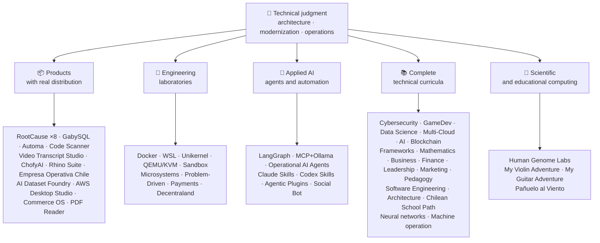

<div align="center">

# 👋Володимир Акуня

## **Архітектор рішення·Старший повний ступінь·Цифрова трансформація·Управління та операції**

**Професійна підготовка до комп’ютерних наук та комп’ютерної інженерії та бізнес-адміністрації, з 16-річним будівництвом та робочим програмним забезпеченням в реальних умовах. Я з'єдную бізнес, люди, процеси та технології проектування, оцінка, постачання та стійкі рішення з технічним судом та оперативним поданням — за рахунок верифікованих доказів у цьому обліковому записі GitHub.**

[](https://vladimiracunadev-create.github.io/)
[](https://www.linkedin.com/in/vladimir-acu%C3%B1a-valdebenito-11924a29/)
[](mailto:vladimir.acuna.dev@gmail.com)

[](#професійний-scope)
[](docs/ECOSYSTEM.uk.md)
[](#повний-технічний-навчальний-план)

<!-- STATS:START -->
[](https://github.com/vladimiracunadev-create?tab=repositories)
[](https://github.com/vladimiracunadev-create?tab=repositories)
[](#екосистема-на-погляді)
[](#повний-технічний-навчальний-план)
[](https://github.com/vladimiracunadev-create?tab=repositories)
<!-- STATS:END -->

[](https://github.com/vladimiracunadev-create?tab=repositories)
[](https://github.com/vladimiracunadev-create?tab=followers)

[🌐 Portfolio (6 languages)](https://vladimiracunadev-create.github.io/) ·
[🧩 Ecosystem](#екосистема-на-погляді) ·
[⚡ Evaluate me in 10 minutes](#якщо-ви-маєте-10-хвилин-щоб-оцінити-мене) ·
[✅ Professional scope](#професійний-scope) ·
[🧭 Non-coding management](#управління-адміністрування-та-незгодні-можливості-карєри) ·
[📋 Role matrix](PROFESIONAL_ROLES.md) ·
[📬 Contact](#контакти)

**🌐 Повні версії:** [Español](README.md) · [English](README.en.md) · [Português](README.pt.md) · [Italiano](README.it.md) · [Français](README.fr.md) · [简体中文](README.zh.md) · [繁體中文](README.zh-TW.md) · [日本語](README.ja.md) · [한국어](README.ko.md) · [Türkçe](README.tr.md) · [Русский](README.ru.md) · [Tiếng Việt](README.vi.md) · [ไทย](README.th.md) · [Deutsch](README.de.md) · [Українська](README.uk.md) · [Polski](README.pl.md) · [العربية](README.ar.md) · [فارسی](README.fa.md) · [Bahasa Indonesia](README.id.md) · [Nederlands](README.nl.md) · [हिन्दी](README.hi.md) · [Ελληνικά](README.el.md)

**Технічна база:**
PHP 8 · Python · Rust · Go · Node/TS · Java 21 · .NET 8 · Dart/Flutter · WASM
· AWS · Terraform · Kubernetes · Docker · n8n · LangGraph/MCP · CI/CD · FinOps · Observability

**Бізнес-технологій міст:**
аналіз процесів і вимог·оцінка розчину·координація доставки·операції та безперервність·Управління ризиками·продукт і сервіс·техніко-технічна освіта

</div>

---

> [!NOTE]
> Цей профіль не перетворює можливості для досвіду. Визначено технічний досвід, переносні навички, вімкнені програми та цілі майбутнього розвитку. Заявка на GitHub є документальним або документальним, де щось**нема**закінчився, він зазначений таким чином.

## 🎯Що ви знайдете тут

Це не “одна репо”: це екосистема з загальними стандартами.

- 🔁 **Відтворюються демо**— клон, біг, валід.
- 🧰 **Стандартний інструмент**— Макефи, Хаб КЛІ,`doctor`й`smoke`за репозиторію.
- 🛡️ **Захист глибини**— секретне сканування, політики та явно заборонені практики.
- 📈 **Відповідальність** — `/health`, `/ready`, `/metrics`, прилади, прилади,
- 📚 **Аудиторія-програма**— рекрутер, початківця, DevOps, або безпека, в залежності від репозиторій.
- 📦 **Розподіл продуктів**— завантажувальні релізи, контрольні та складові докази; підписи комерційного/магазину, заявлені у разі необхідності.
- 🌍 **Інтернаціоналізація**— портфоліо 6 мов (ES)·СЕРЕДОВИЩА·ПТ·ЦЕНА ЗА ЧАС:·ФОП·ЗХ.
- 🧭 **Технічна чесність**— кожен випадок, позначений`OPERATIONAL`, `DOCUMENTED/SCAFFOLD`або`PLANNED`.

## ✅Вигідний статус

| Промисловість | Бетонні докази |
|---|---|
| 🧪 **Тестове покриття** | ДЖИС**828 тести**+ знезадувається над**503.8M запитів**(0 каструлі)·Оператив Чилі**158 тести** ·Автоматика**150 пітест** ·мульти-OS CI |
| 🤖 **Продукція-градусний агент** | Універсальні інженерні рішення**25/25 оперативних запобіжників**(кейси 01–25, 100% покриття)·Операційні агенти AI**13 агентів**з**39 детермінативних ОВД** |
| 🔗 **Інтеграція поліглоту** | **20 випадків**Надсилання на сайті: http://n8n→receiver**19 операцій**, індивідуально аудитовані Docker-· **18+ ДБ-двигуни** · **20+ контейнерів** ·11 візерунки |
| 📦 **Розсилка** | **151 релізи**через екосистему**64 державних репозиторіїв** ·монтажники та артефакти`.exe` · `.msi` · `.dmg` · `.apk`з контрольними та будівельними доказами; комерційні / зберігати підписи в процесі, де це можливо |
| 🛡️ **Мережа поставок** | КодQL·Семгреп·бензо·Триває·Гріпе·ГІДЛІКИ·Трьох·ЦП-Р·укр |
| 📚 **Культура** | **14530 класи**в порівнянні з 21 програм, підраховані[a workflow](.github/workflows/stats.yml)з реальної репозиторійної структури або в'єтнамського джерела, заявленого в репозиторію, не письмово вручну -·Кожна програма оголошує про своє редакційне становище та обмеження |
| 🌐 **Портфоліо** | Установлений PWA· **6 мов** · **36 PDF-файлів**генерується трубопроводом·API даних CV·конденсатор Android·Маяк 100 |
| 🔒 **Телеметрія** | Телеметрія Zero в судових продуктах і Empresa Operativa Chile — перевірена в кожній збудові (без Android`INTERNET`дозвіл |
| 🌐 **Оприлюднено сайт** | **56 GitHub Веб-сайти**—55 посадок, один за продукт, програму, або екосистемний навігатор, плюс портфель — кожен розгорнутий з власної репозиторій·всі 56 перевірені з HTTP`200` |

## 🗺️Екосистема на погляді



## 🗂️ Екосистема: продукти, лабораторії, прикладний ШІ та наукові обчислення

Практична робота профілю винесена в окремий документ: програми, які завантажують і встановлюють, інженерні лабораторії, прикладний ШІ та наукові обчислення, а також опис кожного форку сторонніх проєктів в акаунті.

- 📦 **Продукція з реальним розподілом** (22)
- 🧪 **Інженерні лабораторії** (11)
- 🤖 **Прикладна AI** (6)
- 🔬 **Науковий склад** (1)
- 🍴 **Форки сторонніх проєктів** (52)

👉 **[Переглянути всю екосистему](docs/ECOSYSTEM.uk.md)** · [🍴 Форки сторонніх проєктів](docs/ECOSYSTEM.uk.md#forks)

## 📚Повний технічний навчальний план

Напрями діяльності іспанської мови, з статусом та сферою, що засвідчує кожну репозиторію. 21 програми додано**14530 класи**, підрахунок[a workflow](.github/workflows/stats.yml)з реальної структури репозиторій або в'єтнамського джерела, заявленого в репозиторію; значок освіжає щотижневий і не письмовий вручну.

🧭 [**Lifelong Learning Ecosystem**](https://github.com/vladimiracunadev-create/lifelong-learning-ecosystem)- це федований компас, що поєднує 30 реальних шляхів через 6 зон через візуальні карти та[accessible offline portal](https://vladimiracunadev-create.github.io/lifelong-learning-ecosystem/); не підраховано як додаткова програма.

| Програма | Класи | Промисловість |
|---|---:|---|
| [🔢 **Computational Mathematics**](https://github.com/vladimiracunadev-create/computational-mathematics-program) | 360 | Від підрахунку пальців на пальці, щоб відтворити папір· **360 детермінативних демонстрацій, перевірених на CI** ·1,080 ноутбуки·489-терміновий глянцевий· [site](https://vladimiracunadev-create.github.io/computational-mathematics-program/) |
| [🏦 **Finance and Banking**](https://github.com/vladimiracunadev-create/finance-and-banking-evolution-program) | 356 | 534 ч·Фінансова математика та IFRS → кредит, ризик, Базовий III, відкриті фінанси, DLT, стабільні монети та MiCA· **27 випадків** · **298 тести** · [site](https://vladimiracunadev-create.github.io/finance-and-banking-evolution-program/) |
| [🎮 **GameDev**](https://github.com/vladimiracunadev-create/modern-gamedev-program) | 352 | Математика та C#/C++/GDScript → тіні, AI, мультиплеер, VR/AR·Голос·Зручність·Нереальні· **10 Лабораторія Godot, перевірені на CI**(301 перевірок)· [site](https://vladimiracunadev-create.github.io/modern-gamedev-program/) |
| [🛡️ **Cybersecurity**](https://github.com/vladimiracunadev-create/modern-cybersecurity-program) | 360 | **в1.3.0** ·20 частин·Фундаменти → Red Team, DFIR, хмарна безпека, експлуатувати dev, CTF та безпека ігор·мапа**7 сертифікацій** ·автономний Android / веб-додаток·PDF керівництво·CI, Безпека та перевірені сторінки· [site](https://vladimiracunadev-create.github.io/modern-cybersecurity-program/) |
| [📈 **Marketing, Sales, and Growth**](https://github.com/vladimiracunadev-create/marketing-sales-growth-evolution-program) | 336 | 24 частини з оперативними визначеннями, міркуваннями, врізною бібліографії, та регулятивним контекстом Чиліан· **в1.6.0** ·1.29М слів·17 шляхів на основі ролі· [site](https://vladimiracunadev-create.github.io/marketing-sales-growth-evolution-program/) |
| [🏢 **Business Creation**](https://github.com/vladimiracunadev-create/modern-business-creation-program) | 336 | Створіть і встановіть реальну компанію в Чилі: від ідеї до некорпорації, податкового органу, операцій, кризи та виходу·360 діаграм·1,251-терміновий глянцевий·1,548-сторінок керівництво· [site](https://vladimiracunadev-create.github.io/modern-business-creation-program/) |
| [🏛️ **Architecture and Built Environment**](https://github.com/vladimiracunadev-create/architecture-built-environment-learning-program) | 830 | 83 частини·60 інтегративних сеансів·34 доріжки·простежуються джерела·Відобразити, офлайн зчитувач, і GitHub Сторінки· [site](https://vladimiracunadev-create.github.io/architecture-built-environment-learning-program/) |
| [🇨🇱 **Chilean School Learning Path**](https://github.com/vladimiracunadev-create/chilean-school-learning-path) | 8,841 | 1–12 рр.· **4,156 інтегрованих міжкурсників** · **2,823 цілі навчання** ·Джерела МІНЕДУ·не зажадає пропозицій та спеціалізованих рецензентів, які ще не завадили· [site](https://vladimiracunadev-create.github.io/chilean-school-learning-path/) |
| [🧭 **Modern Software Engineering**](https://github.com/vladimiracunadev-create/modern-software-engineering-program) | 480 | 40 частин і 8 етапів·Основи → продукт, архітектура, безпека, DevOps, SRE, SPEC, AI та багатоагентні системи·Редакційне становище, заявлене репозиторією· [site](https://vladimiracunadev-create.github.io/modern-software-engineering-program/) |
| [🎓 **Pedagogy and Learning Sciences**](https://github.com/vladimiracunadev-create/education-pedagogy-learning-sciences-program) | 300 | Як навчається людина, як навчаються викладачам·25 частин· **Кожен клас визначає стан доказів та ліміти** ·ранніх термінів, порівняльні методи, специфічні навчальні потреби, коексистенція, культурне різноманіття та міжнародні докази·1,097-терміновий глянцевий, 325 діаграми, і 60-активний класний банк·14 кар'єрних шляхів за роль·LMS-експортативний· **v2.1.0** · [site](https://vladimiracunadev-create.github.io/education-pedagogy-learning-sciences-program/) |
| [☁️ **Multi-Cloud**](https://github.com/vladimiracunadev-create/multi-cloud-engineering-program) | 288 | АВС·верстка·ГП·Кубернети·Тераса·СКЛАД·фінолепс· **1 999 час** ·288 лабораторій з доказами JSON·1,032 простежованих джерел·2,884-сторінок PDF керівництво· [site](https://vladimiracunadev-create.github.io/multi-cloud-engineering-program/) |
| [🎖️ **Executive Leadership**](https://github.com/vladimiracunadev-create/executive-leadership-founder-program) | 288 | З власного першого результату, який очолює компанію, і запроваджує власну команду: команди, KPI/OKR, фінанси, продукт, ризик, дошка та M&A·24 випадки, 96 лабораторій, 39 шаблонів· [site](https://vladimiracunadev-create.github.io/executive-leadership-founder-program/) |
| [🐍 **Python Data Science**](https://github.com/vladimiracunadev-create/python-data-science-program) | 232 | Поляри, ML+Optuna/SHAP, PyTorch/LLMs/LoRA, MLOps·English, Українська, Français...· [site](https://vladimiracunadev-create.github.io/python-data-science-program/) |
| [🧠 **AI Evolution**](https://github.com/vladimiracunadev-create/artificial-intelligence-evolution-program) | 184 | Символіка → імовірністичний → глибоке навчання → ЛМС, РАГ, агенти, безпека та передній· **в0.17.0** · **708 блокноти** · **148 Папір фундаментні** ·автономні програми Windows, Android та PWA· [site](https://vladimiracunadev-create.github.io/artificial-intelligence-evolution-program/) |
| [🌐 **Comparative Programming**](https://github.com/vladimiracunadev-create/polyglot-programming-labs) | 176 | Одна концепція,**10 мов**перевірено в CI —**1,360 впровадження**— плюс**1 632 програми**в лівих мовах (COBOL, Fortran, Ada, RPG, MUMPS...) і атлас**60 карток в 15 сім'ях** ·до 1 2 3 4 5+· [site](https://vladimiracunadev-create.github.io/polyglot-programming-labs/) |
| [🧩 **Frameworks Compared**](https://github.com/vladimiracunadev-create/framework-ecosystems-labs) | 149 | Один з найбільш прийнятних контрактів, без адаптерів, проти Експресу, FastAPI, весняного чоботи, ASP.NET, Django, Rails, Laravel, React, Vue, Svelte та багато іншого·12 частин· **70 вбудованих класів** · **397 випадків, перевірені на CI** · **210 ISBN/ДОІ джерела** · [site](https://vladimiracunadev-create.github.io/framework-ecosystems-labs/) |
| [🗄️ **Databases**](https://github.com/vladimiracunadev-create/database-systems-labs) | 74 | **v3.0.0** ·Інженерія бази даних в 15 частинах·230 годин· **джерело для кожного претензії**: 120 джерел з ISBN, DOI, стандартом·односторонній випадок, що вирішило в 27 двигунах·306-терміновий глянцевий·150 пітест· [site](https://vladimiracunadev-create.github.io/database-systems-labs/) |
| [📐 **Psychometrics and Assessment**](https://github.com/vladimiracunadev-create/psychometrics-and-assessment-program) | 40 | Як будується інструмент вимірювання, забитий, перевірений і перевірений·8 частин·керма з виконувальною двигуном**5 інструментів і 344 предметів, 276 громадсько-домен** |
| [⛓️ **Blockchain**](https://github.com/vladimiracunadev-create/blockchain-learning-path) | 66 | **в0.14.0** ·від нуля до програмованої фінансової інфраструктури та аналітики на основі хайнів· **91 практики**і**363 тести** ·контракти з ливарними та варіантами та статичним аналізом на ТПП·автономні програми, перевірені шляхом відкриття бінарних і підрахунку його вмісту· [site](https://vladimiracunadev-create.github.io/blockchain-learning-path/) |
| [🧠 **Neural Network Training Labs**](https://github.com/vladimiracunadev-create/neural-network-training-labs) | 31 | 7 modules · ≈214 hours · **93 notebooks** —31 classes, 31 student versions, and 31 solutions— · questions, visual maps, practices, and assessment with real public data · PyTorch · [study site](https://vladimiracunadev-create.github.io/neural-network-training-labs/) |
| [🕹️ **Machine Operator**](https://github.com/vladimiracunadev-create/machine-operator-program) | 451 | **41 модулів навчання**, один за машиною· **502 ч 15 хв** ·системи, контрольні системи, фізика, безпека та імітаційний дизайн з джерелами на клас·*не виконавний тренажер, але і він продекларований таким чином* |

## ⚡Якщо ви маєте 10 хвилин, щоб оцінити мене

Ідея не просто подивитися на код: це подивитися**Як я думаю**, як я документ, і як я зробити все прийнятним.

**Маршрут А — Реал спостережності та оркестрування***(my улюблений)*

```bash
git clone https://github.com/vladimiracunadev-create/social-bot-scheduler.git
```

Ви побачите робочі процеси, метрики, прилади, охоронці по 19 корпусах та 18+ ДБ-двигунів.

**Маршрут B — Відповідна інфраструктура за хвилину**

```bash
git clone https://github.com/vladimiracunadev-create/docker-labs.git
```

**Маршрут С — Агенти з типом**

```bash
git clone https://github.com/vladimiracunadev-create/langgraph-realworld.git
```

**Маршрут D — Rust forensic продукт, без склінінгу**

Завантажити інсталятор або CLI бінарні з[RootCause releases](https://github.com/vladimiracunadev-create/rootcause-windows-inspector/releases)і перевірка`SHA256SUMS`.

## 🧠Стандарти, які я застосовую в усіх репозиторіях

- **DX перший**— якщо це не просто, не корисно як демо, так і як командна база.
- **Спостереження за днем 1**— метрики і слідованість, не післясумка.
- **Безпека як трубопровод**— секретне сканування, SBOM за випуск, явно заборонені практики.
- **Реальна резистентність**— ідемпотенція, вимикач, контрольний деградація.
- **Поліглот за проектом**— мова та двигун, вибраний за допомогою кейсу, ніколи не модним.
- **Хонсти про статус**— одна репо була перейменована (`Multisimulador` → `machine-operator-program`) щоб уникнути перспективних програм, які ще не існує.
- **Значки сигнальні, не докази**— кожен репо також проголошує**що це не робить**.
- **Модель поза**— домен розроблений першим; інтерфейс – проекція.
- **Зовнішня робота продекларована як зовнішнім** — [52 форків](docs/ECOSYSTEM.uk.md#forks) сторонніх проєктів описано поодинці, і вони не входять до жодної цифри власних робіт цього профілю.

## ✅Професійний Scope

Мій подвійний фон —**Комп'ютерна наука та обчислювальна інженерія + бізнес-адміністрування**— допомагає перевести цілі бізнесу в технічні рішення та технічні обмеження в чіткі параметри операцій, товарів, клієнтів та керівництва.

### 🎯Назва ядра

| , , , , , , , , , , , , , , , , , , , , , , , , , , , , , , , , , , , , , , , , , , , , , , , , , , , , , , , , , , , , , , , , , , , , , , , , , , , , , , , , , , , , , , , , , , , , , , , , , , , , , , , , , , , , , , , , , , , , , , , , , , , , , , , , | Зареєструватися |
|---|---|
| **Архітектор рішення** | Модульний, масштабований дизайн системи з еволюцією |
| **Архітектор з модернізації спадщини** | Реальна еволюція спадщини (PHP 5.x→8.x, неперервне рефакторинг без перервних операцій) |
| **Старший повний набір / Tech Lead** | Архітектура, виконання та стандарти на реальних платформах (+16 років) |
| **Архітектор AI Automation** | Агентичні системи з LangGraph/MCP та n8n потоки з охороною |

### ↗ Природне розширення

**Інженер з оркестру AI** · **Системи / Інженер-рум** · **Мобільний інженер (Flutter)** · **Інженер-консультант з питань автоматизації** · **Технічний конструктор продуктів** · **Технічний тренер** · **Консультант з цифрової трансформації** · **Бізнес / Функціональний аналітик** · **Технічні продукти**

### ⚙️Додаткова сфера

Інженер-платформа / ВПО·Демопс / CI-CD·Хмар / інженер AWS·Додаток SRE·Інженер з автоматизації·Технічно-комерційний консультант

## 🧭Управління, адміністрування та незгодні можливості кар'єри

Ролі в управлінні, адмініструванні та бізнесі, де інформатика й менеджмент приносять користь, а програмування не є головним завданням; класифіковані чесно (переносна компетентність, можливість подання заявки або майбутня мета) із зазначенням прогалини для кожної. Охоплені напрями:

Керівництво по технології · Управління проектами · Управління бізнесом · Стратегія та зміни · Бізнес-аналіз · Продукція та сервіс · Управління кібербезпекою · Продаж комерційної нерухомості · Finance and management control · Якість · Освіта · Логістика та постачальники · Управління даними та AI · Громадська галузь

👉 **[Переглянути повну матрицю можливостей](docs/MANAGEMENT.uk.md)**

## 🤖Процес розробки за допомогою ШІ

| КОМПЛЕКС | Головна |
|---|---|
| **Код товару** | Архітектурний огляд, впровадження та технічна документація |
| **ЧаГП плюс** | Аналіз, архітектура, ітерація (з 2023) |
| **Кодx** | генерація та рефакторинг коду |
| **Антигравітність** | Прискорення процесів розробки та автоматизації |
| **Код ВС / OpenCode** | Навколишнє середовище з інтегрованою службою AI |

> Я поєдную власний технічний суд, вірування людини та архітектурний напрямок. Амплітує продуктивність, швидкість та досягне — це не замінює досвід.

## 📌Наявність

**Відкрито:**Старший повний ступінь·Мистецтво·модернізація спадщини·Платформа/IDP·Додаток SRE·регматичний DevOps·Автоматика·Автоматизація AI·бізнес-процеси·Організація проекту IT·Продукція·цифрова трансформація·консалтинг / продаж·техніко-технічна освіта·якість і безперервне вдосконалення·Імплементація та управління AI

**Оцінено за кожним напрямком ролі:**Менеджер з продажу / технічний менеджер·Доставка послуг·ІТ-операції·ГРК / технологічний ризик·адміністрування та операції·контроль управління·модернізація громадського сектору. Виконавчі та загальні заголовки є майбутніми досягненнями розвитку, не заявленими досвідом.

**Модальність:**дистанційно або гібридні, в залежності від проекту.

## 📬Контакти

[](https://vladimiracunadev-create.github.io/)
[](https://www.linkedin.com/in/vladimir-acu%C3%B1a-valdebenito-11924a29/)
[](https://gitlab.com/vladimir.acuna.dev-group/vladimir.acuna.dev-group)
[](mailto:vladimir.acuna.dev@gmail.com)

---

<div align="center">

[🤝 Contribute](CONTRIBUTING.en.md) ·
[🛡️ Security](SECURITY.en.md) ·
[⚖️ Code of Conduct](CODE_OF_CONDUCT.en.md)

<sub>синхронізований з верифікованим станом публічних репозицій — дивізії та зміни, які прочитаються за допомогою API—·Остання перевірка: 12 жовтня 2026 р.</sub>

</div>
