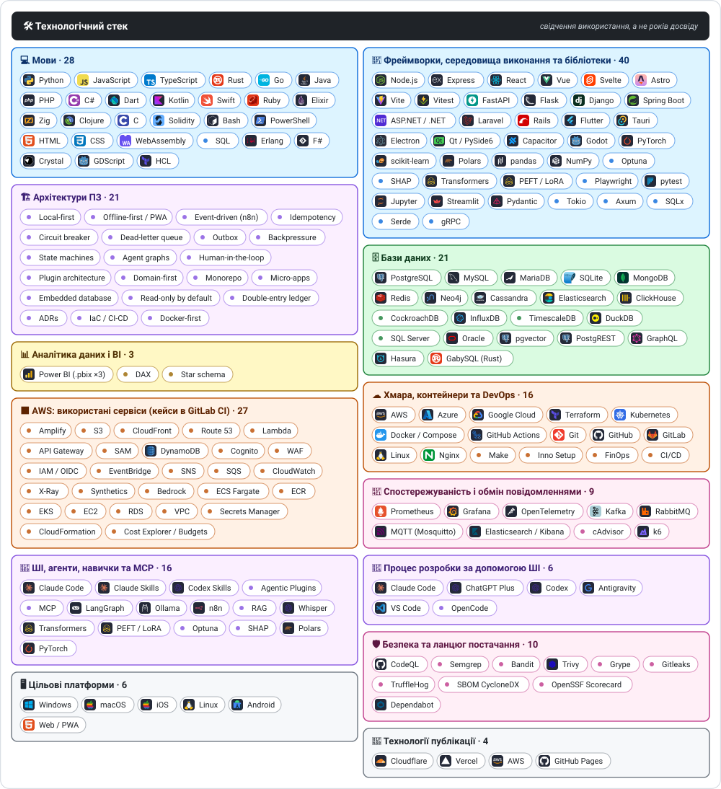
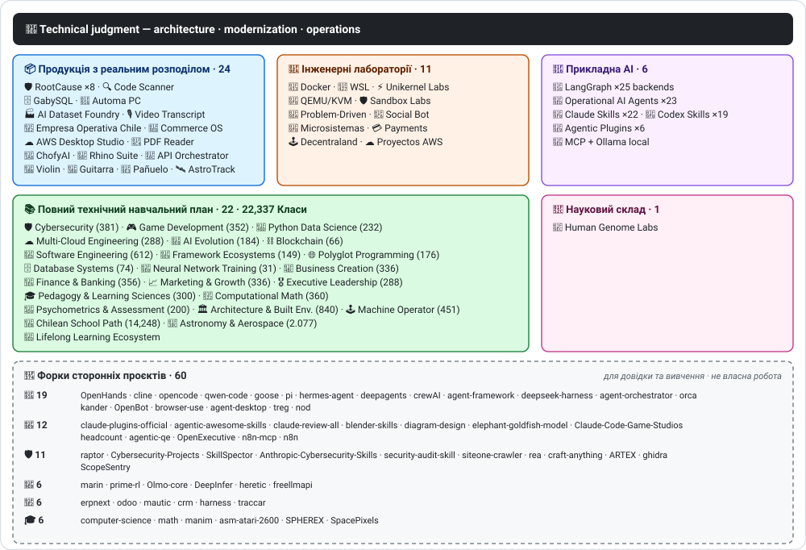

# 👋Володимир Акуня

## **Інженер зі ШІ·Архітектор рішення·Старший повний ступінь·Цифрова трансформація·Управління та операції**

**Професійна підготовка до комп’ютерних наук та комп’ютерної інженерії та бізнес-адміністрації, з 16-річним будівництвом та робочим програмним забезпеченням в реальних умовах. Я з'єдную бізнес, люди, процеси та технології проектування, оцінка, постачання та стійкі рішення з технічним судом та оперативним поданням — за рахунок верифікованих доказів у цьому обліковому записі GitHub.**

<!-- STATS:START -->

<!-- STATS:END -->

[🧭 З чого почати](docs/START_HERE.uk.md) ·
[🌐 Portfolio (22 languages)](https://vladimiracunadev-create.github.io/) ·
[🧩 Ecosystem](#екосистема-на-погляді) ·
[🛠️ Технологічний стек](#-технологічний-стек) ·
[⚡ Evaluate me in 10 minutes](docs/guides/TECH_LEAD.uk.md) ·
[✅ Professional scope](#професійний-scope) ·
[🧭 Non-coding management](#управління-адміністрування-та-незгодні-можливості-карєри) ·
[📋 Матриця посад](PROFESIONAL_ROLES.uk.md) ·
[📬 Contact](#контакти)

**🌐 Повні версії:** [Español](README.md) · [English](README.en.md) · [Português](README.pt.md) · [Italiano](README.it.md) · [Français](README.fr.md) · [简体中文](README.zh.md) · [繁體中文](README.zh-TW.md) · [日本語](README.ja.md) · [한국어](README.ko.md) · [Türkçe](README.tr.md) · [Русский](README.ru.md) · [Tiếng Việt](README.vi.md) · [ไทย](README.th.md) · [Deutsch](README.de.md) · [Українська](README.uk.md) · [Polski](README.pl.md) · [العربية](README.ar.md) · [فارسی](README.fa.md) · [Bahasa Indonesia](README.id.md) · [Nederlands](README.nl.md) · [हिन्दी](README.hi.md) · [Ελληνικά](README.el.md)

**Технічна база:**
PHP 8 · Python · Rust · Go · Node/TS · Java 21 · .NET 8 · Dart/Flutter · WASM
· AWS · Terraform · Kubernetes · Docker · n8n · LangGraph/MCP · CI/CD · FinOps · Observability

**Бізнес-технологій міст:**
аналіз процесів і вимог·оцінка розчину·координація доставки·операції та безперервність·Управління ризиками·продукт і сервіс·техніко-технічна освіта

---

> [!NOTE]
> Цей профіль не перетворює можливості для досвіду. Визначено технічний досвід, переносні навички, вімкнені програми та цілі майбутнього розвитку. Заявка на GitHub є документальним або документальним, де щось**нема**закінчився, він зазначений таким чином.

## 🧭 З чого почати

Оберіть свій випадок і переходьте одразу до потрібного:

🧑‍💼 [Рекрутинг](docs/guides/RECRUITER.uk.md) · 💼 [Клієнт або фриланс](docs/guides/FREELANCE.uk.md) · 🛠️ [Технічна оцінка](docs/guides/TECH_LEAD.uk.md) · 🏢 [Бізнес і управління](docs/guides/BUSINESS.uk.md) · 🤝 [Співпраця та безпека](docs/guides/COLLABORATOR.uk.md) · 🎓 [Вчитися чи навчати](docs/guides/LEARNER.uk.md)

## 🎯Що ви знайдете тут

Це не “одна репо”: це екосистема з загальними стандартами.

- 🔁 **Відтворюються демо**— клон, біг, валід.
- 🧰 **Стандартний інструмент**— Макефи, Хаб КЛІ,`doctor`й`smoke`за репозиторію.
- 🛡️ **Захист глибини**— секретне сканування, політики та явно заборонені практики.
- 📈 **Відповідальність** — `/health`, `/ready`, `/metrics`, прилади, прилади,
- 📚 **Аудиторія-програма**— рекрутер, початківця, DevOps, або безпека, в залежності від репозиторій.
- 📦 **Розподіл продуктів**— завантажувальні релізи, контрольні та складові докази; підписи комерційного/магазину, заявлені у разі необхідності.
- 🌍 **Інтернаціоналізація** — цей профіль опубліковано 22 мовами, а портфоліо пропонує 154 публічні PDF (7 родин × 22 мови) (ES · EN · PT · IT · FR · ZH · ZH-TW · JA · KO · TR · RU · VI · TH · DE · UK · PL · AR · FA · ID · NL · HI · EL).
- 🧭 **Технічна чесність**— кожен випадок, позначений`OPERATIONAL`, `DOCUMENTED/SCAFFOLD`або`PLANNED`.

## ✅Вигідний статус

| Промисловість | Бетонні докази |
|---|---|
| 🧪 **Тестове покриття** | ДЖИС**850 тести**+ знезадувається над**503.8M запитів**(0 каструлі)·Оператив Чилі**230 тести** ·Автоматика**150 пітест** ·мульти-OS CI |
| 🤖 **Продукція-градусний агент** | Універсальні інженерні рішення**25/25 оперативних запобіжників**(кейси 01–25, 100% покриття)·Операційні агенти AI**23 агентів**з**69 детермінативних ОВД** |
| 🔗 **Інтеграція поліглоту** | **20 випадків**Надсилання на сайті: http://n8n→receiver**19 операцій**, індивідуально аудитовані Docker-· **18+ ДБ-двигуни** · **20+ контейнерів** ·11 візерунки |
| 📦 **Розсилка** | **166 релізи**через екосистему**67 державних репозиторіїв** ·монтажники та артефакти`.exe` · `.msi` · `.dmg` · `.apk`з контрольними та будівельними доказами; комерційні / зберігати підписи в процесі, де це можливо |
| 🛡️ **Мережа поставок** | КодQL·Семгреп·бензо·Триває·Гріпе·ГІДЛІКИ·Трьох·ЦП-Р·укр |
| 📚 **Культура** | **22337 класи**в порівнянні з 22 програм, підраховані[a workflow](.github/workflows/stats.yml)з реальної репозиторійної структури або в'єтнамського джерела, заявленого в репозиторію, не письмово вручну -·Кожна програма оголошує про своє редакційне становище та обмеження |
| 🌐 **Портфоліо** | Установлений PWA· **22 мов** · **154 PDF-файлів**генерується трубопроводом·API даних CV·конденсатор Android·Маяк 100 |
| 🔒 **Телеметрія** | Телеметрія Zero в судових продуктах і Empresa Operativa Chile — перевірена в кожній збудові (без Android`INTERNET`дозвіл |
| 🌐 **Оприлюднено сайт** | **57 GitHub Веб-сайти**—56 посадок, один за продукт, програму, або екосистемний навігатор, плюс портфель — кожен розгорнутий з власної репозиторій·всі 57 перевірені з HTTP`200` |

## 🛠️ Технологічний стек

Технології, виявлені в публічних репозиторіях (маніфести, залежності, контейнери та код), згруповані за напрямами. Присутність у репозиторії — зокрема в лабораторіях і навчальних програмах — є свідченням використання, а не заявою про роки виробничого досвіду.

**Архітектури ПЗ**

Local-first → [empresa-operativa-chile](https://github.com/vladimiracunadev-create/empresa-operativa-chile), [ai-dataset-foundry](https://github.com/vladimiracunadev-create/ai-dataset-foundry) · Event-driven → [social-bot-scheduler](https://github.com/vladimiracunadev-create/social-bot-scheduler) · Resilience → [problem-driven-systems-lab](https://github.com/vladimiracunadev-create/problem-driven-systems-lab) · Ledger → [universal-payments-engineering-lab](https://github.com/vladimiracunadev-create/universal-payments-engineering-lab) · Plugins → [agentic-plugins-toolkit](https://github.com/vladimiracunadev-create/agentic-plugins-toolkit) · Agents → [langgraph-realworld](https://github.com/vladimiracunadev-create/langgraph-realworld), [operational-ai-agents](https://github.com/vladimiracunadev-create/operational-ai-agents) · Domain-first → [rhino-suite](https://github.com/vladimiracunadev-create/rhino-suite) · Micro-apps → [microsistemas](https://github.com/vladimiracunadev-create/microsistemas) · Embedded DB → [gabysql](https://github.com/vladimiracunadev-create/gabysql) · IaC → [proyectos-aws](https://github.com/vladimiracunadev-create/proyectos-aws)

**Аналітика даних і BI**

Power BI (.pbix ×3) · DAX · Star schema → [social-bot-scheduler](https://github.com/vladimiracunadev-create/social-bot-scheduler)

**AWS: використані сервіси (кейси в GitLab CI)**

Кейси A–P → [proyectos-aws-gitlab](https://gitlab.com/vladimir.acuna.dev-group/proyectos-aws-gitlab) (GitLab CI → AWS; усі 16 заявлено як завершені; кейс M — лише фаза 1) · [proyectos-aws](https://github.com/vladimiracunadev-create/proyectos-aws) (GitHub Actions) · EC2, RDS, VPC, Secrets Manager, CloudFormation, Cost Explorer → [aws-desktop-studio](https://github.com/vladimiracunadev-create/aws-desktop-studio) (реальні запити інвентаризації; EC2 із запуском, зупинкою та перезавантаженням під подвійним контролем)

**Процес розробки за допомогою ШІ**

| КОМПЛЕКС | Головна |
|---|---|
| **Код товару** | Архітектурний огляд, впровадження та технічна документація |
| **ЧаГП плюс** | Аналіз, архітектура, ітерація (з 2023) |
| **Кодx** | генерація та рефакторинг коду |
| **Антигравітність** | Прискорення процесів розробки та автоматизації |
| **Код ВС / OpenCode** | Навколишнє середовище з інтегрованою службою AI |

> Я поєдную власний технічний суд, вірування людини та архітектурний напрямок. Амплітує продуктивність, швидкість та досягне — це не замінює досвід.

**Технології публікації**

Cloudflare (особиста робота) · Vercel (хакатон NASA Space Apps) · AWS (робочі вебсайти, пов'язані з GitLab) · GitHub Pages

## 🗺️Екосистема на погляді

## 🗂️ Екосистема: продукти, лабораторії, прикладний ШІ, навчальні програми та наукові обчислення

Практична робота профілю винесена в окремий документ: програми, які завантажують і встановлюють, інженерні лабораторії, прикладний ШІ, повні технічні навчальні програми та наукові обчислення, а також опис кожного форку сторонніх проєктів в акаунті.

- 📦 [**Продукція з реальним розподілом**](docs/ECOSYSTEM.uk.md#products) (24)
- 🧪 [**Інженерні лабораторії**](docs/ECOSYSTEM.uk.md#labs) (11)
- 🤖 [**Прикладна AI**](docs/ECOSYSTEM.uk.md#ai) (6)
- 📚 [**Повний технічний навчальний план**](docs/ECOSYSTEM.uk.md#curricula) (22)
- 🔬 [**Науковий склад**](docs/ECOSYSTEM.uk.md#science) (1)
- 🍴 [**Форки сторонніх проєктів**](docs/ECOSYSTEM.uk.md#forks) (60)

👉 **[Переглянути всю екосистему](docs/ECOSYSTEM.uk.md)** · [🍴 Форки сторонніх проєктів](docs/ECOSYSTEM.uk.md#forks)

## 🛰️ Хакатон NASA Space Apps 2026

Я брав участь у **NASA Space Apps Challenge 2026** (Сантьяго, 14–15 листопада) у завданні *Planet X and SPHEREx* у команді з 6 осіб. Продукт — **AstroTrack · SPHEREx**: вебпереглядач, де вводяться координати неба, а ця ділянка показується як послідовність знімків SPHEREx у часі, на даних NASA/IPAC IRSA.

- **Моя частина:** доступ до даних (запити до IRSA з кешем і наперед обчислені поля демо), пакування (PWA, настільні інсталятори на Tauri та APK для Android на Capacitor), розділ «Завантаження» та аудит узгодженості документації й коду.
- **Перевірювана поставка:** [spherex-releases](https://github.com/vladimiracunadev-create/spherex-releases) збирає 7 релізів (від v0.1.0 до v0.4.2) із контрольними сумами SHA-256 · [вебзастосунок](https://spherex-planet-x-tau.vercel.app/) · [репозиторій команди](https://github.com/mauriciovalenzuela742/SPHEREX).
- **Заявлені обмеження:** переглядач, дизайн і решта бекенду — робота інших учасників команди; інсталятори не підписані й не перевірялися на реальних пристроях; я використовував ШІ (Claude Code) як помічника, що зазначено в репозиторії. Це описує мій внесок, а не результат хакатону.

## 🧠Стандарти, які я застосовую в усіх репозиторіях

- **DX перший**— якщо це не просто, не корисно як демо, так і як командна база.
- **Спостереження за днем 1**— метрики і слідованість, не післясумка.
- **Безпека як трубопровод**— секретне сканування, SBOM за випуск, явно заборонені практики.
- **Реальна резистентність**— ідемпотенція, вимикач, контрольний деградація.
- **Поліглот за проектом**— мова та двигун, вибраний за допомогою кейсу, ніколи не модним.
- **Хонсти про статус**— одна репо була перейменована (`Multisimulador` → `machine-operator-program`) щоб уникнути перспективних програм, які ще не існує.
- **Значки сигнальні, не докази**— кожен репо також проголошує**що це не робить**.
- **Модель поза**— домен розроблений першим; інтерфейс – проекція.
- **Зовнішня робота продекларована як зовнішнім** — [60 форків](docs/ECOSYSTEM.uk.md#forks) сторонніх проєктів описано поодинці, і вони не входять до жодної цифри власних робіт цього профілю.

## ✅Професійний Scope

Мій подвійний фон —**Комп'ютерна наука та обчислювальна інженерія + бізнес-адміністрування**— допомагає перевести цілі бізнесу в технічні рішення та технічні обмеження в чіткі параметри операцій, товарів, клієнтів та керівництва.

### 🎯Назва ядра

| , , , , , , , , , , , , , , , , , , , , , , , , , , , , , , , , , , , , , , , , , , , , , , , , , , , , , , , , , , , , , , , , , , , , , , , , , , , , , , , , , , , , , , , , , , , , , , , , , , , , , , , , , , , , , , , , , , , , , , , , , , , , , , , , | Зареєструватися |
|---|---|
| **Архітектор рішення** | Модульний, масштабований дизайн системи з еволюцією |
| **Архітектор з модернізації спадщини** | Реальна еволюція спадщини (PHP 5.x→8.x, неперервне рефакторинг без перервних операцій) |
| **Старший повний набір / Tech Lead** | Архітектура, виконання та стандарти на реальних платформах (+16 років) |
| **Архітектор AI Automation** | Агентичні системи з LangGraph/MCP та n8n потоки з охороною |

### ↗ Природне розширення

**Інженер з оркестру AI** · **Системи / Інженер-рум** · **Мобільний інженер (Flutter)** · **Інженер-консультант з питань автоматизації** · **Технічний конструктор продуктів** · **Технічний тренер** · **Консультант з цифрової трансформації** · **Бізнес / Функціональний аналітик** · **Технічні продукти** · **AI Engineer (LLM / ML)** · **Data Engineer** · **DevSecOps / AppSec Engineer** · **QA Automation / Test Engineer** · **Technical Writer** · **Викладач / Тренер / Інструктор з технологій** · **Instructional Designer (EdTech)** · **Technical Mentor**

### ⚙️Додаткова сфера

Інженер-платформа / ВПО·Демопс / CI-CD·Хмар / інженер AWS·Додаток SRE·Інженер з автоматизації·Технічно-комерційний консультант · Backend / API Engineer · Fintech / Payments Engineer · Developer Advocate / DevRel

## 🧭Управління, адміністрування та незгодні можливості кар'єри

Ролі в управлінні, адмініструванні та бізнесі, де інформатика й менеджмент приносять користь, а програмування не є головним завданням; класифіковані чесно (переносна компетентність, можливість подання заявки або майбутня мета) із зазначенням прогалини для кожної. Охоплені напрями:

Керівництво по технології · Управління проектами · Управління бізнесом · Стратегія та зміни · Бізнес-аналіз · Продукція та сервіс · Управління кібербезпекою · Продаж комерційної нерухомості · Finance and management control · Якість · Освіта · Логістика та постачальники · Управління даними та AI · Громадська галузь

👉 **[Переглянути повну матрицю можливостей](docs/MANAGEMENT.uk.md)**

## 📌Наявність

**Відкрито:**Старший повний ступінь·Мистецтво·модернізація спадщини·Платформа/IDP·Додаток SRE·регматичний DevOps·Автоматика·Автоматизація AI·бізнес-процеси·Організація проекту IT·Продукція·цифрова трансформація·консалтинг / продаж·техніко-технічна освіта·якість і безперервне вдосконалення·Імплементація та управління AI

**Оцінено за кожним напрямком ролі:**Менеджер з продажу / технічний менеджер·Доставка послуг·ІТ-операції·ГРК / технологічний ризик·адміністрування та операції·контроль управління·модернізація громадського сектору. Виконавчі та загальні заголовки є майбутніми досягненнями розвитку, не заявленими досвідом.

**Модальність:**дистанційно або гібридні, в залежності від проекту.

## 📬Контакти

---

[🤝 Contribute](CONTRIBUTING.uk.md) ·
[🛡️ Security](SECURITY.uk.md) ·
[⚖️ Code of Conduct](CODE_OF_CONDUCT.uk.md)

README синхронізовано з перевірюваним станом публічних репозиторіїв —цифри та зміни зчитуються через API— · остання перевірка: <!-- VERIFIED:START -->2026-11-24<!-- VERIFIED:END -->.

