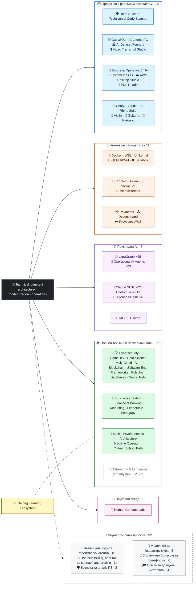

<div align="center">

# 👋Володимир Акуня

## **Архітектор рішення·Старший повний ступінь·Цифрова трансформація·Управління та операції**

**Професійна підготовка до комп’ютерних наук та комп’ютерної інженерії та бізнес-адміністрації, з 16-річним будівництвом та робочим програмним забезпеченням в реальних умовах. Я з'єдную бізнес, люди, процеси та технології проектування, оцінка, постачання та стійкі рішення з технічним судом та оперативним поданням — за рахунок верифікованих доказів у цьому обліковому записі GitHub.**

[](https://vladimiracunadev-create.github.io/)
[](https://www.linkedin.com/in/vladimir-acu%C3%B1a-valdebenito-11924a29/)
[](mailto:vladimir.acuna.dev@gmail.com)

[](#професійний-scope)
[](docs/ECOSYSTEM.uk.md)
[](#повний-технічний-навчальний-план)

<!-- STATS:START -->
[](https://github.com/vladimiracunadev-create?tab=repositories)
[](https://github.com/vladimiracunadev-create?tab=repositories)
[](#екосистема-на-погляді)
[](#повний-технічний-навчальний-план)
[](https://github.com/vladimiracunadev-create?tab=repositories)
[](docs/ECOSYSTEM.uk.md#forks)
[](https://github.com/vladimiracunadev-create?tab=repositories)
[](https://github.com/pulls?q=author%3Avladimiracunadev-create+type%3Apr)
[](https://github.com/issues?q=author%3Avladimiracunadev-create+type%3Aissue)
<!-- STATS:END -->

[](https://github.com/vladimiracunadev-create?tab=repositories)
[](https://github.com/vladimiracunadev-create?tab=followers)

[🌐 Portfolio (22 languages)](https://vladimiracunadev-create.github.io/) ·
[🧩 Ecosystem](#екосистема-на-погляді) ·
[🛠️ Технологічний стек](#-технологічний-стек) ·
[⚡ Evaluate me in 10 minutes](#якщо-ви-маєте-10-хвилин-щоб-оцінити-мене) ·
[✅ Professional scope](#професійний-scope) ·
[🧭 Non-coding management](#управління-адміністрування-та-незгодні-можливості-карєри) ·
[📋 Role matrix](PROFESIONAL_ROLES.md) ·
[📬 Contact](#контакти)

**🌐 Повні версії:** [Español](README.md) · [English](README.en.md) · [Português](README.pt.md) · [Italiano](README.it.md) · [Français](README.fr.md) · [简体中文](README.zh.md) · [繁體中文](README.zh-TW.md) · [日本語](README.ja.md) · [한국어](README.ko.md) · [Türkçe](README.tr.md) · [Русский](README.ru.md) · [Tiếng Việt](README.vi.md) · [ไทย](README.th.md) · [Deutsch](README.de.md) · [Українська](README.uk.md) · [Polski](README.pl.md) · [العربية](README.ar.md) · [فارسی](README.fa.md) · [Bahasa Indonesia](README.id.md) · [Nederlands](README.nl.md) · [हिन्दी](README.hi.md) · [Ελληνικά](README.el.md)

**Технічна база:**
PHP 8 · Python · Rust · Go · Node/TS · Java 21 · .NET 8 · Dart/Flutter · WASM
· AWS · Terraform · Kubernetes · Docker · n8n · LangGraph/MCP · CI/CD · FinOps · Observability

**Бізнес-технологій міст:**
аналіз процесів і вимог·оцінка розчину·координація доставки·операції та безперервність·Управління ризиками·продукт і сервіс·техніко-технічна освіта

</div>

---

> [!NOTE]
> Цей профіль не перетворює можливості для досвіду. Визначено технічний досвід, переносні навички, вімкнені програми та цілі майбутнього розвитку. Заявка на GitHub є документальним або документальним, де щось**нема**закінчився, він зазначений таким чином.

## 🎯Що ви знайдете тут

Це не “одна репо”: це екосистема з загальними стандартами.

- 🔁 **Відтворюються демо**— клон, біг, валід.
- 🧰 **Стандартний інструмент**— Макефи, Хаб КЛІ,`doctor`й`smoke`за репозиторію.
- 🛡️ **Захист глибини**— секретне сканування, політики та явно заборонені практики.
- 📈 **Відповідальність** — `/health`, `/ready`, `/metrics`, прилади, прилади,
- 📚 **Аудиторія-програма**— рекрутер, початківця, DevOps, або безпека, в залежності від репозиторій.
- 📦 **Розподіл продуктів**— завантажувальні релізи, контрольні та складові докази; підписи комерційного/магазину, заявлені у разі необхідності.
- 🌍 **Інтернаціоналізація** — цей профіль опубліковано 22 мовами, а портфоліо пропонує 154 публічні PDF (7 родин × 22 мови) (ES · EN · PT · IT · FR · ZH · ZH-TW · JA · KO · TR · RU · VI · TH · DE · UK · PL · AR · FA · ID · NL · HI · EL).
- 🧭 **Технічна чесність**— кожен випадок, позначений`OPERATIONAL`, `DOCUMENTED/SCAFFOLD`або`PLANNED`.

## ✅Вигідний статус

| Промисловість | Бетонні докази |
|---|---|
| 🧪 **Тестове покриття** | ДЖИС**850 тести**+ знезадувається над**503.8M запитів**(0 каструлі)·Оператив Чилі**230 тести** ·Автоматика**150 пітест** ·мульти-OS CI |
| 🤖 **Продукція-градусний агент** | Універсальні інженерні рішення**25/25 оперативних запобіжників**(кейси 01–25, 100% покриття)·Операційні агенти AI**23 агентів**з**69 детермінативних ОВД** |
| 🔗 **Інтеграція поліглоту** | **20 випадків**Надсилання на сайті: http://n8n→receiver**19 операцій**, індивідуально аудитовані Docker-· **18+ ДБ-двигуни** · **20+ контейнерів** ·11 візерунки |
| 📦 **Розсилка** | **155 релізи**через екосистему**65 державних репозиторіїв** ·монтажники та артефакти`.exe` · `.msi` · `.dmg` · `.apk`з контрольними та будівельними доказами; комерційні / зберігати підписи в процесі, де це можливо |
| 🛡️ **Мережа поставок** | КодQL·Семгреп·бензо·Триває·Гріпе·ГІДЛІКИ·Трьох·ЦП-Р·укр |
| 📚 **Культура** | **14550 класи**в порівнянні з 21 програм, підраховані[a workflow](.github/workflows/stats.yml)з реальної репозиторійної структури або в'єтнамського джерела, заявленого в репозиторію, не письмово вручну -·Кожна програма оголошує про своє редакційне становище та обмеження |
| 🌐 **Портфоліо** | Установлений PWA· **22 мов** · **154 PDF-файлів**генерується трубопроводом·API даних CV·конденсатор Android·Маяк 100 |
| 🔒 **Телеметрія** | Телеметрія Zero в судових продуктах і Empresa Operativa Chile — перевірена в кожній збудові (без Android`INTERNET`дозвіл |
| 🌐 **Оприлюднено сайт** | **57 GitHub Веб-сайти**—56 посадок, один за продукт, програму, або екосистемний навігатор, плюс портфель — кожен розгорнутий з власної репозиторій·всі 57 перевірені з HTTP`200` |

## 🛠️ Технологічний стек

Технології, виявлені в публічних репозиторіях (маніфести, залежності, контейнери та код), згруповані за напрямами. Присутність у репозиторії — зокрема в лабораторіях і навчальних програмах — є свідченням використання, а не заявою про роки виробничого досвіду.

**Мови**


<sub>Python · JavaScript · TypeScript · Rust · Go · Java · PHP · C# · Dart · Kotlin · Swift · Ruby · Elixir · Zig · Clojure · C · Solidity · Bash · PowerShell · HTML · CSS · WebAssembly · SQL · Erlang · F# · Crystal · GDScript · HCL</sub>

**Фреймворки, середовища виконання та бібліотеки**


<sub>Node.js · Express · React · Vue · Svelte · Astro · Vite · Vitest · FastAPI · Flask · Django · Spring Boot · ASP.NET / .NET · Laravel · Rails · Flutter · Tauri · Electron · Qt / PySide6 · Capacitor · Godot · PyTorch · scikit-learn · Polars · pandas · NumPy · Optuna · SHAP · Transformers · PEFT / LoRA · Playwright · pytest · Jupyter · Streamlit · Pydantic · Tokio · Axum · SQLx · Serde</sub>

**Бази даних**


<sub>PostgreSQL · MySQL · MariaDB · SQLite · MongoDB · Redis · Neo4j · Cassandra · Elasticsearch · ClickHouse · CockroachDB · InfluxDB · TimescaleDB · DuckDB · SQL Server · Oracle · pgvector · PostgREST · GraphQL · GabySQL (Rust)</sub>

**Хмара, контейнери та DevOps**


<sub>AWS · Terraform · Kubernetes · Docker / Compose · GitHub Actions · Git · GitHub · GitLab · Linux · Nginx · Make · Inno Setup · FinOps · CI/CD</sub>

**Спостережуваність і обмін повідомленнями**


<sub>Prometheus · Grafana · OpenTelemetry · Kafka · MQTT (Mosquitto) · Elasticsearch / Kibana · cAdvisor · k6</sub>

**ШІ, агенти, навички та MCP**


<sub>Claude Code · Claude Skills · Codex Skills · Agentic Plugins · MCP · LangGraph · Ollama · n8n · RAG · Whisper · Transformers · PEFT / LoRA · Optuna · SHAP · Polars · PyTorch</sub>

**Безпека та ланцюг постачання**


**Цільові платформи**


<sub>Windows · macOS · iOS · Linux · Android · Web / PWA</sub>

## 🗺️Екосистема на погляді



## 🗂️ Екосистема: продукти, лабораторії, прикладний ШІ, навчальні програми та наукові обчислення

Практична робота профілю винесена в окремий документ: програми, які завантажують і встановлюють, інженерні лабораторії, прикладний ШІ, повні технічні навчальні програми та наукові обчислення, а також опис кожного форку сторонніх проєктів в акаунті.

- 📦 **Продукція з реальним розподілом** (22)
- 🧪 **Інженерні лабораторії** (11)
- 🤖 **Прикладна AI** (6)
- 📚 **Повний технічний навчальний план** (21)
- 🔬 **Науковий склад** (1)
- 🍴 **Форки сторонніх проєктів** (52)

👉 **[Переглянути всю екосистему](docs/ECOSYSTEM.uk.md)** · [🍴 Форки сторонніх проєктів](docs/ECOSYSTEM.uk.md#forks)

## 📚Повний технічний навчальний план

Напрями діяльності іспанської мови, з статусом та сферою, що засвідчує кожну репозиторію. 21 програми додано**14550 класи**, підрахунок[a workflow](.github/workflows/stats.yml)з реальної структури репозиторій або в'єтнамського джерела, заявленого в репозиторію; значок освіжає щотижневий і не письмовий вручну.

🌌 **У плануванні, поза підрахунком:** [Астрономія, астрофізика, космічні науки та аерокосмічна інженерія](https://github.com/vladimiracunadev-create/astronomy-astrophysics-space-sciences-aerospace-engineering-learning-program) — 2.077 запланованих занять у 12 напрямах і 133 блоках; у 397 написано текст, усі поки в статусі E0. Незалежне навчання, а не професійна атестація · [сайт](https://vladimiracunadev-create.github.io/astronomy-astrophysics-space-sciences-aerospace-engineering-learning-program/).

👉 **[Переглянути всі 21 програму](docs/ECOSYSTEM.uk.md#curricula)**

## ⚡Якщо ви маєте 10 хвилин, щоб оцінити мене

Ідея не просто подивитися на код: це подивитися**Як я думаю**, як я документ, і як я зробити все прийнятним.

**Маршрут А — Реал спостережності та оркестрування***(my улюблений)*

```bash
git clone https://github.com/vladimiracunadev-create/social-bot-scheduler.git
```

Ви побачите робочі процеси, метрики, прилади, охоронці по 20 корпусах та 18+ ДБ-двигунів.

**Маршрут B — Відповідна інфраструктура за хвилину**

```bash
git clone https://github.com/vladimiracunadev-create/docker-labs.git
```

**Маршрут С — Агенти з типом**

```bash
git clone https://github.com/vladimiracunadev-create/langgraph-realworld.git
```

**Маршрут D — Rust forensic продукт, без склінінгу**

Завантажити інсталятор або CLI бінарні з[RootCause releases](https://github.com/vladimiracunadev-create/rootcause-windows-inspector/releases)і перевірка`SHA256SUMS`.

## 🧠Стандарти, які я застосовую в усіх репозиторіях

- **DX перший**— якщо це не просто, не корисно як демо, так і як командна база.
- **Спостереження за днем 1**— метрики і слідованість, не післясумка.
- **Безпека як трубопровод**— секретне сканування, SBOM за випуск, явно заборонені практики.
- **Реальна резистентність**— ідемпотенція, вимикач, контрольний деградація.
- **Поліглот за проектом**— мова та двигун, вибраний за допомогою кейсу, ніколи не модним.
- **Хонсти про статус**— одна репо була перейменована (`Multisimulador` → `machine-operator-program`) щоб уникнути перспективних програм, які ще не існує.
- **Значки сигнальні, не докази**— кожен репо також проголошує**що це не робить**.
- **Модель поза**— домен розроблений першим; інтерфейс – проекція.
- **Зовнішня робота продекларована як зовнішнім** — [52 форків](docs/ECOSYSTEM.uk.md#forks) сторонніх проєктів описано поодинці, і вони не входять до жодної цифри власних робіт цього профілю.

## ✅Професійний Scope

Мій подвійний фон —**Комп'ютерна наука та обчислювальна інженерія + бізнес-адміністрування**— допомагає перевести цілі бізнесу в технічні рішення та технічні обмеження в чіткі параметри операцій, товарів, клієнтів та керівництва.

### 🎯Назва ядра

| , , , , , , , , , , , , , , , , , , , , , , , , , , , , , , , , , , , , , , , , , , , , , , , , , , , , , , , , , , , , , , , , , , , , , , , , , , , , , , , , , , , , , , , , , , , , , , , , , , , , , , , , , , , , , , , , , , , , , , , , , , , , , , , , | Зареєструватися |
|---|---|
| **Архітектор рішення** | Модульний, масштабований дизайн системи з еволюцією |
| **Архітектор з модернізації спадщини** | Реальна еволюція спадщини (PHP 5.x→8.x, неперервне рефакторинг без перервних операцій) |
| **Старший повний набір / Tech Lead** | Архітектура, виконання та стандарти на реальних платформах (+16 років) |
| **Архітектор AI Automation** | Агентичні системи з LangGraph/MCP та n8n потоки з охороною |

### ↗ Природне розширення

**Інженер з оркестру AI** · **Системи / Інженер-рум** · **Мобільний інженер (Flutter)** · **Інженер-консультант з питань автоматизації** · **Технічний конструктор продуктів** · **Технічний тренер** · **Консультант з цифрової трансформації** · **Бізнес / Функціональний аналітик** · **Технічні продукти**

### ⚙️Додаткова сфера

Інженер-платформа / ВПО·Демопс / CI-CD·Хмар / інженер AWS·Додаток SRE·Інженер з автоматизації·Технічно-комерційний консультант

## 🧭Управління, адміністрування та незгодні можливості кар'єри

Ролі в управлінні, адмініструванні та бізнесі, де інформатика й менеджмент приносять користь, а програмування не є головним завданням; класифіковані чесно (переносна компетентність, можливість подання заявки або майбутня мета) із зазначенням прогалини для кожної. Охоплені напрями:

Керівництво по технології · Управління проектами · Управління бізнесом · Стратегія та зміни · Бізнес-аналіз · Продукція та сервіс · Управління кібербезпекою · Продаж комерційної нерухомості · Finance and management control · Якість · Освіта · Логістика та постачальники · Управління даними та AI · Громадська галузь

👉 **[Переглянути повну матрицю можливостей](docs/MANAGEMENT.uk.md)**

## 🤖Процес розробки за допомогою ШІ

| КОМПЛЕКС | Головна |
|---|---|
| **Код товару** | Архітектурний огляд, впровадження та технічна документація |
| **ЧаГП плюс** | Аналіз, архітектура, ітерація (з 2023) |
| **Кодx** | генерація та рефакторинг коду |
| **Антигравітність** | Прискорення процесів розробки та автоматизації |
| **Код ВС / OpenCode** | Навколишнє середовище з інтегрованою службою AI |

> Я поєдную власний технічний суд, вірування людини та архітектурний напрямок. Амплітує продуктивність, швидкість та досягне — це не замінює досвід.

## 📌Наявність

**Відкрито:**Старший повний ступінь·Мистецтво·модернізація спадщини·Платформа/IDP·Додаток SRE·регматичний DevOps·Автоматика·Автоматизація AI·бізнес-процеси·Організація проекту IT·Продукція·цифрова трансформація·консалтинг / продаж·техніко-технічна освіта·якість і безперервне вдосконалення·Імплементація та управління AI

**Оцінено за кожним напрямком ролі:**Менеджер з продажу / технічний менеджер·Доставка послуг·ІТ-операції·ГРК / технологічний ризик·адміністрування та операції·контроль управління·модернізація громадського сектору. Виконавчі та загальні заголовки є майбутніми досягненнями розвитку, не заявленими досвідом.

**Модальність:**дистанційно або гібридні, в залежності від проекту.

## 📬Контакти

[](https://vladimiracunadev-create.github.io/)
[](https://www.linkedin.com/in/vladimir-acu%C3%B1a-valdebenito-11924a29/)
[](https://gitlab.com/vladimir.acuna.dev-group/vladimir.acuna.dev-group)
[](mailto:vladimir.acuna.dev@gmail.com)

---

<div align="center">

[🤝 Contribute](CONTRIBUTING.en.md) ·
[🛡️ Security](SECURITY.en.md) ·
[⚖️ Code of Conduct](CODE_OF_CONDUCT.en.md)

<sub>README синхронізовано з перевірюваним станом публічних репозиторіїв —цифри та зміни зчитуються через API— · остання перевірка: <!-- VERIFIED:START -->2026-11-09<!-- VERIFIED:END -->.</sub>

</div>
