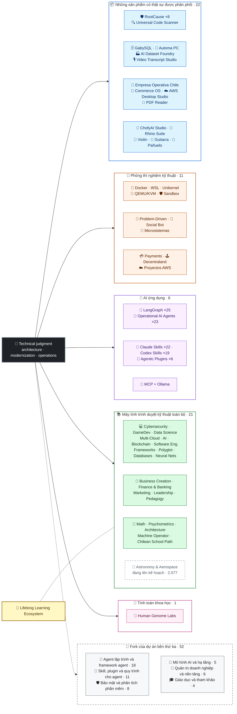

<div align="center">

# 👋Vladimir Acuña

## **Kiến trúc giải quyết·Người đầy đủ cao cấp·Biến hình số·Quản lý & thao tác**

**Professionally trained in Computer Science and Computing Engineering and Business Administration, with 16+ years building and operating software in real environments. I connect business, people, processes, and technology to design, evaluate, deliver, and sustain solutions with technical judgment and an operational view — backed by verifiable evidence in this GitHub account.**

[](https://vladimiracunadev-create.github.io/)
[](https://www.linkedin.com/in/vladimir-acu%C3%B1a-valdebenito-11924a29/)
[](mailto:vladimir.acuna.dev@gmail.com)

[](#phạm-vi-chuyên-nghiệp)
[](docs/ECOSYSTEM.vi.md)
[](#máy-tính-trình-duyệt-kỹ-thuật-toàn-bộ)

<!-- STATS:START -->
[](https://github.com/vladimiracunadev-create?tab=repositories)
[](https://github.com/vladimiracunadev-create?tab=repositories)
[](#hệ-thống-sinh-thái-đang-hưng-thịnh)
[](#máy-tính-trình-duyệt-kỹ-thuật-toàn-bộ)
[](https://github.com/vladimiracunadev-create?tab=repositories)
[](docs/ECOSYSTEM.vi.md#forks)
[](https://github.com/vladimiracunadev-create?tab=repositories)
[](https://github.com/pulls?q=author%3Avladimiracunadev-create+type%3Apr)
[](https://github.com/issues?q=author%3Avladimiracunadev-create+type%3Aissue)
<!-- STATS:END -->

[](https://github.com/vladimiracunadev-create?tab=repositories)
[](https://github.com/vladimiracunadev-create?tab=followers)

[🌐 Portfolio (22 languages)](https://vladimiracunadev-create.github.io/) ·
[🧩 Ecosystem](#hệ-thống-sinh-thái-đang-hưng-thịnh) ·
[🛠️ Ngăn xếp công nghệ](#-ngăn-xếp-công-nghệ) ·
[⚡ Evaluate me in 10 minutes](#nếu-anh-có-10-phút-để-đánh-giá-tôi) ·
[✅ Professional scope](#phạm-vi-chuyên-nghiệp) ·
[🧭 Non-coding management](#quản-lý-quản-lý-và-không-kiểm-soát-sự-bất-tiện-của-các-nhà-kinh-doanh) ·
[📋 Role matrix](PROFESIONAL_ROLES.md) ·
[📬 Contact](#liên-hệ)

**🌐 Phiên bản đầy đủ:** [Español](README.md) · [English](README.en.md) · [Português](README.pt.md) · [Italiano](README.it.md) · [Français](README.fr.md) · [简体中文](README.zh.md) · [繁體中文](README.zh-TW.md) · [日本語](README.ja.md) · [한국어](README.ko.md) · [Türkçe](README.tr.md) · [Русский](README.ru.md) · [Tiếng Việt](README.vi.md) · [ไทย](README.th.md) · [Deutsch](README.de.md) · [Українська](README.uk.md) · [Polski](README.pl.md) · [العربية](README.ar.md) · [فارسی](README.fa.md) · [Bahasa Indonesia](README.id.md) · [Nederlands](README.nl.md) · [हिन्दी](README.hi.md) · [Ελληνικά](README.el.md)

**Trung tâm kỹ thuật:**
PHP 8 · Python · Rust · Go · Node/TS · Java 21 · .NET 8 · Dart/Flutter · WASM
· AWS · Terraform · Kubernetes · Docker · n8n · LangGraph/MCP · CI/CD · FinOps · Observability

**Cầu công nghệ kinh doanh–:**
Phân tích tiến trình và yêu cầu·Đánh giá giải pháp·phối hợp giao hàng·thao tác và liên tục·rủi ro quản lý·sản phẩm và dịch vụ·Giáo dục kỹ thuật

</div>

---

> [!NOTE]
> Hồ sơ này không biến cơ hội thành kinh nghiệm. Kinh nghiệm kỹ thuật, kỹ năng chuyển giao, ứng dụng khả thi và mục tiêu phát triển tương lai được tách biệt rõ ràng. Bằng chứng liên kết của GitHub có thể thực hiện được hoặc tài liệu; nơi có một cái gì đó**không phải**xong, được nói như thế.

## 🎯Những gì bạn sẽ tìm thấy ở đây

Đây không phải là “một sự bãi bỏ: đó là một hệ sinh thái có cùng tiêu chuẩn.

- 🔁 **Bản thử nghiệm không được hỗ trợ**- Nhân bản, chạy, xác nhận.
- 🧰 **Bánh ngọt chuẩn hoá**- Tạo ra tập tin, máy nghe trộm,`doctor`, và`smoke`Mỗi kho.
- 🛡️ **Phòng thủ sâu**— quét bí mật, chính sách và những thực hành rõ ràng bị cấm đoán.
- 📈 **Khả năng quan sát** — `/health`, `/ready`, `/metrics`Bảng điều khiển, và khả năng truy tìm.
- 📚 **Tài liệu hướng dẫn khán giả- ý thức**— Người tuyển dụng, người mới bắt đầu, người bị giam giữ, hay người bảo vệ, tùy thuộc vào kho tàng.
- 📦 **Phân phối sản phẩm**— Những chương trình phát hành, kiểm tra và xây dựng bằng chứng; những ký hiệu thương mại/ hàng hóa được công bố là đang chờ khi được áp dụng.
- 🌍 **Quốc tế hoá** — hồ sơ này được xuất bản bằng 22 ngôn ngữ và portfolio cung cấp 154 tệp PDF công khai (7 nhóm × 22 ngôn ngữ) (ES · EN · PT · IT · FR · ZH · ZH-TW · JA · KO · TR · RU · VI · TH · DE · UK · PL · AR · FA · ID · NL · HI · EL).
- 🧭 **Thành thật với kỹ thuật viên**- mọi trường hợp được dán nhãn`OPERATIONAL`, `DOCUMENTED/SCAFFOLD`, hoặc`PLANNED`.

## ✅Trạng thái có thể truy cập

| Bề mặt | Bằng chứng cụ thể |
|---|---|
| 🧪 **Kiểm tra tin tức** | GabySQUL**Thử ra 850**+ fuzzing trên**503. 8M truy vấn**(0 hoảng loạn)·Empresa Operativa Chile**Thử ra 230** ·Automa**150 py thử** ·Thông tin đa MSName |
| 🤖 **Các tác vụ cấp sản xuất** | Thế giới thật LangGraph**Hậu phương hoạt động 25/25**(case 01–25, 100% tin tức)·Đặc vụ AI hoạt động**23 đặc vụ**có**69 phép đánh giá xác định** |
| 🔗 **Sự kết hợp của bản sắc** | **20 thùng**Trình gửi ảnh cho người nhận thư —**19 Hoạt động**Từng cá nhân được kiểm toán với Docker· **18+B động cơ** · **20+ container** ·11 mẫu |
| 📦 **Phân phối** | **155 bản phát hành**xuyên qua hệ sinh thái của**65 thuộc quyền sở hữu các kho công cộng** ·Bộ cài đặt và tạo tác`.exe` · `.msi` · `.dmg` · `.apk`với việc kiểm tra tổng và tạo bằng chứng; thương mại/tore chữ ký trong tiến trình mà có thể ứng dụng |
| 🛡️ **Chuỗi cung cấp** | CodeQL·Semgrep·Cướp·Trivy·Grype·Gitleaks·TruffleHog·CM SBOM CcconeDX·Điểm |
| 📚 **Curricula** | **14.550 lớp**có thể kiểm tra trên 21 chương trình, được tính bằng[a workflow](.github/workflows/stats.yml)từ cơ cấu kho chứa thực sự hoặc một nguồn có thể xác nhận được tuyên bố trong kho - không phải bằng tay·Mỗi chương trình tuyên bố trạng thái và giới hạn của nó |
| 🌐 **Portfolio** | PWA có thể cài đặt· **22 ngôn ngữ** · **154 PDFs**tạo bởi ống dẫn·Name·Bộ tạo tích hợp a- rô- bốt·Căn nhà sáng 100 |
| 🔒 **Kính viễn vọng** | Không có máy đo trong sản phẩm pháp y và Empresa Operativa Chile — được kiểm tra trong mỗi tòa nhà (không có người máy)`INTERNET`Cho phép |
| 🌐 **Xuất ra các trang** | **57 trang GitHub**-56 hạ cánh, mỗi sản phẩm, chương trình, hay hệ sinh thái, cộng với danh mục đầu tư - mỗi người triển khai từ kho riêng của mình·tất cả 57 được kiểm tra với HTTP`200` |

## 🛠️ Ngăn xếp công nghệ

Các công nghệ được phát hiện trong kho mã công khai (tệp manifest, phụ thuộc, container và mã nguồn), nhóm theo lĩnh vực. Xuất hiện trong một kho mã — kể cả phòng thí nghiệm và giáo trình — là bằng chứng về việc sử dụng, không phải tuyên bố về nhiều năm kinh nghiệm vận hành thực tế.

**Ngôn ngữ**


<sub>Python · JavaScript · TypeScript · Rust · Go · Java · PHP · C# · Dart · Kotlin · Swift · Ruby · Elixir · Zig · Clojure · C · Solidity · Bash · PowerShell · HTML · CSS · WebAssembly · SQL · Erlang · F# · Crystal · GDScript · HCL</sub>

**Framework, môi trường chạy và thư viện**


<sub>Node.js · Express · React · Vue · Svelte · Astro · Vite · Vitest · FastAPI · Flask · Django · Spring Boot · ASP.NET / .NET · Laravel · Rails · Flutter · Tauri · Electron · Qt / PySide6 · Capacitor · Godot · PyTorch · scikit-learn · Polars · pandas · NumPy · Optuna · SHAP · Transformers · PEFT / LoRA · Playwright · pytest · Jupyter · Streamlit · Pydantic · Tokio · Axum · SQLx · Serde</sub>

**Cơ sở dữ liệu**


<sub>PostgreSQL · MySQL · MariaDB · SQLite · MongoDB · Redis · Neo4j · Cassandra · Elasticsearch · ClickHouse · CockroachDB · InfluxDB · TimescaleDB · DuckDB · SQL Server · Oracle · pgvector · PostgREST · GraphQL · GabySQL (Rust)</sub>

**Đám mây, container và DevOps**


<sub>AWS · Terraform · Kubernetes · Docker / Compose · GitHub Actions · Git · GitHub · GitLab · Linux · Nginx · Make · Inno Setup · FinOps · CI/CD</sub>

**Khả năng quan sát và nhắn tin**


<sub>Prometheus · Grafana · OpenTelemetry · Kafka · MQTT (Mosquitto) · Elasticsearch / Kibana · cAdvisor · k6</sub>

**AI, agent, skill và MCP**


<sub>Claude Code · Claude Skills · Codex Skills · Agentic Plugins · MCP · LangGraph · Ollama · n8n · RAG · Whisper · Transformers · PEFT / LoRA · Optuna · SHAP · Polars · PyTorch</sub>

**Bảo mật và chuỗi cung ứng**


**Nền tảng đích**


<sub>Windows · macOS · iOS · Linux · Android · Web / PWA</sub>

## 🗺️Hệ thống sinh thái đang hưng thịnh



## 🗂️ Hệ sinh thái: sản phẩm, phòng thí nghiệm, AI ứng dụng, giáo trình và tính toán khoa học

Phần thực hành của hồ sơ nằm trong một tài liệu riêng: phần mềm để tải về và cài đặt, phòng thí nghiệm kỹ thuật, AI ứng dụng, giáo trình kỹ thuật đầy đủ và tính toán khoa học, cùng mô tả từng fork của các dự án bên thứ ba có trong tài khoản.

- 📦 **Những sản phẩm có thật sự được phân phối** (22)
- 🧪 **Phòng thí nghiệm kỹ thuật** (11)
- 🤖 **AI ứng dụng** (6)
- 📚 **Máy tính trình duyệt kỹ thuật toàn bộ** (21)
- 🔬 **Tính toán khoa học** (1)
- 🍴 **Fork của dự án bên thứ ba** (52)

👉 **[Xem toàn bộ hệ sinh thái](docs/ECOSYSTEM.vi.md)** · [🍴 Fork của dự án bên thứ ba](docs/ECOSYSTEM.vi.md#forks)

## 📚Máy tính trình duyệt kỹ thuật toàn bộ

Sequential programs in Spanish, with status and scope declared by each repository. The 21 programs add up to **14,550 classes**, counted by [a workflow](.github/workflows/stats.yml) from real repository structure or a verifiable source declared in the repository; the badge refreshes weekly and is not written by hand.

🌌 **Đang lên kế hoạch, ngoài số đếm:** [Thiên văn học, vật lý thiên văn, khoa học vũ trụ và kỹ thuật hàng không vũ trụ](https://github.com/vladimiracunadev-create/astronomy-astrophysics-space-sciences-aerospace-engineering-learning-program) — 2.077 bài học dự kiến trong 12 lĩnh vực và 133 khối; 397 bài đã có văn bản, tất cả vẫn ở trạng thái E0. Đào tạo độc lập, không phải chứng chỉ hành nghề · [trang web](https://vladimiracunadev-create.github.io/astronomy-astrophysics-space-sciences-aerospace-engineering-learning-program/).

👉 **[Xem đầy đủ 21 chương trình](docs/ECOSYSTEM.vi.md#curricula)**

## ⚡Nếu anh có 10 phút để đánh giá tôi

Ý tưởng không chỉ là chỉ nhìn vào mã: nó là để xem**Tôi nghĩ sao?**tài liệu của tôi, và cách tôi làm mọi thứ có thể thực hiện được.

**Đường A — Thật sự khó đi và có sự dàn xếp***(người tôi yêu thích)*

```bash
git clone https://github.com/vladimiracunadev-create/social-bot-scheduler.git
```

Bạn sẽ thấy dòng chảy, số đo, bảng điều khiển và đường ống bảo vệ trong 20 trường hợp và 18+DB động cơ.

**Đường B — Cơ sở hạ tầng có khả năng phục hồi trong vài phút**

```bash
git clone https://github.com/vladimiracunadev-create/docker-labs.git
```

**Đường C — Các đặc vụ có chữ**

```bash
git clone https://github.com/vladimiracunadev-create/langgraph-realworld.git
```

**Đường D — Đi quá trình pháp y, không nhân bản**

Tải về các chương trình cài đặt hay clI từ[RootCause releases](https://github.com/vladimiracunadev-create/rootcause-windows-inspector/releases)và xác nhận`SHA256SUMS`.

## 🧠Những tiêu chuẩn tôi áp dụng xuyên qua các kho

- **DX trước**— nếu không dễ để chạy, thì nó không hữu ích như một bản mẫu hoặc một đội.
- **Khả năng quan sát từ ngày 1**--- thước đo và khả năng theo dõi, chứ không phải suy nghĩ khác.
- **Bảo mật như đường ống dẫn**— quét bí mật, SBOM trên một bản phóng thích, rõ ràng là cấm kỵ.
- **Sức bật thật sự**- Sự vô tội, sự phá vòng quanh và sự suy thoái có kiểm soát.
- **Đa thức bằng thiết kế**— ngôn ngữ và động cơ được chọn bằng cách sử dụng trường hợp, không bao giờ theo thời trang.
- **Trung thực về tình trạng**- Một lần nữa được đổi tên (`Multisimulador` → `machine-operator-program`Để tránh phần mềm hứa hẹn mà chưa tồn tại.
- **Huy hiệu là tín hiệu, không phải bằng chứng.**— mỗi người trả tiền cũng tuyên bố**những gì nó không làm**.
- **Mô hình bên ngoài**— lĩnh vực được thiết kế trước; giao diện là một hình chiếu.
- **Công việc bên ngoài được công bố là bên ngoài** — [52 fork](docs/ECOSYSTEM.vi.md#forks) của dự án bên thứ ba được mô tả từng cái một và nằm ngoài mọi con số sản phẩm tự thực hiện của hồ sơ này.

## ✅Phạm vi chuyên nghiệp

Cả hai nền tảng —**Khoa học máy tính và cơ chế tính và quản lý kinh doanh**— giúp tôi dịch mục tiêu kinh doanh thành các quyết định kỹ thuật và giới hạn kỹ thuật thành những lựa chọn rõ ràng cho các hoạt động, sản phẩm, khách hàng và lãnh đạo.

### 🎯Nhận diện lõi

| Nhiệm vụ | Lùi |
|---|---|
| **Kiến trúc giải quyết** | Một hệ thống có thể nhân rộng với sự phán đoán tiến hóa |
| **Kiến trúc hiện đại hóa di sản** | Tiến hóa di sản thật (PHP 5. x x 8. x, tăng dần phục hồi mà không ngắt quãng) |
| **Thượng cấp cao-Stack / Tech lead** | Kiến trúc, thực hiện và tiêu chuẩn trên nền tảng thật (+16 năm) |
| **Kiến trúc tự động AI** | Hệ thống đặc vụ với LangGraph/MCP và n8n chảy với thanh quản bảo vệ |

### ↗ Mở rộng tự nhiên

**AI Orchestration Engineer** · **Systems / Rust Engineer** · **Mobile Engineer (Flutter)** · **Solutions Engineer** · **Technical Product Builder** · **Technical Trainer** · **Digital Transformation Consultant** · **Business / Functional Analyst** · **Technical Product Operations**

### ⚙️Phạm vi khen ngợi

Nền tảng:·DevOps / CI-CD·Mây / Kỹ sư AWS·Ứng dụng SRE·Kỹ sư tự động hóa·Cố vấn kỹ thuật- thương mại

## 🧭Quản lý, quản lý và không kiểm soát sự bất tiện của các nhà kinh doanh

Các vị trí quản lý, hành chính và kinh doanh mà tin học và quản trị đóng góp được mà lập trình không phải nhiệm vụ trung tâm, được phân loại trung thực (năng lực chuyển đổi được, khả năng ứng tuyển hoặc mục tiêu tương lai) kèm khoảng trống của từng vị trí. Các mảng được đề cập:

Lãnh đạo công nghệ · Quản lý dự án · Bộ quản lý kinh doanh · Chiến thuật và thay đổi · Phân tích kinh doanh · Sản phẩm và dịch vụ · Quản lý an ninh mạng · Commercial and sales · Quản lý tài chính và quản lý · Chất lượng · Giáo dục · Hậu cần và cung cấp · Bộ quản lý dữ liệu và AI · Khu vực công cộng

👉 **[Xem ma trận cơ hội đầy đủ](docs/MANAGEMENT.vi.md)**

## 🤖Quy trình phát triển có AI hỗ trợ

| Công cụ | Dùng chính |
|---|---|
| **Mã Claude** | Xem xét kiến trúc, thực hiện và tài liệu kỹ thuật |
| **ChatGPT Plus** | Phân tích, kiến trúc và lặp lại (từ năm 2023) |
| **Cổ bản** | Name |
| **Phản trọng** | Gia tốc dòng chảy phát triển và tự động hóa |
| **Mã VS / OpenCode** | Môi trường có hỗ trợ AI tích hợp |

> Tôi kết hợp những nhận định kỹ thuật của mình, sự xác nhận của con người và sự hướng dẫn kiến trúc. Khả năng, tốc độ và đạt của trí tuệ của AI được phóng đại lên — không thay thế được kinh nghiệm.

## 📌Tính khả năng

**Mở cửa:**Người đầy đủ cao cấp·Kiến trúc·Sự hiện đại hóa di sản·Nền tảng/IDP·Ứng dụng SRE·Thực tế DevOps·Tự động hoá·Tự động hoá Al·phân tích doanh nghiệp/ chức năng·Sự phối hợp của dự án IT·Thao tác sản xuất·Sự chuyển đổi số·Giải pháp cho các nhà tư vấn/góa·Giáo dục kỹ thuật·chất lượng và sự cải tiến liên tục·Nhận nuôi và quản trị AI

**Đánh giá thấp theo phạm vi của mỗi vai trò:**Chủ sản xuất/ quản lý sản phẩm kỹ thuật·Giao dịch·Bộ xử lý IT·GC/ Công nghệ mạo hiểm·quản lý và thao tác·Điều khiển bộ quản lý·Hiện đại hóa xã hội. Điều hành và các chức danh tổng quát là mục tiêu phát triển tương lai, chứ không phải kinh nghiệm.

**Nhân khẩu:**tùy thuộc vào dự án.

## 📬Liên hệ

[](https://vladimiracunadev-create.github.io/)
[](https://www.linkedin.com/in/vladimir-acu%C3%B1a-valdebenito-11924a29/)
[](https://gitlab.com/vladimir.acuna.dev-group/vladimir.acuna.dev-group)
[](mailto:vladimir.acuna.dev@gmail.com)

---

<div align="center">

[🤝 Contribute](CONTRIBUTING.en.md) ·
[🛡️ Security](SECURITY.en.md) ·
[⚖️ Code of Conduct](CODE_OF_CONDUCT.en.md)

<sub>README được đồng bộ với trạng thái có thể kiểm chứng của các kho mã công khai —số liệu và thay đổi được đọc qua API— · xác minh gần nhất: <!-- VERIFIED:START -->2026-11-09<!-- VERIFIED:END -->.</sub>

</div>
