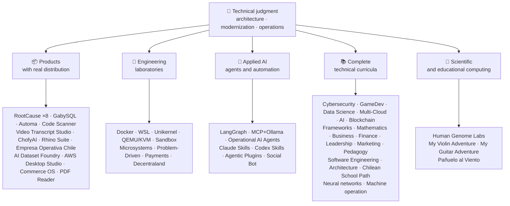

<div align="center">

# 👋Vladimir Acuña

## **Kiến trúc giải quyết·Người đầy đủ cao cấp·Biến hình số·Quản lý & thao tác**

**Professionally trained in Computer Science and Computing Engineering and Business Administration, with 16+ years building and operating software in real environments. I connect business, people, processes, and technology to design, evaluate, deliver, and sustain solutions with technical judgment and an operational view — backed by verifiable evidence in this GitHub account.**

[](https://vladimiracunadev-create.github.io/)
[](https://www.linkedin.com/in/vladimir-acu%C3%B1a-valdebenito-11924a29/)
[](mailto:vladimir.acuna.dev@gmail.com)

[](#phạm-vi-chuyên-nghiệp)
[](docs/ECOSYSTEM.vi.md)
[](#máy-tính-trình-duyệt-kỹ-thuật-toàn-bộ)

<!-- STATS:START -->
[](https://github.com/vladimiracunadev-create?tab=repositories)
[](https://github.com/vladimiracunadev-create?tab=repositories)
[](#hệ-thống-sinh-thái-đang-hưng-thịnh)
[](#máy-tính-trình-duyệt-kỹ-thuật-toàn-bộ)
[](https://github.com/vladimiracunadev-create?tab=repositories)
<!-- STATS:END -->

[](https://github.com/vladimiracunadev-create?tab=repositories)
[](https://github.com/vladimiracunadev-create?tab=followers)

[🌐 Portfolio (6 languages)](https://vladimiracunadev-create.github.io/) ·
[🧩 Ecosystem](#hệ-thống-sinh-thái-đang-hưng-thịnh) ·
[⚡ Evaluate me in 10 minutes](#nếu-anh-có-10-phút-để-đánh-giá-tôi) ·
[✅ Professional scope](#phạm-vi-chuyên-nghiệp) ·
[🧭 Non-coding management](#quản-lý-quản-lý-và-không-kiểm-soát-sự-bất-tiện-của-các-nhà-kinh-doanh) ·
[📋 Role matrix](PROFESIONAL_ROLES.md) ·
[📬 Contact](#liên-hệ)

**🌐 Phiên bản đầy đủ:** [Español](README.md) · [English](README.en.md) · [Português](README.pt.md) · [Italiano](README.it.md) · [Français](README.fr.md) · [简体中文](README.zh.md) · [繁體中文](README.zh-TW.md) · [日本語](README.ja.md) · [한국어](README.ko.md) · [Türkçe](README.tr.md) · [Русский](README.ru.md) · [Tiếng Việt](README.vi.md) · [ไทย](README.th.md) · [Deutsch](README.de.md) · [Українська](README.uk.md) · [Polski](README.pl.md) · [العربية](README.ar.md) · [فارسی](README.fa.md) · [Bahasa Indonesia](README.id.md) · [Nederlands](README.nl.md) · [हिन्दी](README.hi.md) · [Ελληνικά](README.el.md)

**Trung tâm kỹ thuật:**
PHP 8 · Python · Rust · Go · Node/TS · Java 21 · .NET 8 · Dart/Flutter · WASM
· AWS · Terraform · Kubernetes · Docker · n8n · LangGraph/MCP · CI/CD · FinOps · Observability

**Cầu công nghệ kinh doanh–:**
Phân tích tiến trình và yêu cầu·Đánh giá giải pháp·phối hợp giao hàng·thao tác và liên tục·rủi ro quản lý·sản phẩm và dịch vụ·Giáo dục kỹ thuật

</div>

---

> [!NOTE]
> Hồ sơ này không biến cơ hội thành kinh nghiệm. Kinh nghiệm kỹ thuật, kỹ năng chuyển giao, ứng dụng khả thi và mục tiêu phát triển tương lai được tách biệt rõ ràng. Bằng chứng liên kết của GitHub có thể thực hiện được hoặc tài liệu; nơi có một cái gì đó**không phải**xong, được nói như thế.

## 🎯Những gì bạn sẽ tìm thấy ở đây

Đây không phải là “một sự bãi bỏ: đó là một hệ sinh thái có cùng tiêu chuẩn.

- 🔁 **Bản thử nghiệm không được hỗ trợ**- Nhân bản, chạy, xác nhận.
- 🧰 **Bánh ngọt chuẩn hoá**- Tạo ra tập tin, máy nghe trộm,`doctor`, và`smoke`Mỗi kho.
- 🛡️ **Phòng thủ sâu**— quét bí mật, chính sách và những thực hành rõ ràng bị cấm đoán.
- 📈 **Khả năng quan sát** — `/health`, `/ready`, `/metrics`Bảng điều khiển, và khả năng truy tìm.
- 📚 **Tài liệu hướng dẫn khán giả- ý thức**— Người tuyển dụng, người mới bắt đầu, người bị giam giữ, hay người bảo vệ, tùy thuộc vào kho tàng.
- 📦 **Phân phối sản phẩm**— Những chương trình phát hành, kiểm tra và xây dựng bằng chứng; những ký hiệu thương mại/ hàng hóa được công bố là đang chờ khi được áp dụng.
- 🌍 **Quốc tế hoá**— Danh mục đầu tư trong 6 ngôn ngữ (ES·EN·PT·IT·FR·ZH).
- 🧭 **Thành thật với kỹ thuật viên**- mọi trường hợp được dán nhãn`OPERATIONAL`, `DOCUMENTED/SCAFFOLD`, hoặc`PLANNED`.

## ✅Trạng thái có thể truy cập

| Bề mặt | Bằng chứng cụ thể |
|---|---|
| 🧪 **Kiểm tra tin tức** | GabySQUL**Thử ra 828**+ fuzzing trên**503. 8M truy vấn**(0 hoảng loạn)·Empresa Operativa Chile**Thử ra 158** ·Automa**150 py thử** ·Thông tin đa MSName |
| 🤖 **Các tác vụ cấp sản xuất** | Thế giới thật LangGraph**Hậu phương hoạt động 25/25**(case 01–25, 100% tin tức)·Đặc vụ AI hoạt động**13 đặc vụ**có**39 phép đánh giá xác định** |
| 🔗 **Sự kết hợp của bản sắc** | **20 thùng**Trình gửi ảnh cho người nhận thư —**19 Hoạt động**Từng cá nhân được kiểm toán với Docker· **18+B động cơ** · **20+ container** ·11 mẫu |
| 📦 **Phân phối** | **151 bản phát hành**xuyên qua hệ sinh thái của**64 thuộc quyền sở hữu các kho công cộng** ·Bộ cài đặt và tạo tác`.exe` · `.msi` · `.dmg` · `.apk`với việc kiểm tra tổng và tạo bằng chứng; thương mại/tore chữ ký trong tiến trình mà có thể ứng dụng |
| 🛡️ **Chuỗi cung cấp** | CodeQL·Semgrep·Cướp·Trivy·Grype·Gitleaks·TruffleHog·CM SBOM CcconeDX·Điểm |
| 📚 **Curricula** | **14.530 lớp**có thể kiểm tra trên 21 chương trình, được tính bằng[a workflow](.github/workflows/stats.yml)từ cơ cấu kho chứa thực sự hoặc một nguồn có thể xác nhận được tuyên bố trong kho - không phải bằng tay·Mỗi chương trình tuyên bố trạng thái và giới hạn của nó |
| 🌐 **Portfolio** | PWA có thể cài đặt· **6 ngôn ngữ** · **36 PDFs**tạo bởi ống dẫn·Name·Bộ tạo tích hợp a- rô- bốt·Căn nhà sáng 100 |
| 🔒 **Kính viễn vọng** | Không có máy đo trong sản phẩm pháp y và Empresa Operativa Chile — được kiểm tra trong mỗi tòa nhà (không có người máy)`INTERNET`Cho phép |
| 🌐 **Xuất ra các trang** | **56 trang GitHub**-55 hạ cánh, mỗi sản phẩm, chương trình, hay hệ sinh thái, cộng với danh mục đầu tư - mỗi người triển khai từ kho riêng của mình·tất cả 56 được kiểm tra với HTTP`200` |

## 🗺️Hệ thống sinh thái đang hưng thịnh



## 🗂️ Hệ sinh thái: sản phẩm, phòng thí nghiệm, AI ứng dụng và tính toán khoa học

Phần thực hành của hồ sơ nằm trong một tài liệu riêng: phần mềm để tải về và cài đặt, phòng thí nghiệm kỹ thuật, AI ứng dụng và tính toán khoa học, cùng mô tả từng fork của các dự án bên thứ ba có trong tài khoản.

- 📦 **Những sản phẩm có thật sự được phân phối** (22)
- 🧪 **Phòng thí nghiệm kỹ thuật** (11)
- 🤖 **AI ứng dụng** (6)
- 🔬 **Tính toán khoa học** (1)
- 🍴 **Fork của dự án bên thứ ba** (52)

👉 **[Xem toàn bộ hệ sinh thái](docs/ECOSYSTEM.vi.md)** · [🍴 Fork của dự án bên thứ ba](docs/ECOSYSTEM.vi.md#forks)

## 📚Máy tính trình duyệt kỹ thuật toàn bộ

Sequential programs in Spanish, with status and scope declared by each repository. The 21 programs add up to **14,530 classes**, counted by [a workflow](.github/workflows/stats.yml) from real repository structure or a verifiable source declared in the repository; the badge refreshes weekly and is not written by hand.

🧭 [**Lifelong Learning Ecosystem**](https://github.com/vladimiracunadev-create/lifelong-learning-ecosystem)là một la bàn liên kết 30 con đường thật trên 6 khu vực thông qua bản đồ thị giác và một[accessible offline portal](https://vladimiracunadev-create.github.io/lifelong-learning-ecosystem/); nó không được tính là một chương trình bổ sung.

| Chương trình | Hạng | Phạm vị |
|---|---:|---|
| [🔢 **Computational Mathematics**](https://github.com/vladimiracunadev-create/computational-mathematics-program) | 360 | Từ việc đếm trên ngón tay đến việc tái sản xuất một tờ giấy· **Đã kiểm tra 360 cuộc biểu tình xác định trong CN** ·1. 080 cuốn sổ·Bản chú giải 489- hạn· [site](https://vladimiracunadev-create.github.io/computational-mathematics-program/) |
| [🏦 **Finance and Banking**](https://github.com/vladimiracunadev-create/finance-and-banking-evolution-program) | 356 | 534 h · financial mathematics and IFRS → credit, risk, Basel III, open finance, DLT, stablecoins, and MiCA · **27 cases** · **298 tests** · [site](https://vladimiracunadev-create.github.io/finance-and-banking-evolution-program/) |
| [🎮 **GameDev**](https://github.com/vladimiracunadev-create/modern-gamedev-program) | 352 | Toán học và C#/C++/GDGD maker  lushers, Al, đa người chơi, VR/AR·Godot·Hợp nhất·Không thật· **10 Phòng thí nghiệm Godot được xác nhận ở CI**(301 Kiểm tra)· [site](https://vladimiracunadev-create.github.io/modern-gamedev-program/) |
| [🛡️ **Cybersecurity**](https://github.com/vladimiracunadev-create/modern-cybersecurity-program) | 360 | **v1.3. 0** ·20 phần·Tổ chức nhóm đỏ, DFIR, an ninh đám mây, khai thác dev, CTF, và bảo mật trò chơi·Bản đồ**7 xác thực** ·Name·Sổ tay PDF·Đã kiểm tra các trang, CI, Security và Pages· [site](https://vladimiracunadev-create.github.io/modern-cybersecurity-program/) |
| [📈 **Marketing, Sales, and Growth**](https://github.com/vladimiracunadev-create/marketing-sales-growth-evolution-program) | 336 | 24 phần với định nghĩa hoạt động, bảng đo đạc, tính toán bản thảo, và ngữ cảnh điều chỉnh Chile· **v1. 6. 0** ·1.29M từ·17 đường đi dựa trên vai trò· [site](https://vladimiracunadev-create.github.io/marketing-sales-growth-evolution-program/) |
| [🏢 **Business Creation**](https://github.com/vladimiracunadev-create/modern-business-creation-program) | 336 | Tạo và điều hành một công ty thực sự ở Chile: từ ý tưởng đến hợp tác, quyền thuế, hoạt động, khủng hoảng và thoát·360 sơ đồ·1, 251 hạn·Sổ tay 1, 548 trang· [site](https://vladimiracunadev-create.github.io/modern-business-creation-program/) |
| [🏛️ **Architecture and Built Environment**](https://github.com/vladimiracunadev-create/architecture-built-environment-learning-program) | 830 | 83 phần·60 phiên chạy không có tính chất cao·34 đường·Nguồn có thể theo dõi·Đánh dấu, đọc ngoài và trang GitHub· [site](https://vladimiracunadev-create.github.io/architecture-built-environment-learning-program/) |
| [🇨🇱 **Chilean School Learning Path**](https://github.com/vladimiracunadev-create/chilean-school-learning-path) | 8,841 | Lớp 1–12· **4.156 kinh nghiệm kết hợp giữa các chu kỳ** · **2. 823 mục tiêu học tập** ·Nguồn của Jimmy·Không có đề nghị chờ đợi và phê bình chuyên môn của con người vẫn còn chờ· [site](https://vladimiracunadev-create.github.io/chilean-school-learning-path/) |
| [🧭 **Modern Software Engineering**](https://github.com/vladimiracunadev-create/modern-software-engineering-program) | 480 | 40 phần và 8 giai đoạn·Nền tảng sản phẩm, kiến trúc, an ninh, DevOps, SRE, SPEC, Al và nhiều hệ thống đa tác nhân·Trạng thái biên tập được tuyên bố bởi kho· [site](https://vladimiracunadev-create.github.io/modern-software-engineering-program/) |
| [🎓 **Pedagogy and Learning Sciences**](https://github.com/vladimiracunadev-create/education-pedagogy-learning-sciences-program) | 300 | Từ cách một người học hỏi đến cách giáo viên được huấn luyện·25 phần· **Mỗi lớp tuyên bố trạng thái và giới hạn của mình** ·Việc biết chữ sớm, phương pháp so sánh, nhu cầu giáo dục cụ thể, sự tồn tại, đa dạng văn hóa và bằng chứng quốc tế·1,097 năm bóng loáng, 325 biểu đồ, và một ngân hàng lớp học 60 hoạt động·14 con đường sự nghiệp·Name· **v2.1. 0** · [site](https://vladimiracunadev-create.github.io/education-pedagogy-learning-sciences-program/) |
| [☁️ **Multi-Cloud**](https://github.com/vladimiracunadev-create/multi-cloud-engineering-program) | 288 | AWS·Azure·GCP·Kubernetes·Name·SRE·FinOps· **1,288 giờ** ·288 phòng thí nghiệm với bằng chứng JSON·1,032 nguồn theo dõi·Sổ tay PDF 2. 884 trang· [site](https://vladimiracunadev-create.github.io/multi-cloud-engineering-program/) |
| [🎖️ **Executive Leadership**](https://github.com/vladimiracunadev-create/executive-leadership-founder-program) | 288 | Từ việc sở hữu kết quả đầu tiên của bạn đến việc lãnh đạo một công ty và thành lập các nhóm riêng của bạn: các nhóm, KPI/OKR, tài chính, sản phẩm, rủi ro, bảng điều khiển và M&A·24 vụ án, 96 phòng thí nghiệm và 39 mẫu vật· [site](https://vladimiracunadev-create.github.io/executive-leadership-founder-program/) |
| [🐍 **Python Data Science**](https://github.com/vladimiracunadev-create/python-data-science-program) | 232 | Hình cực, ML+Optuna/SHAP, PyTorch/LMs/LoRA, MLOps·Ứng dụng Windows bản địa + An- mô- sin A- ven· [site](https://vladimiracunadev-create.github.io/python-data-science-program/) |
| [🧠 **AI Evolution**](https://github.com/vladimiracunadev-create/artificial-intelligence-evolution-program) | 184 | Tính xác suất tượng trưng cho việc học sâu sắc LM, RAG, đặc vụ, an toàn và biên giới· **v0.17.0** · **778 sổ ghi chép** · **Giấy có nền tảng 148** ·Name· [site](https://vladimiracunadev-create.github.io/artificial-intelligence-evolution-program/) |
| [🌐 **Comparative Programming**](https://github.com/vladimiracunadev-create/polyglot-programming-labs) | 176 | Một khái niệm,**10 ngôn ngữ**Xác nhận bằng CI —**1.360 lượt thực hiện**--và**1. 632 chương trình**trong ngôn ngữ vẫn còn sống (COBOL, Forran, Ada, RPG, MUPS...) và một atlas của**60 lá bài trong 15 gia đình** ·v1.0· [site](https://vladimiracunadev-create.github.io/polyglot-programming-labs/) |
| [🧩 **Frameworks Compared**](https://github.com/vladimiracunadev-create/framework-ecosystems-labs) | 149 | Một hợp đồng thực hiện được, không có người thích nghi, không có tốc độ cao, không có tốc độ cao, không có tốc độ, không có tốc độ, không có tốc độ, mùa xuân, AP.NET, Django, Rails, Laravel, Phản ứng, Vue, Svelte, và nhiều hơn nữa·12 phần· **70 lớp đã xây dựng** · **397 vụ án được xác nhận ở CIA** · **210 ISBN/DOI Nguồn** · [site](https://vladimiracunadev-create.github.io/framework-ecosystems-labs/) |
| [🗄️ **Databases**](https://github.com/vladimiracunadev-create/database-systems-labs) | 74 | **v3.0** ·Công nghệ cơ sở dữ liệu trong 15 phần·230 giờ· **nguồn có thể kiểm tra cho mỗi yêu cầu**: 120 nguồn có ISBN, DOI, hoặc tiêu chuẩn·Cùng một trường hợp được giải quyết trong 27 động cơ·Bản chú giải 30- 6- nhiệm kỳ·150 py thử· [site](https://vladimiracunadev-create.github.io/database-systems-labs/) |
| [📐 **Psychometrics and Assessment**](https://github.com/vladimiracunadev-create/psychometrics-and-assessment-program) | 40 | Làm thế nào để chế tạo, ghi điểm, xác nhận và kiểm toán·8 phần·Cơ chế thực hiện với**5 nhạc cụ và 334 mục, 276 công- làm việc chung** |
| [⛓️ **Blockchain**](https://github.com/vladimiracunadev-create/blockchain-learning-path) | 66 | **v0.14.0** ·từ 0 đến cơ sở hạ tầng tài chính có thể lập trình được và trên máy tính phân tích· **91 thực hành**và**Thử 333** ·Hợp đồng với Nhà phát hiện (tiếng va chạm và tiếng Ý) và phân tích tĩnh Slither ở CIA·Comment· [site](https://vladimiracunadev-create.github.io/blockchain-learning-path/) |
| [🧠 **Neural Network Training Labs**](https://github.com/vladimiracunadev-create/neural-network-training-labs) | 31 | 7 Mô- đun·214 tiếng· **93 cuốn sổ tay**31 lớp học, 31 bản dịch sinh viên, và 31 giải pháp·câu hỏi, bản đồ thị giác, thực hành và đánh giá với dữ liệu công cộng thực tế·PyTorch· [study site](https://vladimiracunadev-create.github.io/neural-network-training-labs/) |
| [🕹️ **Machine Operator**](https://github.com/vladimiracunadev-create/machine-operator-program) | 451 | **41 mô- đun huấn luyện**, mỗi máy một người· **502 H 15 phút** ·hệ thống, điều khiển, vật lý, an toàn và mô phỏng thiết kế với các nguồn trên mỗi lớp·Chưa có trình mô phỏng thực hiện được, và nó được công bố như vậy. |

## ⚡Nếu anh có 10 phút để đánh giá tôi

Ý tưởng không chỉ là chỉ nhìn vào mã: nó là để xem**Tôi nghĩ sao?**tài liệu của tôi, và cách tôi làm mọi thứ có thể thực hiện được.

**Đường A — Thật sự khó đi và có sự dàn xếp***(người tôi yêu thích)*

```bash
git clone https://github.com/vladimiracunadev-create/social-bot-scheduler.git
```

Bạn sẽ thấy dòng chảy, số đo, bảng điều khiển và đường ống bảo vệ trong 19 trường hợp và 18+DB động cơ.

**Đường B — Cơ sở hạ tầng có khả năng phục hồi trong vài phút**

```bash
git clone https://github.com/vladimiracunadev-create/docker-labs.git
```

**Đường C — Các đặc vụ có chữ**

```bash
git clone https://github.com/vladimiracunadev-create/langgraph-realworld.git
```

**Đường D — Đi quá trình pháp y, không nhân bản**

Tải về các chương trình cài đặt hay clI từ[RootCause releases](https://github.com/vladimiracunadev-create/rootcause-windows-inspector/releases)và xác nhận`SHA256SUMS`.

## 🧠Những tiêu chuẩn tôi áp dụng xuyên qua các kho

- **DX trước**— nếu không dễ để chạy, thì nó không hữu ích như một bản mẫu hoặc một đội.
- **Khả năng quan sát từ ngày 1**--- thước đo và khả năng theo dõi, chứ không phải suy nghĩ khác.
- **Bảo mật như đường ống dẫn**— quét bí mật, SBOM trên một bản phóng thích, rõ ràng là cấm kỵ.
- **Sức bật thật sự**- Sự vô tội, sự phá vòng quanh và sự suy thoái có kiểm soát.
- **Đa thức bằng thiết kế**— ngôn ngữ và động cơ được chọn bằng cách sử dụng trường hợp, không bao giờ theo thời trang.
- **Trung thực về tình trạng**- Một lần nữa được đổi tên (`Multisimulador` → `machine-operator-program`Để tránh phần mềm hứa hẹn mà chưa tồn tại.
- **Huy hiệu là tín hiệu, không phải bằng chứng.**— mỗi người trả tiền cũng tuyên bố**những gì nó không làm**.
- **Mô hình bên ngoài**— lĩnh vực được thiết kế trước; giao diện là một hình chiếu.
- **Công việc bên ngoài được công bố là bên ngoài** — [52 fork](docs/ECOSYSTEM.vi.md#forks) của dự án bên thứ ba được mô tả từng cái một và nằm ngoài mọi con số sản phẩm tự thực hiện của hồ sơ này.

## ✅Phạm vi chuyên nghiệp

Cả hai nền tảng —**Khoa học máy tính và cơ chế tính và quản lý kinh doanh**— giúp tôi dịch mục tiêu kinh doanh thành các quyết định kỹ thuật và giới hạn kỹ thuật thành những lựa chọn rõ ràng cho các hoạt động, sản phẩm, khách hàng và lãnh đạo.

### 🎯Nhận diện lõi

| Nhiệm vụ | Lùi |
|---|---|
| **Kiến trúc giải quyết** | Một hệ thống có thể nhân rộng với sự phán đoán tiến hóa |
| **Kiến trúc hiện đại hóa di sản** | Tiến hóa di sản thật (PHP 5. x x 8. x, tăng dần phục hồi mà không ngắt quãng) |
| **Thượng cấp cao-Stack / Tech lead** | Kiến trúc, thực hiện và tiêu chuẩn trên nền tảng thật (+16 năm) |
| **Kiến trúc tự động AI** | Hệ thống đặc vụ với LangGraph/MCP và n8n chảy với thanh quản bảo vệ |

### ↗ Mở rộng tự nhiên

**AI Orchestration Engineer** · **Systems / Rust Engineer** · **Mobile Engineer (Flutter)** · **Solutions Engineer** · **Technical Product Builder** · **Technical Trainer** · **Digital Transformation Consultant** · **Business / Functional Analyst** · **Technical Product Operations**

### ⚙️Phạm vi khen ngợi

Nền tảng:·DevOps / CI-CD·Mây / Kỹ sư AWS·Ứng dụng SRE·Kỹ sư tự động hóa·Cố vấn kỹ thuật- thương mại

## 🧭Quản lý, quản lý và không kiểm soát sự bất tiện của các nhà kinh doanh

Các vị trí quản lý, hành chính và kinh doanh mà tin học và quản trị đóng góp được mà lập trình không phải nhiệm vụ trung tâm, được phân loại trung thực (năng lực chuyển đổi được, khả năng ứng tuyển hoặc mục tiêu tương lai) kèm khoảng trống của từng vị trí. Các mảng được đề cập:

Lãnh đạo công nghệ · Quản lý dự án · Bộ quản lý kinh doanh · Chiến thuật và thay đổi · Phân tích kinh doanh · Sản phẩm và dịch vụ · Quản lý an ninh mạng · Commercial and sales · Quản lý tài chính và quản lý · Chất lượng · Giáo dục · Hậu cần và cung cấp · Bộ quản lý dữ liệu và AI · Khu vực công cộng

👉 **[Xem ma trận cơ hội đầy đủ](docs/MANAGEMENT.vi.md)**

## 🤖Quy trình phát triển có AI hỗ trợ

| Công cụ | Dùng chính |
|---|---|
| **Mã Claude** | Xem xét kiến trúc, thực hiện và tài liệu kỹ thuật |
| **ChatGPT Plus** | Phân tích, kiến trúc và lặp lại (từ năm 2023) |
| **Cổ bản** | Name |
| **Phản trọng** | Gia tốc dòng chảy phát triển và tự động hóa |
| **Mã VS / OpenCode** | Môi trường có hỗ trợ AI tích hợp |

> Tôi kết hợp những nhận định kỹ thuật của mình, sự xác nhận của con người và sự hướng dẫn kiến trúc. Khả năng, tốc độ và đạt của trí tuệ của AI được phóng đại lên — không thay thế được kinh nghiệm.

## 📌Tính khả năng

**Mở cửa:**Người đầy đủ cao cấp·Kiến trúc·Sự hiện đại hóa di sản·Nền tảng/IDP·Ứng dụng SRE·Thực tế DevOps·Tự động hoá·Tự động hoá Al·phân tích doanh nghiệp/ chức năng·Sự phối hợp của dự án IT·Thao tác sản xuất·Sự chuyển đổi số·Giải pháp cho các nhà tư vấn/góa·Giáo dục kỹ thuật·chất lượng và sự cải tiến liên tục·Nhận nuôi và quản trị AI

**Đánh giá thấp theo phạm vi của mỗi vai trò:**Chủ sản xuất/ quản lý sản phẩm kỹ thuật·Giao dịch·Bộ xử lý IT·GC/ Công nghệ mạo hiểm·quản lý và thao tác·Điều khiển bộ quản lý·Hiện đại hóa xã hội. Điều hành và các chức danh tổng quát là mục tiêu phát triển tương lai, chứ không phải kinh nghiệm.

**Nhân khẩu:**tùy thuộc vào dự án.

## 📬Liên hệ

[](https://vladimiracunadev-create.github.io/)
[](https://www.linkedin.com/in/vladimir-acu%C3%B1a-valdebenito-11924a29/)
[](https://gitlab.com/vladimir.acuna.dev-group/vladimir.acuna.dev-group)
[](mailto:vladimir.acuna.dev@gmail.com)

---

<div align="center">

[🤝 Contribute](CONTRIBUTING.en.md) ·
[🛡️ Security](SECURITY.en.md) ·
[⚖️ Code of Conduct](CODE_OF_CONDUCT.en.md)

<sub>Dịch bởi Vũ Hạnh, Mai Linh, Nga, Huy Tô, Huy Tô, Yuki, Ann, Phương·Xác thực cuối cùng: ngày 12 tháng 10 năm 2026.</sub>

</div>
