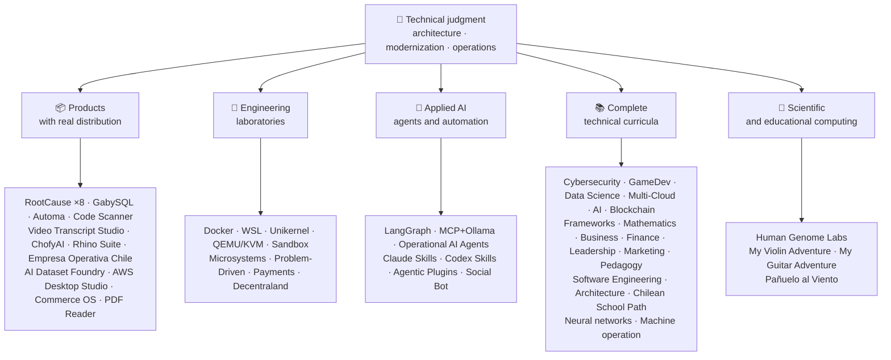

<div align="center">

# 👋弗拉基米爾·阿庫尼亞

## **解決方案架構·高階全速板·數字轉換·管理和業務**

**專業接受電腦科學與計算工程與工商管理專業培訓,擁有16年以上在真實環境下的建設和操作軟體. 我將商業、人、流程和技術與技術判斷和業務觀點聯絡起來,以設計、評價、交付和維持解決方案,並在GitHub賬戶中以可核實的證據作為後盾。**

[](https://vladimiracunadev-create.github.io/)
[](https://www.linkedin.com/in/vladimir-acu%C3%B1a-valdebenito-11924a29/)
[](mailto:vladimir.acuna.dev@gmail.com)

[](#專業範圍)
[](docs/ECOSYSTEM.zh-TW.md)
[](#完成技術課程)

<!-- STATS:START -->
[](https://github.com/vladimiracunadev-create?tab=repositories)
[](https://github.com/vladimiracunadev-create?tab=repositories)
[](#生態系統一一)
[](#完成技術課程)
[](https://github.com/vladimiracunadev-create?tab=repositories)
<!-- STATS:END -->

[](https://github.com/vladimiracunadev-create?tab=repositories)
[](https://github.com/vladimiracunadev-create?tab=followers)

[🌐 Portfolio (6 languages)](https://vladimiracunadev-create.github.io/) ·
[🧩 Ecosystem](#生態系統一一) ·
[⚡ Evaluate me in 10 minutes](#如果你有十分鐘的時間來評價我) ·
[✅ Professional scope](#專業範圍) ·
[🧭 Non-coding management](#管理行政和非編碼職業機會) ·
[📋 Role matrix](PROFESIONAL_ROLES.md) ·
[📬 Contact](#聯絡人)

**🌐 完整版本:** [Español](README.md) · [English](README.en.md) · [Português](README.pt.md) · [Italiano](README.it.md) · [Français](README.fr.md) · [簡體中文](README.zh.md) · [繁體中文](README.zh-TW.md) · [日本語](README.ja.md) · [한국어](README.ko.md) · [Türkçe](README.tr.md) · [Русский](README.ru.md) · [Tiếng Việt](README.vi.md) · [ไทย](README.th.md) · [Deutsch](README.de.md) · [Українська](README.uk.md) · [Polski](README.pl.md) · [العربية](README.ar.md) · [فارسی](README.fa.md) · [Bahasa Indonesia](README.id.md) · [Nederlands](README.nl.md) · [हिन्दी](README.hi.md) · [Ελληνικά](README.el.md)

**技術核心:**
PHP 8 · Python · Rust · Go · Node/TS · Java 21 · .NET 8 · Dart/Flutter · WASM
· AWS · Terraform · Kubernetes · Docker · n8n · LangGraph/MCP · CI/CD · FinOps · Observability

**商業-技術橋樑:**
程式和要求分析·解決方案評價·執行協調·業務和連續性·風險管理·產品和服務·技術教育

</div>

---

> [!NOTE]
> 這一概況並沒有將機會轉化為經驗。 已證實的技術經驗、可轉讓的技能、可行的應用和未來發展目標明確分開。 連結到的 GitHub 證據是可執行的或檔案的; 某物在哪裡**不詳**完成後,即為完成。

## 🎯你在這裡能找到什麼

這不是“一回式”的:它是具有共同標準的生態系統。

- 🔁 **可複製的演示**——克隆,執行,驗證.
- 🧰 **標準化工具**檔案,CLI中心,`doctor`,以及`smoke`每個儲存器。
- 🛡️ **深入防禦**秘密掃描、政策和明確禁止的做法。
- 📈 **觀察性** — `/health`, `/ready`, `/metrics`儀表板 和可追蹤性
- 📚 **觀眾認識檔案**——根據暫存器的不同,招募者,初學者,DevOps,或安全性.
- 📦 **產品銷售**可下載的釋出、核對和建立證據;酌情宣佈商業/儲存簽名待決。
- 🌍 **國際化**——以6種語文編寫的教材(ES)·EN 語·常規·資訊科技·法語·) ,"中國共產黨黨史人物彙編"(第1輯).
- 🧭 **技術誠實**- 每一個案件都標註在標籤上`OPERATIONAL`, `DOCUMENTED/SCAFFOLD`,或 ,或 ,`PLANNED`.

## ✅可核實狀態

| 表面 | 具體證據 |
|---|---|
| 🧪 **測試覆蓋率** | 蓋比SQL**828個測試**+ 模糊過**503.8M次查詢**(0恐慌) (笑聲)·智利企業**158次試驗** ·自動**150個火試** ·多作業系統分類 |
| 🤖 **生產級製劑** | 朗格勒真實世界**25/25 業務後端**(病例01-25,100%覆蓋)·業務助理**13名特工人員**與**39個確定性評估** |
| 🔗 **多塊塊融合** | **20個案件**傳送者 n8n 收發者-**19起業務**,個人審計 與多克 -· **18+ DB 發動機** · **20個以上集裝箱** ·11種模式 |
| 📦 **分發** | **151次釋放**跨越生態系統的**64個擁有的公共儲存庫** ·安裝器和文物`.exe` · `.msi` · `.dmg` · `.apk`核對和建立證據; 酌情在商業/儲存中籤名 |
| 🛡️ **供應鏈** | 程式碼QL·衛星·匪幫·特里維·格萊普·巨頭·旋轉木偶·旋風DX SBOM·計分卡 |
| 📚 **課程** | **14 530個班級**21個方案可核查,按[a workflow](.github/workflows/stats.yml)或可核查的來源,·每個節目都宣佈其編輯地位和限制 |
| 🌐 **組合** | 可安裝的 PWA· **6種語言** · **36個PDF**管道產生的·CV 資料 API·電容安卓·燈塔 100 |
| 🔒 **遙測** | 法證產品和智利企業的零遙測——在每個建築中都得到核實(無Android)`INTERNET`許可權) |
| 🌐 **出版網站** | **56個基特胡佈網頁網站**-55次著陸,每件產品、程式或生態系統導航員一次,加上組合——從自己的儲存庫部署·全部56個已與HTTP核實`200` |

## 🗺️生態系統一一



## 🗂️ 生態系統：產品、實驗室、應用 AI 與科學運算

本檔案的實作成果集中在獨立文件中：可下載安裝的軟體、工程實驗室、應用 AI 與科學運算，以及帳號中每個第三方專案 fork 的說明。

- 📦 **具有實際分佈的產品** (22)
- 🧪 **工程實驗室** (11)
- 🤖 **應用AI** (6)
- 🔬 **科學計算** (1)
- 🍴 **第三方專案的 fork** (52)

👉 **[查看完整生態系統](docs/ECOSYSTEM.zh-TW.md)** · [🍴 第三方專案的 fork](docs/ECOSYSTEM.zh-TW.md#forks)

## 📚完成技術課程

西班牙語序列程式,每個儲存器都宣告狀態和範圍. 21個方案加起來是:**14 530個班級**,計算為[a workflow](.github/workflows/stats.yml),從真正的暫存器結構或暫存器中宣告的可核查源;徽章每週重新整理一次,不由手寫.

🧭 [**Lifelong Learning Ecosystem**](https://github.com/vladimiracunadev-create/lifelong-learning-ecosystem)是一個聯邦指南針,透過視覺地圖和影象圖連線6個地區的30個真實路徑[accessible offline portal](https://vladimiracunadev-create.github.io/lifelong-learning-ecosystem/);不計為附加程式。

| 程式 | 類 | 範圍 |
|---|---:|---|
| [🔢 **Computational Mathematics**](https://github.com/vladimiracunadev-create/computational-mathematics-program) | 360 | 從依靠手指到複製出紙· **360起在CI核實的決定性示威** ·1 080個筆記本·489個術語表· [site](https://vladimiracunadev-create.github.io/computational-mathematics-program/) |
| [🏦 **Finance and Banking**](https://github.com/vladimiracunadev-create/finance-and-banking-evolution-program) | 356 | 534小時·金融數學和《國際財務報告準則》 ——信貸、風險、巴塞爾三號、公開金融、DLT、穩定幣和MICA· **27個案件** · **298次測試** · [site](https://vladimiracunadev-create.github.io/finance-and-banking-evolution-program/) |
| [🎮 **GameDev**](https://github.com/vladimiracunadev-create/modern-gamedev-program) | 352 | 數學和C#/C++/GDScript → 陰影器,AI,多人遊戲,VR/AR·哥多特語·團結·虛幻· **在CI中核實的10個戈多實驗室**(301次檢查)· [site](https://vladimiracunadev-create.github.io/modern-gamedev-program/) |
| [🛡️ **Cybersecurity**](https://github.com/vladimiracunadev-create/modern-cybersecurity-program) | 360 | **編號: 1.3.0** ·20個部分·– 紅色團隊,DFIR,雲安全,開發dev,CTF,和遊戲安全·對映到**7份證書** ·離線Android/web app·PDF 手冊·核實了CI、安保和網頁· [site](https://vladimiracunadev-create.github.io/modern-cybersecurity-program/) |
| [📈 **Marketing, Sales, and Growth**](https://github.com/vladimiracunadev-create/marketing-sales-growth-evolution-program) | 336 | 24個部分,包括業務定義、計量單、可核查的參考書目和智利的監管背景· **千分之一.6.0 千分之一.** ·1.29M字數·17個基於角色的路徑· [site](https://vladimiracunadev-create.github.io/marketing-sales-growth-evolution-program/) |
| [🏢 **Business Creation**](https://github.com/vladimiracunadev-create/modern-business-creation-program) | 336 | 在智利建立和經營一家真正的公司:從想法到成立、稅務當局、業務、危機和退出·360 個圖表·1 251個任期詞彙表·1 548頁手冊· [site](https://vladimiracunadev-create.github.io/modern-business-creation-program/) |
| [🏛️ **Architecture and Built Environment**](https://github.com/vladimiracunadev-create/architecture-built-environment-learning-program) | 830 | 83個編·60屆綜合會議·34道路徑·可追蹤來源·下行、離線閱讀器和 GitHub Pages· [site](https://vladimiracunadev-create.github.io/architecture-built-environment-learning-program/) |
| [🇨🇱 **Chilean School Learning Path**](https://github.com/vladimiracunadev-create/chilean-school-learning-path) | 8,841 | 1至12年級· **4 156次綜合跨課程經驗** · **2 823個學習目標** ·聯剛特派團的訊息來源·尚未提出待決提案和尚未進行專門人力審查· [site](https://vladimiracunadev-create.github.io/chilean-school-learning-path/) |
| [🧭 **Modern Software Engineering**](https://github.com/vladimiracunadev-create/modern-software-engineering-program) | 480 | 40個部分和8個階段·基礎 → 產品、建築、安全、DevOps、SRE、SPEC、AI和多代理系統·資料庫宣佈的編輯地位· [site](https://vladimiracunadev-create.github.io/modern-software-engineering-program/) |
| [🎓 **Pedagogy and Learning Sciences**](https://github.com/vladimiracunadev-create/education-pedagogy-learning-sciences-program) | 300 | 從一個人如何學習到如何培訓教師·25個部分· **每一類都宣告其證據狀態和限度** ·早期識字、比較方法、具體教育需要、共處、文化多樣性和國際證據·1 097個定期詞彙表、325個圖表和60個活動課堂庫·按角色分列的14個職業道路·LMS 可出口· **維基百科中的相關條目: 維基語錄連結:名人名言 - 分類** · [site](https://vladimiracunadev-create.github.io/education-pedagogy-learning-sciences-program/) |
| [☁️ **Multi-Cloud**](https://github.com/vladimiracunadev-create/multi-cloud-engineering-program) | 288 | 自動取款機·阿蘇雷·GCP 常規·庫伯涅斯·地表·塞爾維亞·財務操作· **1 288小時** ·288個有JSON證據的實驗室·1 032個來源·2 884頁PDF手冊· [site](https://vladimiracunadev-create.github.io/multi-cloud-engineering-program/) |
| [🎖️ **Executive Leadership**](https://github.com/vladimiracunadev-create/executive-leadership-founder-program) | 288 | 從擁有第一個結果到領導一個公司和建立自己的團隊:團隊、KPI/OKR、金融、產品、風險、板子和併購·24個病例、96個實驗室和39個模板· [site](https://vladimiracunadev-create.github.io/executive-leadership-founder-program/) |
| [🐍 **Python Data Science**](https://github.com/vladimiracunadev-create/python-data-science-program) | 232 | 極地,ML+Optuna/SHAP,PyTorch/LLMS/LORA,MLOps·本地 Windows 應用程式 + Android APK· [site](https://vladimiracunadev-create.github.io/python-data-science-program/) |
| [🧠 **AI Evolution**](https://github.com/vladimiracunadev-create/artificial-intelligence-evolution-program) | 184 | 典型的 / 機率的 / 深層學習 / 法學碩士、 研究與培訓、代理、安全和邊境· **0.17.0 億** · **708個筆記本** · **148份基礎檔案** ·離線的 Windows, Android, 和 PWA 應用程式· [site](https://vladimiracunadev-create.github.io/artificial-intelligence-evolution-program/) |
| [🌐 **Comparative Programming**](https://github.com/vladimiracunadev-create/polyglot-programming-labs) | 176 | 有個概念**10種語言**由CI核實 -**1 360項執行**+ 加上**1 632個方案**以活語言(COBOL、Fortran、Ada、RPG、MUPS......)和地圖集**15個家庭的60張卡片** ·維基百科中的相關條目: 維基語錄連結:名人名言 - 分類· [site](https://vladimiracunadev-create.github.io/polyglot-programming-labs/) |
| [🧩 **Frameworks Compared**](https://github.com/vladimiracunadev-create/framework-ecosystems-labs) | 149 | 一份沒有介面卡的可執行合同,針對快遞、快活API、斯普林布特、ASP.NET、Django、Rails、Laravel、React、Vue、Svelte等·12個部分· **70個建築班級** · **397起在CI核實的案件** · **210 ISBN/DOI來源 網際網路檔案館的存檔,存檔日期2013-03-02.** · [site](https://vladimiracunadev-create.github.io/framework-ecosystems-labs/) |
| [🗄️ **Databases**](https://github.com/vladimiracunadev-create/database-systems-labs) | 74 | **單曲3. 0.0** ·15個部分的資料庫工程·230小時· **每項索賠的可核實來源**:120 有ISBN,DOI,或標準來源.·27個引擎破了同樣的案子·306個術語表·150個火試· [site](https://vladimiracunadev-create.github.io/database-systems-labs/) |
| [📐 **Psychometrics and Assessment**](https://github.com/vladimiracunadev-create/psychometrics-and-assessment-program) | 40 | 衡量工具如何構建、打分、驗證和審計·8個部分·可執行引擎, 使用**5項文書和344項,276項公共領域** |
| [⛓️ **Blockchain**](https://github.com/vladimiracunadev-create/blockchain-learning-path) | 66 | **0.14.0 維基百科** ·從零到可程式設計的金融基礎設施和鏈上分析· **91個做法**財務報告和已審計財務報表**363次測試** ·與開業公司(模糊和變化不定)和CI的Slither靜態分析的合同·開啟二進位制並計數其內容的離線應用程式· [site](https://vladimiracunadev-create.github.io/blockchain-learning-path/) |
| [🧠 **Neural Network Training Labs**](https://github.com/vladimiracunadev-create/neural-network-training-labs) | 31 | 7 modules · ≈214 hours · **93 notebooks** —31 classes, 31 student versions, and 31 solutions— · questions, visual maps, practices, and assessment with real public data · PyTorch · [study site](https://vladimiracunadev-create.github.io/neural-network-training-labs/) |
| [🕹️ **Machine Operator**](https://github.com/vladimiracunadev-create/machine-operator-program) | 451 | **41個培訓單元**,每臺一臺機器· **502小時15分鐘** ·系統、控制、物理、安全和模擬設計,每類源·*還沒有可執行模擬器,而且它被宣佈為這樣* |

## ⚡如果你有十分鐘的時間來評價我

想法不僅僅是看程式碼,而是看**怎麼樣**記錄我的方式 以及我如何使一切可以執行

**A道——真正可觀察和有條理***(我最喜歡的) *

```bash
git clone https://github.com/vladimiracunadev-create/social-bot-scheduler.git
```

將會看到工作流程, 度量衡,儀表板, 和護欄, 覆蓋19個案例和18+ DB引擎。

**B道——幾分鐘內可複製的基礎設施**

```bash
git clone https://github.com/vladimiracunadev-create/docker-labs.git
```

**C道——具有型別狀態的代理**

```bash
git clone https://github.com/vladimiracunadev-create/langgraph-realworld.git
```

**D道——不克隆的粗糙法證產品**

從中下載安裝器或 CLI 二進位制[RootCause releases](https://github.com/vladimiracunadev-create/rootcause-windows-inspector/releases)並核實`SHA256SUMS`.

## 🧠標準一應用到所有倉庫

- **第一次DX遊戲**——如果執行不便,則作為演示或團隊基礎,並不有用.
- **第1天起的可觀察性**——衡量尺度和可追溯性,不是事後思考.
- **安全作為管道**——秘密掃描,每出一出SBOM,明令禁止的做法.
- **實際復原力**——一能分解,斷路器分解,並有控制的降解.
- **設計型多塊**——語言和引擎由用例選擇,從不由時尚選擇.
- **誠實的狀態**——一雷波被更名(.`Multisimulador` → `machine-operator-program`),以避免尚不存在的有希望的軟體.
- **徽章是訊號,不是證據**——每筆還本付息也宣告**做它不做的東西**.
- **型號向外**——域名設計為先;介面為投影.
- **對外工作被宣佈為對外工作** — 第三方專案的 [52 個 fork](docs/ECOSYSTEM.zh-TW.md#forks) 逐一說明，且不計入本檔案任何自有作品數字。

## ✅專業範圍

我的雙重背景**電腦科學與計算工程+工商管理**——幫助我把業務目標轉化為技術決定和技術制約轉化為明確的業務選擇,產品,客戶和領導權.

### 🎯核心身份

| 作用 | 備份 |
|---|---|
| **解決方案架構** | 具有進化判斷力的可縮放式系統設計 |
| **遺產現代化建築師** | 真正的遺產演變(PHP 5.x 8.x,增量再造而不會中斷操作). |
| **高階全層/技術鉛** | 實際平臺的架構、執行和標準(+16年) |
| **AI 自動化建築師** | 具有LangGraph/MCP和有護欄的n8n流動的代理系統 |

### ↗ 自然延伸

**AI 管絃樂工程師** · **系統/粗糙工程師** · **移動工程師(Flutter)** · **解決方案工程師** · **技術產品構建器** · **技術培訓人員** · **數字轉換顧問** · **業務/職能分析員** · **技術產品業務**

### ⚙️補充範圍

平臺工程師/境內流離失所者·開發/開發/開發/開發·雲/ AWS 工程師·應用程式 SRE·自動化工程師·技術商業諮詢人

## 🧭管理、行政和非編碼職業機會

管理、行政與業務職務：資訊與管理背景能夠貢獻價值，而程式設計並非核心工作；誠實分類（可轉移能力、可應徵機會或未來目標），並標明每項的差距。涵蓋領域：

技術領導 · 專案管理 · 工商管理 · 戰略和改革 · 業務分析 · 產品和服務 · 網路安全管理 · 商業和銷售 · 財務和管理控制 · 質量 · 學歷 · 後勤和供應商 · 資料和人工智慧治理 · 公共部門

👉 **[查看完整機會矩陣](docs/MANAGEMENT.zh-TW.md)**

## 🤖AI-輔助發展流動

| 工具 | 主要用途 |
|---|---|
| **克勞德程式碼** | 建築審查、實施和技術檔案 |
| **聊天GPT 附加軟體** | 分析、結構和迭代(自2023年起) |
| **程式碼** | 程式碼生成和重構 |
| **反重力** | 加快發展和自動化流動 |
| **VS 程式碼/ 開啟程式碼** | 綜合AI援助的環境 |

> 我綜合了自己的技術判斷,人性驗證,建築方向. AI能增強能力,速度,以及達到——它不會取代經驗.

## 📌可用性

**開啟到 :**高階全速板·建築·遺產現代化·平臺/綜合發展方案·應用程式 SRE·實用的 DevOps 軟體·自動化·AI 自動化·業務/職能分析·資訊科技專案協調·產品操作·數字化轉換·諮詢/銷售·技術教育·質量和不斷改進·AI 收養和治理

**根據每個角色的範圍進行評估:**產品所有人/技術產品經理·提供服務·資訊科技業務·GRC/技術風險·行政和業務·管理控制·公共部門的現代化。 行政和一般管理頭銜是未來的發展目標,而不是聲稱的經驗。

**模式 :**遠端或混合,取決於專案。

## 📬聯絡人

[](https://vladimiracunadev-create.github.io/)
[](https://www.linkedin.com/in/vladimir-acu%C3%B1a-valdebenito-11924a29/)
[](https://gitlab.com/vladimir.acuna.dev-group/vladimir.acuna.dev-group)
[](mailto:vladimir.acuna.dev@gmail.com)

---

<div align="center">

[🤝 Contribute](CONTRIBUTING.en.md) ·
[🛡️ Security](SECURITY.en.md) ·
[⚖️ Code of Conduct](CODE_OF_CONDUCT.en.md)

<sub>README 與可核查的公共庫狀態同步——圖和變化透過API讀取——·最後核實:2026年10月12日。</sub>

</div>
