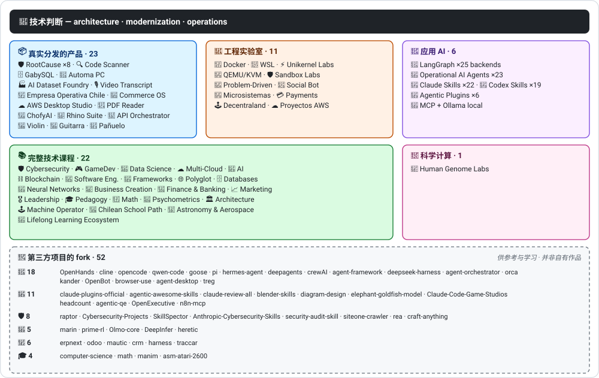

<div align="center">

# 👋 Vladimir Acuña

## **AI 工程师·解决方案架构师 · Senior Full-Stack · 数字化转型 · 管理与运营**

**拥有信息与计算机工程和企业管理双重教育背景，以及 16 年以上真实软件建设与运维经验。我连接业务、人员、流程与技术，以设计、评估、交付并持续运营解决方案 — 相关证据均可在此 GitHub 验证。**

[](https://vladimiracunadev-create.github.io/)
[](https://www.linkedin.com/in/vladimir-acu%C3%B1a-valdebenito-11924a29/)
[](mailto:vladimir.acuna.dev@gmail.com)

[](#-专业范围)
[](docs/ECOSYSTEM.zh.md)
[](#-完整技术课程)

<!-- STATS:START -->
[](https://github.com/vladimiracunadev-create?tab=repositories)
[](https://github.com/vladimiracunadev-create?tab=repositories)
[](#-生态系统概览)
[](#-完整技术课程)
[](https://github.com/vladimiracunadev-create?tab=repositories)
[](docs/ECOSYSTEM.zh.md#forks)
[](https://github.com/vladimiracunadev-create?tab=repositories)
[](https://github.com/pulls?q=author%3Avladimiracunadev-create+type%3Apr)
[](https://github.com/issues?q=author%3Avladimiracunadev-create+type%3Aissue)
<!-- STATS:END -->

[](https://github.com/vladimiracunadev-create?tab=repositories)
[](https://github.com/vladimiracunadev-create?tab=followers)

[🧭 从哪里开始](docs/START_HERE.zh.md) ·
[🌐 作品集（22 种语言）](https://vladimiracunadev-create.github.io/) ·
[🧩 生态系统](#-生态系统概览) ·
[🛠️ 技术栈](#-技术栈) ·
[⚡ 10 分钟评估我](#-如果你有-10-分钟评估我) ·
[✅ 专业范围](#-专业范围) ·
[🧭 无需编程的管理机会](#-管理行政与无需编程的职业机会) ·
[📋 岗位矩阵](PROFESIONAL_ROLES.zh.md) ·
[📬 联系方式](#-联系方式)

**🌐 完整版本：** [Español](README.md) · [English](README.en.md) · [Português](README.pt.md) · [Italiano](README.it.md) · [Français](README.fr.md) · [简体中文](README.zh.md) · [繁體中文](README.zh-TW.md) · [日本語](README.ja.md) · [한국어](README.ko.md) · [Türkçe](README.tr.md) · [Русский](README.ru.md) · [Tiếng Việt](README.vi.md) · [ไทย](README.th.md) · [Deutsch](README.de.md) · [Українська](README.uk.md) · [Polski](README.pl.md) · [العربية](README.ar.md) · [فارسی](README.fa.md) · [Bahasa Indonesia](README.id.md) · [Nederlands](README.nl.md) · [हिन्दी](README.hi.md) · [Ελληνικά](README.el.md)

**技术核心：**
PHP 8 · Python · Rust · Go · Node/TS · Java 21 · .NET 8 · Dart/Flutter · WASM
· AWS · Terraform · Kubernetes · Docker · n8n · LangGraph/MCP · CI/CD · FinOps · Observability

**业务–技术桥梁：**流程与需求分析 · 解决方案评估 · 交付协调 · 运营与连续性 · 风险管理 · 产品与服务 · 技术培训

</div>

---

> [!NOTE]
> 本档案不会把职业可能性写成已任职经验。经验证的技术经验、可迁移能力、可申请机会与未来发展目标均明确区分。

## 🧭 从哪里开始

选择你的情况，直达所需内容:

🧑‍💼 [招聘](docs/guides/RECRUITER.zh.md) · 💼 [客户或自由职业](docs/guides/FREELANCE.zh.md) · 🛠️ [技术评估](docs/guides/TECH_LEAD.zh.md) · 🏢 [商业与管理](docs/guides/BUSINESS.zh.md) · 🤝 [协作与安全](docs/guides/COLLABORATOR.zh.md) · 🎓 [学习或教学](docs/guides/LEARNER.zh.md)

## 🎯 这里有什么

这不是“一个 repo”，而是一个有共同标准的生态系统。

- 🔁 **可复现 Demo** — clone、运行、验证。
- 🧰 **标准化工具链** — 每个仓库都有 Makefile、Hub CLI、`doctor` 和 `smoke`。
- 🛡️ **纵深防御** — secret scanning、策略和明确禁止的实践。
- 📈 **可观测性** — `/health`、`/ready`、`/metrics`、dashboard 和可追踪性。
- 📚 **面向不同读者的文档** — 招聘方、初学者、DevOps 或安全人员，按仓库定位。
- 📦 **产品级分发** — 可下载 release、checksum、build 证据；商业签名/商店发布在适用时标注为进行中。
- 🌍 **国际化** — 本档案以 22 种语言发布，作品集提供 154 份公开 PDF（7 个系列 × 22 种语言） (ES · EN · PT · IT · FR · ZH · ZH-TW · JA · KO · TR · RU · VI · TH · DE · UK · PL · AR · FA · ID · NL · HI · EL).
- 🧭 **技术诚实** — 每个案例标注为 `OPERATIONAL`、`DOCUMENTED/SCAFFOLD` 或 `PLANNED`。

## ✅ 可验证状态

| 范围 | 具体证据 |
|---|---|
| 🧪 **测试覆盖** | GabySQL **850 tests** + **503.8M queries** fuzz（0 panics）· Empresa Operativa Chile **230 tests** · Automa **150 pytest** · multi-OS CI |
| 🤖 **生产级 Agent** | LangGraph RealWorld **25/25 operational backends**（cases 01–25，100% 覆盖）· Operational AI Agents **23 agents** 和 **69 deterministic evals** |
| 🔗 **多语言集成** | **20 cases** sender→n8n→receiver —**19 operational**，逐一用 Docker 审计— · **18+ DB engines** · **20+ containers** · 11 patterns |
| 📦 **分发** | 在 **66 个自有公共仓库**生态中发布 **156 releases** · `.exe` · `.msi` · `.dmg` · `.apk` 安装器和制品，带 checksum 与 build 证据；适用时商业/商店签名标注为进行中 |
| 🛡️ **供应链** | CodeQL · Semgrep · Bandit · Trivy · Grype · Gitleaks · TruffleHog · CycloneDX SBOM · Scorecard |
| 📚 **课程** | **16,798 classes**，覆盖 22 个项目，由 [workflow](.github/workflows/stats.yml) 从真实仓库结构或仓库内声明的可验证来源统计 —不是手写数字— · 每个项目都声明其编辑状态和限制 |
| 🌐 **作品集** | 可安装 PWA · **22 种语言** · pipeline 生成 **154 PDFs** · CV Data API · Capacitor Android · Lighthouse 100 |
| 🔒 **遥测** | 取证产品和 Empresa Operativa Chile 中为零 — 每次 build 验证（Android 无 `INTERNET` 权限） |
| 🌐 **已发布站点** | **57 个 GitHub Pages 站点** —56 个产品、项目或生态导航 landing 加主作品集— 每个都从自己的仓库部署 · 57 个均验证 HTTP `200` |

## 🛠️ 技术栈

在公开仓库中检测到的技术（清单文件、依赖、容器与代码），按领域分组。出现在某个仓库中——包括实验室和课程——是使用的证据，而不是多年生产经验的声明。

**编程语言**


<sub>Python · JavaScript · TypeScript · Rust · Go · Java · PHP · C# · Dart · Kotlin · Swift · Ruby · Elixir · Zig · Clojure · C · Solidity · Bash · PowerShell · HTML · CSS · WebAssembly · SQL · Erlang · F# · Crystal · GDScript · HCL</sub>

**框架、运行时与库**


<sub>Node.js · Express · React · Vue · Svelte · Astro · Vite · Vitest · FastAPI · Flask · Django · Spring Boot · ASP.NET / .NET · Laravel · Rails · Flutter · Tauri · Electron · Qt / PySide6 · Capacitor · Godot · PyTorch · scikit-learn · Polars · pandas · NumPy · Optuna · SHAP · Transformers · PEFT / LoRA · Playwright · pytest · Jupyter · Streamlit · Pydantic · Tokio · Axum · SQLx · Serde</sub>

**软件架构**


-0969da?style=flat-square)


<sub>Local-first → [empresa-operativa-chile](https://github.com/vladimiracunadev-create/empresa-operativa-chile), [ai-dataset-foundry](https://github.com/vladimiracunadev-create/ai-dataset-foundry) · Event-driven → [social-bot-scheduler](https://github.com/vladimiracunadev-create/social-bot-scheduler) · Resilience → [problem-driven-systems-lab](https://github.com/vladimiracunadev-create/problem-driven-systems-lab) · Ledger → [universal-payments-engineering-lab](https://github.com/vladimiracunadev-create/universal-payments-engineering-lab) · Plugins → [agentic-plugins-toolkit](https://github.com/vladimiracunadev-create/agentic-plugins-toolkit) · Agents → [langgraph-realworld](https://github.com/vladimiracunadev-create/langgraph-realworld), [operational-ai-agents](https://github.com/vladimiracunadev-create/operational-ai-agents) · Domain-first → [rhino-suite](https://github.com/vladimiracunadev-create/rhino-suite) · Micro-apps → [microsistemas](https://github.com/vladimiracunadev-create/microsistemas) · Embedded DB → [gabysql](https://github.com/vladimiracunadev-create/gabysql) · IaC → [proyectos-aws](https://github.com/vladimiracunadev-create/proyectos-aws)</sub>

**数据库**


<sub>PostgreSQL · MySQL · MariaDB · SQLite · MongoDB · Redis · Neo4j · Cassandra · Elasticsearch · ClickHouse · CockroachDB · InfluxDB · TimescaleDB · DuckDB · SQL Server · Oracle · pgvector · PostgREST · GraphQL · GabySQL (Rust)</sub>

**云、容器与 DevOps**


<sub>AWS · Terraform · Kubernetes · Docker / Compose · GitHub Actions · Git · GitHub · GitLab · Linux · Nginx · Make · Inno Setup · FinOps · CI/CD</sub>

**可观测性与消息**


<sub>Prometheus · Grafana · OpenTelemetry · Kafka · MQTT (Mosquitto) · Elasticsearch / Kibana · cAdvisor · k6</sub>

**AI、代理、技能与 MCP**


<sub>Claude Code · Claude Skills · Codex Skills · Agentic Plugins · MCP · LangGraph · Ollama · n8n · RAG · Whisper · Transformers · PEFT / LoRA · Optuna · SHAP · Polars · PyTorch</sub>

**AI 辅助开发流程**


| 工具 | 主要用途 |
|---|---|
| **Claude Code** | 架构审查、实现与技术文档 |
| **ChatGPT Plus** | 分析、架构和迭代（自 2023） |
| **Codex** | 代码生成与重构 |
| **Antigravity** | 加速开发与自动化流程 |
| **VS Code / OpenCode** | 带集成 AI 辅助的环境 |

> 我结合自身技术判断、人工验证和架构方向。AI 放大能力、速度和覆盖范围 — 但不替代经验。

**安全与供应链**


**目标平台**


<sub>Windows · macOS · iOS · Linux · Android · Web / PWA</sub>

## 🗺️ 生态系统概览



## 🗂️ 生态系统：产品、实验室、应用 AI、课程与科学计算

本档案的实践成果集中在独立文档中：可下载安装的软件、工程实验室、应用 AI、完整技术课程与科学计算，以及账号中每个第三方项目 fork 的说明。

- 📦 **真实分发的产品** (23)
- 🧪 **工程实验室** (11)
- 🤖 **应用 AI** (6)
- 📚 **完整技术课程** (22)
- 🔬 **科学计算** (1)
- 🍴 **第三方项目的 fork** (52)

👉 **[查看完整生态系统](docs/ECOSYSTEM.zh.md)** · [🍴 第三方项目的 fork](docs/ECOSYSTEM.zh.md#forks)

## 📚 完整技术课程

这些是西班牙语顺序课程，每个仓库都明确声明状态和范围。22 个项目共 **16,798 classes**，由 [workflow](.github/workflows/stats.yml) 从真实仓库结构或仓库内声明的可验证来源统计；徽章每周刷新，不是手写数字。

🌌 **已计入统计：**[天文学、天体物理学、空间科学与航空航天工程](https://github.com/vladimiracunadev-create/astronomy-astrophysics-space-sciences-aerospace-engineering-learning-program)——12 个领域、133 个模块共 2,077 节课程；全部已有正文，仍处于 E0 状态（待专业审阅与作者批准）。独立培训，并非职业资格认证 · [网站](https://vladimiracunadev-create.github.io/astronomy-astrophysics-space-sciences-aerospace-engineering-learning-program/)。

👉 **[查看全部 22 个课程](docs/ECOSYSTEM.zh.md#curricula)**

## ⚡ 如果你有 10 分钟评估我

重点不只是看代码，而是看**我如何思考**、如何写文档、如何让一切可运行。

**路线 A — 真实可观测性与编排** *(我最推荐)*

```bash
git clone https://github.com/vladimiracunadev-create/social-bot-scheduler.git
```

你会看到 workflows、metrics、dashboards 和 guardrails，覆盖 20 cases 与 18+ DB engines。

**路线 B — 几分钟内复现基础设施**

```bash
git clone https://github.com/vladimiracunadev-create/docker-labs.git
```

**路线 C — 带 typed state 的 agents**

```bash
git clone https://github.com/vladimiracunadev-create/langgraph-realworld.git
```

**路线 D — Rust 取证产品，无需 clone**

从 [RootCause releases](https://github.com/vladimiracunadev-create/rootcause-windows-inspector/releases) 下载 installer 或 CLI binary，并验证 `SHA256SUMS`。

## 🧠 我在所有仓库中应用的标准

- **DX first** — 如果不容易运行，就不能作为 demo 或团队基础。
- **Day 1 observability** — metrics 和 traceability 不是后补。
- **Security as pipeline** — secret scanning、每个 release 的 SBOM、明确禁止的实践。
- **Real resilience** — idempotency、circuit breaker、controlled degradation。
- **Polyglot by design** — 根据用例选择语言和引擎，而不是追逐流行。
- **Honesty about status** — 一个 repo 从 `Multisimulador` 改名为 `machine-operator-program`，避免承诺尚不存在的软件。
- **Badges are signals, not evidence** — 每个 repo 也声明**它不做什么**。
- **Model outward** — 先设计 domain，interface 只是 projection。
- **外部作品会明确标注** — 第三方项目的 [52 个 fork](docs/ECOSYSTEM.zh.md#forks) 逐一说明，并不计入本档案任何自有作品数字。

## ✅ 专业范围

我的双重教育背景 —**信息与计算机工程 + 企业管理**— 使我能够把业务目标转化为技术决策，并把技术约束转化为面向运营、产品、客户和管理层的清晰选项。

### 🎯 核心身份

| 角色 | 支撑 |
|---|---|
| **Solution Architect** | 模块化、可扩展、具备演进判断的系统设计 |
| **Legacy Modernization Architect** | 真实 legacy 演进（PHP 5.x→8.x，无中断渐进重构） |
| **Senior Full-Stack / Tech Lead** | 在真实平台上的架构、交付与标准（+16 年） |
| **AI Automation Architect** | LangGraph/MCP agentic systems 与带 guardrails 的 n8n flows |

### ↗ 自然扩展

**AI Orchestration Engineer** · **Systems / Rust Engineer** · **Mobile Engineer (Flutter)** · **Solutions Engineer** · **Technical Product Builder** · **Technical Trainer** · **Digital Transformation Consultant** · **Business / Functional Analyst** · **Technical Product Operations** · **AI Engineer (LLM / ML)** · **Data Engineer** · **DevSecOps / AppSec Engineer** · **QA Automation / Test Engineer** · **Technical Writer** · **讲师 / 培训师 / 技术讲师** · **Instructional Designer (EdTech)** · **Technical Mentor**

### ⚙️ 补充范围

Platform Engineer / IDP · DevOps / CI-CD · Cloud / AWS Engineer · Application SRE · Automation Engineer · 技术-商业顾问 · Backend / API Engineer · Fintech / Payments Engineer · Developer Advocate / DevRel

## 🧭 管理、行政与无需编程的职业机会

管理、行政与业务岗位：信息技术与管理学背景可以贡献价值，而编程并非核心任务；诚实分类（可迁移能力、可申请机会或未来目标），并标明每项的差距。涵盖领域：

技术管理 · 项目管理 · 企业行政 · 战略与变革 · 业务分析 · 产品与服务 · GRC 与连续性 · 商业与销售 · 财务与管理控制 · 质量 · 教育 · 物流与供应商 · 数据与 AI 治理 · 公共部门

👉 **[查看完整机会矩阵](docs/MANAGEMENT.zh.md)**

## 📌 可合作方向

**开放方向：** Senior Full-Stack · Architecture · Legacy modernization · Platform/IDP · SRE · DevOps · Automation · AI Automation · business/functional analysis · IT 项目协调 · Product Operations · 数字化转型 · 解决方案咨询/售前 · 技术教育 · 质量与持续改进 · AI 采用与治理

**根据职位范围评估：**技术 Product Owner/Manager · Service Delivery · IT Operations · GRC/technology risk · 行政与运营 · management control · 公共部门现代化。高管与综合管理职位属于未来发展目标，并非已声明经验。

**模式：** remote 或 hybrid，按项目而定。

## 📬 联系方式

[](https://vladimiracunadev-create.github.io/)
[](https://www.linkedin.com/in/vladimir-acu%C3%B1a-valdebenito-11924a29/)
[](https://gitlab.com/vladimir.acuna.dev-group/vladimir.acuna.dev-group)
[](mailto:vladimir.acuna.dev@gmail.com)

---

<div align="center">

[🤝 贡献](CONTRIBUTING.zh.md) ·
[🛡️ 安全](SECURITY.zh.md) ·
[⚖️ 行为准则](CODE_OF_CONDUCT.zh.md)

<sub>README 已与公共仓库的可验证状态同步 —数字和变更通过 API 读取— · 最后验证：<!-- VERIFIED:START -->2026-11-13<!-- VERIFIED:END -->。</sub>

</div>
